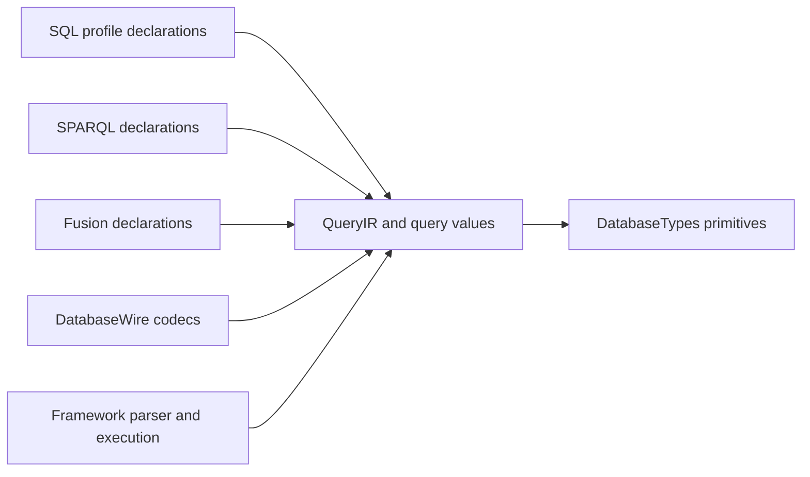

# Query

## Purpose and Scope

Query owns the Foundation-independent query-language values, their pure
structural validation, parameter references, and declaration-side budgets.
Its parent is [DatabaseKit](../DESIGN.md); its direct child is
[SQL](SQL/DESIGN.md), the authority for the accepted PostgreSQL basic
compatibility profile. SPARQL, SQL/PGQ, and Fusion remain distinct language or
feature contracts within Query; the SQL profile does not redefine them.

## Responsibilities and Boundaries

- Own QueryIR structure, literals, expression/source/projection declarations,
  parameters, ordered result semantics, and query-specific typed values.
- Own pure construction, intrinsic validation, structural resource accounting,
  and language-specific declaration constraints.
- Consume primitive owners and representations from DatabaseTypes. A query
  value adds query meaning or metadata; it does not duplicate the primitive
  field-value algebra.
- Leave parsing and SQL serialization to Framework QueryAST; schema-dependent
  binding, planning, evaluation, authorization, and publication to their runtime
  owners; binary encoding to DatabaseWire; storage to StorageKit.

Existing SQL-generation extensions are current placement, not the target
owner. Their migration to QueryAST is part of SQL L08, with callers migrated
and semantic rejection tested before the old paths are removed.

## Related Designs

| Design | Relationship | Contract Used | Summary | Cautions |
|---|---|---|---|---|
| [DatabaseKit](../DESIGN.md) | parent | module declaration and trait boundary | Composes Query with schema, model, graph, and other declarations. | Query holds no runtime handles. |
| [SQL](SQL/DESIGN.md) | child | feature IDs, typed SQL meaning, compatibility differences | Owns the complete SQL profile and acceptance obligations. | SQL coercion, NULL, order, or collation rules must not silently affect SPARQL. |
| [Model](../Model/DESIGN.md) | coordinates with | static query type metadata and field adaptation | Carries query meaning through concrete model fields. | No inference from a stored object or byte payload. |
| [Schema](../Schema/DESIGN.md) | coordinates with | admitted query descriptor and schema identity | Validates storage/type/default agreement. | A descriptor change is a schema encoding change. |
| [DatabaseWire](../../DatabaseWire/DESIGN.md) | used by | query/result value encoding | Encodes QueryIR and typed results with retained frame ownership. | Wire representation is not a second semantic model. |
| [DatabaseEngine](../../../../database-framework/Sources/DatabaseEngine/DESIGN.md) | used by | validated QueryIR and execution budgets | Binds and executes query meaning. | Runtime catalog, work-meter reservations, and transaction lifetime stay downstream. |
| [database-types](../../../../database-types/DESIGN.md) | depends on | primitive values and bounded byte ownership | Supplies retained bytes and intrinsic scalar representations. | Cross-package consumption does not change semantic ownership. |

## Architecture



## Contracts and Invariants

- QueryStatement, SelectQuery, Expression, Literal, and DataSource currently
  share representation across SQL and SPARQL. Representation sharing is not
  semantic equivalence: RDF term identity, unbound variables, SPARQL error
  propagation, aggregates, ordering, and datasets retain their contracts.
- Each SQL extension is language-qualified or validated at the language
  boundary. SQL-only forms cannot be admitted as meaningful SPARQL by a codec
  round trip or a shared evaluator switch.
- Query values own their type and query-specific metadata while retaining
  primitive storage. No storage key, pointer, lease, transaction, transport,
  function implementation, mutable registry, or schema generation owner is
  stored in a declaration value.
- Ordered result columns and positional cells retain duplicates and zero-row
  metadata. Runtime reservations remain runtime-owned; encoding does not
  invent a lifetime-independent intermediate materialization.
- Structural validation, parameter traversal, hashing/equality, encoders,
  decoders, and language validators must cover every admitted semantic case.
- Canonical primitive identity and existing application-model storage are
  unchanged by SQL-specific type, display, or lexical metadata.
- Default declarations are target-free. MultiBase-only declarations remain
  trait-gated; SQL does not provide a route around target or authority rules.

### SELECT source language applicability

`DataSource.usesSPARQLSemantics` owns the language applicability of a SELECT's
top-level source. It is true only for graphPattern, namedGraph and service.
Relational table/logical/values/join/subquery/set sources, SQL/PGQ graphTable and
MultiBase base sources are false. This is not a recursive test for SPARQL
descendants: a relational join or subquery retains its own top-level boundary.
The exhaustive switch requires an explicit decision whenever DataSource gains
a case.

Framework execution and Server admission consume this property when selecting
the SPARQL semantic gate for SELECT. Structural validation and parameter binding
remain applicable to both languages. An explicit public call to
SPARQLSemanticValidator continues to apply its SPARQL-specific rules regardless
of this property; it is not changed into an automatic language dispatcher.

### S01 public query boundary

S01 implements these frozen interfaces in this component. The SQL child owns
their SQL-specific validation and persistence adaptation, including the exact
rich-value cases and falsifiable case IDs. Runtime evidence is recorded in the
workspace task progress; later SQL expression support remains separately gated.

| Declaration | Public contract |
|---|---|
| `QueryValue` | Closed query-domain algebra with `.primitive(FieldValue)` and the SQL child's five rich-value alternatives. Primitive alternatives are not duplicated. |
| `QueryColumnType` | `.sql(DataType)` or `.primitive(FieldSchemaType, isArray: Bool)`, with isArray default false. The primitive array flag preserves existing non-SQL array declarations. No unknown/success-placeholder case. RDF/reference/vector results retain a primitive declaration instead of a fabricated SQL type. |
| `QueryColumn` | Kit-owned immutable `number: UInt32`, `name: String`, `type: QueryColumnType`, `isNullable: Bool`. Number is the one-based output ordinal, not a persisted field number. Names may be empty or duplicate, but column numbers must be consecutive in a result. |
| `QueryParameter` | `position` and optional `name` retain current addressing; `value` becomes QueryValue and optional `type: QueryColumnType?` declares an explicit type. NULL has no separate value tag: `.primitive(.null)` is typed by this declaration or its bound expression/column. |
| `Literal.queryValue(QueryValue, type: QueryColumnType? = nil)` | Adds query values and an optional explicit declaration to the existing Literal model. Binding preserves parameter type here, including typed NULL and empty arrays. Existing SQL/SPARQL literal cases remain; primitive/term meaning is not rewritten. |
| `QueryValueError` | Typed intrinsic value/type/shape/metadata/persistence failures described in the child contract. Runtime SQLSTATE mapping remains outside this module. |

Primitive array declarations admit NULL cells as well as cells of the declared
primitive element type. Column nullability controls the entire array value;
it does not reject NULL elements in existing `[Optional<Element>]` models.

Wire imports this QueryColumn rather than retaining a second semantic type of
the same name. Its codec may be an extension, but its initializer, equality,
validation and meaning are Kit-owned. Pure representation Hashable/Equatable
preserves metadata; SQL equality, grouping and distinctness are runtime-bound
operations and cannot use representation hashing without the SQL comparator.

Parameter binding retains the complete QueryParameter in its address maps.
A primitive value with nil explicit type uses the existing FieldValue-to-Literal
conversion unchanged; rich or explicitly typed values use Literal.queryValue
with both value and type. GraphTerm positions retain their primitive term
conversion and explicitly reject rich values. Structural/resource traversal visits
the new literal's complete tree and retained bytes. SQL parameters whose type
cannot be inferred or reconciled fail explicitly; RDF primitive parameters
continue to use SPARQL term conversion and validation. QueryLiteralConvertible
conformances for the rich wrappers produce the same case and preserve metadata.

The binder owns context-free value substitution, not interpreter selection.
Its initializer does not acquire SQL/SPARQL language metadata. Framework's
existing SQL/Graph interpreter context consumes the richer literal declaration;
wrapped primitives can delegate to the existing primitive semantics there.

Literal.queryValue diagnostic description is nonthrowing and metadata-free on
every target. It reports the closed value family and whether the explicit
declaration is SQL, primitive, or inferred. It neither reflects a generic value
or optional type nor serializes a payload. SQL/SPARQL generation continues to use
its own typed, fallible contract rather than diagnostic text.

## Runtime Flows

```text
text or builder → Framework QueryAST → QueryIR
    → pure structure/parameter validation
        → Framework binding/planning/execution
            → typed columns + positional values
                → DatabaseWire encoding or final public materialization
```

Only the declaration and pure-validation stages belong to Query.

## State, Ownership, and Lifecycle

Declaration instances are immutable or task-local value construction state.
Retained ByteString owners outlive all bounded views; pointer borrows remain
synchronous. Runtime-owned admission, isolation, generation leases, catalog
state, clocks, and authority do not migrate into Query values.

## Failure, Concurrency, and Constraints

Values and callbacks retain the same Sendable contract on native, WASM, and
Embedded targets. Structural byte/node/collection/depth limits are applied
before constructing untrusted trees. Invalid, unsupported, unbound, or
resource-limited input is a typed failure, not a default query or empty result.
Foundation, reflection, Codable persistence, and platform services stay out of
the canonical module.

## Verification and Change Impact

| Contract | Evidence owner |
|---|---|
| Structure and parameter success/failure/boundaries | [Query test component](../../../Tests/DatabaseKitTests/Query) |
| QueryIR and lazy typed-result codecs | [DatabaseWire tests](../../../Tests/DatabaseWireTests) |
| SQL profile behavior and differential acceptance | [SQL verification contract](SQL/DESIGN.md#verification-and-change-impact) |
| Language isolation | Existing SPARQL semantic/term suites plus regression cases for shared QueryIR changes |
| Top-level SELECT applicability | SelectQueryMetadataTests and SPARQLSemanticValidatorTests cover relational/graph boundaries and preserve explicit-validator rejection; Framework parser and Server admission tests exercise their consumer gates |

Changes to shared QueryIR require SQL and SPARQL consumers, structural and
parameter traversals, codecs, and direct runtime callers to be checked. Changes
to the SQL child contract propagate through this component to DatabaseKit and
DatabaseWire without copying the profile into those parents. This S00 document
fixes intended contracts; it is not evidence that S01+ behavior is implemented.
