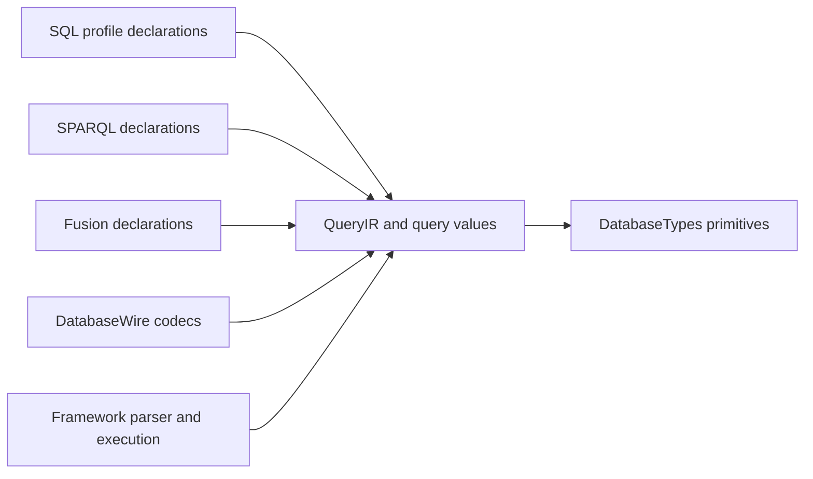
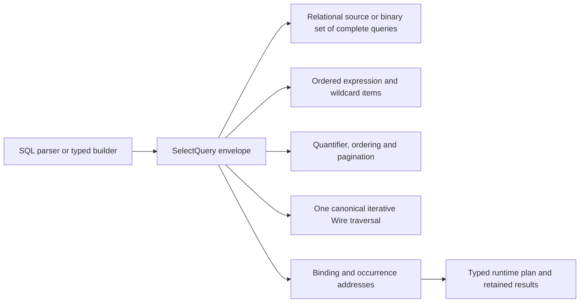
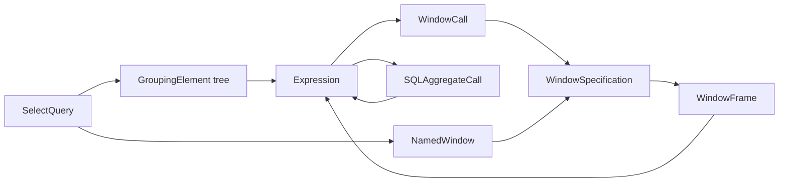

# Query

The proposed [Fluent construction child](Fluent/DESIGN.md) owns NDB24 source/
selection construction and the declaration-only predicate split. This is a
future construction contract; current execution and SQL semantics are unchanged.

## Purpose and Scope

Query owns the Foundation-independent query-language values, their pure
structural validation, parameter references, and declaration-side budgets.
Its parent is [DatabaseKit](../DESIGN.md); its direct child is
[SQL](SQL/DESIGN.md), the authority for the accepted PostgreSQL basic
compatibility profile. SPARQL, SQL/PGQ, and Fusion remain distinct language or
feature contracts within Query; the SQL profile does not redefine them.

## Responsibilities and Boundaries

- Own QueryIR structure, literals, expression/source/projection declarations,
  parameters, ordered result semantics, and query-specific typed values.
- Own pure construction, intrinsic validation, structural resource accounting,
  and language-specific declaration constraints.
- Consume primitive owners and representations from DatabaseTypes. A query
  value adds query meaning or metadata; it does not duplicate the primitive
  field-value algebra.
- Leave parsing and SQL serialization to Framework QueryAST; schema-dependent
  binding, planning, evaluation, authorization, and publication to their runtime
  owners; binary encoding to DatabaseWire; storage to StorageKit.

Existing SQL-generation extensions are current placement, not the target
owner. Their migration to QueryAST is part of SQL L08, with callers migrated
and semantic rejection tested before the old paths are removed.

## Related Designs

| Design | Relationship | Contract Used | Summary | Cautions |
|---|---|---|---|---|
| [DatabaseKit](../DESIGN.md) | parent | module declaration and trait boundary | Composes Query with schema, model, graph, and other declarations. | Query holds no runtime handles. |
| [SQL](SQL/DESIGN.md) | child | feature IDs, typed SQL meaning, compatibility differences | Owns the complete SQL profile and acceptance obligations. | SQL coercion, NULL, order, or collation rules must not silently affect SPARQL. |
| [Model](../Model/DESIGN.md) | coordinates with | static query type metadata and field adaptation | Carries query meaning through concrete model fields. | No inference from a stored object or byte payload. |
| [Schema](../Schema/DESIGN.md) | coordinates with | admitted query descriptor and schema identity | Validates storage/type/default agreement. | A descriptor change is a schema encoding change. |
| [DatabaseWire](../../DatabaseWire/DESIGN.md) | used by | query/result value encoding | Encodes QueryIR and typed results with retained frame ownership. | Wire representation is not a second semantic model. |
| [DatabaseEngine](../../../../database-framework/Sources/DatabaseEngine/DESIGN.md) | used by | validated QueryIR and execution budgets | Binds and executes query meaning. | Runtime catalog, work-meter reservations, and transaction lifetime stay downstream. |
| [database-types](../../../../database-types/DESIGN.md) | depends on | primitive values and bounded byte ownership | Supplies retained bytes and intrinsic scalar representations. | Cross-package consumption does not change semantic ownership. |

## Architecture



## Contracts and Invariants

### S12 semantic block carriage

The [SQL component](SQL/DESIGN.md#s12-semantic-block-contract)
owns `SQLBlock`, `SQLBlockStep`, command metadata, and their
intrinsic validation. A block step wraps the existing `QueryStatement`;
it does not introduce a second SQL statement algebra or change SPARQL meaning.
These immutable declarations contain no transaction, checkpoint token, meter,
runtime generation, executable closure, or Framework result owner.

Framework owns statement results derived from execution, including rows and
retained claims, and the aggregate Collecting-to-Ready transition. Existing
`QueryColumn` and `QueryValue` remain their semantic vocabulary. S12 does not
add a third materialized row representation alongside existing Framework and
Wire rows. Binary block descriptors and remote invocation remain S17.

The public immutable block stops at the first statement or checkpoint error,
rolls back the entire request and throws the typed failure. It does not execute
later recovery steps. Lower-level callback recovery remains Transaction-owned.
Declarations and test definitions alone do not establish runtime completion.

### SQL lexical value construction

Query-owned context-free constructors form existing query values from bounded
SQL lexical input. They do not own runtime casts, typmod rounding, collation,
work metering, reservations or source positions. The synchronous borrowed
Substring is not retained by the result. Callers admit and charge the original
input before invoking a constructor, and retain any runtime result claim until
their true output owner ends. Kit enforces maximumUTF8Count before parsing;
malformed input is a typed failure rather than an untyped-string fallback.

| API | Result and intrinsic guarantees |
|---|---|
| `QueryNumericValue.init(sqlLexicalForm:maximumUTF8Count:)` | Exact finite decimal value and lexical displayScale. Decimal/exponent and SQL radix integer forms retain legal digit separators; ASCII exterior whitespace is accepted. At most 38 canonical coefficient digits, displayScale 0...16383 and the existing SQL input integral-digit bound apply before runtime typmod conversion. Parsing does not round a 39-digit value into the admitted profile. |
| `QueryValue.uuid(sqlLexicalForm:maximumUTF8Count:)` | Existing primitive UUID, accepting hexadecimal case, optional braces, omitted hyphens and hyphens after groups of four hexadecimal digits. Exactly 16 bytes result; canonical output and ordering remain the primitive owner's contract. |
| `QueryValue.binary(sqlLexicalForm:maximumUTF8Count:)` | Existing primitive ByteString, accepting BYTEA hex and traditional octal/backslash input. Space, tab, LF and CR are accepted between complete hex byte pairs; VT and FF are rejected. Output byte count never exceeds original input UTF-8 count. |

Each API takes `borrowing Substring` and an explicit UInt64 maximumUTF8Count,
and throws QueryValueError. Invalid numeric/UUID/binary lexical input carries
a byte offset and reason; resource and numeric range failures retain their
existing categories. Parsing scans borrowed UTF-8 without copying the input
into an array. Numeric and UUID formation use fixed scalar state. Binary
formation validates and measures first, then initializes one final immutable
byte owner; no decoded intermediate byte array is retained. Runtime callers
account for both scans before invocation. These APIs add no primitive value
wrapper, generic scalar-input service, lower-layer SQL parser or global state.

SQL CHAR/VARCHAR descriptors admit absent length or a length in
1...10_485_760, including typed NULL admission. This is descriptor validation,
not string truncation, padding or assignment conversion. Binary descriptor
length policy is unchanged. The Kit lexical tests and QueryAST constant tests
own exact/one-past input limits, malformed forms, dscale and typed-constant
agreement; Native and ordinary/Embedded WASM evidence remains target-specific.

- QueryStatement, SelectQuery, Expression, Literal, and DataSource currently
  share representation across SQL and SPARQL. Representation sharing is not
  semantic equivalence: RDF term identity, unbound variables, SPARQL error
  propagation, aggregates, ordering, and datasets retain their contracts.
- Each SQL extension is language-qualified or validated at the language
  boundary. SQL-only forms cannot be admitted as meaningful SPARQL by a codec
  round trip or a shared evaluator switch.
- Query values own their type and query-specific metadata while retaining
  primitive storage. No storage key, pointer, lease, transaction, transport,
  function implementation, mutable registry, or schema generation owner is
  stored in a declaration value.
- Ordered result columns and positional cells retain duplicates and zero-row
  metadata. Runtime reservations remain runtime-owned; encoding does not
  invent a lifetime-independent intermediate materialization.
- Structural validation, parameter traversal, hashing/equality, encoders,
  decoders, and language validators must cover every admitted semantic case.
- Canonical primitive identity and existing application-model storage are
  unchanged by SQL-specific type, display, or lexical metadata.
- Default declarations are target-free. MultiBase-only declarations remain
  trait-gated; SQL does not provide a route around target or authority rules.

### Expression representation identity

The Bool-returning Equatable witness compares exact declaration identity,
including ordered children, absent versus present operands, exact names, type
metadata and conditional flags. Expression-building comparison operators keep
their existing API and do not participate in this representation comparison.
Equality and hashing traverse direct Expression edges with explicit work
stacks, including edges inside functions, aggregates, CASE pairs and sort
keys. Collection cursors retain the immutable input arrays and advance by
index; they do not copy or flatten a subtree or push one work item per sibling.
Temporary work is bounded by input depth, with constant call-stack depth for
those Expression edges. There is no guessed depth cap or failure-to-false
fallback. Literal, DataType and SelectQuery payload identity remains owned by
those existing representations; this change does not redefine SQL value
equality or subquery semantics. Equal expressions feed identical ordered
identity tokens to Hasher; numeric hash values are not persistent identifiers.

The legal 48-edge alternating ARRAY/ROW Wire fixture exercises equal,
different-leaf and different-child-count comparisons and equal-value hashing.
The existing conditional identity fixtures cover flags, source discriminators,
simple/searched CASE and exact name/type metadata. Native, ordinary WASM and
Embedded runtime witnesses must execute this identity path after decoding;
compilation alone does not close the stack-exhaustion counterexample.

### SELECT source language applicability

`DataSource.usesSPARQLSemantics` owns the language applicability of a SELECT's
top-level source. It is true only for graphPattern, namedGraph and service.
Relational table/logical/values/join/subquery/set sources, SQL/PGQ graphTable and
MultiBase base sources are false. This is not a recursive test for SPARQL
descendants: a relational join or subquery retains its own top-level boundary.
The exhaustive switch requires an explicit decision whenever DataSource gains
a case.

Framework execution and Server admission consume this property when selecting
the SPARQL semantic gate for SELECT. Structural validation and parameter binding
remain applicable to both languages. An explicit public call to
SPARQLSemanticValidator continues to apply its SPARQL-specific rules regardless
of this property; it is not changed into an automatic language dispatcher.

### S01 public query boundary

S01 implements these frozen interfaces in this component. The SQL child owns
their SQL-specific validation and persistence adaptation, including the exact
rich-value cases and falsifiable case IDs. Runtime evidence is recorded in the
workspace task progress; later SQL expression support remains separately gated.

| Declaration | Public contract |
|---|---|
| `QueryValue` | Closed query-domain algebra with `.primitive(FieldValue)` and the SQL child's five rich-value alternatives. Primitive alternatives are not duplicated. |
| `QueryColumnType` | `.sql(DataType)` or `.primitive(FieldSchemaType, isArray: Bool)`, with isArray default false. The primitive array flag preserves existing non-SQL array declarations. No unknown/success-placeholder case. RDF/reference/vector results retain a primitive declaration instead of a fabricated SQL type. |
| `QueryColumn` | Kit-owned immutable `number: UInt32`, `name: String`, `type: QueryColumnType`, `isNullable: Bool`. Number is the one-based output ordinal, not a persisted field number. Names may be empty or duplicate, but column numbers must be consecutive in a result. |
| `QueryParameter` | `position` and optional `name` retain current addressing; `value` becomes QueryValue and optional `type: QueryColumnType?` declares an explicit type. NULL has no separate value tag: `.primitive(.null)` is typed by this declaration or its bound expression/column. |
| `Literal.queryValue(QueryValue, type: QueryColumnType? = nil)` | Adds query values and an optional explicit declaration to the existing Literal model. Binding preserves parameter type here, including typed NULL and empty arrays. Existing SQL/SPARQL literal cases remain; primitive/term meaning is not rewritten. |
| `QueryValueError` | Typed intrinsic value/type/shape/metadata/persistence failures described in the child contract. Runtime SQLSTATE mapping remains outside this module. |

Primitive array declarations admit NULL cells as well as cells of the declared
primitive element type. Column nullability controls the entire array value;
it does not reject NULL elements in existing `[Optional<Element>]` models.

Wire imports this QueryColumn rather than retaining a second semantic type of
the same name. Its codec may be an extension, but its initializer, equality,
validation and meaning are Kit-owned. Pure representation Hashable/Equatable
preserves metadata; SQL equality, grouping and distinctness are runtime-bound
operations and cannot use representation hashing without the SQL comparator.

Parameter binding retains the complete QueryParameter in its address maps.
A primitive value with nil explicit type uses the existing FieldValue-to-Literal
conversion unchanged; rich or explicitly typed values use Literal.queryValue
with both value and type. GraphTerm positions retain their primitive term
conversion and explicitly reject rich values. Structural/resource traversal visits
the new literal's complete tree and retained bytes. SQL parameters whose type
cannot be inferred or reconciled fail explicitly; RDF primitive parameters
continue to use SPARQL term conversion and validation. QueryLiteralConvertible
conformances for the rich wrappers produce the same case and preserve metadata.

The binder owns context-free value substitution, not interpreter selection.
Its initializer does not acquire SQL/SPARQL language metadata. Framework's
existing SQL/Graph interpreter context consumes the richer literal declaration;
wrapped primitives can delegate to the existing primitive semantics there.

Literal.queryValue diagnostic description is nonthrowing and metadata-free on
every target. It reports the closed value family and whether the explicit
declaration is SQL, primitive, or inferred. It neither reflects a generic value
or optional type nor serializes a payload. SQL/SPARQL generation continues to use
its own typed, fallible contract rather than diagnostic text.

### S02 declaration migration

The [SQL child contract](SQL/DESIGN.md#s02-frozen-syntax-to-value-boundary) owns
integer-width selection, exact numeric constants, constructor expressions and
temporal typmod meaning. Query composes these changes into existing Expression,
DataType, Literal, parameters and structural validation. It introduces neither
a parallel SQL AST nor QueryValue.row. Every new child is visited by binding,
validation, resource accounting, hashing and canonical Wire traversal.

Kit no longer owns executable SQL generation after S02. SQL methods on semantic
values, SQL type-name generation and SQL escape policy are removed from this
package after Framework callers/tests migrate. Non-SQL metadata and RDF
expressions cannot gain SQL meaning through a serializer fallback. SPARQL
serialization and diagnostic/value formatting remain here under their existing
language contracts. Quoted state and parser source spans are not Kit metadata.

QueryStructuralResourceLedger.remainingLimits is a read-only projection of its
owned counters. It subtracts admitted usage from every limit, including current
nesting depth. A caller may admit a child payload against that residual budget
before constructing it, then charge the measured payload to the same parent
ledger. Callers do not mirror ledger counters. Rejected claims preserve the
remaining budget; leaving a nesting scope restores depth capacity without
releasing cumulative node, byte, token or collection consumption.

### S03 semantic carriage and occurrence addresses

DataType.sparqlFunction uses a throwing QueryLiteralConversionError getter.
It owns SPARQL type-name generation and rejects schema-qualified custom types
and existing explicit temporal modifiers, including nested types, with
unsupportedSPARQLLiteral. Expression serialization consumes that same path.

The [SQL child](SQL/DESIGN.md#s03-frozen-semantic-binding-boundary) owns S03
resolution meaning. Query adds Literal.sqlUnknownString(String), optional
exact FunctionCall.schema via init(name:arguments:distinct:schema:), and
DataType.custom(String, schema: String? = nil). Existing Literal.string
remains typed text. These changes retain QueryValue's six cases and do not
alter primitive storage. Every shared consumer/traversal migrates; qualified
SQL forms and unknown strings fail at SPARQL boundaries rather than inheriting
SQL coercion or name policy. QueryValue literals with an explicit declaration
must pass its intrinsic type validator before SPARQL primitive adaptation;
unresolved custom declarations cannot be ignored merely because the payload
is primitive. Existing valid typed primitive literals retain their RDF path.

QueryParameterBinder.validate(_:) validates supplied parameters and statement
structure/references without substitution. SQL uses this admission path and
passes original references plus parameters to Framework. Existing bind(_:) can
delegate validation then retain context-free replacement for consumers whose
contract requires it. Position/name maps still retain complete QueryParameter;
Framework alone resolves SQL base types and legal occurrence coercions.

QueryOccurrenceID is a UInt32 arena-local index. QueryOccurrenceField is a
closed semantic edge-role enum; an occurrence retains parent ID, field and
optional collection index. One QueryOccurrenceArena owns entries, child lookup
index and structural ledger. append(parent:field:index:) checks parent, unique
edge, depth/count/byte/overflow admission before growing; child(of:field:index:)
and occurrence(_:) resolve within that arena. IDs are meaningful only with
their owning arena/root; parser and binder receive that same provenance rather
than independently guessing traversal numbers. QueryOccurrenceError preserves
invalid-address and resource failures. The immutable operation result retains
arena ownership; no source text or source range enters these values.

| Semantic position | Edge meaning |
|---|---|
| Root | One statement root; statement index distinguishes batch roots. SELECT itself is the query root without a redundant wrapper. |
| Query clauses | cte/projection/groupBy/orderBy use ordered indices; source/filter/having are singular. |
| Source/nested query | joinLeft/joinRight/joinCondition and subquery preserve scope boundaries. |
| Expression children | operand(index) follows ordered operands including unary/binary/BETWEEN/CAST; argument(index) follows function/COALESCE/IN-value/constructor children. |
| Conditional/type/aggregate children | caseCondition/caseResult indices, caseElse, castType, elementType, aggregateArgument and aggregateOrderBy indices preserve their distinct roles. |

Required edges may be refined by their semantic owner without introducing a
second AST; parser and binder must use identical meaning. Shared parent/edge
storage and lookup indexes use O(nodes + edges) retained space. No per-node
full ancestor-path allocation, Expression-equality identity, parser-state
reference or global mutable identity service is part of this contract. Counts,
depth, lookup entries and logical retained representation bytes are admitted
using existing structural limits before growth. This does not claim exact Swift
allocator capacity; Framework separately retains its existing actual-owner/
capacity-based plan claim under the runtime work meter.

S03-C01–C04/C10–C12 verify semantic distinction, parameter validation,
occurrence uniqueness, bounded failures, language isolation and canonical
native/WASM/Embedded carriage. Parser source annotations remain QueryAST-owned;
runtime binding/execution and lifetime remain Framework-owned.

## Runtime Flows

```text
text or builder → Framework QueryAST → QueryIR
    → pure structure/parameter validation
        → Framework binding/planning/execution
            → typed columns + positional values
                → DatabaseWire encoding or final public materialization
```

Only the declaration and pure-validation stages belong to Query.

## State, Ownership, and Lifecycle

Declaration instances are immutable or task-local value construction state.
Retained ByteString owners outlive all bounded views; pointer borrows remain
synchronous. Runtime-owned admission, isolation, generation leases, catalog
state, clocks, and authority do not migrate into Query values.

## Failure, Concurrency, and Constraints

Values and callbacks retain the same Sendable contract on native, WASM, and
Embedded targets. Structural byte/node/collection/depth limits are applied
before constructing untrusted trees. Invalid, unsupported, unbound, or
resource-limited input is a typed failure, not a default query or empty result.
Foundation, reflection, Codable persistence, and platform services stay out of
the canonical module.

## Verification and Change Impact

| Contract | Evidence owner |
|---|---|
| Structure and parameter success/failure/boundaries | [Query test component](../../../Tests/DatabaseKitTests/Query) |
| QueryIR and lazy typed-result codecs | [DatabaseWire tests](../../../Tests/DatabaseWireTests) |
| SQL profile behavior and differential acceptance | [SQL verification contract](SQL/DESIGN.md#verification-and-change-impact) |
| Language isolation | Existing SPARQL semantic/term suites plus regression cases for shared QueryIR changes |
| Top-level SELECT applicability | SelectQueryMetadataTests and SPARQLSemanticValidatorTests cover relational/graph boundaries and preserve explicit-validator rejection; Framework parser and Server admission tests exercise their consumer gates |

Changes to shared QueryIR require SQL and SPARQL consumers, structural and
parameter traversals, codecs, and direct runtime callers to be checked. Changes
to the SQL child contract propagate through this component to DatabaseKit and
DatabaseWire without copying the profile into those parents. This S00 document
fixes intended contracts; it is not evidence that S01+ behavior is implemented.

### S04 semantic carriage and occurrence edges

[S04 SQL](SQL/DESIGN.md#s04-semantic-additions-and-scope) owns the added closed
forms and their meaning. Query owns exhaustive equality/hash, structural
validation, parameter transforms and semantic occurrence traversal. Simple
CASE has one `.operand` child; its WHEN matches/results retain indexed
`.caseCondition` / `.caseResult` and fallback `.caseElse`. GREATEST/LEAST use
indexed `.argument`. Truth test uses `.operand`; DISTINCT uses indexed
`.operand`; quantified comparison uses left `.operand` and right `.argument`
for array expression or `.subquery` for the query. Every walker uses the same
edges and charges each child once. No source text or mutable runtime state
enters these values. RDF/SPARQL consumers explicitly gate SQL-only forms.

### S05 pattern and concatenation declarations

`Expression.patternMatch(subject:pattern:escape:kind:)` owns one SQL pattern
predicate with expression children. `PatternMatchKind` is closed over LIKE,
case-insensitive LIKE, SIMILAR TO, ERE and case-insensitive ERE. An absent escape
disables escaping; SQL parser/builder default backslash is an explicit child.
ERE forms reject an escape child. SPARQL `regex` remains distinct.
`Expression.concatenate` owns the strict overloaded SQL concatenation operator;
it is distinct from non-strict CONCAT calls. These declarations replace the old
constant-pattern LIKE case without aliases. Every identity, traversal, parameter
and structural validation path retains subject, pattern and optional escape.
Structural admission charges every raw string literal's UTF-8 byte count through
the shared retained-byte ledger, including each pattern child and concatenation
operand; the expression shape does not bypass or duplicate that literal charge.
The SQL profile owns execution meaning; Graph adapters preserve their existing
case-sensitive/no-escape LIKE capability and typed language failures.
Graph export admits only that static literal LIKE shape and emits escaped,
case-sensitive REGEX; dynamic patterns, new operator kinds and explicit escapes
are typed unsupported there. SPARQL regex keeps its separate contract.

Verification covers expression identity/hash/deep traversal, dynamic parameter
children, malformed escape structure and bounded values; Wire and QueryAST
round trips consume the same declarations.


### S06 temporal composition

The [SQL S06 contract](SQL/DESIGN.md#s06-frozen-temporal-contract) adds exact
SQL time/offset/infinity values, interval modifiers and the dedicated
currentValue expression. Existing primitive representations and structural
QueryValue losslessness remain intact. Query consumes the Model/Schema
adaptation and Wire/SchemaJSON codecs; clocks, timezone services and SQL
comparison stay in Framework. All traversals handle currentValue as a leaf;
SPARQL rejects SQL-only temporal forms explicitly rather than assuming their
presence gives RDF semantics. Tests prove constructor/descriptor bounds,
lossless persistence/carriage and malformed input under the respective owners.


### S07 collection expression carriage

Consume the single [SQL S07 semantic and intrinsic authority](SQL/DESIGN.md#s07-frozen-array-and-json-contract).
Query owns these exact Foundation-independent declarations; execution, scalar
conversion, runtime admission and cursor lifecycle remain Framework concerns.

```swift
case arrayAccess(Expression, subscripts: [ArraySubscript])
case collectionOperation(CollectionOperator, left: Expression, right: Expression)

public enum ArraySubscript: Sendable, Hashable {
    case index(Expression)
    case slice(lower: Expression?, upper: Expression?)
}

public enum CollectionOperator: UInt8, Sendable, Hashable {
    case contains = 0
    case containedBy = 1
    case overlaps = 2
    case jsonField = 3
    case jsonFieldText = 4
    case jsonPath = 5
    case jsonPathText = 6
    case jsonHasKey = 7
    case jsonHasAnyKey = 8
    case jsonHasAllKeys = 9
    case jsonDeletePath = 10
}
```

Each arrayAccess is one contiguous group of one through six subscripts. A later
group is another arrayAccess node; identities/serialization must not flatten
nested groups. An index and a slice with omitted/present bounds are distinct.
Reuse subtract for JSONB `-`, concatenate for array/JSONB `||`, and ordinary
FunctionCall for F08–F10. No SQL policy enters QueryValue structural identity.

| Child | Canonical source occurrence edge |
|---|---|
| Access base | operand |
| Index or lower bound in zero-based dimension d | argument(2*d) |
| Upper bound in dimension d | argument(2*d+1) |
| Collection operation operands | left / right |

Absent slice bounds create no expression occurrence. Every semantic identity,
hash, deep equality, iterative walk, node/depth/byte admission, parameter
collection/substitution, structural validator and source-occurrence consumer
must cover both cases and each present child exactly once. Retain existing
literal owner accounting; expression metadata does not bypass it. SQL parser,
serializer and [Wire](../../DatabaseWire/DESIGN.md#s07-collection-expression-carriage)
share these declarations. RDF/SPARQL translation and execution explicitly
reject SQL-only collection expressions with their existing typed language
failures. Existing array/JSON values, model adaptation and storage/Wire value
productions remain unchanged.

Behavioral evidence covers grouped element/slice roundtrips, every operator,
missing bounds versus NULL expressions, nested/deep parameters and malformed
count/metadata, plus explicit non-SQL language gates. Scalar and bounded cursor
semantics and S08/S10 integration gates are defined only by the SQL authority.


### S07 explicit variadic function carriage

FunctionCall adds `public let finalArrayIsVariadic: Bool` and extends its existing
initializer with the trailing defaulted parameter, preserving ordinary calls:

```swift
public init(
    name: String,
    arguments: [Expression],
    distinct: Bool = false,
    schema: String? = nil,
    finalArrayIsVariadic: Bool = false
)
```

The flag means explicit SQL VARIADIC on the final array expression. It is not
inferred from an argument's type or parentheses. True requires at least one
argument structurally; selected binding restricts it to registered admitted
signatures under the [SQL semantic contract](SQL/DESIGN.md#s07-function-and-mutation-details).
An unflagged array stays one argument. No new child expression or occurrence
edge is added: arguments retain their indexed argument edges, and the flag
belongs to function identity. Structural equality/hash, iterative rebuilds,
walks, parameter replacement and serialization retain it exactly. A rebuild
must never silently restore the default false. Non-SQL language adapters reject
unsupported explicit variadic calls with typed failures.

[Wire](../../DatabaseWire/DESIGN.md#s07-explicit-variadic-function-layout) keeps
ordinary false calls byte-for-byte on tags28/43 and uses tag55 only for true.
Required evidence distinguishes flagged/unflagged array arguments, NULL/empty
variadic arrays, qualified identity, nested parameters and empty-argument
structural rejection across parser, identity, rebuild and codecs.

### S08 frozen relational query carriage

**PLANNED; not implementation or execution evidence.** This section owns the
canonical S08 query declarations and supersedes the affected source,
projection, DISTINCT and pagination shapes above when S08 is implemented.
The [SQL feature inventory](SQL/DESIGN.md#verification-and-change-impact) owns
Q01–Q10/Q12 meaning. The result-only composite value/type, flat owner, bounds,
and JSON conversion contract has one authority in
[SQL S08](SQL/DESIGN.md#s08-frozen-composite-values-and-ownership); this section
consumes `DataType.composite(QueryCompositeType)` and
`QueryValue.composite(QueryCompositeValue)` without defining another row value.
DatabaseTypes and persisted application-model adaptation do not gain query
structure or a composite result representation.

#### Confirmed implementation gap and ownership

The current [SelectQuery](SelectQuery.swift) stores a separate DISTINCT Boolean,
fixed unsigned limits and a whole-projection enum. Its combined copy method
uses nil coalescing, which cannot explicitly clear an optional field.
[DataSource](DataSource.swift) stores aliases in individual source families,
literal-only VALUES and source-valued set operands. The current iterative
[Wire encoder](../../DatabaseWire/QueryIRExpressionWireEncoder.swift) and
[decoder](../../DatabaseWire/QueryIRExpressionWireDecoder.swift) preserve those
shapes. `QueryParameterBindingTraversal` currently treats relational VALUES as
a leaf. These are migration inputs, not evidence of the profile's behavior.

| Concept | Semantic owner | Change boundary |
|---|---|---|
| Ordered projection, aliases, query operands, quantifiers, pagination expressions and collation declarations | Query | Immutable Foundation-independent values, intrinsic structure and declaration identity. |
| Accepted syntax, precedence, source locations and executable SQL text | Framework QueryAST | Construct and serialize the canonical values without a second semantic AST. |
| Namespace/whole-row resolution, expanded descriptors, comparison, cardinality, CTE demand and result presence | Framework DatabaseEngine | Bind the complete tree before reads; retain typed runtime owners and errors. |
| Deterministic bounded query/value bytes | DatabaseWire | The [S08 Wire contract](../../DatabaseWire/DESIGN.md#s08-relational-query-carriage) owns exact layouts and reserved tags. |



#### Canonical public declarations

The following is the minimum public shape; declaration names are semantic and
all new values are Sendable, Equatable and Hashable. Enum cases below belong to
their existing enum unless a new owning declaration is shown.

```swift
public enum ProjectionItem: Sendable, Hashable {
    case expression(Expression, alias: String? = nil)
    case wildcard(qualifier: String? = nil)
}

public enum SelectQuantifier: Sendable, Hashable {
    case all
    case distinct
    case distinctOn([Expression])
}

public enum SetOperator: Sendable, Hashable {
    case union, intersect, except
}

public enum SetQuantifier: Sendable, Hashable {
    case all, distinct
}

public enum QueryCount: Sendable, Hashable {
    case fixed(UInt64)
    case expression(Expression)
}

public enum QueryLimit: Sendable, Hashable {
    case all
    case count(QueryCount, withTies: Bool)
}

public struct QueryPagination: Sendable, Hashable {
    public let limit: QueryLimit?
    public let offset: QueryCount?
    public init(limit: QueryLimit? = nil, offset: QueryCount? = nil)
}

public enum SQLCollation: Sendable, Hashable {
    case c, posix
}

// DataSource cases replacing the affected old cases.
case values([[Expression]])
case subquery(SelectQuery)
case aliased(DataSource, name: String, columns: [String]? = nil)
case setOperation(
    operator: SetOperator, quantifier: SetQuantifier,
    left: SelectQuery, right: SelectQuery
)

// New Expression cases.
case collate(Expression, collation: SQLCollation)
case arraySubquery(SelectQuery)
case wholeRow(String)
case field(Expression, name: String)
case fieldExpansion(Expression)
```

`SelectQuery` retains its existing envelope and other stored fields. Its
`projection` becomes `[ProjectionItem]`, `quantifier: SelectQuantifier = .all`
replaces `distinct`, and `pagination: QueryPagination = QueryPagination()`
replaces the stored `limit`/`offset`. The initializer accepts these fields
instead of the superseded ones. There is no parallel SQL query, alternate set
tree, versioned alias or fallback initializer. `Projection` and its
all/allFrom/items/distinctItems cases are removed after callers migrate.
`ProjectionItem.init(_:alias:)` and column convenience construction may remain
as constructors of the single `.expression` representation; they store no
second discriminator or DISTINCT state. SELECT ALL and an omitted quantifier
both construct `.all`; spelling, optional AS/OUTER and parentheses are parser
syntax rather than semantic metadata.

Every immutable copy helper preserves the entire envelope, including
accessPath, subqueries, reduced and dataset. Keep one-field helpers for
projection, source, accessPath, filter, groupBy, having, orderBy, quantifier,
pagination, subqueries, reduced and dataset. An optional argument means replacement with that optional
value, so `replacing(filter: nil)` clears WHERE. Delete the combined nil-coalescing
helper and old limit/offset/distinct helpers; callers construct one canonical
pagination value or chain the owning replacements. No copied query silently
restores an initializer default.

#### Sources, projection and query operands

`aliased` owns source relation aliases and their ordered column-name override.
Its name is required; a derived source without an alias is a bare `subquery`.
The same wrapper covers a table, VALUES, a derived query or a parenthesized
joined group. Binding applies the supplied column names to the leading output
positions, retains the remaining names and rejects an excess. Duplicate names
remain positional metadata and can make a later reference ambiguous. An outer
joined-group alias hides the constituent relation names; aliases do not create
a new data or storage owner. Remove `LogicalSourceRef.alias`,
`GraphTableSource.alias` and VALUES columnNames after migrating their callers.
`NamedSubquery.columns` remains the CTE's own output declaration, not a source
alias. `TableRef.alias` remains only for existing mutation-target contracts
that consume TableRef directly; `DataSource.table` requires it to be
nil and rejects a nonnil value before reads. FROM construction uses `aliased`.
This preserves existing mutation-target aliases without creating two admitted
source-alias paths or redesigning S14 mutation targets in S08.

VALUES traverses general expressions in row-major order, including parameters
and subqueries, and requires equal expanded row arity. Context-free validation
checks raw row widths only when no row has a direct `fieldExpansion` cell.
If any direct cell expands, binding validates every final expanded width; an
expansion nested inside another expression does not defer the raw-width check.
Carriage retains the original rows and cells without expansion or normalization.
`values([])` retains the existing
programmatic empty zero-column relation; `values([[]])` retains the no-FROM
one-row zero-column identity. SQL VALUES syntax requires nonempty rows with at
least one expression; the parser rejects empty SQL rows, and the serializer
omits FROM for the internal identity. No fabricated output row is substituted
for an empty source. SPARQL VALUES continues to use GraphPattern.values with
its existing literal/UNDEF and variable contracts.

A projection is one ordered sequence: wildcard expansion inserts the selected
source slots at that position; expression items contribute their expression
and optional output alias. A relation wildcard and a scalar whole-row value
have distinct meaning. `wholeRow(name)` explicitly refers to a visible source's
complete composite value. An ordinary unqualified column syntax retains SQL's
column-name priority before whole-row fallback at binding. `field` selects one
named composite field; `fieldExpansion` expands a composite at an admitted
list position. Only a direct SELECT/RETURNING target, top-level VALUES item or
ROW constructor item expands into fields. In every other expression position,
including a function argument, ORDER key or expression nested inside one of
those lists, the same node yields its single whole composite operand. Thus
`row_to_json(t.*)` receives one composite argument. This rule applies equally
to parsed SQL and directly constructed QueryIR; scalar position alone is not
an error. Star syntax over a simple name constructs `wholeRow(name)` before
the wrapper, so column-name priority cannot change its relation reference.
Alias-bearing expansion is rejected
when it would assign one alias to multiple output fields. Runtime binding owns
field arity, output names/types and whole-row outer-join presence; all-null
present rows and absent rows remain distinct under the SQL composite contract.
Expansion preserves PostgreSQL's per-field expression semantics rather than
implicitly sharing one evaluation of a composite-producing expression. The
parent-context and evaluation rules follow
[PostgreSQL 18 composite queries](https://www.postgresql.org/docs/18/rowtypes.html#ROWTYPES-USAGE).

Executable SQL serialization of composite literals succeeds only when the
admitted SQL syntax can preserve the exact descriptor and value, including
field names/types/nullability, nested array element descriptors and dimensions.
A result-only named descriptor or an empty array of composite values need not
have such a spelling. Use the existing typed
`SQLSerializationError.unsupportedLiteral` or `unsupportedType` in those cases;
do not invent aliases, substitute a primitive object or publish partial SQL.
Completion requires a successful semantic round trip for representable
composite literals and exact typed rejection for the unrepresentable named,
nested and empty-array cases, while typed Wire parameters/results retain their
complete metadata in every case. This is a serializer limitation, not an
unsupported composite value, parameter, result or expression execution path.

The single binary set tree carries complete query operands, including operand
projection, predicates, CTEs and local ORDER/pagination. INTERSECT binds more
tightly than UNION/EXCEPT; UNION/EXCEPT are left associative. The parser encodes
that tree and serialization inserts parentheses where required to preserve it.
Each node independently carries ALL or DISTINCT. Remove DataSource.union,
unionAll, intersect and except after moving every caller to this tree; SPARQL
GraphPattern.union and minus retain their separate algebra.

A SelectQuery whose direct source is setOperation is a query-expression
envelope: its projection is exactly one unqualified wildcard, quantifier is
all, and filter/groupBy/having/accessPath/reduced are absent or false and its
dataset is implicit. Outer CTEs, ORDER and pagination belong to that envelope.
setOperation is admitted only as that direct query source; using it as an
ordinary aliased/joined/Base-wrapped relation requires DataSource.subquery over
the complete envelope.
Extra relational clauses are expressed by wrapping the complete set query in
DataSource.subquery under an ordinary SELECT, preserving scope rather than
discarding clauses. Intrinsic validation rejects an invalid set envelope before
any read. Set type/arity, multiplicity, NULL equality and outer output-name
resolution remain the SQL/runtime owners' contracts.

#### Quantifiers, pagination and collation

DISTINCT exists only in SelectQuantifier; distinctOn requires at least one
expression and preserves its ordered keys. Binding checks its ORDER prefix and
SQL comparison capabilities before reads; declaration equality does not select
the retained row. SetQuantifier belongs to its own set node and cannot carry
DISTINCT ON.

QueryCount.fixed preserves every UInt64 value for existing non-SQL callers.
For SQL, a fixed value and a pagination expression must satisfy the SQL signed
bigint coercion/range contract; values above Int64.max fail rather than wrap.
An expression may be a parameter or SQL NULL. Limit nil, explicit ALL and a
NULL-valued limit retain their declaration identities while runtime applies
the SQL meaning. FETCH FIRST/NEXT without a count constructs fixed(1); ONLY
constructs withTies false. FETCH/LIMIT spelling and legal OFFSET clause order
normalize to this single pagination owner. withTies true requires ordering and
preserves the complete final peer group under all sort keys. Binding forbids
source-row references, aggregates and windows in pagination, resolves types
before reads, and execution evaluates admitted expressions once per query
invocation with the correct correlation scope. NULL, negatives and overflow
use the [SQL profile](SQL/DESIGN.md) rules, not UInt64 parsing defaults.

COLLATE is an expression over the closed C/POSIX common profile. Sort keys
continue to own only expression, direction and optional NULL order; wrapping
their expression carries collation without a second SortKey collation field.
Name resolution and unsupported-collation diagnostics remain SQL-owned.

#### Occurrence, traversal and bounded identity obligations

Add the following QueryOccurrenceField roles. Every entry denotes one unique
parent/role/index address, with nil for singular edges. Equal payloads at
different positions retain distinct identities; absent children have no edge.

| Semantic child | Role and zero-based index | Ordered children |
|---|---|---|
| Projection item, including a wildcard leaf | projection(index) | Projection order; an expression item's ID is its expression root. |
| DISTINCT ON expression | distinctOn(index) | Key order. |
| Alias input | source(nil) | One nested source; names are metadata, not expressions. |
| Set operands | setLeft(nil), setRight(nil) | Left query, then right query, each with its own scope. |
| VALUES row and expression cell | valuesRow(row), then valuesCell(column) under that row | Row-major; row nodes distinguish repeated cell indices. |
| Pagination expression | offset(nil), limit(nil) | Offset before limit; fixed/ALL alternatives create no expression edge. |
| ARRAY subquery | subquery(nil) | Complete nested query under the existing subquery role. |
| COLLATE, field selection and field expansion | operand(0) | One expression child; collation/name stay exact metadata. |
| Explicit whole row | No child | Exact source name is identity metadata. |

Canonical query child order is CTEs, projection, source, filter, groupBy, having,
DISTINCT ON, orderBy, offset and limit. Existing child roles for joins,
subqueries, aggregates, CASE, types and other expressions remain unchanged.
This fixes structural enumeration, not SQL parameter-inference or evaluation
order: those follow the SQL semantic authority, while lookup uses the same
arena provenance and named edges regardless of visitation order. The parser's
construction collector must record wildcard/row group nodes and recover these
edges from construction provenance, never match equal expression values.

Every semantic walker, referenced-columns/variables analysis, parameter
collection/admission/substitution, scope analyzer, SQL/SPARQL validator,
occurrence builder, deep equality/hash, serializer and codec handles each new
child once. Rebuilds retain all metadata, including CTE materialization,
quantifiers, column aliases, withTies, collation and optional children. SQL
parameter admission keeps references for selected runtime inference;
context-free bind still substitutes all admitted expression children, including
VALUES and pagination, without changing interpreter selection. Binding rejects
malformed shape instead of treating an unvisited child as unused.

Extend the existing explicit traversal stacks and collection cursors; a new
generic visitor framework is unnecessary. Across nested
expression/query/source/set/VALUES edges, equality/hash, validation,
substitution and Wire encoding/decoding use constant process-stack depth.
Cursors retain immutable input owners and advance one child at a time; scratch
is O(active depth), not one stack entry or subtree copy per sibling. Identity
tokens include exact discriminator, ordered children, count, optional presence
and metadata. Query continuation fingerprints consume the canonical Wire
encoding, so these fields cannot be omitted or separately approximated.

The existing QueryStructuralResourceLedger admits node/depth/count growth,
VALUES rows/cells, alias/column collections, DISTINCT keys, and retained UTF-8
names/qualifiers before allocation. VALUES variable counts remain charged where
their non-SQL contract applies; source column alias count is an ordinary
collection charge. Bound values consume the SQL composite owner's measured
footprint once, including nested metadata and retained leaf bytes. Overflow,
duplicate occurrence addresses, invalid shape and resource exhaustion remain
typed failures with unchanged residual budgets. Runtime actual capacities,
sort/set/CTE work and retained output reservations remain Framework-owned.

Intrinsic shape failures extend QueryStructuralValidationError with
`invalidValuesRowArity(row: Int, expected: Int, actual: Int)`,
`emptyDistinctOn`, `invalidSetQueryEnvelope` and `sourceAliasInTableReference`.
Alias arity/name resolution, a non-composite expansion operand, SQL pagination coercion
and language failures remain the existing typed runtime/language owners'
categories; intrinsic validation does not need a catalog or infer SQL types.

#### Language isolation and falsifiable completion cases

Default/MultiBase target boundaries remain unchanged. The new relational
aliased/setOperation forms classify as non-SPARQL in
DataSource.usesSPARQLSemantics; top-level graphPattern/namedGraph/service retain
their existing classification. Explicit SPARQL validation remains explicit.
SPARQL SELECT retains ordinary ALL/DISTINCT, REDUCED, datasets, variable
projection, term identity and unbound semantics. Its pagination accepts only
fixed unsigned counts, including UInt64.max; SQL-only expression/ALL/WITH TIES,
DISTINCT ON, composite expansion and collation fail with typed language errors.
SPARQLSolutionModifiers retains its existing unsigned fields and maps losslessly
when composing a shared SELECT. SQL NULL never becomes RDF UNDEF by codec or
copy-helper defaulting.

| Case | Required distinguishing evidence | Local owner / runtime consumer |
|---|---|---|
| S08-QC01 / Q01 | Mixed bare/qualified wildcards and aliased expressions preserve position, duplicate names and zero-row descriptors; implicit/explicit AS construct equal values. | SelectQuery metadata tests; QueryAST parser/serializer and bound output tests. |
| S08-QC02 / Q02–Q03 | Expression VALUES parameters are visited; ragged rows/alias excess fail; omitted derived alias and aliased joined group retain lexical visibility; no-FROM is exactly one zero-column row. | Structural/parameter tests; source scope and join runtime tests. |
| S08-QC03 / Q04–Q06/F09 | Whole-row value, present all-NULL and absent outer-join row differ; field selection and list/ROW expansion retain arity while nested star and ROW_TO_JSON/TO_JSON receive one composite; ARRAY(subquery) retains one-column query scope and inner array bounds, adding only outer lower bound 1. | Query identity/Wire tests; SQL composite, JSON and ARRAY runtime tests. |
| S08-QC04 / Q07–Q09 | DISTINCT ON differs from DISTINCT; binary set precedence and each ALL/DISTINCT node survive copies/round trips; local and outer ORDER/pagination remain distinct; C and POSIX are explicit identity metadata. | Identity/recursive codec tests; selected set/order execution tests. |
| S08-QC05 / Q10 | Parameter/NULL/ALL/FETCH/WITH TIES carriage, explicit clearing, missing-parameter and negative/overflow failures; full UInt64 non-SQL fixed domain remains valid. | Parameter/metadata/structural tests; SQL pagination and SPARQL behavioral tests. |
| S08-QC06 / Q12 | CTE name/columns/query/materialization survive enclosing copies and set/subquery round trips without duplicated declaration ownership. | Metadata/recursive codec tests; demand-driven nonrecursive CTE runtime tests. |
| S08-QC07 | Distinct repeated occurrences, wildcard/VALUES row addresses and every new child at exact/one-past node/depth/byte/collection limits; mixed deep expression/source/query traversal does not grow the process stack. | Occurrence/structural/parameter and recursive Wire tests, separately executed Native/ordinary WASM/Embedded witnesses. |
| S08-QC08 | Malformed or reserved old query layouts, tags, counts, enum alternatives, duplicate states, missing/trailing bytes and inadmissible set envelopes fail explicitly; representable composite literals round trip and unrepresentable descriptors fail SQL serialization while Wire remains lossless; no compatibility fallback or synthetic success. | Wire negative/golden tests, QueryAST serializer tests and runtime pre-read admission tests. |

These cases close declaration/carriage gaps only. S08 source binding does not
claim complete Q02: schema-qualified table execution remains S11 and public
table functions/SRF relation composition remain S10. New grouping/windows and
recursive CTE algorithms remain S09/S10. The S08 ARRAY lower-bound decision is
the user's 2026-10-16 choice of observed PostgreSQL 18.6 behavior; the SQL child
owns its detailed value semantics.

Migration includes every direct consumer of the removed fields/cases: Kit
builders and SPARQL metadata/scope/serialization paths; Wire's iterative and
standalone codecs, validators and deterministic fixtures; Framework QueryAST,
query binding/planning/execution, continuation fingerprints and MultiBase
Composition; Server admission/dispatch; Client/CLI/Cloudflare or other package
callers present in the dependency graph. Migrate source before deleting old
cases, and verify the replacement path before removing its obsolete tests.
Affected upper designs must consume this contract before implementation.

### S09 frozen grouping, aggregate and window declarations

Query owns the immutable SQL-S09 carriage and child identity. The canonical
SELECT groupBy is `[GroupingElement]?`; its indirect alternatives are
expression(Expression), rollup([[Expression]]), cube([[Expression]]) and
groupingSets([[GroupingElement]]). No parallel flat grouping list is retained.
SelectQuery also owns `windows: [NamedWindow]`, defaulting to an empty array.
Every preserving copy retains grouping shape and window definitions.

AggregateFunction.sql(SQLAggregateCall) carries one closed SQL aggregate
function plus ordered arguments, DISTINCT, internal ORDER BY, optional FILTER,
optional WITHIN GROUP and exact optional schema. Existing aggregate cases
remain generic/SPARQL declarations; SQL binding normalizes them once before
selecting the SQL execution path. Expression.grouping([Expression]) and
Expression.window(WindowCall) have explicit SQL language applicability.

WindowCall owns a WindowFunction (aggregate or analytic) and WindowReference
(named or specification). WindowSpecification owns inheritedName, partitionBy,
orderBy and optional frame. WindowFrame owns mode, start, end and exclusion;
bound offsets remain Expression children. NamedWindow owns its exact name and
specification. The exact frozen spellings and initializer layout are recorded
in the task's kit-api-contract.json; this section owns their semantics.



All edges participate in iterative declaration equality/hash, reference and
parameter traversal, structural resource admission, occurrence identity and
Wire encoding/decoding. Grouping components, nested sets, filter, aggregate
ordering, named-window partitions/order and both frame offsets retain distinct
semantic occurrence roles. Arrays are visited by retained cursors, not flattened
into width-proportional work stacks. Metadata, counts and prospective builder
capacity are admitted before growth. No platform-dependent mutable state,
registry, execution handle or capability is added to these values.

SPARQL accepts only expression grouping elements and rejects SQL aggregate,
GROUPING, window calls and named WINDOW definitions explicitly. SQL binders and
executors own context, nesting, type/coercion, default frame, peers and resource
semantics; successful carriage does not imply executable SQL. Native and exact
ordinary/Embedded WASM witnesses must check every child, preserving copies,
identity, bound parameters and typed invalid/truncated/over-limit rejection.

S09's measured ordinary-WASM validator path keeps the iterative ledger driver
separate from declaration scheduling and value validation phases. Non-inlined
phase calls release unrelated case temporaries before value measurement; they
retain one ledger and one explicit continuation stack. The default SDK stack
size is unchanged. Runtime validation must demonstrate the actual fixed-stack
path, with generated prologue evidence for any stack-frame repair.


## S10 Frozen Recursive and Function Source Carriage

This section owns query representation for Q13/Q15. The [SQL profile](SQL/DESIGN.md#s10-frozen-recursion-and-table-functions) owns meaning; [QueryExecution](../../../../database-framework/Sources/DatabaseEngine/QueryExecution/DESIGN.md#s10-frozen-recursive-and-function-execution) owns execution. These are implementation contracts until their behavioral evidence is complete.

| Declaration | Immutable meaning |
|---|---|
| `SelectQuery.withRecursive: Bool` | WITH-clause-wide recursive visibility, default false, retained by every replacement/copy. It is not a per-definition execution flag. |
| `NamedSubquery.search: CTESearchClause?` | Optional SEARCH metadata, default nil. `CTESearchClause` has `order: CTESearchOrder` (`depthFirst`, `breadthFirst`), `columns: [String]`, and `sequenceColumn: String`. |
| `NamedSubquery.cycle: CTECycleClause?` | Optional CYCLE metadata, default nil. `CTECycleClause` has `columns: [String]`, `markColumn: String`, `pathColumn: String`, `markValue: Literal?`, `defaultValue: Literal?`. Both literal fields are absent for the default Boolean pair, or both present. Marks are SQL constants, not row expressions or parameter slots. |
| `DataSource.tableFunction(TableFunctionSource)` | One FROM function invocation. `TableFunctionSource` has `function: FunctionCall`, `withOrdinality: Bool` default false. Existing FunctionCall owns schema, name, arguments and final-array VARIADIC. Existing `DataSource.aliased` exclusively owns relation/column aliases. |

Literal metadata uses existing value/type invariants and explicit iterative admission; it never creates hidden operational state. Search/cycle keys and generated names are bounded strings/collections. Generated metadata participates in equality/hash/structural accounting and both Wire paths. Complete query reconstruction retains withRecursive and every definition's search/cycle fields. Source traversal visits table-function arguments and constant metadata without recursive process-stack walks. Existing CTE body occurrence paths remain stable; additional declaration/source fields receive distinct occurrence roles where they have source nodes.

SQL functions in FROM are implicitly lateral. The semantic source does not duplicate an explicit LATERAL spelling bit; existing join kinds retain explicit lateral subquery behavior. A leading explicit LATERAL function is the same invocation. SQL-only sources are rejected explicitly by SPARQL applicability/validation consumers. New source children must reach reference/parameter/identity/occurrence/structural traversal, security/Fusion consumers and standard/MultiBase bounded codecs together.

`ROWS FROM`, SQL record column-definition lists, SELECT-list SRF expansion, user-defined functions and mutual recursion are outside this frozen S10 surface. Closed composite descriptors remain typed values: UNNEST can expose their known fields without inventing a dynamic record catalog. This descriptor knowledge is an explicit product difference from PostgreSQL's untyped anonymous record requirement; it never fabricates or guesses field types.

Verification owners are DatabaseKitTests query metadata/identity/traversal/limit cases, DatabaseWireTests standard/MultiBase roundtrip/malformed/golden cases and QueryValueRuntimeContract on both formal targets. They must preserve recursive visibility and all function arguments/ordinality at exact/one-past limits, retain constant payload owners and reject invalid layouts without fallback.


### S10 structural and occurrence integration

`QueryStructuralValidationError.invalidCTESearchClause`, `.invalidCTECycleClause` and `.invalidTableFunctionSource` identify intrinsic declaration/source shape failures. Package-scoped shape validators on `QueryStructuralValidator` are shared by graph admission and bounded Wire metadata boundaries; they do not synthesize a query, walk a body again, or independently duplicate the graph resource ledger. Unknown key references and inferred seed-column collisions remain selected binding failures. Intrinsic validation rejects empty/duplicate keys, empty/generated-name collisions, unmatched constant pairs, explicit CTE-column/generated-name collisions and invalid function name/schema/modifier layouts.

CYCLE constants admit SQL scalar constant Literal cases and the existing flat `Literal.queryValue` carrier; recursive `Literal.array` and RDF-only literal cases are not SQL CYCLE constants. SQL typed constant text can select an admitted array/composite value through the existing cast owner. No generic recursive Literal identity refactor is required by this metadata. Payload bytes, including binary constants, are still admitted by the existing literal/value ledger before retention.

The CTE body keeps the existing query-to-`.cte[index]` occurrence edge. Explicit mark/default Literal nodes use sibling query-to-`.cteCycleMark[index]` and `.cteCycleDefault[index]` roles. Literal construction capture is distinct from an expression wrapper; names/keys have no fabricated expression occurrence. A table-function source points directly to its existing `.argument[index]` expression children. Kit owns the two new occurrence fields; QueryAST owns capture construction and Engine consumes those exact roles.


## S13 DEFAULT Leaf

`Expression.defaultValue` represents SQL DEFAULT without a value or children.
All existing identity, reference, structural, parameter and Wire traversals retain
it as a distinct leaf. It is not NULL, an omitted expression or an application-model
default. SQL execution admits it only in mutation positions selected by the
[S13 SQL contract](SQL/DESIGN.md#s13-semantic-constraint-and-sequence-controls);
SPARQL explicitly rejects the SQL-only marker. No evaluator invents a scalar value.

### S14 mutation declaration carriage

This section freezes the declaration changes for SQL M01–M08. It is a design
contract, not evidence that the currently incomplete execution paths work.
[SQL](SQL/DESIGN.md#s14-mutation-semantics) owns their observable SQL meaning;
[DatabaseWire](../../DatabaseWire/DESIGN.md#s14-mutation-carriage) owns binary
layout; Framework [Parser](../../../../database-framework/Sources/QueryAST/Parser/DESIGN.md#s14-complete-mutation-grammar)
and [Builder](../../../../database-framework/Sources/QueryAST/Builder/DESIGN.md#s14-mutation-emission)
own text adaptation. Every declaration is immutable, Sendable, Equatable and
Hashable, with the same storage and conformance on all targets.

New mutation identifiers use exact UTF-8 identity for equality and hashing,
including tuple targets, conflict targets, returning aliases, MERGE INSERT
columns and named-statement names/columns/SEARCH/CYCLE metadata. Canonically
equivalent Unicode spellings are distinct SQL identifiers. Named statement
metadata uses the same intrinsic cross-collision checks as NamedSubquery,
after the enclosing traversal admits its collections once on the shared ledger.

| Declaration | Frozen public shape |
|---|---|
| `QueryStatement` | Indirect enum adding `with(SQLWithStatement)`, `merge(MergeQuery)` and `truncate(TruncateQuery)`. Existing cases retain their meaning. |
| `Assignment` | Stored `columns: [String]` and `value: Expression`. `init(column:value:)` constructs one target; `init(columns:value:)` constructs an ordered tuple. No duplicate stored scalar target or compatibility property. |
| `SQLConflictTarget` | Enum `columns([String], where: Expression?)`, `constraint(String)`. `InsertQuery.conflictTarget: SQLConflictTarget?` defaults nil independently of its existing `onConflict` action. |
| `SQLReturningAliases` | Stored `old: String?`, `new: String?`; initializer defaults both nil. All four DML queries add optional `returningAliases`, default nil, and retain `returning: [ProjectionItem]?`. |
| `SQLWithStatement` | Stored `recursive: Bool`, `statements: [SQLNamedStatement]`, `body: QueryStatement`; recursive defaults false. |
| `SQLNamedStatement` | Stored `name: String`, `columns: [String]?`, `statement: QueryStatement`, `materialized: Materialization?`, `search: CTESearchClause?`, `cycle: CTECycleClause?`; optional metadata defaults nil. |
| `MergeQuery` | Stored `target: TableRef`, `source: DataSource`, `condition: Expression`, `clauses: [SQLMergeClause]`, `returning: [ProjectionItem]?`, `returningAliases: SQLReturningAliases?`. |
| `SQLMergeClause` | Stored `match: SQLMergeMatch`, `condition: Expression?`, `action: SQLMergeAction`; condition defaults nil. |
| `SQLMergeMatch` | Enum `matched`, `notMatchedByTarget`, `notMatchedBySource`. |
| `SQLMergeAction` | Enum `insert(columns: [String]?, values: [Expression]?, overriding: SQLIdentityOverride?)`, `update([Assignment])`, `delete`, `doNothing`. Nil values means DEFAULT VALUES and requires nil columns; an explicit empty values array is invalid. |
| `TruncateQuery` | Stored `tables: [TableRef]`, `identity: SQLTruncateIdentity`, `references: SQLTruncateReferences`; defaults `continue` and `restrict`. |
| `SQLTruncateIdentity` / `SQLTruncateReferences` | Enums `continue` / `restart`, and `restrict` / `cascade`. |
| `SQLCommandKind` | Adds `merge` (reports affected rows) and `truncate` (does not report affected rows). WITH takes the observable command of its main body. |

NamedSubquery and SelectQuery remain the SELECT-only CTE owner. Pure SELECT
WITH normalizes to that existing representation. WITH with a DML main body or
any writable definition uses SQLWithStatement; its SELECT definitions retain
all materialization/SEARCH/CYCLE metadata. No second accepted representation
is introduced for the same parsed SQL. Query values own neither eager CTE
execution state, snapshots, mutation images nor retained result leases.

#### Intrinsic admission and traversal

Structural validation rejects empty assignment targets, target-free conflict
UPDATE, conflictTarget without an action, empty conflict columns, invalid
identifiers, empty WITH definitions, empty MERGE clauses and empty TRUNCATE
targets. Aliases require RETURNING and at least one nonempty/NUL-free member.
An explicit empty RETURNING list fails. Assignment and MERGE INSERT value
arity is checked where statically known; catalog-dependent arity, aliases,
action legality, scope and constraint existence belong to binding. INSERT
VALUES rows are nonempty and rectangular, with explicit target-column arity
checked before traversal succeeds. A tuple RHS is one Expression child, never
copied into one expression per target column.

Every new child participates in structural budgets, parameter discovery and
substitution, complete immutable reconstruction, equality/hash, Wire, SQL
serialization and SQL-only SPARQL rejection. WITH statement edges use explicit
continuation stacks and indexed sibling cursors; no new recursive statement
walk may bypass the existing bounded stack contract. Names, metadata, tuple
targets and every nested statement share the enclosing admission ledger.
There is no per-CTE reset or increased formal target stack allowance.

| Semantic child | Canonical occurrence roles |
|---|---|
| DML target and assignment | `mutationTarget`, indexed `assignment`, its single `assignmentValue`; nested expression roles remain unchanged. |
| Conflict inference/action | `conflictTarget`, `conflictPredicate`, `conflictAction`; the action's own WHERE retains a distinct `filter` child. |
| Output | Indexed `returning`, `returningAlias`; OLD/NEW qualified columns and wildcards retain existing expression/projection roles. |
| Statement WITH | Indexed `cte`, child `cteStatement`, and `withBody`; SELECT metadata retains existing SEARCH/CYCLE child roles. |
| MERGE | `source`, `mergeCondition`, indexed `mergeClause`, optional `filter`, `mergeAction`, and existing assignment/value roles. |
| TRUNCATE | Indexed `truncateRelation`. |

Construction provenance identifies equal repeated expressions separately.
Finishing a DML statement must retain these children, rather than dropping
their captures and retaining only a statement root. Occurrences own no source
text; QueryAST owns UTF-8 annotations and Engine owns error annotation.

| Case | Falsifiable completion evidence |
|---|---|
| S14-K01 | All fields survive equal/different identity, forced parameter substitution and standard/MultiBase carriage, including conflict predicate, tuple RHS, CTE metadata and returning aliases. |
| S14-K02 | Intrinsically invalid shape and exact/one-past node, collection, retained-byte and nesting limits fail typed on a shared ledger. |
| S14-K03 | Deep statement/SELECT/expression mixtures execute identity, validation, reconstruction and bounded Wire on Native, ordinary WASM and Embedded at the existing stack allowance. |
| S14-K04 | SQL-only new statements explicitly fail SPARQL validation; unchanged SELECT CTE, recursive metadata and SPARQL behavior retain their existing witnesses. |

Kit owns these declaration tests; Framework owns actual effects, shared
snapshots, tuple evaluation cardinality, authorization, lifecycle and outputs.

## S15 DDL Statement Integration

[DDL](SQL/DDL/DESIGN.md) owns the frozen name-based declaration algebra.
QueryStatement adds `.ddl(SQLDDLStatement)`, classified as schema definition,
not read-only or a row modification. Existing SQLBlockStep.statement carries
DDL and shares its cumulative structural ledger. No statement operation or
protocol version is added. The [SQLCatalog](../Schema/SQLCatalog/DESIGN.md#s15-ddl-catalog-metadata)
owner receives resolved stable identities after Framework binding.

DDL's declaration layers are fixed-depth and use retained indexed structural
cursors. Embedded Expression, DataType and SelectQuery children enter the
existing iterative validators and reconstruction machinery. Parameter binding
first admits the entire statement on one ledger, then reconstructs fixed DDL
layers and invokes the existing nonrecursive child traversal. There is no
recursive statement/query walk or reset of admission counters. Unchanged final
declarations retain the original value, and exact identifier identity preserves
byte-distinct Unicode names.

| DDL child | Semantic occurrence edge |
|---|---|
| Named target / indexed DROP target | `ddlTarget` |
| CREATE column / inline constraint | Indexed `ddlColumn` / indexed `ddlConstraint` |
| Default / generated / CHECK expression | `ddlDefault` / `ddlGenerated` / `ddlCheck` |
| ALTER action / USING | Indexed `ddlAction` / `ddlUsing` |
| Index expression key / predicate | Indexed `ddlIndexKey` then `operand` / `ddlIndexPredicate` |
| CTAS, ordinary view or materialized view query | `ddlQuery`, then existing SELECT roles |

The narrow `QueryColumnRenaming.rename(_:from:to:limits:)` operation reuses the
same bounded expression reconstruction. It compares both qualifier and column
name as exact UTF-8, preserves parameters and stops at nested SELECT lexical
boundaries. Framework may use it only for the scalar default/generated/CHECK
scope it already admitted; the helper does not resolve names or rewrite another
query scope. Failure remains typed QueryParameterBindingError, including wrapped
structural rejection. No callback, metatype, KeyPath or runtime registration is
introduced.

[S15SQLDDLCarriageTests](../../../Tests/DatabaseKitTests/Query/S15SQLDDLCarriageTests.swift)
owns direct child substitution, missing parameters, metadata identity,
malformed declarations, cumulative limits, deep mixed children, classification,
SPARQL rejection and lexical renaming. Actual effects and binary layouts remain
Framework and Wire evidence.

## S16 Operational Declaration Carriage

[SQL S16](SQL/DESIGN.md#s16-block-operations-and-diagnostics) owns the operational
contract. Query owns its one cumulative structural ledger and parameter traversal.
PREPARE bodies participate in structural admission but have independent parameters;
request binding traverses statements, settings, EXECUTE arguments, EXPLAIN and COPY
queries, preserving PREPARE bodies verbatim. SQLBlockStep is the sole operational
algebra; QueryStatement remains ordinary query/mutation/DDL. Names retain exact
UTF-8 identity. COPY owns immutable input bytes; its options resolve format defaults
and reject invalid single-byte delimiters, quoting and null markers.
PREPARE's newly declared parameter types charge custom terminal-name bytes at
that operation boundary, including array element types, on the same ledger as
its prepared name and statement. Existing DataType traversal owns depth, nodes,
schema qualifiers and composite footprints; ordinary CAST admission is unchanged.

```text
SQLBlock -> one structural ledger -> bounded ordinary child traversal
         -> request binder -> independent PREPARE definition retained
```

Verification: S16SQLOperationTests owns identity, invalid payloads, cumulative
boundaries and independent parameter scopes. Wire tests establish carriage only.

## IR-centered Execution

[Execution](Execution/DESIGN.md) owns the common input/final-result declarations
built on the existing QueryStatement and SQLBlock. Runtime transaction-bound rows
remain Framework-owned; canonical final QueryRow values and result interfaces
are semantic declarations. Wire consumes these declarations with retained-page
codecs. This replaces the historical split of public SQL-only versus Query IR
execution after the dependent runtime/consumer migration is complete.
