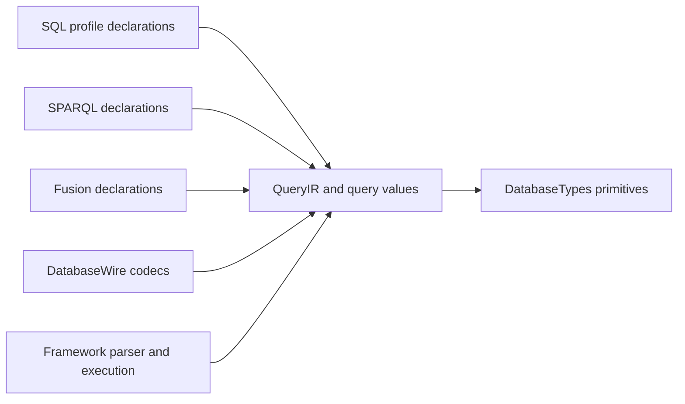

# Query

## Purpose and Scope

Query owns the Foundation-independent query-language values, their pure
structural validation, parameter references, and declaration-side budgets.
Its parent is [DatabaseKit](../DESIGN.md); its direct child is
[SQL](SQL/DESIGN.md), the authority for the accepted PostgreSQL basic
compatibility profile. SPARQL, SQL/PGQ, and Fusion remain distinct language or
feature contracts within Query; the SQL profile does not redefine them.

## Responsibilities and Boundaries

- Own QueryIR structure, literals, expression/source/projection declarations,
  parameters, ordered result semantics, and query-specific typed values.
- Own pure construction, intrinsic validation, structural resource accounting,
  and language-specific declaration constraints.
- Consume primitive owners and representations from DatabaseTypes. A query
  value adds query meaning or metadata; it does not duplicate the primitive
  field-value algebra.
- Leave parsing and SQL serialization to Framework QueryAST; schema-dependent
  binding, planning, evaluation, authorization, and publication to their runtime
  owners; binary encoding to DatabaseWire; storage to StorageKit.

Existing SQL-generation extensions are current placement, not the target
owner. Their migration to QueryAST is part of SQL L08, with callers migrated
and semantic rejection tested before the old paths are removed.

## Related Designs

| Design | Relationship | Contract Used | Summary | Cautions |
|---|---|---|---|---|
| [DatabaseKit](../DESIGN.md) | parent | module declaration and trait boundary | Composes Query with schema, model, graph, and other declarations. | Query holds no runtime handles. |
| [SQL](SQL/DESIGN.md) | child | feature IDs, typed SQL meaning, compatibility differences | Owns the complete SQL profile and acceptance obligations. | SQL coercion, NULL, order, or collation rules must not silently affect SPARQL. |
| [Model](../Model/DESIGN.md) | coordinates with | static query type metadata and field adaptation | Carries query meaning through concrete model fields. | No inference from a stored object or byte payload. |
| [Schema](../Schema/DESIGN.md) | coordinates with | admitted query descriptor and schema identity | Validates storage/type/default agreement. | A descriptor change is a schema encoding change. |
| [DatabaseWire](../../DatabaseWire/DESIGN.md) | used by | query/result value encoding | Encodes QueryIR and typed results with retained frame ownership. | Wire representation is not a second semantic model. |
| [DatabaseEngine](../../../../database-framework/Sources/DatabaseEngine/DESIGN.md) | used by | validated QueryIR and execution budgets | Binds and executes query meaning. | Runtime catalog, work-meter reservations, and transaction lifetime stay downstream. |
| [database-types](../../../../database-types/DESIGN.md) | depends on | primitive values and bounded byte ownership | Supplies retained bytes and intrinsic scalar representations. | Cross-package consumption does not change semantic ownership. |

## Architecture



## Contracts and Invariants

### SQL lexical value construction

Query-owned context-free constructors form existing query values from bounded
SQL lexical input. They do not own runtime casts, typmod rounding, collation,
work metering, reservations or source positions. The synchronous borrowed
Substring is not retained by the result. Callers admit and charge the original
input before invoking a constructor, and retain any runtime result claim until
their true output owner ends. Kit enforces maximumUTF8Count before parsing;
malformed input is a typed failure rather than an untyped-string fallback.

| API | Result and intrinsic guarantees |
|---|---|
| `QueryNumericValue.init(sqlLexicalForm:maximumUTF8Count:)` | Exact finite decimal value and lexical displayScale. Decimal/exponent and SQL radix integer forms retain legal digit separators; ASCII exterior whitespace is accepted. At most 38 canonical coefficient digits, displayScale 0...16383 and the existing SQL input integral-digit bound apply before runtime typmod conversion. Parsing does not round a 39-digit value into the admitted profile. |
| `QueryValue.uuid(sqlLexicalForm:maximumUTF8Count:)` | Existing primitive UUID, accepting hexadecimal case, optional braces, omitted hyphens and hyphens after groups of four hexadecimal digits. Exactly 16 bytes result; canonical output and ordering remain the primitive owner's contract. |
| `QueryValue.binary(sqlLexicalForm:maximumUTF8Count:)` | Existing primitive ByteString, accepting BYTEA hex and traditional octal/backslash input. Space, tab, LF and CR are accepted between complete hex byte pairs; VT and FF are rejected. Output byte count never exceeds original input UTF-8 count. |

Each API takes `borrowing Substring` and an explicit UInt64 maximumUTF8Count,
and throws QueryValueError. Invalid numeric/UUID/binary lexical input carries
a byte offset and reason; resource and numeric range failures retain their
existing categories. Parsing scans borrowed UTF-8 without copying the input
into an array. Numeric and UUID formation use fixed scalar state. Binary
formation validates and measures first, then initializes one final immutable
byte owner; no decoded intermediate byte array is retained. Runtime callers
account for both scans before invocation. These APIs add no primitive value
wrapper, generic scalar-input service, lower-layer SQL parser or global state.

SQL CHAR/VARCHAR descriptors admit absent length or a length in
1...10_485_760, including typed NULL admission. This is descriptor validation,
not string truncation, padding or assignment conversion. Binary descriptor
length policy is unchanged. The Kit lexical tests and QueryAST constant tests
own exact/one-past input limits, malformed forms, dscale and typed-constant
agreement; Native and ordinary/Embedded WASM evidence remains target-specific.

- QueryStatement, SelectQuery, Expression, Literal, and DataSource currently
  share representation across SQL and SPARQL. Representation sharing is not
  semantic equivalence: RDF term identity, unbound variables, SPARQL error
  propagation, aggregates, ordering, and datasets retain their contracts.
- Each SQL extension is language-qualified or validated at the language
  boundary. SQL-only forms cannot be admitted as meaningful SPARQL by a codec
  round trip or a shared evaluator switch.
- Query values own their type and query-specific metadata while retaining
  primitive storage. No storage key, pointer, lease, transaction, transport,
  function implementation, mutable registry, or schema generation owner is
  stored in a declaration value.
- Ordered result columns and positional cells retain duplicates and zero-row
  metadata. Runtime reservations remain runtime-owned; encoding does not
  invent a lifetime-independent intermediate materialization.
- Structural validation, parameter traversal, hashing/equality, encoders,
  decoders, and language validators must cover every admitted semantic case.
- Canonical primitive identity and existing application-model storage are
  unchanged by SQL-specific type, display, or lexical metadata.
- Default declarations are target-free. MultiBase-only declarations remain
  trait-gated; SQL does not provide a route around target or authority rules.

### Expression representation identity

The Bool-returning Equatable witness compares exact declaration identity,
including ordered children, absent versus present operands, exact names, type
metadata and conditional flags. Expression-building comparison operators keep
their existing API and do not participate in this representation comparison.
Equality and hashing traverse direct Expression edges with explicit work
stacks, including edges inside functions, aggregates, CASE pairs and sort
keys. Collection cursors retain the immutable input arrays and advance by
index; they do not copy or flatten a subtree or push one work item per sibling.
Temporary work is bounded by input depth, with constant call-stack depth for
those Expression edges. There is no guessed depth cap or failure-to-false
fallback. Literal, DataType and SelectQuery payload identity remains owned by
those existing representations; this change does not redefine SQL value
equality or subquery semantics. Equal expressions feed identical ordered
identity tokens to Hasher; numeric hash values are not persistent identifiers.

The legal 48-edge alternating ARRAY/ROW Wire fixture exercises equal,
different-leaf and different-child-count comparisons and equal-value hashing.
The existing conditional identity fixtures cover flags, source discriminators,
simple/searched CASE and exact name/type metadata. Native, ordinary WASM and
Embedded runtime witnesses must execute this identity path after decoding;
compilation alone does not close the stack-exhaustion counterexample.

### SELECT source language applicability

`DataSource.usesSPARQLSemantics` owns the language applicability of a SELECT's
top-level source. It is true only for graphPattern, namedGraph and service.
Relational table/logical/values/join/subquery/set sources, SQL/PGQ graphTable and
MultiBase base sources are false. This is not a recursive test for SPARQL
descendants: a relational join or subquery retains its own top-level boundary.
The exhaustive switch requires an explicit decision whenever DataSource gains
a case.

Framework execution and Server admission consume this property when selecting
the SPARQL semantic gate for SELECT. Structural validation and parameter binding
remain applicable to both languages. An explicit public call to
SPARQLSemanticValidator continues to apply its SPARQL-specific rules regardless
of this property; it is not changed into an automatic language dispatcher.

### S01 public query boundary

S01 implements these frozen interfaces in this component. The SQL child owns
their SQL-specific validation and persistence adaptation, including the exact
rich-value cases and falsifiable case IDs. Runtime evidence is recorded in the
workspace task progress; later SQL expression support remains separately gated.

| Declaration | Public contract |
|---|---|
| `QueryValue` | Closed query-domain algebra with `.primitive(FieldValue)` and the SQL child's five rich-value alternatives. Primitive alternatives are not duplicated. |
| `QueryColumnType` | `.sql(DataType)` or `.primitive(FieldSchemaType, isArray: Bool)`, with isArray default false. The primitive array flag preserves existing non-SQL array declarations. No unknown/success-placeholder case. RDF/reference/vector results retain a primitive declaration instead of a fabricated SQL type. |
| `QueryColumn` | Kit-owned immutable `number: UInt32`, `name: String`, `type: QueryColumnType`, `isNullable: Bool`. Number is the one-based output ordinal, not a persisted field number. Names may be empty or duplicate, but column numbers must be consecutive in a result. |
| `QueryParameter` | `position` and optional `name` retain current addressing; `value` becomes QueryValue and optional `type: QueryColumnType?` declares an explicit type. NULL has no separate value tag: `.primitive(.null)` is typed by this declaration or its bound expression/column. |
| `Literal.queryValue(QueryValue, type: QueryColumnType? = nil)` | Adds query values and an optional explicit declaration to the existing Literal model. Binding preserves parameter type here, including typed NULL and empty arrays. Existing SQL/SPARQL literal cases remain; primitive/term meaning is not rewritten. |
| `QueryValueError` | Typed intrinsic value/type/shape/metadata/persistence failures described in the child contract. Runtime SQLSTATE mapping remains outside this module. |

Primitive array declarations admit NULL cells as well as cells of the declared
primitive element type. Column nullability controls the entire array value;
it does not reject NULL elements in existing `[Optional<Element>]` models.

Wire imports this QueryColumn rather than retaining a second semantic type of
the same name. Its codec may be an extension, but its initializer, equality,
validation and meaning are Kit-owned. Pure representation Hashable/Equatable
preserves metadata; SQL equality, grouping and distinctness are runtime-bound
operations and cannot use representation hashing without the SQL comparator.

Parameter binding retains the complete QueryParameter in its address maps.
A primitive value with nil explicit type uses the existing FieldValue-to-Literal
conversion unchanged; rich or explicitly typed values use Literal.queryValue
with both value and type. GraphTerm positions retain their primitive term
conversion and explicitly reject rich values. Structural/resource traversal visits
the new literal's complete tree and retained bytes. SQL parameters whose type
cannot be inferred or reconciled fail explicitly; RDF primitive parameters
continue to use SPARQL term conversion and validation. QueryLiteralConvertible
conformances for the rich wrappers produce the same case and preserve metadata.

The binder owns context-free value substitution, not interpreter selection.
Its initializer does not acquire SQL/SPARQL language metadata. Framework's
existing SQL/Graph interpreter context consumes the richer literal declaration;
wrapped primitives can delegate to the existing primitive semantics there.

Literal.queryValue diagnostic description is nonthrowing and metadata-free on
every target. It reports the closed value family and whether the explicit
declaration is SQL, primitive, or inferred. It neither reflects a generic value
or optional type nor serializes a payload. SQL/SPARQL generation continues to use
its own typed, fallible contract rather than diagnostic text.

### S02 declaration migration

The [SQL child contract](SQL/DESIGN.md#s02-frozen-syntax-to-value-boundary) owns
integer-width selection, exact numeric constants, constructor expressions and
temporal typmod meaning. Query composes these changes into existing Expression,
DataType, Literal, parameters and structural validation. It introduces neither
a parallel SQL AST nor QueryValue.row. Every new child is visited by binding,
validation, resource accounting, hashing and canonical Wire traversal.

Kit no longer owns executable SQL generation after S02. SQL methods on semantic
values, SQL type-name generation and SQL escape policy are removed from this
package after Framework callers/tests migrate. Non-SQL metadata and RDF
expressions cannot gain SQL meaning through a serializer fallback. SPARQL
serialization and diagnostic/value formatting remain here under their existing
language contracts. Quoted state and parser source spans are not Kit metadata.

QueryStructuralResourceLedger.remainingLimits is a read-only projection of its
owned counters. It subtracts admitted usage from every limit, including current
nesting depth. A caller may admit a child payload against that residual budget
before constructing it, then charge the measured payload to the same parent
ledger. Callers do not mirror ledger counters. Rejected claims preserve the
remaining budget; leaving a nesting scope restores depth capacity without
releasing cumulative node, byte, token or collection consumption.

### S03 semantic carriage and occurrence addresses

DataType.sparqlFunction uses a throwing QueryLiteralConversionError getter.
It owns SPARQL type-name generation and rejects schema-qualified custom types
and existing explicit temporal modifiers, including nested types, with
unsupportedSPARQLLiteral. Expression serialization consumes that same path.

The [SQL child](SQL/DESIGN.md#s03-frozen-semantic-binding-boundary) owns S03
resolution meaning. Query adds Literal.sqlUnknownString(String), optional
exact FunctionCall.schema via init(name:arguments:distinct:schema:), and
DataType.custom(String, schema: String? = nil). Existing Literal.string
remains typed text. These changes retain QueryValue's six cases and do not
alter primitive storage. Every shared consumer/traversal migrates; qualified
SQL forms and unknown strings fail at SPARQL boundaries rather than inheriting
SQL coercion or name policy. QueryValue literals with an explicit declaration
must pass its intrinsic type validator before SPARQL primitive adaptation;
unresolved custom declarations cannot be ignored merely because the payload
is primitive. Existing valid typed primitive literals retain their RDF path.

QueryParameterBinder.validate(_:) validates supplied parameters and statement
structure/references without substitution. SQL uses this admission path and
passes original references plus parameters to Framework. Existing bind(_:) can
delegate validation then retain context-free replacement for consumers whose
contract requires it. Position/name maps still retain complete QueryParameter;
Framework alone resolves SQL base types and legal occurrence coercions.

QueryOccurrenceID is a UInt32 arena-local index. QueryOccurrenceField is a
closed semantic edge-role enum; an occurrence retains parent ID, field and
optional collection index. One QueryOccurrenceArena owns entries, child lookup
index and structural ledger. append(parent:field:index:) checks parent, unique
edge, depth/count/byte/overflow admission before growing; child(of:field:index:)
and occurrence(_:) resolve within that arena. IDs are meaningful only with
their owning arena/root; parser and binder receive that same provenance rather
than independently guessing traversal numbers. QueryOccurrenceError preserves
invalid-address and resource failures. The immutable operation result retains
arena ownership; no source text or source range enters these values.

| Semantic position | Edge meaning |
|---|---|
| Root | One statement root; statement index distinguishes batch roots. SELECT itself is the query root without a redundant wrapper. |
| Query clauses | cte/projection/groupBy/orderBy use ordered indices; source/filter/having are singular. |
| Source/nested query | joinLeft/joinRight/joinCondition and subquery preserve scope boundaries. |
| Expression children | operand(index) follows ordered operands including unary/binary/BETWEEN/CAST; argument(index) follows function/COALESCE/IN-value/constructor children. |
| Conditional/type/aggregate children | caseCondition/caseResult indices, caseElse, castType, elementType, aggregateArgument and aggregateOrderBy indices preserve their distinct roles. |

Required edges may be refined by their semantic owner without introducing a
second AST; parser and binder must use identical meaning. Shared parent/edge
storage and lookup indexes use O(nodes + edges) retained space. No per-node
full ancestor-path allocation, Expression-equality identity, parser-state
reference or global mutable identity service is part of this contract. Counts,
depth, lookup entries and logical retained representation bytes are admitted
using existing structural limits before growth. This does not claim exact Swift
allocator capacity; Framework separately retains its existing actual-owner/
capacity-based plan claim under the runtime work meter.

S03-C01–C04/C10–C12 verify semantic distinction, parameter validation,
occurrence uniqueness, bounded failures, language isolation and canonical
native/WASM/Embedded carriage. Parser source annotations remain QueryAST-owned;
runtime binding/execution and lifetime remain Framework-owned.

## Runtime Flows

```text
text or builder → Framework QueryAST → QueryIR
    → pure structure/parameter validation
        → Framework binding/planning/execution
            → typed columns + positional values
                → DatabaseWire encoding or final public materialization
```

Only the declaration and pure-validation stages belong to Query.

## State, Ownership, and Lifecycle

Declaration instances are immutable or task-local value construction state.
Retained ByteString owners outlive all bounded views; pointer borrows remain
synchronous. Runtime-owned admission, isolation, generation leases, catalog
state, clocks, and authority do not migrate into Query values.

## Failure, Concurrency, and Constraints

Values and callbacks retain the same Sendable contract on native, WASM, and
Embedded targets. Structural byte/node/collection/depth limits are applied
before constructing untrusted trees. Invalid, unsupported, unbound, or
resource-limited input is a typed failure, not a default query or empty result.
Foundation, reflection, Codable persistence, and platform services stay out of
the canonical module.

## Verification and Change Impact

| Contract | Evidence owner |
|---|---|
| Structure and parameter success/failure/boundaries | [Query test component](../../../Tests/DatabaseKitTests/Query) |
| QueryIR and lazy typed-result codecs | [DatabaseWire tests](../../../Tests/DatabaseWireTests) |
| SQL profile behavior and differential acceptance | [SQL verification contract](SQL/DESIGN.md#verification-and-change-impact) |
| Language isolation | Existing SPARQL semantic/term suites plus regression cases for shared QueryIR changes |
| Top-level SELECT applicability | SelectQueryMetadataTests and SPARQLSemanticValidatorTests cover relational/graph boundaries and preserve explicit-validator rejection; Framework parser and Server admission tests exercise their consumer gates |

Changes to shared QueryIR require SQL and SPARQL consumers, structural and
parameter traversals, codecs, and direct runtime callers to be checked. Changes
to the SQL child contract propagate through this component to DatabaseKit and
DatabaseWire without copying the profile into those parents. This S00 document
fixes intended contracts; it is not evidence that S01+ behavior is implemented.

### S04 semantic carriage and occurrence edges

[S04 SQL](SQL/DESIGN.md#s04-semantic-additions-and-scope) owns the added closed
forms and their meaning. Query owns exhaustive equality/hash, structural
validation, parameter transforms and semantic occurrence traversal. Simple
CASE has one `.operand` child; its WHEN matches/results retain indexed
`.caseCondition` / `.caseResult` and fallback `.caseElse`. GREATEST/LEAST use
indexed `.argument`. Truth test uses `.operand`; DISTINCT uses indexed
`.operand`; quantified comparison uses left `.operand` and right `.argument`
for array expression or `.subquery` for the query. Every walker uses the same
edges and charges each child once. No source text or mutable runtime state
enters these values. RDF/SPARQL consumers explicitly gate SQL-only forms.

### S05 pattern and concatenation declarations

`Expression.patternMatch(subject:pattern:escape:kind:)` owns one SQL pattern
predicate with expression children. `PatternMatchKind` is closed over LIKE,
case-insensitive LIKE, SIMILAR TO, ERE and case-insensitive ERE. An absent escape
disables escaping; SQL parser/builder default backslash is an explicit child.
ERE forms reject an escape child. SPARQL `regex` remains distinct.
`Expression.concatenate` owns the strict overloaded SQL concatenation operator;
it is distinct from non-strict CONCAT calls. These declarations replace the old
constant-pattern LIKE case without aliases. Every identity, traversal, parameter
and structural validation path retains subject, pattern and optional escape.
Structural admission charges every raw string literal's UTF-8 byte count through
the shared retained-byte ledger, including each pattern child and concatenation
operand; the expression shape does not bypass or duplicate that literal charge.
The SQL profile owns execution meaning; Graph adapters preserve their existing
case-sensitive/no-escape LIKE capability and typed language failures.
Graph export admits only that static literal LIKE shape and emits escaped,
case-sensitive REGEX; dynamic patterns, new operator kinds and explicit escapes
are typed unsupported there. SPARQL regex keeps its separate contract.

Verification covers expression identity/hash/deep traversal, dynamic parameter
children, malformed escape structure and bounded values; Wire and QueryAST
round trips consume the same declarations.


### S06 temporal composition

The [SQL S06 contract](SQL/DESIGN.md#s06-frozen-temporal-contract) adds exact
SQL time/offset/infinity values, interval modifiers and the dedicated
currentValue expression. Existing primitive representations and structural
QueryValue losslessness remain intact. Query consumes the Model/Schema
adaptation and Wire/SchemaJSON codecs; clocks, timezone services and SQL
comparison stay in Framework. All traversals handle currentValue as a leaf;
SPARQL rejects SQL-only temporal forms explicitly rather than assuming their
presence gives RDF semantics. Tests prove constructor/descriptor bounds,
lossless persistence/carriage and malformed input under the respective owners.
