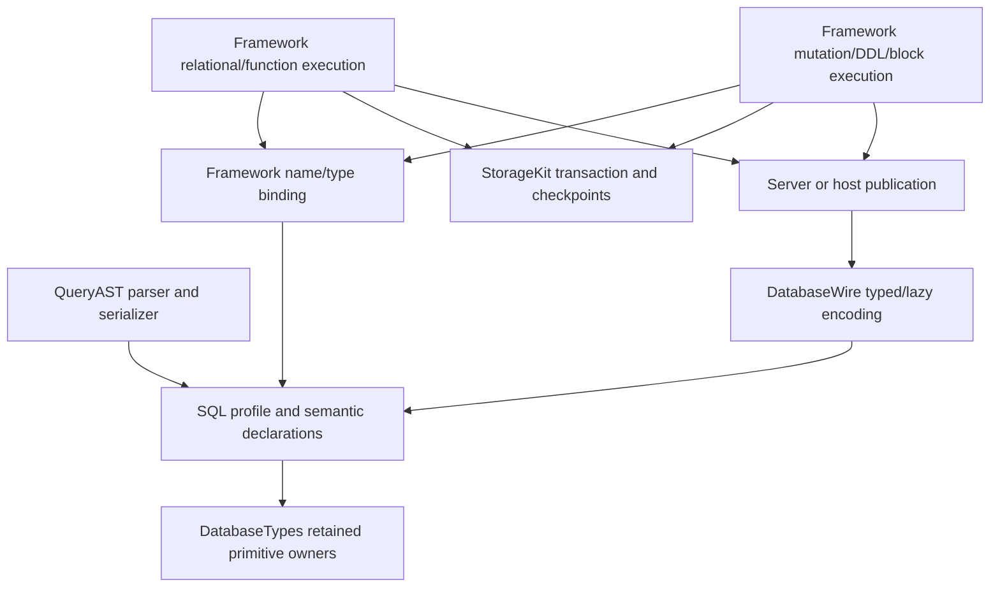

# SQL Basic Compatibility Profile

## Purpose and Scope

This component is the semantic authority for the accepted PostgreSQL 18 basic
SQL compatibility profile. Parent: [Query](../DESIGN.md). Children: none.
The feature inventory below is the complete implementation target, including
analysis queries, mutations, basic DDL, and one-request SQL blocks. A limited
SELECT implementation does not satisfy this profile.

Status: **S00 accepted design; S01–S18 implementation and behavioral evidence
pending.** Names and interfaces labeled planned are not existing capabilities.
Inventory rows state required behavior, not current implementation completion.
The reference dialect is PostgreSQL 18; the accepted differential-server pin
is 18.6, verified by the harness before its evidence is accepted.

## Responsibilities and Boundaries

| Meaning or lifecycle | Owner |
|---|---|
| SQL profile, expression/statement/type/result meaning, intrinsic validation | DatabaseKit Query/SQL |
| Primitive bytes/scalars, canonical FieldValue, intrinsic primitive operations | DatabaseTypes |
| Parsing, source positions, canonical SQL serialization | Framework QueryAST |
| Catalog-dependent binding, overload selection, planning, evaluation, constraints, SQL catalog, schema generation, block execution | Framework execution components |
| Transactions, checkpoints, backend/Directory behavior | StorageKit |
| Bounded binary encoding, closed operation descriptors, lazy result pages | DatabaseWire |
| Invocation, response correlation, cancellation/transport adaptation | DatabaseClient |
| Dispatch, remote admission, publication and native hosting | DatabaseServer |
| Command parsing, typed rendering and application composition | DatabaseCLI and applications |

SQL schema is a logical namespace, not a Directory, Partition, tenant, Base,
placement, or authority boundary. SQL cannot widen principal/entity/field
permissions. Default v3 requests remain target-free; MultiBase-only v5 target
contracts remain compile-time gated. Physical backend choice does not select
the SQL dialect or bypass Framework SQL execution.

## Related Designs

| Design | Relationship | Contract Used | Summary | Cautions |
|---|---|---|---|---|
| [Query](../DESIGN.md) | parent | QueryIR, language separation, retained query values | Composes SQL with shared query contracts. | SQL changes do not redefine SPARQL. |
| [DatabaseWire](../../../DatabaseWire/DESIGN.md) | used by | deterministic bounded semantic encoding | Carries the profile's types, statements, diagnostics and results. | No generic DTO collection, eager page decode, or runtime version negotiation. |
| [QueryAST](../../../../../database-framework/Sources/QueryAST/DESIGN.md) | used by | parser and serializer language contract | Owns accepted text forms, positions and rejected syntax. | Parsing a built-in form does not imply an available execution capability. |
| [DatabaseEngine](../../../../../database-framework/Sources/DatabaseEngine/DESIGN.md) | used by | SQL binding and execution contracts | Executes this profile on the injected storage engine. | Authorization, work meters, clocks and lifecycle remain runtime-owned. |
| [QueryExecution](../../../../../database-framework/Sources/DatabaseEngine/QueryExecution/DESIGN.md) | coordinates with | retained rows and admission | Supplies footprint-first result construction. | SQL output must not detach from runtime reservations before publication. |
| [StorageKit](../../../../../storage-kit/DESIGN.md) | coordinates with | transaction/checkpoint/Directory guarantees | Supplies backend-neutral transactional effects. | SQL meaning does not migrate into storage contracts. |
| [SPEC](../../../../../SPEC.md) | system authority | placement, Partition, authority and publication | Fixes product invariants above this feature. | The profile cannot reinterpret these invariants. |

## Architecture



## Contracts and Invariants

### Current implementation facts

These are source observations, not newly executed verification. Existing tests
are linked as behavioral specifications; their existence is not a passing run.

| Observed current fact | Source or behavioral specification |
|---|---|
| DataType lists integer/numeric/string/time/JSON/array forms, but declarations alone do not establish runtime support. | [Expression](../Expression.swift) |
| SelectQuery has UInt64 limit/offset and shared SPARQL fields; QueryStatement has SELECT/INSERT/UPDATE/DELETE but no general SQL block or ordinary DDL cases. | [SelectQuery](../SelectQuery.swift), [QueryStatement](../QueryStatement.swift) |
| QueryParameter and Wire QueryRow currently carry primitive FieldValue; Literal.decimal canonicalizes ExactDecimal rather than preserving SQL display scale. | [QueryParameter](../QueryParameter.swift), [Literal](../Literal.swift), [QueryRow](../../../DatabaseWire/QueryRow.swift), [exact numeric tests](../../../../Tests/DatabaseKitTests/Query/ExactNumericLiteralTests.swift) |
| Wire rows are already positional and lazy; QueryColumn contains number/name without SQL type metadata. | [QueryColumn](../../../DatabaseWire/QueryColumn.swift), [QueryRowPage](../../../DatabaseWire/QueryRowPage.swift), [ownership tests](../../../../Tests/DatabaseWireTests/QueryResultPageTests.swift) |
| Public executeSQL parses and binds but explicitly rejects non-SELECT statements; SQL row tests currently inspect fields by name. | [DatabaseContext SQL entry](../../../../../database-framework/Sources/Database/DatabaseContext+SQL.swift), [SQL row tests](../../../../../database-framework/Tests/DatabaseTests/SQLRowExecutionTests.swift) |
| Existing expression SQL serialization maps case-insensitive regex to UPPER/LIKE; source serialization has non-SQL cases. | [SQL-generation implementation](MatchPattern.swift) |

### Planned public semantic contracts

- Extend the existing DataType/QueryStatement/QueryIR owners rather than create
  a parallel SQL statement algebra. Represent SELECT/VALUES/set-operation
  bodies with CTEs and outer ordering/pagination, then add DML/DDL/block forms.
- Introduce a query-domain value contract in DatabaseKit for type and metadata
  that primitive FieldValue cannot express: numeric display scale, retained
  JSON lexical bytes, normalized JSONB, array dimensions/lower bounds, and a
  mixed month/day/time interval. Retain existing primitive representations;
  do not duplicate ByteString, ExactDecimal, UUID, or application field values.
- Query result columns are ordered declarations with stable position, name,
  SQL type, nullability and typmod. Duplicate names are valid. Cells are
  positional and their count equals column count. Columns survive zero rows.
  Dictionary access is an explicit convenience only when names are unambiguous.
- Parameters carry the same query value contract as expressions, persistence,
  and results, with explicit type or contextual inference. Primitive callers
  adapt explicitly without losing identity or metadata.
- Planned runtime entry points are executeStatement and executeSQLBlock in
  Framework, alongside the read-only SELECT facade. A statement result
  distinguishes rows, command count and schema change; a block result preserves
  statement order and is published only after authoritative close.
- DatabaseWire extends its existing positional row representation with these
  semantics and provides closed statement/block descriptors. v3/v5 boundaries
  are unchanged. Source, codecs, golden vectors and direct consumers migrate
  together; initial development does not require duplicate compatibility APIs.
- Planned SQL diagnostics preserve typed category, SQLSTATE classification,
  input location, target identifier and cause. Framework owns semantic errors;
  Wire owns malformed binary errors; neither owns the other's failure policy.

Every admitted built-in statement/operator/function must have an available
execution path. A parser or semantic case can be introduced before that path
only with explicit unsupported failure and the required incomplete marker at
the callable implementation branch; such a form remains incomplete in the
feature ledger. No placeholder, empty rows or synthetic success is permitted.

### Numeric and language invariants

| Concern | Contract |
|---|---|
| Integer types | Preserve smallint/integer/bigint bounds, promotion and result type; integer division truncates according to PostgreSQL. Overflow remains an error. |
| Bounded numeric | Finite normalized coefficient at most 38 decimal digits. Explicit precision 1–38 and typmod scale −1000…1000. Round before typmod overflow validation. |
| Scale distinctions | Canonical ExactDecimal scale, declared typmod scale and observable display scale are distinct. Do not reject a canonical exponent solely because it falls outside typmod-scale limits. |
| Numeric operations | Primitive exact division remains exact. Add pure bounded arithmetic accepting explicit output scale/rounding; Framework chooses SQL scale/rounding rules. |
| Numeric intermediates | Use bounded wider multiplication/division workspace and exact limb aggregate accumulation. Reject only the final out-of-profile result or an admitted workspace limit; a representable AVG must not fail solely because intermediate SUM exceeds 38 digits. |
| Float | Preserve real versus double precision, finite values and their overload behavior. SQL nonfinite values are explicit unsupported input in this profile. |
| Equality | SQL joins, grouping, DISTINCT, set operations and SQL indexes use one bound SQL equality/collation contract. Display scale does not create numeric inequality. |
| Language boundary | SQL NULL/coercion/numeric/order rules do not replace RDF term identity, SPARQL unbound/error semantics, datasets, aggregate or ordering contracts. |

### Complete feature inventory and acceptance obligations

Each stable ID owns a success case, an explicit failure case and a boundary
case. The final column records distinguishing evidence that must reject an
incorrect implementation; function rows apply this obligation to every named
function and admitted overload. The rows are requirements, not completion
checks. Test completion and commits are recorded only in workspace PROGRESS.md.

#### Lexical forms and SQL generation

| ID | Required capability | Distinguishing acceptance |
|---|---|---|
| L01 | Unquoted lowercase identifiers, double-quoted identifiers and doubled quotes, qualification and reserved-word distinction | Case-sensitive quoted lookup, folded unquoted lookup, escaped quote, ambiguous/undefined name. |
| L02 | Ordinary, E, Unicode-escape and dollar-quoted strings | Literal bytes/codepoints preserved; invalid escape and unterminated delimiter fail with position. |
| L03 | Integer/decimal/exponent literals with PostgreSQL type selection | Exact exponent decimal without Double intermediate; range boundary and one-past failure. |
| L04 | DATE/TIME/TIMESTAMP/INTERVAL/UUID/BYTEA/ARRAY/ROW typed literals | Correct type/value and invalid lexical/type/shape rejection. |
| L05 | $n parameters plus product :name and ? forms | Contextual/explicit type, every expression position, missing/conflicting type rejection. |
| L06 | Nested comments, statement separators, multi-statement input and positioned diagnostics | Semicolon in every quoted form stays inside a value; malformed tail/comment is rejected. |
| L07 | CAST and ::, aliases and typmods | Equivalent bound types; invalid precision/scale/length/temporal precision rejected. |
| L08 | One canonical serializer in QueryAST | Parse/serialize/parse meaning preserved with identifiers, precedence, CTE hints and LATERAL; unsupported source or cross-language expression is a typed error. |

#### Retrieval and relational/analytic syntax

| ID | Required capability | Distinguishing acceptance |
|---|---|---|
| Q01 | SELECT columns/expressions, implicit aliases, table.*, mixed wildcards | Column order, duplicate names, zero-row types and no-FROM singleton relation preserved. |
| Q02 | Schema-qualified tables, column aliases, comma/parenthesized joins, derived tables, VALUES and table functions | Alias scope/arity, empty sources and absent relation errors. |
| Q03 | INNER/LEFT/RIGHT/FULL/CROSS/NATURAL/USING joins, optional OUTER, LATERAL | Required conditions, USING column merge/order, NULL extension, empty side and correlated lateral rows. |
| Q04 | Comparisons/logical/IN/BETWEEN, truth/unknown predicates, IS DISTINCT FROM, ANY/SOME/ALL, ROW comparison | Three-valued logic, NOT IN with NULL, empty quantified set, mixed row NULLs and incompatible types. |
| Q05 | Simple/searched CASE, COALESCE, NULLIF, GREATEST, LEAST | Common type resolved before execution; an unselected failing branch is not evaluated. |
| Q06 | Scalar/IN/EXISTS and correlated subqueries | Column count/type, scalar multirow cardinality error, empty result/NULL and lexical scope. |
| Q07 | SELECT ALL, DISTINCT, DISTINCT ON | SQL equality and collation, ORDER BY restrictions and correct selected row with duplicates. |
| Q08 | UNION/INTERSECT/EXCEPT with ALL/DISTINCT | Operator precedence, multiplicities, common type, NULL equality and outer ORDER/LIMIT. |
| Q09 | ORDER BY expression/alias/ordinal/multiple keys/collation | PostgreSQL name-resolution priority and default NULL order; invalid ordinal/ambiguity fails. |
| Q10 | LIMIT/OFFSET expressions and parameters, LIMIT ALL/NULL, FETCH FIRST/NEXT and WITH TIES | Legal clause order, negative/overflow input, tied final peer group and empty page. |
| Q11 | GROUP BY/HAVING aliases/ordinals/key functional dependency, GROUPING SETS/ROLLUP/CUBE/GROUPING | Empty grouping set, duplicate groups, GROUPING bits and invalid nongrouped projection. |
| Q12 | Nonrecursive CTEs, column aliases, MATERIALIZED/NOT MATERIALIZED | All public entry points, lexical visibility/shadowing, arity and materialization/volatility behavior. |
| Q13 | Recursive CTEs, UNION/ALL, SEARCH and CYCLE | Working table progression, duplicate/cycle behavior, search ordering and frontier/iteration cancellation limits. |
| Q14 | OVER/named WINDOW, PARTITION/ORDER, ROWS/RANGE/GROUPS, bounds and EXCLUDE | Peer groups, default frame, empty frame, invalid frame bound and type constraints. |
| Q15 | UNNEST/GENERATE_SERIES, WITH ORDINALITY, table functions and LATERAL | Output column/type/ordinality, correlated inputs, direction/zero-step failures and bounded generation. |

#### Types and type resolution

| ID | Required capability | Distinguishing acceptance |
|---|---|---|
| T01 | smallint/integer/bigint bounds, operation result/promotion and integer division | Width boundaries, min-value negation/division overflow and CAST assignment errors. |
| T02 | Bounded numeric, division/AVG/SUM/rounding/precision/scale | Repeating quotient, negative scale, rounding carry, large intermediate AVG and final 38-digit overflow. |
| T03 | real/double precision, implicit casts, rounding, comparison and aggregates | Correct result type, representable boundary, underflow/overflow and finite-only rejection. |
| T04 | Boolean, typed NULL and SQL three-valued logic | Empty ANY/ALL, NULL-safe comparison, typed empty columns and short circuit. |
| T05 | text/char/varchar lengths, space rules and C/POSIX collation | Character versus byte lengths, explicit cast truncation versus assignment failure, trailing-space equality. |
| T06 | BYTEA/UUID lexical forms, input/output/CAST/comparison | Invalid byte encoding/UUID, bytewise ordering, retained owner and round trip. |
| T07 | date/time/timestamp/timestamptz precision, timezone and arithmetic | Leap/day bounds, UTC/fixed/IANA zones, DST transition, missing-zone failure and no offset loss. |
| T08 | One interval value retaining months/days/time | Mixed signs/components, month-end arithmetic, comparison/cast and interval range error. |
| T09 | Typed multidimensional arrays, lower bounds, index/slice/comparison/containment/overlap/concat | Non-1 lower bounds, empty/NULL arrays, rectangularity and dimension overflow. |
| T10 | JSON lexical preservation and normalized JSONB | Duplicate keys, input order/whitespace, SQL NULL versus JSON null, malformed input and retained-byte round trip. |
| T11 | Unknown literals, parameter inference, operator/function overload, assignment casts and common types | Ambiguous/undefined overload rejection; common type in CASE/set operations before zero-row execution. |
| T12 | Shared SQL equality across JOIN/GROUP/DISTINCT/set/index paths | Equal cross-numeric values and NULL groups agree; index lookup matches scan for admitted collation. |

#### Functions and operators

| ID | Required function/operator names | Distinguishing acceptance |
|---|---|---|
| F01 | CASE, COALESCE, NULLIF, GREATEST, LEAST | Type/NULL rules and evaluation only of required branches. |
| F02 | ABS, SIGN, CEIL/CEILING, FLOOR, ROUND, TRUNC, DIV, MOD, POWER, SQRT, CBRT, EXP, LN, LOG/LOG10, GCD, LCM, WIDTH_BUCKET, SCALE, MIN_SCALE, TRIM_SCALE | Integer/numeric overload and return type; numeric math avoids float demotion; domain, zero-divisor, rounding and width boundaries. |
| F03 | PI, DEGREES, RADIANS, SIN, COS, TAN, ASIN, ACOS, ATAN, ATAN2 | Float overload and finite error contracts; admitted numeric overloads stay decimal. |
| F04 | LOWER, UPPER, LENGTH, CHAR_LENGTH/CHARACTER_LENGTH, OCTET_LENGTH, BIT_LENGTH, SUBSTRING/SUBSTR, POSITION/STRPOS, TRIM/BTRIM/LTRIM/RTRIM, CONCAT/CONCAT_WS, REPLACE, TRANSLATE, SPLIT_PART, LEFT, RIGHT, LPAD, RPAD, REPEAT, REVERSE, ASCII, CHR | Unicode character positions, bytes versus characters, negative/empty inputs, NULL and output-byte limits. |
| F05 | LIKE/ILIKE and NOT forms, ESCAPE, SIMILAR TO, ~/~*/!~/!~*, REGEXP_LIKE, REGEXP_MATCH, REGEXP_MATCHES, REGEXP_REPLACE, REGEXP_SPLIT_TO_ARRAY/TABLE | Wildcards/escape versus regex semantics, flags/captures/global rows, unsupported ARE syntax and regex resource bounds. |
| F06 | ENCODE, DECODE, GET_BYTE, SET_BYTE, GET_BIT, SET_BIT; BYTEA length/subsequence/concat | Encoding validity, bit numbering, byte/bit offsets and immutable source preservation. |
| F07 | CURRENT_DATE/TIME/TIMESTAMP, LOCALTIME/LOCALTIMESTAMP, NOW, TRANSACTION_TIMESTAMP, STATEMENT_TIMESTAMP, CLOCK_TIMESTAMP, EXTRACT/DATE_PART, DATE_TRUNC, DATE_BIN, AGE, MAKE_DATE/TIME/TIMESTAMP/TIMESTAMPTZ/INTERVAL, AT TIME ZONE, TO_CHAR, TO_DATE, TO_TIMESTAMP | Controlled clocks/zone data, transaction versus statement time, format directives, invalid format/range/zone and DST. |
| F08 | ARRAY_LENGTH/LOWER/UPPER/NDIMS/DIMS, CARDINALITY, ARRAY_APPEND/PREPEND/CAT, ARRAY_POSITION/POSITIONS, ARRAY_REMOVE/REPLACE, ARRAY_TO_STRING, STRING_TO_ARRAY, UNNEST, GENERATE_SUBSCRIPTS | Dimensions/lower bounds, NULL element comparison, index boundaries and stable element order. |
| F09 | TO_JSON/TO_JSONB, ROW_TO_JSON, ARRAY_TO_JSON, JSON/JSONB_BUILD_OBJECT/ARRAY, JSON/JSONB_TYPEOF, JSON/JSONB_ARRAY_LENGTH, JSON/JSONB_EACH/EACH_TEXT, JSON/JSONB_ARRAY_ELEMENTS/ARRAY_ELEMENTS_TEXT, JSON/JSONB_OBJECT_KEYS, JSON/JSONB_EXTRACT_PATH/EXTRACT_PATH_TEXT | Object/array type errors, lexical versus normalized value, missing member versus JSON null, deterministic row shape. |
| F10 | JSONB_SET, JSONB_INSERT, JSONB_STRIP_NULLS, ->/->>/#>/#>>, @>/<@, ?/?|/?&, ||, -, #- | Nested paths, create-missing, containment, array deletion/negative indexes and wrong operand types. |
| F11 | COUNT, SUM, AVG, MIN, MAX, STRING_AGG, ARRAY_AGG, BOOL_AND, BOOL_OR, EVERY, BIT_AND, BIT_OR, BIT_XOR, JSON/JSONB_AGG, JSON/JSONB_OBJECT_AGG | Empty/NULL inputs, widened result types, FILTER, DISTINCT, internal ORDER BY and invalid key/input. |
| F12 | VAR_POP/VAR_SAMP/VARIANCE, STDDEV_POP/STDDEV_SAMP/STDDEV, CORR, COVAR_POP/COVAR_SAMP, REGR_COUNT/AVGX/AVGY/SXX/SXY/SYY/SLOPE/INTERCEPT/R2, PERCENTILE_CONT/DISC, MODE | Pairwise NULL removal, small/degenerate samples, WITHIN GROUP, percentile bounds, ties and numeric accuracy. |
| F13 | ROW_NUMBER, RANK, DENSE_RANK, PERCENT_RANK, CUME_DIST, NTILE, LAG, LEAD, FIRST_VALUE, LAST_VALUE, NTH_VALUE; ordinary aggregate OVER | Peers/ranking, offset/default evaluation, frame-aware first/last/nth, bucket/offset errors and partitions. |
| F14 | NEXTVAL, CURRVAL, LASTVAL, SETVAL, CURRENT_SCHEMA, CURRENT_SCHEMAS, CURRENT_DATABASE, CURRENT_USER, SESSION_USER | Block sequence state, uninitialized currval, existing principal/namespace identity and no fabricated authority. |

Function support includes argument types, result types, NULL rules, typed
failures and resource admission. Parsing an arbitrary FunctionCall is not
support. F11–F12 include FILTER, internal ORDER BY, DISTINCT and WITHIN GROUP
where the PostgreSQL function permits them; invalid combinations must fail.

#### Mutations

| ID | Required capability | Distinguishing acceptance |
|---|---|---|
| M01 | INSERT multiple VALUES, DEFAULT cells/VALUES, SELECT, omitted columns and casts | Default evaluation per row, arity/type errors, missing required column and all-or-nothing batch. |
| M02 | UPDATE FROM, tuple SET, DEFAULT, correlated values, key/placement-identity changes | Old-row RHS semantics, source cardinality, simultaneous assignments and atomic rekey/Directory/index changes. |
| M03 | DELETE USING and correlated conditions | Correct matched rows and reference action, failure leaves data and indexes unchanged. |
| M04 | All DML RETURNING columns/expressions/* and affected count | Column order/type/duplicates and data match committed state; no precommit publication. |
| M05 | ON CONFLICT columns/constraint, composite UNIQUE, EXCLUDED and WHERE | Index-based conflict selection, duplicate input cardinality and NULL distinctness, no internal-id substitute. |
| M06 | Data-modifying CTE with RETURNING | Shared snapshot/transaction, downstream CTE read, exactly-once effects and rollback on later failure. |
| M07 | MERGE MATCHED/NOT MATCHED with INSERT/UPDATE/DELETE/DO NOTHING, conditions and RETURNING | Clause priority, multiple-source cardinality error and mixed actions atomically committed. |
| M08 | TRUNCATE multiple tables, reference rules, RESTART/CONTINUE IDENTITY | Dependent tables, count/state semantics and rollback including required identity effects. |

#### DDL, identity and constraints

| ID | Required capability | Distinguishing acceptance |
|---|---|---|
| D01 | CREATE/ALTER/DROP logical SQL SCHEMA, search_path | Name resolution, namespace rename/drop and authority remains separate from Directory/Partition. |
| D02 | CREATE TABLE, IF NOT EXISTS, AS, block-scoped temporary tables | Catalog/data/type creation, duplicate-name mismatch, zero-row CTAS types and temporary lifetime. |
| D03 | ALTER TABLE add/drop/rename column, TYPE USING, DEFAULT, NULL/other constraints and table rename | Existing data validation/backfill, expression errors, stable IDs/Directory and atomic rollback. |
| D04 | DROP TABLE IF EXISTS/RESTRICT/CASCADE | Dependency checks and removal of exact catalog/data/index state, static-model protection. |
| D05 | Arbitrary/composite primary keys, no-PK tables, UNIQUE NULLS DISTINCT/NOT DISTINCT | Logical key versus row identity, composite conflicts and correct null uniqueness. |
| D06 | NOT NULL, CHECK, FOREIGN KEY, MATCH SIMPLE/FULL, ON UPDATE/DELETE actions | SQL UNKNOWN check behavior, partial-null keys, concurrent references and cascading/restrict/set actions. |
| D07 | Immediate/deferred constraints, DEFERRABLE/INITIALLY and SET CONSTRAINTS | Intermediate legal repair, immediate validation on mode change and final failure rollback. |
| D08 | DEFAULT expressions, IDENTITY, SERIAL forms, GENERATED STORED/VIRTUAL | Evaluation dependencies, overriding behavior, updates/backfill and prohibited mutable/default expressions. |
| D09 | CREATE/DROP INDEX, UNIQUE/composite/expression/partial indexes | Build validates existing rows; mutation maintenance and indexed/scan equivalence; rollback. |
| D10 | CREATE/OR REPLACE/DROP read-only ordinary VIEW | Bound columns/dependencies, replacement validation, execution and explicit mutation rejection. |
| D11 | CREATE/REFRESH/DROP MATERIALIZED VIEW | Durable data/restart, atomic refresh visibility, dependency and rollback. |
| D12 | CREATE/ALTER/DROP SEQUENCE, start/increment/bounds/CYCLE | Consumption survives data rollback, retry/crash recovery, exhaustion and block-serialized access. |

#### Blocks and supporting statements

| ID | Required capability | Distinguishing acceptance |
|---|---|---|
| O01 | BEGIN/START TRANSACTION, COMMIT/END, ROLLBACK/ABORT in one request | Serializable storage-domain block, read-your-writes, abort state and publication only after authoritative close. |
| O02 | SAVEPOINT, ROLLBACK TO, RELEASE | Data/index/Directory/catalog journal restored together, nested names and released/unknown checkpoint errors. |
| O03 | Block SET/SHOW/RESET for search_path, TimeZone, statement_timeout and constraint modes | Local lifetime, validation, timeout/zone errors and no process-global leakage. |
| O04 | Block PREPARE/EXECUTE/DEALLOCATE | Parameter types, reused names, schema-generation invalidation and deallocated/missing statement error. |
| O05 | EXPLAIN TEXT/JSON, ANALYZE, VERBOSE | Actual bound plan; ANALYZE executes with measured rows/work/time and obeys transaction semantics. |
| O06 | Request-contained COPY STDIN/STDOUT, TEXT/CSV, columns/NULL/HEADER/quote/escape | Real data round trip, malformed row/input rollback, bounded transfer and no server file/program access. |
| O07 | information_schema tables/columns/constraints/key columns/references/views/sequences | Committed and own-transaction catalog visibility, static/dynamic agreement and permission-filtered metadata. |
| O08 | SQLSTATE, position, identifier, retained cause and CLI status | Classification across syntax/name/type/cardinality/constraint/numeric/serialization/cancel/unsupported/resource failures. |

### Fixed product differences and excluded capabilities

These boundaries are accepted profile decisions. A failing required feature
cannot be moved here to make a sprint pass.

| Area | Profile contract |
|---|---|
| Protocol | DatabaseWire only; PostgreSQL wire protocol, psql and driver connection compatibility are excluded. |
| Storage/authority | Directory, Partition, Base, MultiBase and principal/entity/field policy retain SPEC meaning. SQL schema does not substitute for them. |
| Nonfinite numeric/float | numeric NaN/Infinity and float NaN/Infinity SQL compatibility are excluded and explicitly rejected. |
| Numeric range | Bounded numeric contract above applies; no unbounded PostgreSQL precision claim. |
| Collation | C/POSIX common profile; ICU and locale-specific collation excluded. |
| Timezone | UTC/fixed offsets common; IANA requires explicitly supplied zone data. Unknown/unavailable zone fails, never falls back. |
| Regular expressions | POSIX ERE basic syntax included; PostgreSQL ARE backreferences/lookaround excluded and explicitly diagnosed. |
| Transaction lifetime | One request only; no cross-request interactive transaction or intermediate result publication. |
| Isolation/locks | Serializable within one storage domain; READ COMMITTED-specific behavior and FOR UPDATE/SHARE, NOWAIT/SKIP LOCKED excluded. |
| Sequence behavior | Nonrollback allocation included, accesses serialized per request; PostgreSQL nonblocking and intermediate visibility are not promised. |
| DDL bounds | One admitted transaction; resource excess is an error, not an implicit background job. |
| Operations | WAL, replication, VACUUM, tablespaces, FDW, extensions, procedures, triggers, LISTEN/NOTIFY and two-phase commit excluded. |
| Types | money, network, bit-string, XML, range/multirange, user-defined type/domain and PostgreSQL-specific geographic types excluded. |
| Syntax | Table inheritance, SQL partitioning, CONCURRENTLY, file/PROGRAM COPY and SQL/JSON PATH/JSON_TABLE excluded. |
| Permissions | GRANT/REVOKE/SET ROLE excluded; existing principal/entity/field policy applies to every SQL path. |
| Catalog | Listed information_schema included; full pg_catalog/OID/ctid/xmin compatibility excluded, with no synthetic substitutes. |

Authoritative dialect references: [lexical structure](https://www.postgresql.org/docs/18/sql-syntax-lexical.html),
[SELECT](https://www.postgresql.org/docs/18/sql-select.html),
[numeric](https://www.postgresql.org/docs/18/datatype-numeric.html),
[aggregate functions](https://www.postgresql.org/docs/18/functions-aggregate.html),
[CREATE TABLE](https://www.postgresql.org/docs/18/sql-createtable.html),
[ALTER TABLE](https://www.postgresql.org/docs/18/sql-altertable.html),
[INSERT](https://www.postgresql.org/docs/18/sql-insert.html),
[MERGE](https://www.postgresql.org/docs/18/sql-merge.html).

## Runtime Flows

```text
SQL text / semantic statement / SQL block
    → parse + positioned lexical diagnostics
        → structural and language validation
            → names/types/functions/collations bound against admitted catalog
                → plan and reserve work/resources
                    → execute reads or stage data/index/catalog changes
                        → authoritative commit or rollback
                            → required generation/sequence close work
                                → Ready typed results → publication
```

Pure syntax and type validity do not imply authorization or backend capability.
Runtime rejection precedes partial execution when capability is unavailable.
SQL retries retain the prescribed sequence consumption, volatile-expression,
catalog and publication contracts rather than blindly replay visible effects.

## State, Ownership, and Lifecycle

| State/value | Owner and lifetime |
|---|---|
| Query declaration/type/column metadata | DatabaseKit immutable semantic instance; independent of runtime generation lease |
| Retained query lexical/binary bytes | One primitive byte owner plus bounded views; pointer cannot escape synchronous borrow |
| Typed plan and function implementation | Framework execution and its admitted catalog-generation lifetime |
| Working rows, sort/group/window/recursion state | Framework request work meter; reservations persist through final destination transfer |
| Logical SQL catalog | Framework persisted stable relation/column IDs; namespace rename does not relocate Directory |
| Static-model schema contract | Existing application declaration; SQL DDL validates consistency before staging changes |
| Candidate schema generation | Framework staged validated candidate, published only after authoritative catalog/data commit |
| Block settings/prepared statements/temporary tables | Framework SQL block, destroyed after authoritative close |
| Checkpoint journal/read overlay | StorageKit transaction; includes data, indexes, Directory metadata and schema staging |
| Sequence state | Framework persisted nonrollback allocation owner, with explicit retry/crash recovery |
| Result page/frame | Runtime owner until publication; Wire lazy page retains its immutable encoded owner afterward |

The SQL catalog separates SQL keys from internal row identity, including
no-primary-key and composite-key tables. DDL validates a candidate schema/runtime
before staging data/catalog/generation in one transaction. Existing asynchronous
schema.apply job acceptance is not SQL DDL completion.

## Failure, Concurrency, and Constraints

- Reject malformed syntax, undefined/ambiguous names, invalid types/overloads,
  cardinality, constraints, overflow, serialization, cancellation, unsupported
  capabilities and resource limits as distinct typed failures. Preserve storage
  commit-unknown outcomes; never report committed state without authority.
- SAVEPOINT journal covers set/clear/range-clear/atomic effects in order and
  read-your-writes. FoundationDB native Directory mutations must participate in
  the same checkpoint path, not remain after data rollback.
- Budgets account for parse/bind trees, bytes and output, sort/group/window
  partitions, recursion frontier/iterations, numeric workspace, regex work,
  array/JSON construction, COPY and DDL backfill. Admit growth before allocation.
  Runtime owners choose configurable operational limits from measured capacity;
  correctness depends on checked admission and explicit failure, not guessed
  constants in this design.
- Use actor isolation for ordered suspending runtime lifecycles and Mutex for
  short nonsuspending shared state. Native/WASM/Embedded share storage owner,
  isolation, Sendable and mutation-entry contracts; target branches cannot
  replace synchronization with raw state.
- Cancellation and failure release work reservations and close transactions,
  cursors, checkpoint state and block resources. Successful results are not
  published before mandatory close/generation/sequence work completes.

## Verification and Change Impact

### Evidence protocol

For every inventory ID, the package-owned ledger names the semantic owner,
runtime implementation, successful case, typed failure and exact/one-past
boundary. Function IDs expand to individual names and overloads. Evidence is
accepted only from the public SQL entry through concrete execution, not from
parser tests plus unrelated manually constructed IR tests.

| Comparison | Required observation |
|---|---|
| Columns | Order, duplicate names, type, precision/scale and zero-row metadata |
| Values | Lossless integers/numeric, SQL NULL versus JSON null, bytes, array dimensions/bounds and interval components |
| Unordered rows | Multiset including multiplicity; never set-only comparison |
| Ordered rows | Exact sequence for unique keys; equivalent peer groups for tied keys |
| Failures | SQLSTATE category and postfailure persisted state; messages need not match verbatim |
| DML | Affected count, RETURNING, committed readback, unchanged state on failure |
| DDL | Catalog/type/default/constraint/index state, rollback, restart and generation visibility |
| Blocks | Read-your-writes, nested checkpoints, failure state, cancellation, retry and authoritative close |
| Nondeterminism | Controlled clock/principal/zone data; volatile function evaluation-count properties |
| Resource/lifetime | Time/retained bytes/allocation/copy measures and complete release after cancellation/failure |

The differential harness runs the same SQL/schema/fixtures on real PostgreSQL
18.6 and SQLite-backed Framework SQL execution first. Production-backend lanes
then prove changed persistence/transaction/Directory/index contracts on SQLite,
PostgreSQL, FoundationDB and Durable Object. Connecting Framework to a
PostgreSQL storage engine is not SQL differential evidence.

### Evidence owners and minimum regression cases

| Evidence owner | Required cases |
|---|---|
| [DatabaseKit Query tests](../../../../Tests/DatabaseKitTests/Query) | Type/value metadata construction and validation; canonical/display/typmod scale separation; language isolation; structure/parameter boundaries |
| [DatabaseWire tests](../../../../Tests/DatabaseWireTests) | Positional duplicate names and zero-row columns; retained frames; values/typmods; malformed/truncated/unknown/trailing input; v3/v5 golden vectors |
| [QueryAST tests](../../../../../database-framework/Tests/QueryASTTests) | Public WITH, quoted generated identifiers, incomplete AS/NULLS, all L/Q/M/D/O text forms and syntax limits |
| [DatabaseEngine tests](../../../../../database-framework/Tests/DatabaseEngineTests) | Binding/evaluation, numeric and NULL semantics, shared SQL equality, short-circuit scalar subqueries and resource release |
| [Database SQL tests](../../../../../database-framework/Tests/DatabaseTests) | Real SQL public entry, typed results/ordering/pagination, DML/DDL/block readback and failure |
| Runtime and StorageKit integration harnesses | Savepoint rollback of Directory/index/catalog; schema generation publication; nonrollback sequences/retry/crash; real-service teardown |
| Server/Client/CLI integration | Same metadata, values, failures, pages and ordered block results through real transport/rendering |

Initial counterexamples include public WITH rejection, generation of quoted
names, acceptance of incomplete SELECT AS/NULLS, missing zero-row types or
duplicate names, ORDER BY ordinal/default NULL placement, integer AVG/bigint
SUM type, repeating numeric division, negative-scale CAST/rounding carry,
large-intermediate AVG, unselected multirow CASE subquery, NOT IN NULL, empty
ANY/ALL, same-input upsert conflicts, composite uniqueness, EXCLUDED/RETURNING,
identity changes and savepoint rollback including Directory/schema effects.

Native tests use the package-owned timed Xcode harness with unique xcresult and
raw logs; supported Linux/backend harnesses use their pinned runner. Native,
standard WASM and Embedded lanes use separately identified fixed
toolchain/SDKs; snapshot evidence is never generalized to a release toolchain.
Counts have one executable owner, updated only with coverage changes. Discovery,
zero execution, skips, expected failures, internal errors or runtime warnings
cannot satisfy a feature. Source manifests and URL dependency pins remain
unchanged by trait harness copies.

SQL semantic changes propagate to Query, DatabaseKit, DatabaseWire, Framework
binding/evaluation/mutation/catalog and direct client/server mappings as
applicable. Shared QueryIR changes additionally require SPARQL/graph regression.
Primitive representation changes require a separate intrinsic-meaning analysis;
SQL metadata alone does not authorize them. Each sprint owns focused evidence;
the complete accepted profile and cumulative backend/target matrix is S18's
integration obligation, not evidence already supplied by S00.
