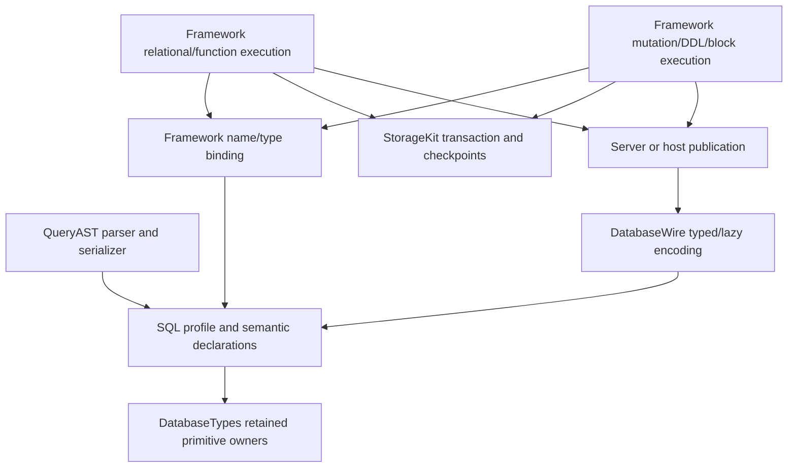

# SQL Basic Compatibility Profile

## Purpose and Scope

This component is the semantic authority for the accepted PostgreSQL 18 basic
SQL compatibility profile. Parent: [Query](../DESIGN.md). Children: none.
The feature inventory below is the complete implementation target, including
analysis queries, mutations, basic DDL, and one-request SQL blocks. A limited
SELECT implementation does not satisfy this profile.

Implementation and verification status is owned by the workspace
[PROGRESS.md](../../../../../PROGRESS.md). Full FoundationDB, Graph-enabled
Database WASM/Embedded and final URL-graph acceptance remain S18 evidence.
Interfaces explicitly labeled planned are not existing capabilities.
Inventory rows state required behavior, not current implementation completion.
The reference dialect is PostgreSQL 18; the accepted differential-server pin
is 18.6, verified by the harness before its evidence is accepted.

## Responsibilities and Boundaries

| Meaning or lifecycle | Owner |
|---|---|
| SQL profile, expression/statement/type/result meaning, intrinsic validation | DatabaseKit Query/SQL |
| Primitive bytes/scalars, canonical FieldValue, intrinsic primitive operations | DatabaseTypes |
| Parsing, source positions, canonical SQL serialization | Framework QueryAST |
| Catalog-dependent binding, overload selection, planning, evaluation, constraints, SQL catalog, schema generation, block execution | Framework execution components |
| Transactions, checkpoints, backend/Directory behavior | StorageKit |
| Bounded binary encoding, closed operation descriptors, lazy result pages | DatabaseWire |
| Invocation, response correlation, cancellation/transport adaptation | DatabaseClient |
| Dispatch, remote admission, publication and native hosting | DatabaseServer |
| Command parsing, typed rendering and application composition | DatabaseCLI and applications |

SQL schema is a logical namespace, not a Directory, Partition, tenant, Base,
placement, or authority boundary. SQL cannot widen principal/entity/field
permissions. Default v3 requests remain target-free; MultiBase-only v5 target
contracts remain compile-time gated. Physical backend choice does not select
the SQL dialect or bypass Framework SQL execution.

## Related Designs

| Design | Relationship | Contract Used | Summary | Cautions |
|---|---|---|---|---|
| [Query](../DESIGN.md) | parent | QueryIR, language separation, retained query values | Composes SQL with shared query contracts. | SQL changes do not redefine SPARQL. |
| [Model](../../Model/DESIGN.md) | coordinates with | declared field metadata and static wrapper conversion | Propagates rich SQL values through existing generic model adaptation. | Model owns public traversal/conformance changes. |
| [Schema](../../Schema/DESIGN.md) | coordinates with | descriptor admission, defaults, fingerprint and evolution | Keeps explicit SQL meaning attached to admitted fields. | Schema owns FieldSchema changes; matching object storage is insufficient. |
| [DatabaseWire](../../../DatabaseWire/DESIGN.md) | used by | deterministic bounded semantic encoding | Carries the profile's types, statements, diagnostics and results. | No generic DTO collection, eager page decode, or runtime version negotiation. |
| [QueryAST](../../../../../database-framework/Sources/QueryAST/DESIGN.md) | used by | parser and serializer language contract | Owns accepted text forms, positions and rejected syntax. | Parsing a built-in form does not imply an available execution capability. |
| [DatabaseEngine](../../../../../database-framework/Sources/DatabaseEngine/DESIGN.md) | used by | SQL binding and execution contracts | Executes this profile on the injected storage engine. | Authorization, work meters, clocks and lifecycle remain runtime-owned. |
| [QueryExecution](../../../../../database-framework/Sources/DatabaseEngine/QueryExecution/DESIGN.md) | coordinates with | retained rows and admission | Supplies footprint-first result construction. | SQL output must not detach from runtime reservations before publication. |
| [StorageKit](../../../../../storage-kit/DESIGN.md) | coordinates with | transaction/checkpoint/Directory guarantees | Supplies backend-neutral transactional effects. | SQL meaning does not migrate into storage contracts. |
| [SPEC](../../../../../SPEC.md) | system authority | placement, Partition, authority and publication | Fixes product invariants above this feature. | The profile cannot reinterpret these invariants. |

## Architecture



## Contracts and Invariants

### Current implementation facts

These observations track the S01 implementation. Behavioral specifications
identify their owners; completed execution evidence is recorded in the task's
progress record rather than inferred from test declarations.

| Observed current fact | Source or behavioral specification |
|---|---|
| DataType lists integer/numeric/string/time/JSON/array forms, but declarations alone do not establish runtime support. | [Expression](../Expression.swift) |
| SelectQuery has UInt64 limit/offset and shared SPARQL fields; QueryStatement has SELECT/INSERT/UPDATE/DELETE but no general SQL block or ordinary DDL cases. | [SelectQuery](../SelectQuery.swift), [QueryStatement](../QueryStatement.swift) |
| QueryParameter, Literal.queryValue and Wire QueryRow carry QueryValue; numeric display scale and explicit parameter declarations survive carriage. Literal.decimal remains the primitive exact-value form. | [QueryParameter](../QueryParameter.swift), [Literal](../Literal.swift), [QueryRow](../../../DatabaseWire/QueryRow.swift), [typed page tests](../../../../Tests/DatabaseWireTests/QueryTypedPageTests.swift) |
| Wire rows are positional and lazy; Kit-owned QueryColumn declares number/name/type/nullability independently of row count. | [QueryColumn](../QueryColumn.swift), [QueryRowPage](../../../DatabaseWire/QueryRowPage.swift), [ownership tests](../../../../Tests/DatabaseWireTests/QueryResultPageTests.swift) |
| Public executeSQL parses and binds but explicitly rejects non-SELECT statements; canonical responses preserve declared columns and positional cells. Name-based projection throws for ambiguous labels. | [DatabaseContext SQL entry](../../../../../database-framework/Sources/Database/DatabaseContext+SQL.swift), [SQL row tests](../../../../../database-framework/Tests/DatabaseTests/SQLRowExecutionTests.swift) |
| Existing expression SQL serialization maps case-insensitive regex to UPPER/LIKE; source serialization has non-SQL cases. | [SQL-generation implementation](MatchPattern.swift) |

### Accepted public semantic contracts

- Extend the existing DataType/QueryStatement/QueryIR owners rather than create
  a parallel SQL statement algebra. Represent SELECT/VALUES/set-operation
  bodies with CTEs and outer ordering/pagination, then add DML/DDL/block forms.
- The S01 query-domain value contract in DatabaseKit retains type and metadata
  that primitive FieldValue cannot express: numeric display scale, retained
  JSON lexical bytes, normalized JSONB, array dimensions/lower bounds, and a
  mixed month/day/time interval. Retain existing primitive representations;
  do not duplicate ByteString, ExactDecimal, UUID, or application field values.
- Query result columns are ordered declarations with stable position, name,
  SQL type, nullability and typmod. Duplicate names are valid. Cells are
  positional and their count equals column count. Columns survive zero rows.
  Dictionary access is an explicit convenience only when names are unambiguous.
- Parameters carry the same query value contract as expressions, persistence,
  and results, with explicit type or contextual inference. Primitive callers
  adapt explicitly without losing identity or metadata.
- Planned runtime entry points are executeStatement and executeSQLBlock in
  Framework, alongside the read-only SELECT facade. A Framework-owned statement result
  distinguishes rows, command count and schema change; a block result preserves
  statement order and is published only after authoritative close.
- DatabaseWire extends its existing positional row representation with these
  semantics and provides closed statement/block descriptors. v3/v5 boundaries
  are unchanged. Source, codecs, golden vectors and direct consumers migrate
  together; initial development does not require duplicate compatibility APIs.
- Planned SQL diagnostics preserve typed category, SQLSTATE classification,
  input location, target identifier and cause. Framework owns semantic errors;
  Wire owns malformed binary errors; neither owns the other's failure policy.

Every admitted built-in statement/operator/function must have an available
execution path. A parser or semantic case can be introduced before that path
only with explicit unsupported failure and the required incomplete marker at
the callable implementation branch; such a form remains incomplete in the
feature ledger. No placeholder, empty rows or synthetic success is permitted.

### Numeric and language invariants

| Concern | Contract |
|---|---|
| Integer types | Preserve smallint/integer/bigint bounds, promotion and result type; integer division truncates according to PostgreSQL. Overflow remains an error. |
| Bounded numeric | Finite normalized coefficient at most 38 decimal digits. Explicit precision 1–38 and typmod scale −1000…1000. Round before typmod overflow validation. |
| Scale distinctions | Canonical ExactDecimal scale, declared typmod scale and observable display scale are distinct. Do not reject a canonical exponent solely because it falls outside typmod-scale limits. |
| Numeric operations | Primitive exact division remains exact. Add pure bounded arithmetic accepting explicit output scale/rounding; Framework chooses SQL scale/rounding rules. |
| Numeric intermediates | Use bounded wider multiplication/division workspace and exact limb aggregate accumulation. Reject only the final out-of-profile result or an admitted workspace limit; a representable AVG must not fail solely because intermediate SUM exceeds 38 digits. |
| Float | Preserve real versus double precision, finite values and their overload behavior. SQL nonfinite values are explicit unsupported input in this profile. |
| Equality | SQL joins, grouping, DISTINCT, set operations and SQL indexes use one bound SQL equality/collation contract. Display scale does not create numeric inequality. |
| Language boundary | SQL NULL/coercion/numeric/order rules do not replace RDF term identity, SPARQL unbound/error semantics, datasets, aggregate or ordering contracts. |

### S01 frozen value and persistence interfaces

S01 implements lossless carriage, declared persistence adaptation and output
typing for already-admitted expressions. It does not implement later JSON,
array, interval, numeric arithmetic functions or SQL DDL. Constructors and
codecs must validate the complete values before publishing them; later
expression support cannot be used to excuse a lossy S01 round trip.

| Implemented type/case | Stored properties and validation |
|---|---|
| `QueryValue` | `.primitive(FieldValue)`, `.numeric(QueryNumericValue)`, `.json(QueryJSONValue)`, `.jsonb(QueryJSONBValue)`, `.array(QueryArrayValue)`, `.interval(QueryIntervalValue)`. Only `.primitive(.null)` means SQL NULL. |
| `QueryNumericValue` | `value: ExactDecimal`, `displayScale: Int32`; throwing initializer enforces at most 38 coefficient digits, `0...16383` display scale and no hidden significant fractional digits (`displayScale >= max(0, value.scale)` for a nonzero value). Zero retains its requested displayScale. Typmod is not stored in this value. |
| `QueryJSONValue` | `bytes: ByteString`; throwing initializer validates one complete UTF-8 JSON value and retains the original owner, whitespace, key order and duplicate members. No numeric conversion is required for lexical JSON. JSON `null` remains a JSON value, distinct from SQL NULL. |
| `QueryJSONBValue` | `root: QueryJSONBNode`; input parsing normalizes object keys/duplicates and validates JSONB semantics. It retains numeric display scale. A constructor from a normalized node validates canonical order instead of silently repairing malformed persisted/Wire data. |
| `QueryJSONBNode` | Non-indirect closed `.null`, `.bool(Bool)`, `.string(String)`, `.number(QueryNumericValue)`, `.array(QueryJSONBElements)`, `.object(QueryJSONBMembers)`. Collection payloads are immutable views into one flat owner, never arrays of recursively owned nodes. QueryJSONBMember contains `key: String`, `value: QueryJSONBNode`. Members are unique and ordered by UTF-8 byte length, then unsigned byte order; textual duplicate keys keep the last input value. |
| `QueryArrayDimension` | `lowerBound: Int32`, `length: Int32`; nonempty dimensions have positive length and a checked Int32 upper bound. |
| `QueryArrayValue` | `elementType: DataType`, `dimensions: [QueryArrayDimension]`, flat row-major `elements: [QueryValue]`; zero dimensions and zero elements are the one empty form. Nonempty arrays have at most six dimensions. Checked product equals element count. Element type is a resolved non-array SQL type; cells are NULL or exactly compatible with it. Nested array cells are not a substitute for dimensions. |
| `QueryIntervalValue` | `period: CalendarPeriod`, `time: TimeSpan`; preserves months, days and elapsed time without converting between components. Throwing initializer requires Int32 months/days and elapsed time exactly representable as Int64 microseconds. Existing primitive nanosecond/Int64 calendar representations are not changed. |

Numeric displayScale is separate from the precision/scale bounds on declared
typmods: PostgreSQL's stored dscale supports 14 bits, whereas the public typmod
scale is limited to −1000…1000. Formatting uses checked output-byte admission
before expanding an exponent or display scale. This is value metadata
validation, not an instruction to allocate a padded decimal string. See the
[PostgreSQL numeric implementation](https://raw.githubusercontent.com/postgres/postgres/REL_18_STABLE/src/backend/utils/adt/numeric.c).

JSON lexical validation accepts syntactically valid Unicode escape sequences
without decoding every escape; JSONB rejects escaped U+0000, unpaired surrogate
escapes and numeric values outside this profile. Invalid raw UTF-8 and trailing
input fail for both. JSONB numbers retain trailing fractional zeros while SQL
numeric equality ignores them, as required by the
[PostgreSQL JSON specification](https://www.postgresql.org/docs/18/datatype-json.html).
Canonical member order follows
[lengthCompareJsonbString/uniqueifyJsonbObject](https://raw.githubusercontent.com/postgres/postgres/REL_18_STABLE/src/backend/utils/adt/jsonb_util.c).
Primitive FieldObject ordering is not the JSONB member ordering contract.

#### Flat JSONB ownership and construction

The deep-value lifecycle contract includes destruction as well as parsing,
comparison and persistence. The previous indirect enum recursively destroyed
admitted depth-4096 values; a larger process stack or an arbitrary depth ceiling
does not discharge this contract. The replacement has these exact interfaces:

| Interface | Contract |
|---|---|
| `QueryJSONBElements` | Public immutable Sendable RandomAccessCollection, Index Int and Element QueryJSONBNode, zero-based indices. Stores one immutable owner and an element-index range. Its subscript creates a scalar value or another bounded view without copying a subtree. No public array-literal conformance or mutable storage access. |
| `QueryJSONBMembers` | The corresponding public immutable collection with Element QueryJSONBMember. A member's node view retains the owner as required. |
| `QueryJSONBNode.array(_:limits:)` | Public throwing overload accepting `[QueryJSONBNode]` and explicit QueryValueLimits. Iteratively copies caller-owned logical subtrees into one new owner, admitting counts and preserving order. Before reading a child or pushing a copy-parent frame, checks the prospective output node count and depth, including the enclosing factory root and all visited but not yet appended ancestors. A deep existing input cannot allocate an unadmitted temporary descent stack. Throws QueryValueError; it grants no runtime reservation. |
| `QueryJSONBNode.object(_:limits:)` | Corresponding overload accepting `[QueryJSONBMember]`; validates unique canonical key order rather than silently normalizing arbitrary callers. |
| `QueryJSONBNode.storageFootprint` | Public QueryJSONBStorageFootprint with UInt64 nodeCapacity, elementIndexCapacity, memberCapacity, retainedStorageByteCount and utf8ByteCount. It separates actual backing-array capacities and their checked retainedStorageByteCount from retained string content. It measures the whole retained owner, including unreachable records left by duplicate-key normalization, not merely the visible subtree. Scalars have no flat owner. String content size is not a claim about physical String capacity. |
| `QueryJSONBStorageFootprint.storageByteCount(nodeCapacity:elementIndexCapacity:memberCapacity:)` | Public checked, allocation-free byte calculation for explicitly chosen capacities using Kit-owned record layouts. Logical counts do not predict capacities selected by Swift Array growth. |
| `QueryJSONBBuilder.init(limits:)` | Public task-local mutable builder from S07. Resource limits are explicit; construction confers no ambient runtime authority. |
| `QueryJSONBBuilder.append(_:)` | Public throwing scalar append returning Int node ID; composite inputs are rejected. |
| `QueryJSONBBuilder.appendArray(_:)` | Public throwing `[Int]` child-ID append returning the new node ID. |
| `QueryJSONBBuilder.appendObject(_:)` | Public throwing `[QueryJSONBIndexedMember]` append, where each indexed member has immutable key String and value Int. Canonical keys and child ownership are checked. |
| `QueryJSONBBuilder.finish(root:)` | Public consuming throwing operation returning QueryJSONBNode. A root ID must identify the last completed record. Invalid IDs, repeated parent ownership, noncanonical members or incomplete construction are typed QueryValueError.nonCanonicalJSONB failures. |

The immutable storage owns only raw scalar/container records, integer child
indices and key/index member records. It stores neither QueryJSONBNode nor
another storage owner. Container records reference earlier completed records;
child IDs acquire at most one parent. Consequently ownership has no recursive
RC chain or arena cycle. Destruction releases a fixed number of flat arrays.
Parser, Wire and declared field decoding append IDs into this builder instead
of repeatedly invoking public composite factories. Each production node/edge
is appended once; textual object sorting retains its existing key-order cost.
Parser duplicate handling may leave admitted unused records; full-owner
retention measurement includes them, while equality, hashing and logical
node/depth measurement visit only the canonical root. All traversals use
iterative cursor continuations bounded by nesting rather than width.

Builder checks prospective node, collection, depth and UTF-8 content counts
before appending. Backing-array capacity is observed from actual Swift arrays;
requested count is never reported as physical capacity. These representation
counts and actual retained capacities remain separate from Framework's platform
allocation policy and reservations. Builder finish checks actual retained buffer
bytes plus string content against its admitted retained-byte limit before
exposing a root. Public measurement uses that same combined amount. Framework
reserves conservatively from prospective logical requirements and its owned
capacity policy, then reconciles actual footprint before publication; unknown
physical String capacity is never replaced by an equality claim about content.
A child collection view retains the entire
owner; independent public values conservatively charge each retained reference.
Known-source runtime leases may share that origin without claiming universal
physical deduplication. No DatabaseTypes representation is changed.

All public value properties are immutable. Typed initializers, Wire decoding,
field decoding and expression binding use the same intrinsic validator, with
`QueryValueLimits` explicitly bounding retained bytes, total nodes, nesting
depth and collection elements. Limits are supplied by the admitting boundary;
runtime work-meter reservations remain Framework-owned. Checked counts and
dimensions are verified before allocation; formatting/parsing cannot evade
limits through exponent expansion or escaped characters.

Public QueryValue validation and measurement conservatively count known retained
capacity for every byte reference. They do not claim unique physical allocation
or deduplicate aliased backing owners. A bounded slice retains its complete
known owner capacity; unknown retained capacity is a typed
unknownRetainedByteCount failure wherever a retained-byte bound is being proven.
Visible slice length is never substituted for unknown physical retention.
Callers may explicitly detach/copy into a self-contained ByteString instead.

DatabaseWire may use a package-limited assembly path for values decoded from
one admitted root frame. The codec first admits that root's known retention
once, then separately admits views, new UTF-8 allocations, nodes, depth and
collection elements. Array assembly uses the same intrinsic shape/type checks
as public construction but does not repeat the conservative per-reference
capacity sum after those codec ledgers have admitted the input. This path is
only for codec-created children of that root, has no public bypass, and does
not change subsequent public measurement into a physical deduplication claim.
Framework similarly shares an admitted source-payload lease for known origins;
independent caller roots retain the conservative public contract.
The package-only entry is
`QueryArrayValue.init(admittedElementType:dimensions:elements:) throws(QueryValueError)`.
It shares validateShapeAndTypes with public construction. Individual lexical
JSON values retain their public constructor and known-root capacity check;
there is no JSON-validation bypass. Wire's root gate rejects unknown or
oversized physical retention before children reach this entry.

#### Exact declared persistence adaptation

The chosen adaptation preserves the existing primitive persistence traversal.
It does not require Kit to call a Framework codec or let a primitive object
silently acquire SQL meaning.

| Planned interface/change | Contract |
|---|---|
| Schema query descriptor | Consume the [Schema-owned optional descriptor and identity contract](../../Schema/DESIGN.md#contracts-and-invariants) to select rich field interpretation. |
| Static model adaptation | Consume [Model-owned Field metadata and conformance propagation](../../Model/DESIGN.md#contracts-and-invariants) through existing generic field traversal. |
| Rich scalar wrappers | QueryNumericValue, QueryJSONValue, QueryJSONBValue and QueryIntervalValue provide the corresponding unconstrained SQL DataType and the declared storage-adapter conversions consumed by Model. QueryLiteralConvertible produces Literal.queryValue. |
| `QueryArrayElement` | Static `queryDataType: DataType`, throwing `queryValue` getter and `static decodeQueryValue(_:) throws(QueryValueError) -> Self`. Primitive scalar and rich scalar conformances supply a resolved, non-array type; it is a statically specialized model-adaptation protocol, not a runtime registry. |
| `QueryArray<Element: QueryArrayElement>` | Typed array wrapper holding dimensions and flat optional elements, declaring `.sql(.array(Element.queryDataType))`. Converts to/from QueryArrayValue with identical shape/type checks. Model and Schema own its persisted-field admission; runtime-erased QueryArrayValue is not a model field. |
| `QueryFieldStorageAdapter` | Pure Kit static operations `encode(_:type:limits:) -> FieldValue` and `decode(_:type:limits:) -> QueryValue`, throwing QueryValueError. Type is the declared QueryColumnType; plain object/bytes content is never inspected to guess a wrapper. |
| `QueryFieldStorageAdapter.measure(_:type:)` | Checked iterative traversal returning QueryFieldStorageFootprint for the exact envelope that encode will construct. Measurement owns a bounded temporary worklist; it does not materialize the destination envelope, format numeric text, decode lexical JSON into a tree or obtain runtime authority. |
| `QueryFieldStorageAdapter.measureDecoded(_:type:)` | Returns QueryFieldDecodedFootprint without materializing the destination: logical value nodes, collection elements, depth, UTF-8 content, and aggregate JSONB node/element-index/member requirements. Its minimumJSONBStorageByteCount uses logical counts as capacities only to compute a layout minimum, not an actual capacity forecast. |

The adapter preserves primitive values unchanged for `.primitive` descriptors.
For rich SQL descriptors it produces a declared FieldObject envelope with a
closed `kind` tag and exact payload; decode requires the matching declaration,
tag, exact fields and intrinsic value validity. There is no permissive unknown
tag, extra-key, old-layout or missing-metadata fallback. The pure conversion is
Kit model adaptation; actual persistence bytes remain the Framework primitive
storage codec's responsibility.

| Envelope kind | Exact payload meaning |
|---|---|
| `numeric` | `value` is primitive ExactDecimal and `displayScale` is Int32. |
| `json` | `bytes` retains the validated original ByteString. |
| `jsonb` | `nodes` is a flat array of prefix node records; the first record is the implicit root. Scalar records retain existing kind/value/displayScale meanings. Array records carry exact child count; object records carry canonical ordered keys, one for each following child subtree. Decoding consumes exactly all records and declared child counts, rejecting extras or truncation. Physical FieldValue nesting is constant regardless of logical JSON depth. |
| `array` | `dimensions` is ordered `{lowerBound, length}` entries and `elements` is a flat array of declared element adaptations, with SQL NULL represented by primitive null. The array element type comes from the field declaration, not row contents. |
| `interval` | `months`/`days` are Int32, `microseconds` is Int64; conversion back to existing calendar/time primitives is checked and exact. |

Each envelope has exactly `kind` plus the named payload fields. The JSONB
`nodes` array is nonempty and stores exactly one depth-first prefix tree:

| Record kind | Exact fields and meaning |
|---|---|
| `null` | `kind` only; JSON null remains distinct from SQL NULL. |
| `bool` | `kind`, `value: FieldValue.bool`. |
| `string` | `kind`, `value: FieldValue.string`. |
| `number` | `kind`, `value: FieldValue.decimal`, `displayScale: FieldValue.int32`. |
| `array` | `kind`, `childCount: FieldValue.uint64`; exactly that many following child subtrees. |
| `object` | `kind`, `keys: FieldValue.array` of primitive strings in canonical unique JSONB key order; one following child subtree per key, in the same order. |

Reference indices and old recursive layouts are not admitted. Unknown, missing,
extra or mismatched fields, invalid key order, impossible child counts,
truncated subtrees and trailing records fail explicitly. Array element
adaptation uses the declared DataType. Schema consumes these same envelopes
for its default-validation contract; optional outer NULL remains primitive
null. Schema's evolution contract governs descriptor changes.

The [Model-owned static conversion flow](../../Model/DESIGN.md#runtime-flows)
calls this adapter for wrapper values, selected fields and defaults. Framework
SQL projection/read/update consumes the
[Schema-owned admitted descriptor](../../Schema/DESIGN.md#contracts-and-invariants),
and never treats the declared envelope as a user JSON/object. Schema owns
Directory/index admission and descriptor changes; this component supplies the
rich type/value validation consumed there.

#### Failure model and type boundaries

QueryValueError is the one intrinsic failure enum for these operations, with
distinct cases for invalid display scale, coefficient range, malformed JSON
(byte offset/reason), invalid UTF-8, noncanonical JSONB, invalid dimension count,
invalid dimension/upper bound, dimension product overflow, element count,
element type, incompatible declared type, invalid column numbering,
missing/invalid persistence descriptor or envelope, and value-resource limit.
Model's error contract preserves the typed query adaptation cause through
persisted-field conversion; it cannot silently remove metadata.
Wire maps these to its typed malformed-value errors while retaining the cause;
Framework maps to its semantic diagnostics. Array and JSONB validation reports
the failing element/member path within the bounded input.

The frozen constructor and adapter spellings are:

```swift
QueryNumericValue.init(value: ExactDecimal, displayScale: Int32)
QueryJSONValue.init(bytes: ByteString, limits: QueryValueLimits)
QueryJSONBValue.init(json: QueryJSONValue, limits: QueryValueLimits)
QueryJSONBValue.init(root: QueryJSONBNode, limits: QueryValueLimits)
QueryArrayDimension.init(lowerBound: Int32, length: Int32)
QueryArrayValue.init(elementType: DataType, dimensions: [QueryArrayDimension],
                    elements: [QueryValue], limits: QueryValueLimits)
QueryIntervalValue.init(period: CalendarPeriod, time: TimeSpan)
QueryArray<Element>.init(dimensions: [QueryArrayDimension], elements: [Element?],
                         limits: QueryValueLimits)
QueryFieldStorageAdapter.encode(_ value: QueryValue, type: QueryColumnType,
                                limits: QueryValueLimits) -> FieldValue
QueryFieldStorageAdapter.decode(_ value: FieldValue, type: QueryColumnType,
                                limits: QueryValueLimits) -> QueryValue
```

The throwing operations above use QueryValueError. These are the implemented
S01 interfaces. QueryValueLimits
has immutable UInt64 maximumRetainedBytes, maximumTotalNodes,
maximumNestingDepth and maximumCollectionElements, with an initializer requiring
all four. The admitting runtime or codec derives limits from its existing budget
and limits; value construction does not silently choose a larger budget.
QueryArrayElement requirements include Sendable, retain no metatype in values,
and return primitive/rich representations without inferred element schemas.

Existing FieldValueEncodable/FieldValueDecodable methods have no execution
budget argument. Their wrapper conformances perform intrinsic conversion under
checked structural bounds derived from the already-owned input/value footprint,
without a global/unlimited fallback or stored runtime reservation. Runtime
catalog conversion calls the explicit limits-taking adapter before admitting
the value; typed model destinations independently pre-admit the resulting
footprint. Thus the model conformance cannot authorize a larger runtime budget,
and the no-budget protocol does not force a Kit dependency on Framework state.

QueryFieldStorageFootprint records checked UInt64 scalar/value node count,
object-entry count, array-element count, newly materialized UTF-8 byte count,
retained byte-view count/length and maximum depth. It describes the adapter's
representation, not platform allocator size or a reservation. Measurement owns
an explicit temporary worklist with at most one continuation per active input
container and one current child. Children are scheduled individually after node,
depth and collection checks; workspace growth is bounded by the admitted input
nodes and depth rather than collection width. This temporary traversal allocation
is not a destination envelope allocation and is released when measurement returns
or throws. JSONB field encoding writes shallow prefix records and decoding uses
the intrinsic flat builder. The complete destination footprint is admitted before
assembly; traversal descends one child at a time and preserves declared member
order and exact closed node layouts. The encoded FieldValue and decoded JSONB
owners both have nonrecursive destruction. Adapter inferred limits include the
prospective decoded arena records, edges, members and UTF-8 content in addition
to the encoded envelope shape. Its decode-footprint measurement reports those
destination counts without materializing that arena; Framework pre-admits them
using its existing platform allocation policy before conversion. Workspace is
bounded by admitted input nodes and depth, with no guessed platform-safe
recursion limit. Framework selects a logical layout allowance before construction
and reconciles the resulting actual storageFootprint before publication; allocator
internal overhead and exact physical peak are not claimed by these counts. Pure
payload-derived limits provide a checked allowance of twice the logical JSONB
storage layout plus the retained envelope and UTF-8 content. This is a finite
policy allowance, not a prediction of Swift Array capacity; builder finish rejects
an actual retained owner exceeding that allowance before returning it. S08 applies
the same checked twice-layout allowance to persisted scalar-element SQL arrays:
the prospective decoded footprint reports value records, child indices,
dimensions and the independent scalar type record without constructing the
destination. Its minimumQueryValueStorageByteCount includes the corresponding
flat value/type buffer containers. This preserves existing array persistence
under the new structural owner; composite descriptors remain rejected. Pure no-budget model measurement derives its finite
workspace from the already-owned structure; runtime admission remains the caller's
responsibility. Primitive byte payloads and lexical JSON retain the same ByteString
owner; measure records that retention separately from new destination allocations. Framework combines
these counts with its existing platform/layout/capacity footprint calculation,
pre-admits the destination, then calls encode. Encoding uses that same traversal
and capacity policy, so measurement cannot omit recursively tagged JSONB nodes,
dimension arrays, element envelopes or metadata strings. Exact/one-past logical
node, collection and depth budgets reject growth before its allocation. Actual
Swift Array capacities are reconciled against admitted retained-storage budgets
before publication; allocator-internal bytes are outside these representation
counts. Known byte-owner source retention is admitted before conversion. Failure
after actual-capacity reconciliation releases the unpublished destination and its
claims. User-owned pure
model encoding has no Framework meter; invoking it inside a runtime path is
permitted only after the runtime's admission. No constructor limit, footprint
value or static conformance itself grants work-meter admission.

An explicit cast/adaptation is required to drop rich metadata. The explicit
name-keyed result/model projection rejects duplicate names, unrepresentable
rich values and incompatible types. No first/last-wins dictionary projection,
missing-cell-to-NULL rule, first-row type inference or `.unknown` output type
is part of S01. The existing SQL syntax needs a type binder for its admitted
columns/literals/casts/operators/functions/aggregate/CASE/subquery forms even
when zero rows are produced; S03 extends that same binder later.

S01 also closes the actual existing SQL-generation boundary in
[MatchPattern.swift](MatchPattern.swift): Literal.toSQL and its reachable
expression/source/query/graph generators become throwing. Add
`QueryLiteralConversionError.unsupportedSQLLiteral` to the existing Kit-owned
conversion error; preflight rejects numeric/json/jsonb/array/interval rich
QueryValue alternatives anywhere in a generation request before producing SQL
text, and propagates the typed failure to current Framework builder callers.
Literal.queryValue(.primitive(value)) explicitly delegates through the existing
lossless FieldValue-to-Literal conversion and its existing SQL literal path;
unsupported primitive conversion remains a typed error. It cannot strip
metadata from a rich alternative to obtain that primitive path.
Literal.description remains diagnostic and is not a SQL
serialization fallback. This is narrow safety for S01's new value case, not
implementation of its later SQL literal syntax or S02 serializer consolidation.

#### S01 falsifiable case IDs

| Case ID | Required behavior and counterexample rejected |
|---|---|
| S01-C01 | Public SQL `SELECT 1 AS x, 2 AS x` returns ordered columns 1/2 and cells 1/2. Name projection fails as ambiguous; duplicate names themselves succeed. |
| S01-C02 | Zero-row projection of typed NULL and BIGINT retains both ordered types/nullability. An explicitly BIGINT parameter containing NULL, and an explicitly typed empty-array parameter, retain their declarations after parameter replacement and Wire IR round trip. Nonempty NULL result carries the same declarations; no first-row inference is possible. |
| S01-C03 | Join/derived relation duplicates preserve all slots and qualified lookup; unqualified ambiguous lookup fails before execution. |
| S01-C04 | QueryNumericValue canonical `1` with displayScale 2 and zero with nonzero scale survive literal/parameter, model insert/reload/update, SQL projection and Wire round trip. Negative/16384 dscale, hidden fractional digits and 39-digit coefficient fail. |
| S01-C05 | JSON whitespace/key order/duplicates remain byte-identical through all boundaries; JSON null differs from SQL NULL. Invalid UTF-8, trailing tokens, incomplete escapes and depth/byte limits fail. |
| S01-C06 | JSONB duplicate keys last-win, length-first/bytewise key order, numeric trailing zeros, nested JSON null and normalized tree survive all boundaries. Invalid surrogate/U+0000, noncanonical persisted members, nonfinite/out-of-range numbers fail. |
| S01-C07 | Typed multidimensional array with negative/non-1 lower bounds and NULL elements survives literal/parameter, model persistence, projection and Wire. Empty array type survives zero cells. Wrong element type, count/product/upper-bound overflow and seventh dimension fail. |
| S01-C08 | Mixed-sign month/day/time interval survives all boundaries without component normalization. Month/day overflow, nonmicrosecond time or elapsed-microsecond overflow fail. |
| S01-C09 | Declared wrapper schema, generated Field metadata, default, selected-field encode, persisted model decode and SchemaManifest retain queryType. Plain object/bytes resembling envelopes remain primitive; mismatched/extra/missing/unknown envelope fields fail. |
| S01-C10 | First, continuation and zero-row pages preserve identical columns/values across actual server/client/CLI mapping; no row-derived schema reconstruction. |
| S01-C11 | Lazy Wire query values/columns survive source-frame scope, preserve one retained byte owner and reject unknown tags, arity/type mismatch, truncation, trailing input and exact/one-past budgets. Encoded-page validation checks grammar, intrinsic values, logical/UTF-8 limits and known frame retention in place. Fallible iterator row materialization reconciles actual flat-owner capacity before returning a row; a resource failure returns no partial row. It does not eagerly build/discard future arenas or expand quota. See [Wire ownership phases](../../../DatabaseWire/DESIGN.md). Two known slices of one root demonstrate conservative public per-reference capacity versus codec root-once admission. Unknown capacity is explicitly rejected, never replaced by visible length. |
| S01-C12 | Framework lexical/array/JSONB values and columns retain reservations through admitted construction and required resource close. Retained Ready/Server paths keep claims until last-owner release or explicit consuming final transfer. Complete public materialization becomes caller-owned after that transfer and ends runtime claims. Failure/cancel release all claims. Exact/one-past logical node, collection and depth growth rejects before allocation; known byte-owned source retention is pre-admitted. Actual full-owner Swift Array capacity is reconciled before publication, with allocator internals excluded rather than guessed. Reconciliation failure releases the unpublished value and all claims. |
| S01-C13 | Existing primitive persistence identity/bytes, RDF terms/SPARQL NULL-unbound semantics, and standard v3 versus MultiBase v5 target/provenance contracts regress without adopting SQL equality. |

S01-C04–C08 each exercise both a rich literal and a rich parameter and at least
one generated @Persistable model, not manually fabricated storage envelopes
alone. S01-C09 additionally checks schema evolution/fingerprint distinguishes
the same primitive storage kind with different query descriptors. S01-C11 uses
codec golden/malformed inputs; S01-C10 uses actual public invocation. Every case
is pending until its owning runtime test executes successfully.
S01-C09 additionally rejects ordinary `[RichWrapper]` and optional variants via
the single static metadata-forwarding path. S01-C04–C08 include direct and
nested toSQL attempts, each failing with unsupportedSQLLiteral instead of
emitting diagnostic descriptions, partial SQL or placeholders.

### Complete feature inventory and acceptance obligations

Each stable ID owns a success case, an explicit failure case and a boundary
case. The final column records distinguishing evidence that must reject an
incorrect implementation; function rows apply this obligation to every named
function and admitted overload. The rows are requirements, not completion
checks. Test completion and commits are recorded only in workspace PROGRESS.md.

#### Lexical forms and SQL generation

| ID | Required capability | Distinguishing acceptance |
|---|---|---|
| L01 | Unquoted lowercase identifiers, double-quoted identifiers and doubled quotes, qualification and reserved-word distinction | Case-sensitive quoted lookup, folded unquoted lookup, escaped quote, ambiguous/undefined name. |
| L02 | Ordinary, E, Unicode-escape and dollar-quoted strings | Literal bytes/codepoints preserved; invalid escape and unterminated delimiter fail with position. |
| L03 | Integer/decimal/exponent literals with PostgreSQL type selection | Exact exponent decimal without Double intermediate; range boundary and one-past failure. |
| L04 | DATE/TIME/TIMESTAMP/INTERVAL/UUID/BYTEA/ARRAY/ROW typed literals | Correct type/value and invalid lexical/type/shape rejection. |
| L05 | $n parameters plus product :name and ? forms | Contextual/explicit type, every expression position, missing/conflicting type rejection. |
| L06 | Nested comments, statement separators, multi-statement input and positioned diagnostics | Semicolon in every quoted form stays inside a value; malformed tail/comment is rejected. |
| L07 | CAST and ::, aliases and typmods | Equivalent bound types; invalid precision/scale/length/temporal precision rejected. |
| L08 | One canonical serializer in QueryAST | Parse/serialize/parse meaning preserved with identifiers, precedence, CTE hints and LATERAL; unsupported source or cross-language expression is a typed error. |

#### Retrieval and relational/analytic syntax

| ID | Required capability | Distinguishing acceptance |
|---|---|---|
| Q01 | SELECT columns/expressions, implicit aliases, table.*, mixed wildcards | Column order, duplicate names, zero-row types and no-FROM singleton relation preserved. |
| Q02 | Schema-qualified tables, column aliases, comma/parenthesized joins, derived tables, VALUES and table functions | Alias scope/arity, empty sources and absent relation errors. |
| Q03 | INNER/LEFT/RIGHT/FULL/CROSS/NATURAL/USING joins, optional OUTER, LATERAL | Required conditions, USING column merge/order, NULL extension, empty side and correlated lateral rows. |
| Q04 | Comparisons/logical/IN/BETWEEN, truth/unknown predicates, IS DISTINCT FROM, ANY/SOME/ALL, ROW comparison | Three-valued logic, NOT IN with NULL, empty quantified set, mixed row NULLs and incompatible types. |
| Q05 | Simple/searched CASE, COALESCE, NULLIF, GREATEST, LEAST | Common type resolved before execution; an unselected failing branch is not evaluated. |
| Q06 | Scalar/IN/EXISTS and correlated subqueries | Column count/type, scalar multirow cardinality error, empty result/NULL and lexical scope. |
| Q07 | SELECT ALL, DISTINCT, DISTINCT ON | SQL equality and collation, ORDER BY restrictions and correct selected row with duplicates. |
| Q08 | UNION/INTERSECT/EXCEPT with ALL/DISTINCT | Operator precedence, multiplicities, common type, NULL equality and outer ORDER/LIMIT. |
| Q09 | ORDER BY expression/alias/ordinal/multiple keys/collation | PostgreSQL name-resolution priority and default NULL order; invalid ordinal/ambiguity fails. |
| Q10 | LIMIT/OFFSET expressions and parameters, LIMIT ALL/NULL, FETCH FIRST/NEXT and WITH TIES | Legal clause order, negative/overflow input, tied final peer group and empty page. |
| Q11 | GROUP BY/HAVING aliases/ordinals/key functional dependency, GROUPING SETS/ROLLUP/CUBE/GROUPING | Empty grouping set, duplicate groups, GROUPING bits and invalid nongrouped projection. |
| Q12 | Nonrecursive CTEs, column aliases, MATERIALIZED/NOT MATERIALIZED | All public entry points, lexical visibility/shadowing, arity and materialization/volatility behavior. |
| Q13 | Recursive CTEs, UNION/ALL, SEARCH and CYCLE | Working table progression, duplicate/cycle behavior, search ordering and frontier/iteration cancellation limits. |
| Q14 | OVER/named WINDOW, PARTITION/ORDER, ROWS/RANGE/GROUPS, bounds and EXCLUDE | Peer groups, default frame, empty frame, invalid frame bound and type constraints. |
| Q15 | UNNEST/GENERATE_SERIES, WITH ORDINALITY, table functions and LATERAL | Output column/type/ordinality, correlated inputs, direction/zero-step failures and bounded generation. |

#### Types and type resolution

| ID | Required capability | Distinguishing acceptance |
|---|---|---|
| T01 | smallint/integer/bigint bounds, operation result/promotion and integer division | Width boundaries, min-value negation/division overflow and CAST assignment errors. |
| T02 | Bounded numeric, division/AVG/SUM/rounding/precision/scale | Repeating quotient, negative scale, rounding carry, large intermediate AVG and final 38-digit overflow. |
| T03 | real/double precision, implicit casts, rounding, comparison and aggregates | Correct result type, representable boundary, underflow/overflow and finite-only rejection. |
| T04 | Boolean, typed NULL and SQL three-valued logic | Empty ANY/ALL, NULL-safe comparison, typed empty columns and short circuit. |
| T05 | text/char/varchar lengths, space rules and C/POSIX collation | Character versus byte lengths, explicit cast truncation versus assignment failure, trailing-space equality. |
| T06 | BYTEA/UUID lexical forms, input/output/CAST/comparison | Invalid byte encoding/UUID, bytewise ordering, retained owner and round trip. |
| T07 | date/time/timestamp/timestamptz precision, timezone and arithmetic | Leap/day bounds, UTC/fixed/IANA zones, DST transition, missing-zone failure and no offset loss. |
| T08 | One interval value retaining months/days/time | Mixed signs/components, month-end arithmetic, comparison/cast and interval range error. |
| T09 | Typed multidimensional arrays, lower bounds, index/slice/comparison/containment/overlap/concat | Non-1 lower bounds, empty/NULL arrays, rectangularity and dimension overflow. |
| T10 | JSON lexical preservation and normalized JSONB | Duplicate keys, input order/whitespace, SQL NULL versus JSON null, malformed input and retained-byte round trip. |
| T11 | Unknown literals, parameter inference, operator/function overload, assignment casts and common types | Ambiguous/undefined overload rejection; common type in CASE/set operations before zero-row execution. |
| T12 | Shared SQL equality across JOIN/GROUP/DISTINCT/set/index paths | Equal cross-numeric values and NULL groups agree; index lookup matches scan for admitted collation. |

#### Functions and operators

| ID | Required function/operator names | Distinguishing acceptance |
|---|---|---|
| F01 | CASE, COALESCE, NULLIF, GREATEST, LEAST | Type/NULL rules and evaluation only of required branches. |
| F02 | ABS, SIGN, CEIL/CEILING, FLOOR, ROUND, TRUNC, DIV, MOD, POWER, SQRT, CBRT, EXP, LN, LOG/LOG10, GCD, LCM, WIDTH_BUCKET, SCALE, MIN_SCALE, TRIM_SCALE | Integer/numeric overload and return type; numeric math avoids float demotion; domain, zero-divisor, rounding and width boundaries. |
| F03 | PI, DEGREES, RADIANS, SIN, COS, TAN, ASIN, ACOS, ATAN, ATAN2 | Float overload and finite error contracts; admitted numeric overloads stay decimal. |
| F04 | LOWER, UPPER, LENGTH, CHAR_LENGTH/CHARACTER_LENGTH, OCTET_LENGTH, BIT_LENGTH, SUBSTRING/SUBSTR, POSITION/STRPOS, TRIM/BTRIM/LTRIM/RTRIM, CONCAT/CONCAT_WS, REPLACE, TRANSLATE, SPLIT_PART, LEFT, RIGHT, LPAD, RPAD, REPEAT, REVERSE, ASCII, CHR | Unicode character positions, bytes versus characters, negative/empty inputs, NULL and output-byte limits. |
| F05 | LIKE/ILIKE and NOT forms, ESCAPE, SIMILAR TO, ~/~*/!~/!~*, REGEXP_LIKE, REGEXP_MATCH, REGEXP_MATCHES, REGEXP_REPLACE, REGEXP_SPLIT_TO_ARRAY/TABLE | Wildcards/escape versus regex semantics, flags/captures/global rows, unsupported ARE syntax and regex resource bounds. |
| F06 | ENCODE, DECODE, GET_BYTE, SET_BYTE, GET_BIT, SET_BIT; BYTEA length/subsequence/concat | Encoding validity, bit numbering, byte/bit offsets and immutable source preservation. |
| F07 | CURRENT_DATE/TIME/TIMESTAMP, LOCALTIME/LOCALTIMESTAMP, NOW, TRANSACTION_TIMESTAMP, STATEMENT_TIMESTAMP, CLOCK_TIMESTAMP, EXTRACT/DATE_PART, DATE_TRUNC, DATE_BIN, AGE, MAKE_DATE/TIME/TIMESTAMP/TIMESTAMPTZ/INTERVAL, AT TIME ZONE, TO_CHAR, TO_DATE, TO_TIMESTAMP | Controlled clocks/zone data, transaction versus statement time, format directives, invalid format/range/zone and DST. |
| F08 | ARRAY_LENGTH/LOWER/UPPER/NDIMS/DIMS, CARDINALITY, ARRAY_APPEND/PREPEND/CAT, ARRAY_POSITION/POSITIONS, ARRAY_REMOVE/REPLACE, ARRAY_TO_STRING, STRING_TO_ARRAY, UNNEST, GENERATE_SUBSCRIPTS | Dimensions/lower bounds, NULL element comparison, index boundaries and stable element order. |
| F09 | TO_JSON/TO_JSONB, ROW_TO_JSON, ARRAY_TO_JSON, JSON/JSONB_BUILD_OBJECT/ARRAY, JSON/JSONB_TYPEOF, JSON/JSONB_ARRAY_LENGTH, JSON/JSONB_EACH/EACH_TEXT, JSON/JSONB_ARRAY_ELEMENTS/ARRAY_ELEMENTS_TEXT, JSON/JSONB_OBJECT_KEYS, JSON/JSONB_EXTRACT_PATH/EXTRACT_PATH_TEXT | Object/array type errors, lexical versus normalized value, missing member versus JSON null, deterministic row shape. |
| F10 | JSONB_SET, JSONB_INSERT, JSONB_STRIP_NULLS, ->/->>/#>/#>>, @>/<@, ?/?|/?&, ||, -, #- | Nested paths, create-missing, containment, array deletion/negative indexes and wrong operand types. |
| F11 | COUNT, SUM, AVG, MIN, MAX, STRING_AGG, ARRAY_AGG, BOOL_AND, BOOL_OR, EVERY, BIT_AND, BIT_OR, BIT_XOR, JSON/JSONB_AGG, JSON/JSONB_OBJECT_AGG | Empty/NULL inputs, widened result types, FILTER, DISTINCT, internal ORDER BY and invalid key/input. |
| F12 | VAR_POP/VAR_SAMP/VARIANCE, STDDEV_POP/STDDEV_SAMP/STDDEV, CORR, COVAR_POP/COVAR_SAMP, REGR_COUNT/AVGX/AVGY/SXX/SXY/SYY/SLOPE/INTERCEPT/R2, PERCENTILE_CONT/DISC, MODE | Pairwise NULL removal, small/degenerate samples, WITHIN GROUP, percentile bounds, ties and numeric accuracy. |
| F13 | ROW_NUMBER, RANK, DENSE_RANK, PERCENT_RANK, CUME_DIST, NTILE, LAG, LEAD, FIRST_VALUE, LAST_VALUE, NTH_VALUE; ordinary aggregate OVER | Peers/ranking, offset/default evaluation, frame-aware first/last/nth, bucket/offset errors and partitions. |
| F14 | NEXTVAL, CURRVAL, LASTVAL, SETVAL, CURRENT_SCHEMA, CURRENT_SCHEMAS, CURRENT_DATABASE, CURRENT_USER, SESSION_USER | Block sequence state, uninitialized currval, existing principal/namespace identity and no fabricated authority. |

Function support includes argument types, result types, NULL rules, typed
failures and resource admission. Parsing an arbitrary FunctionCall is not
support. F11–F12 include FILTER, internal ORDER BY, DISTINCT and WITHIN GROUP
where the PostgreSQL function permits them; invalid combinations must fail.

#### Mutations

| ID | Required capability | Distinguishing acceptance |
|---|---|---|
| M01 | INSERT multiple VALUES, DEFAULT cells/VALUES, SELECT, omitted columns and casts | Default evaluation per row, arity/type errors, missing required column and all-or-nothing batch. |
| M02 | UPDATE FROM, tuple SET, DEFAULT, correlated values, key/placement-identity changes | Old-row RHS semantics, source cardinality, simultaneous assignments and atomic rekey/Directory/index changes. |
| M03 | DELETE USING and correlated conditions | Correct matched rows and reference action, failure leaves data and indexes unchanged. |
| M04 | All DML RETURNING columns/expressions/* and affected count | Column order/type/duplicates and data match committed state; no precommit publication. |
| M05 | ON CONFLICT columns/constraint, composite UNIQUE, EXCLUDED and WHERE | Index-based conflict selection, duplicate input cardinality and NULL distinctness, no internal-id substitute. |
| M06 | Data-modifying CTE with RETURNING | Shared snapshot/transaction, downstream CTE read, exactly-once effects and rollback on later failure. |
| M07 | MERGE MATCHED/NOT MATCHED with INSERT/UPDATE/DELETE/DO NOTHING, conditions and RETURNING | Clause priority, multiple-source cardinality error and mixed actions atomically committed. |
| M08 | TRUNCATE multiple tables, reference rules, RESTART/CONTINUE IDENTITY | Dependent tables, count/state semantics and rollback including required identity effects. |

#### DDL, identity and constraints

| ID | Required capability | Distinguishing acceptance |
|---|---|---|
| D01 | CREATE/ALTER/DROP logical SQL SCHEMA, search_path | Name resolution, namespace rename/drop and authority remains separate from Directory/Partition. |
| D02 | CREATE TABLE, IF NOT EXISTS, AS, block-scoped temporary tables | Catalog/data/type creation, duplicate-name mismatch, zero-row CTAS types and temporary lifetime. |
| D03 | ALTER TABLE add/drop/rename column, TYPE USING, DEFAULT, NULL/other constraints and table rename | Existing data validation/backfill, expression errors, stable IDs/Directory and atomic rollback. |
| D04 | DROP TABLE IF EXISTS/RESTRICT/CASCADE | Dependency checks and removal of exact catalog/data/index state, static-model protection. |
| D05 | Arbitrary/composite primary keys, no-PK tables, UNIQUE NULLS DISTINCT/NOT DISTINCT | Logical key versus row identity, composite conflicts and correct null uniqueness. |
| D06 | NOT NULL, CHECK, FOREIGN KEY, MATCH SIMPLE/FULL, ON UPDATE/DELETE actions | SQL UNKNOWN check behavior, partial-null keys, concurrent references and cascading/restrict/set actions. |
| D07 | Immediate/deferred constraints, DEFERRABLE/INITIALLY and SET CONSTRAINTS | Intermediate legal repair, immediate validation on mode change and final failure rollback. |
| D08 | DEFAULT expressions, IDENTITY, SERIAL forms, GENERATED STORED/VIRTUAL | Evaluation dependencies, overriding behavior, updates/backfill and prohibited mutable/default expressions. |
| D09 | CREATE/DROP INDEX, UNIQUE/composite/expression/partial indexes | Build validates existing rows; mutation maintenance and indexed/scan equivalence; rollback. |
| D10 | CREATE/OR REPLACE/DROP read-only ordinary VIEW | Bound columns/dependencies, replacement validation, execution and explicit mutation rejection. |
| D11 | CREATE/REFRESH/DROP MATERIALIZED VIEW | Durable data/restart, atomic refresh visibility, dependency and rollback. |
| D12 | CREATE/ALTER/DROP SEQUENCE, start/increment/bounds/CYCLE | Consumption survives data rollback, retry/crash recovery, exhaustion and block-serialized access. |

#### Blocks and supporting statements

| ID | Required capability | Distinguishing acceptance |
|---|---|---|
| O01 | BEGIN/START TRANSACTION, COMMIT/END, ROLLBACK/ABORT in one request | Serializable storage-domain block, read-your-writes, abort state and publication only after authoritative close. |
| O02 | SAVEPOINT, ROLLBACK TO, RELEASE | Data/index/Directory/catalog journal restored together, nested names and released/unknown checkpoint errors. |
| O03 | Block SET/SHOW/RESET for search_path, TimeZone, statement_timeout and constraint modes | Local lifetime, validation, timeout/zone errors and no process-global leakage. |
| O04 | Block PREPARE/EXECUTE/DEALLOCATE | Parameter types, reused names, schema-generation invalidation and deallocated/missing statement error. |
| O05 | EXPLAIN TEXT/JSON, ANALYZE, VERBOSE | Actual bound plan; ANALYZE executes with measured rows/work/time and obeys transaction semantics. |
| O06 | Request-contained COPY STDIN/STDOUT, TEXT/CSV, columns/NULL/HEADER/quote/escape | Real data round trip, malformed row/input rollback, bounded transfer and no server file/program access. |
| O07 | information_schema tables/columns/constraints/key columns/references/views/sequences | Committed and own-transaction catalog visibility, static/dynamic agreement and permission-filtered metadata. |
| O08 | SQLSTATE, position, identifier, retained cause and CLI status | Classification across syntax/name/type/cardinality/constraint/numeric/serialization/cancel/unsupported/resource failures. |

### Fixed product differences and excluded capabilities

These boundaries are accepted profile decisions. A failing required feature
cannot be moved here to make a sprint pass.

| Area | Profile contract |
|---|---|
| Protocol | DatabaseWire only; PostgreSQL wire protocol, psql and driver connection compatibility are excluded. |
| Storage/authority | Directory, Partition, Base, MultiBase and principal/entity/field policy retain SPEC meaning. SQL schema does not substitute for them. |
| Nonfinite numeric/float | numeric NaN/Infinity and float NaN/Infinity SQL compatibility are excluded and explicitly rejected. |
| Numeric range | Bounded numeric contract above applies; no unbounded PostgreSQL precision claim. |
| Collation | C/POSIX common profile; ICU and locale-specific collation excluded. |
| Timezone | UTC/fixed offsets common; IANA requires explicitly supplied zone data. Unknown/unavailable zone fails, never falls back. |
| Regular expressions | POSIX ERE basic syntax included; PostgreSQL ARE backreferences/lookaround excluded and explicitly diagnosed. |
| Transaction lifetime | One request only; no cross-request interactive transaction or intermediate result publication. |
| Isolation/locks | Serializable within one storage domain; READ COMMITTED-specific behavior and FOR UPDATE/SHARE, NOWAIT/SKIP LOCKED excluded. |
| Sequence behavior | Nonrollback allocation included, accesses serialized per request; PostgreSQL nonblocking and intermediate visibility are not promised. |
| DDL bounds | One admitted transaction; resource excess is an error, not an implicit background job. |
| Operations | WAL, replication, VACUUM, tablespaces, FDW, extensions, procedures, triggers, LISTEN/NOTIFY and two-phase commit excluded. |
| Types | money, network, bit-string, XML, range/multirange, user-defined type/domain and PostgreSQL-specific geographic types excluded. |
| Syntax | Table inheritance, SQL partitioning, CONCURRENTLY, file/PROGRAM COPY and SQL/JSON PATH/JSON_TABLE excluded. |
| Permissions | GRANT/REVOKE/SET ROLE excluded; existing principal/entity/field policy applies to every SQL path. |
| Catalog | Listed information_schema included; full pg_catalog/OID/ctid/xmin compatibility excluded, with no synthetic substitutes. |

Authoritative dialect references: [lexical structure](https://www.postgresql.org/docs/18/sql-syntax-lexical.html),
[SELECT](https://www.postgresql.org/docs/18/sql-select.html),
[numeric](https://www.postgresql.org/docs/18/datatype-numeric.html),
[aggregate functions](https://www.postgresql.org/docs/18/functions-aggregate.html),
[CREATE TABLE](https://www.postgresql.org/docs/18/sql-createtable.html),
[ALTER TABLE](https://www.postgresql.org/docs/18/sql-altertable.html),
[INSERT](https://www.postgresql.org/docs/18/sql-insert.html),
[MERGE](https://www.postgresql.org/docs/18/sql-merge.html).

### S02 frozen syntax-to-value boundary

S01 is committed; S02 is a syntax and canonical-text sprint, not completion of
later binding, temporal/array functions, relational features, DDL, or blocks.
L01-L08 retain their complete acceptance obligations. Syntax acceptance and
value-preserving text carriage are reported separately from execution support.
The canonical SQL spellings and constant normalization are owned once by
[Builder](../../../../../database-framework/Sources/QueryAST/Builder/DESIGN.md#s02-canonical-sql-and-constant-normalization).

| Semantic responsibility | S02 frozen contract |
|---|---|
| Names | QueryIR strings are exact logical identifiers. Parsing folds unquoted ASCII A-Z to a-z and preserves quoted Unicode scalar content; quoted state is not a new Kit field. Static schema/entity/field registration is quoted-equivalent and never renamed or searched with a fallback. |
| Integer constants | Fold a unary sign applied directly to a numeric literal before selecting its type; intervening whitespace does not change classification. Choose SQL integer when Int32 fits, bigint when only Int64 fits, otherwise numeric within the bounded profile. The integer-width declaration uses the existing typed query literal; the SQL parser never selects unsigned solely because a positive constant exceeds Int64. Shared SPARQL and primitive integer parsing retain their separate contracts. |
| Decimal/exponent constants | Any decimal point or exponent selects numeric. Preserve exact coefficient and displayScale, including zero and trailing zeros, without Double intermediates. Parse ASCII digits, supported base prefixes and digit separators with checked arithmetic. Reject nonfinite, invalid separators, exponent/scale overflow and values outside the numeric profile. Normalization may remove coefficient zeros but cannot remove display metadata. |
| Explicit typed constants | Existing cast plus string is the semantic representation of typed lexical input whose conversion requires later binding/runtime policy. Intrinsically decidable canonical rich constants normalize to the existing QueryValue literal through Builder's one constant adapter. Date/timezone-dependent interpretation is never performed by a parser using host defaults. |
| Constructor expressions | Add SQL-only Expression.array([Expression]) and Expression.row([Expression]); retain order, NULLs, parameters and structural children. These are expressions, not new persisted query-value alternatives. QueryValue remains its six S01 cases; no row-valued public result is invented in S02. |
| Temporal typmods | Extend existing DataType.time and .timestamp with optional precision Int?, valid only in 0...6. Nil differs from explicit precision. Preserve withTimeZone and precision through binding inputs, equality, hashing, parameters, schema/query descriptors, JSON and Wire. S06 owns conversion, rounding and timezone semantics. |
| Other typmods | Decimal precision is 1...38 and scale is -1000...1000; scale may exceed precision. Length modifiers are positive bounded integers. Parse aliases into existing canonical types, including bytea, int2/int4/int8, float4/float8, numeric/decimal, character varying and timestamptz/timetz. Array suffix dimensions do not pretend to enforce declared lengths. |
| Parameter declarations | Existing position/name identity and explicit type survive serialization. SQL $n is canonical; existing :name and ? remain accepted product forms. Preserve the existing rejection of mixed anonymous/explicit positional numbering and invalid zero/overflow markers. Named parameters retain exact identity. |

Unknown literal coercion and overload inference remain S03. General ARRAY
construction/operations belong to S07; ROW comparison, result typing and
relational execution belong to S08; temporal interpretation belongs to S06.
Every newly reachable unsupported runtime/language branch returns its typed
unsupported failure and carries the required INCOMPLETE_IMPLEMENTATION marker.
Parsing a ROW or precision-modified temporal cast cannot become synthetic NULL,
primitive object, omitted modifier, or successful row-valued execution.

S02 extends existing QueryStructuralLimits/ledger use rather than introducing
a second semantic AST or source-position model. Source UTF-8, decoded token
content and serializer output are bounded by the admitting boundary's existing
maximumRetainedBytes policy; token/node/collection/depth counters remain
independent. This is a bounded representation contract, not allocator-size
measurement. Wire's new grammar is owned by
[DatabaseWire](../../../DatabaseWire/DESIGN.md#s02-type-and-constructor-wire-grammar).
Source-token spans remain QueryAST-owned; S03 later introduces and verifies the
parse-to-binding diagnostic annotation boundary when that owner consumes it.

S02 must migrate every exhaustive semantic walker, parameter binder,
structural ledger, fingerprint, codec and language validator for the added
constructors and typmods. SQL-only forms fail explicitly at SPARQL/RDF gates.
Existing SQL-producing extensions move out of Kit into Framework; Kit retains
pure value formatting, primitive adaptation and SPARQL generation, with no
Framework import and no duplicate SQL spelling policy.

### S03 frozen semantic binding boundary

S03 owns L05/T11 and the name/type portions of Q02/Q03/Q08/Q11 needed by
already-executable expressions. It changes binding and its actual execution
inputs, not the deferred S04–S10 algorithms, S11 dynamic catalog/search path,
or S16 remote SQLSTATE/details/CLI presentation. The following are planned
S03 contracts until their behavioral evidence and commits are recorded.

| Meaning | Semantic owner and guarantee |
|---|---|
| Unknown SQL string | A distinct Literal alternative retains the decoded string without declaring text. Existing Literal.string remains typed text and retains SPARQL meaning. Unknown is a binding state, never a QueryValue, DataType or public column-type alternative. Unconstrained final SQL output becomes text. |
| Qualified function | FunctionCall retains optional exact schema separately from its exact terminal name. A dot inside one quoted identifier remains part of that one name. Qualification is never recovered by splitting a String. |
| Qualified custom type | DataType.custom retains optional exact schema separately from its exact terminal name. Unresolved names remain CAST input until Framework resolves or rejects them; NULL cannot bypass name resolution. |
| Parameter identity | QueryParameter.position and optional exact name identify one supplied parameter. SQL references and declarations survive admission until Framework binding. Kit retains context-free substitution for existing SPARQL/GraphTerm consumers and owns duplicate/missing/reference/structural checks, not SQL inference. |
| Occurrence address | Query owns source-independent addresses defined by QueryIR child/field roles and collection indices. The same semantic value in two occurrences has two addresses. Source bytes, spans and quoted state remain outside semantic AST nodes. |

Every new semantic alternative reaches equality/hash, structural validation,
retained-byte accounting, parameter traversal, language validation, Wire,
strict native descriptor adapters and all direct consumers in one coherent
model migration. QueryValue's six alternatives and DatabaseTypes remain
unchanged. SQL-only unknown literals and qualified SQL calls cannot silently
gain RDF meaning. Existing primitive execution capabilities remain available
under their existing non-SQL/product contracts.

#### Resolution rules and reference authority

Framework owns the binding algorithm in
[QueryExecution](../../../../../database-framework/Sources/DatabaseEngine/QueryExecution/DESIGN.md#s03-executable-binding-contract).
It selects an available overload/coercion once and executes that selection.
The reference facts below were observed on one isolated PostgreSQL 18.6
instance: [summary](../../../../../.codex-tools/sql-s03-evidence/postgresql-binding-summary.json),
[fixture](../../../../../.codex-tools/sql-s03-evidence/postgresql-binding.sql).
All 43 observations matched their recorded outcome; identity, authoritative
stop, negative readiness and owned container/network absence were checked.
These are dialect facts, not evidence that Framework already implements them.

| Decision | Required S03 behavior |
|---|---|
| Unknown versus text | Unknown can adopt a known compatible operand or common type; explicit text does not acquire integer equality. All-unknown CASE/COALESCE resolve as text; mixed known categories must have a legal common type. |
| Parameter base type | Explicit QueryParameter.type wins. Without it, a non-NULL typed Wire payload supplies its intrinsic base type, preserving primitive width/rich metadata. NULL and empty primitive arrays require context. This existing typed invocation contract differs from PostgreSQL's untyped textual PREPARE inputs and is tested separately. |
| Contextual inference order | Infer one base type for each parameter in PostgreSQL semantic visitation order, retain every occurrence and validate its permitted use-site coercion. Do not globally optimize or retroactively repair unresolved earlier occurrences. A final bare NULL parameter output resolves to text; IS NULL alone remains unresolved. A prior unresolved IS NULL is not rescued by a later integer CAST; a prior integer CAST permits a later explicit text CAST. Projection abs($1) selects double precision before the WHERE integer comparison. |
| Operator/function resolution | Apply exact matches, admitted implicit conversions, type categories and preferred overloads for the executable subset. Unknown abs input prefers double precision; typed abs retains smallint/integer/bigint/real/double precision overload width. length(text/bytea) returns integer with checked result bounds. Signature, NULL behavior, runtime capability and output metadata agree even with zero rows. |
| SQL namespace | Existing built-ins match exact lowercase terminal names, unqualified or explicitly in pg_catalog. Quoted uppercase and quoted dotted identifiers are different names. Resolve admitted pg_catalog type names without dropping the schema. Other schema-qualified functions/types fail explicitly until an admitted owner provides them; table lookup uses the S11 logical catalog and never drops qualification to search the static registry. |
| Product SQL/SPARQL boundary | The SQL-embedded product SPARQL call matches only its exact unqualified semantic name. Its established SQL spelling and SPARQL language case policy remain distinct. The existing graph signature, parent transaction and retained prepared storage are preserved. |
| CAST of NULL | Bare untyped NULL may acquire any valid resolved target type. A typed NULL retains its incoming type and must pass the same source-to-target cast-signature check as a non-NULL operand. Legal same-family temporal precision casts preserve NULL and target precision without performing S06 rounding. Unknown/custom targets and illegal chains fail before reads. |
| ORDER/GROUP names | Bare ORDER BY names prefer output labels; matching duplicate labels are valid only when the output expressions are equivalent, otherwise ambiguous. Bare GROUP BY names prefer an input column, then output labels. Names inside a larger expression resolve against input scope. Integer ordinals address the expanded output list and reject zero/negative/out-of-range values; GROUP ordinals cannot select aggregates. |
| CTE and nested scope | Bind every nonrecursive CTE body in declaration order, including unused bodies; only earlier siblings and inherited CTEs are visible. Local names shadow inherited names. Bind derived/subquery/LATERAL/ON scopes before row iteration; local qualifier presence prevents fallback to the same outer qualifier when its column is missing. |

Numeric arithmetic/aggregate rounding remains S04/S09, string algorithms S05,
temporal interpretation S06, general ARRAY/JSON operations S07, relation
algorithms S08, new grouping/windows S09 and recursive/table functions S10.
Already-working primitive operations are retained. A selected signature that
requires a deferred kernel fails explicitly before the affected read even
on empty input; it cannot be advertised by metadata while failing only when
a row reaches the evaluator. Contextual unknown conversion uses existing
executable input capabilities, not a new general conversion framework.

#### S03 falsifiable case IDs

| ID | Required counterexample-detecting evidence |
|---|---|
| S03-C01 | Public SQL unknown '7' versus explicit TEXT '7' in comparison; CASE/COALESCE known/unknown/all-unknown types, values and zero-row columns; existing AST.string remains typed text. |
| S03-C02 | Explicit typed NULL, empty primitive array, non-NULL primitive width and rich metadata survive native/Wire invocation; absent declarations infer one identity across positional/name aliases; missing/duplicate supplied parameters fail. |
| S03-C03 | Contextual NULL parameter in column comparison, predicate, CAST, nested query and CASE; unresolved IS NULL, earlier unresolved occurrence, incompatible integer/text operator contexts and legal integer-then-text CAST distinguish errors from legal per-use conversions. |
| S03-C04 | Exact/unqualified/pg_catalog calls and type names, quoted uppercase and quoted dotted names round trip; unrelated schema names and qualified tables cannot resolve by dropping qualification; product SPARQL recognition and language policy regressions. |
| S03-C05 | abs preferred/typed-width overload and length integer output agree with actual evaluation on empty/nonempty input; unavailable rich/deferred signatures fail before scan; primitive product capabilities remain covered. |
| S03-C06 | Bare NULL target identity, typed legal precision identity, illegal uuid-to-integer and integer-to-timestamp chains, unresolved custom targets and malformed target descriptors; parser normalization cannot erase source type. |
| S03-C07 | ORDER output precedence, GROUP input precedence, implicit labels, identical/different duplicate aliases, valid/zero/negative/one-past ordinals and aggregate GROUP ordinal rejection; metadata independent of row presence. |
| S03-C08 | Unused invalid CTE, forward CTE, inherited/local shadowing, derived arity, ambiguous JOIN columns, correlated local/outer addresses and missing local-qualified column; empty LATERAL still rejects invalid right expressions. |
| S03-C09 | Selected coercions/functions/column addresses affect actual JOIN/filter/group/projection/sort/CASE/subquery results; canonical scan and admitted index pushdown yield equal values/types/multiplicity/order, including rich outer-column retention. |
| S03-C10 | Public local binding diagnostics resolve the correct occurrence for repeated identical nodes in different scopes, multibyte/CRLF/comment input, normalized casts and alias/ordinal/SPARQL rewrites; direct IR supplies no fabricated source position. |
| S03-C11 | Exact/one-past source/map/address/plan budgets fail before growth; binding/cancel failure releases claims, starts no affected scan and leaves the same container usable; correlated outer payload owners survive suspension. |
| S03-C12 | Canonical Wire/goldens/strict JSON/native plus separately identified standard WASM/Embedded compile/link/runtime cases preserve the new distinctions; SQL/SPARQL/graph/MultiBase ownership, zero-row metadata and existing retained-page behavior regressions pass. |

On 2026-10-15, the user moved the graph-enabled Database standard WASM and
Embedded compile/link/runtime portion of S03-C12 to S18. That portion remains
unverified and is required for overall task completion; Native graph evidence
does not substitute for it. S03 retains the separate Kit/Wire/QueryAST/Engine
portable cases and Native SQL/SPARQL/graph/MultiBase regressions. The deferred
runtime path is owned by [Database](../../../../../database-framework/Sources/Database/DESIGN.md#verification-and-change-impact).

The referenced PostgreSQL cases determine dialect behavior. Cases requiring
not-yet-admitted algorithms remain explicit deferred failures under their
owning sprint; they do not become S03 success claims. Engine failures retain
typed category and semantic occurrence; Database adds optional local source
position. S16 owns final SQLSTATE/remote details and CLI formatting.

## Runtime Flows

```text
SQL text / semantic statement / SQL block
    → parse + positioned lexical diagnostics
        → structural and language validation
            → names/types/functions/collations bound against admitted catalog
                → plan and reserve work/resources
                    → execute reads or stage data/index/catalog changes
                        → authoritative commit or rollback
                            → required generation/sequence close work
                                → Ready typed results → publication
```

Pure syntax and type validity do not imply authorization or backend capability.
Runtime rejection precedes partial execution when capability is unavailable.
SQL retries retain the prescribed sequence consumption, volatile-expression,
catalog and publication contracts rather than blindly replay visible effects.

## State, Ownership, and Lifecycle

| State/value | Owner and lifetime |
|---|---|
| Query declaration/type/column metadata | DatabaseKit immutable semantic instance; independent of runtime generation lease |
| Retained query lexical/binary bytes | One primitive byte owner plus bounded views; pointer cannot escape synchronous borrow |
| Typed plan and function implementation | Framework execution and its admitted catalog-generation lifetime |
| Working rows, sort/group/window/recursion state | Framework request work meter; reservations persist through final destination transfer |
| Logical SQL catalog | Framework persisted stable relation/column IDs; namespace rename does not relocate Directory |
| Static-model schema contract | Existing application declaration; SQL DDL validates consistency before staging changes |
| Candidate schema generation | Framework staged validated candidate, published only after authoritative catalog/data commit |
| Block settings/prepared statements/temporary tables | Framework SQL block, destroyed after authoritative close |
| Checkpoint journal/read overlay | StorageKit transaction; includes data, indexes, Directory metadata and schema staging |
| Sequence state | Framework persisted nonrollback allocation owner, with explicit retry/crash recovery |
| Result page/frame | Runtime retained owner until last release or explicit consuming final-output transfer; complete public materialization is caller-owned afterward, while Wire lazy pages retain their encoded byte owner |

The SQL catalog separates SQL keys from internal row identity, including
no-primary-key and composite-key tables. DDL validates a candidate schema/runtime
before staging data/catalog/generation in one transaction. Existing asynchronous
schema.apply job acceptance is not SQL DDL completion.

## Failure, Concurrency, and Constraints

- Reject malformed syntax, undefined/ambiguous names, invalid types/overloads,
  cardinality, constraints, overflow, serialization, cancellation, unsupported
  capabilities and resource limits as distinct typed failures. Preserve storage
  commit-unknown outcomes; never report committed state without authority.
- SAVEPOINT journal covers set/clear/range-clear/atomic effects in order and
  read-your-writes. FoundationDB native Directory mutations must participate in
  the same checkpoint path, not remain after data rollback.
- Budgets account for parse/bind trees, bytes and output, sort/group/window
  partitions, recursion frontier/iterations, numeric workspace, regex work,
  array/JSON construction, COPY and DDL backfill. Admit growth before allocation.
  Runtime owners choose configurable operational limits from measured capacity;
  correctness depends on checked admission and explicit failure, not guessed
  constants in this design.
- Use actor isolation for ordered suspending runtime lifecycles and Mutex for
  short nonsuspending shared state. Native/WASM/Embedded share storage owner,
  isolation, Sendable and mutation-entry contracts; target branches cannot
  replace synchronization with raw state.
- Cancellation and failure release work reservations and close transactions,
  cursors, checkpoint state and block resources. Successful results are not
  published before mandatory close/generation/sequence work completes.

## Verification and Change Impact

### Evidence protocol

For every inventory ID, the package-owned ledger names the semantic owner,
runtime implementation, successful case, typed failure and exact/one-past
boundary. Function IDs expand to individual names and overloads. Evidence is
accepted only from the public SQL entry through concrete execution, not from
parser tests plus unrelated manually constructed IR tests.

| Comparison | Required observation |
|---|---|
| Columns | Order, duplicate names, type, precision/scale and zero-row metadata |
| Values | Lossless integers/numeric, SQL NULL versus JSON null, bytes, array dimensions/bounds and interval components |
| Unordered rows | Multiset including multiplicity; never set-only comparison |
| Ordered rows | Exact sequence for unique keys; equivalent peer groups for tied keys |
| Failures | SQLSTATE category and postfailure persisted state; messages need not match verbatim |
| DML | Affected count, RETURNING, committed readback, unchanged state on failure |
| DDL | Catalog/type/default/constraint/index state, rollback, restart and generation visibility |
| Blocks | Read-your-writes, nested checkpoints, failure state, cancellation, retry and authoritative close |
| Nondeterminism | Controlled clock/principal/zone data; volatile function evaluation-count properties |
| Resource/lifetime | Time/retained bytes/allocation/copy measures and complete release after cancellation/failure |

The differential harness runs the same SQL/schema/fixtures on real PostgreSQL
18.6 and SQLite-backed Framework SQL execution first. Production-backend lanes
then prove changed persistence/transaction/Directory/index contracts on SQLite,
PostgreSQL, FoundationDB and Durable Object. Connecting Framework to a
PostgreSQL storage engine is not SQL differential evidence.

### Evidence owners and minimum regression cases

| Evidence owner | Required cases |
|---|---|
| [DatabaseKit Query tests](../../../../Tests/DatabaseKitTests/Query) | Type/value metadata construction and validation; canonical/display/typmod scale separation; language isolation; structure/parameter boundaries |
| [DatabaseWire tests](../../../../Tests/DatabaseWireTests) | Positional duplicate names and zero-row columns; retained frames; values/typmods; malformed/truncated/unknown/trailing input; v3/v5 golden vectors |
| [QueryAST tests](../../../../../database-framework/Tests/QueryASTTests) | Public WITH, quoted generated identifiers, incomplete AS/NULLS, all L/Q/M/D/O text forms and syntax limits |
| [DatabaseEngine tests](../../../../../database-framework/Tests/DatabaseEngineTests) | Binding/evaluation, numeric and NULL semantics, shared SQL equality, short-circuit scalar subqueries and resource release |
| [Database SQL tests](../../../../../database-framework/Tests/DatabaseTests) | Real SQL public entry, typed results/ordering/pagination, DML/DDL/block readback and failure |
| Runtime and StorageKit integration harnesses | Savepoint rollback of Directory/index/catalog; schema generation publication; nonrollback sequences/retry/crash; real-service teardown |
| Server/Client/CLI integration | Same metadata, values, failures, pages and ordered block results through real transport/rendering |

Initial counterexamples include public WITH rejection, generation of quoted
names, acceptance of incomplete SELECT AS/NULLS, missing zero-row types or
duplicate names, ORDER BY ordinal/default NULL placement, integer AVG/bigint
SUM type, repeating numeric division, negative-scale CAST/rounding carry,
large-intermediate AVG, unselected multirow CASE subquery, NOT IN NULL, empty
ANY/ALL, same-input upsert conflicts, composite uniqueness, EXCLUDED/RETURNING,
identity changes and savepoint rollback including Directory/schema effects.

Native tests use the package-owned timed Xcode harness with unique xcresult and
raw logs; supported Linux/backend harnesses use their pinned runner. Native,
standard WASM and Embedded lanes use separately identified fixed
toolchain/SDKs; snapshot evidence is never generalized to a release toolchain.
Counts have one executable owner, updated only with coverage changes. Discovery,
zero execution, skips, expected failures, internal errors or runtime warnings
cannot satisfy a feature. Source manifests and URL dependency pins remain
unchanged by trait harness copies.

SQL semantic changes propagate to Query, DatabaseKit, DatabaseWire, Framework
binding/evaluation/mutation/catalog and direct client/server mappings as
applicable. Shared QueryIR changes additionally require SPARQL/graph regression.
Primitive representation changes require a separate intrinsic-meaning analysis;
SQL metadata alone does not authorize them. Each sprint verifies its changed
contracts against a frozen task-source dependency graph, records the exact
source and dependency inputs, completes its affected feature/backend and package
lanes, and then commits. Local dependency copies provide sprint evidence, not
final URL-graph acceptance. S18 owns the complete accepted profile and cumulative
backend/target matrix, normal task-only upstream publication and URL-pin
reconciliation, followed by final verification against that published URL graph.
S00 does not supply this later integration evidence. Tags, releases and deployment
remain outside this implementation task.

### S04 frozen numeric and conditional semantics

This section freezes T01–T04 and every named F01–F03 obligation for S04.
It consumes the [Decimal primitive contract](../../../../../database-types/Sources/DatabaseTypes/Decimal/DESIGN.md#s04-frozen-explicit-rounding-boundary)
and delegates execution to [QueryExecution](../../../../../database-framework/Sources/DatabaseEngine/QueryExecution/DESIGN.md#s04-frozen-selected-value-execution).
The SQL profile remains finite normalized coefficient at most 38 digits,
typmod precision 1...38 / scale -1000...1000, and displayScale 0...16383.
Division/AVG and decimal SQRT/EXP/LN/LOG/POWER select a result scale capped at
1000. Add/subtract/MOD/GCD/LCM/SUM preserve the maximum input display scale;
multiplication uses the sum of input display scales, rounded only at the packed
16383 limit. Explicit ROUND/TRUNC follow their retained operation-specific
scale rules. These policies do not replace the packed display-scale range.
Typmod rounds half away from zero before
checking absolute value < 10^(precision-scale); displayed scale is max(0,scale).
Kit validates the rounded carrier and never performs the SQL rounding itself.

| Owner | Guarantee consumed above the boundary |
|---|---|
| Types Decimal | Pure exact/explicit rounded arithmetic, canonical identity and full Int128 range. |
| Kit Query/SQL | Lossless QueryNumericValue, semantic expressions, occurrences and bounded validation. |
| Kit Wire | Canonical bounded carriage of those semantic distinctions. |
| Framework QueryAST | Grammar/quotes/source locations and one canonical SQL serializer. |
| Framework QueryExecution | Selected overload/coercion, numeric scales/math, NULL/control flow and exact bounded aggregates. |
| Framework Base | Composes the same selected SQL value/aggregate contract under MultiBase admission. |

The reference snapshot is PostgreSQL 18.6 REL_18_6 at
`724edf9bde9d356724ad384a2e196edc3c9f80f7`. The task's retained
[reference summary](../../../../../.codex-tools/sql-s04-evidence/reference-summary.md),
[operator/function matrices](../../../../../.codex-tools/sql-s04-evidence/overload-matrices.json),
and [observations](../../../../../.codex-tools/sql-s04-evidence/oracle-results.json)
contain 897 valid SQL observations; one malformed constant-folding probe is
excluded. They are reference evidence, never product verification. Operator
selection differs from conditional common-type selection. Real mixed with
integer/numeric arithmetic selects double; real-real stays real. Conditional
numeric/real common type selects real. All named F02/F03 overloads follow that
snapshot: F03 and CBRT have only double signatures, so numeric arguments may
coerce to double there; a selected decimal signature never demotes to float.
Nonfinite input is explicitly unsupported within this product profile.

#### S04 semantic additions and scope

The minimal planned semantic shapes are:

```swift
case caseWhen(operand: Expression? = nil, cases: [CaseWhenPair], elseResult: Expression?)
case greatest([Expression])
case least([Expression])
case truthTest(Expression, value: TruthValue, negated: Bool)
case isDistinctFrom(Expression, Expression, negated: Bool)
case quantifiedComparison(Expression, comparison: ComparisonOperator,
                          quantifier: ComparisonQuantifier, source: QuantifiedComparisonSource)
```

`TruthValue` is true/false/unknown; `ComparisonOperator` is equal/notEqual/
lessThan/lessThanOrEqual/greaterThan/greaterThanOrEqual;
`ComparisonQuantifier` is any/all; `QuantifiedComparisonSource` is
`array(Expression)` or `subquery(SelectQuery)`. Each is a Query-owned closed
semantic enum with its own source file. A simple CASE stores its operand once;
CaseWhenPair.condition is the match value for that form. Each WHEN independently
selects equality and its input coercions against the original typed operand;
one WHEN cannot widen or round the operand used by another WHEN. The original
operand evaluates once and its saved value is coerced separately for each
examined equality. Searched CASE retains nil operand and Boolean conditions. CASE/COALESCE are lazy after all branches
bind. NULLIF evaluates both operands after equality overload coercion and
returns its coerced first operand or NULL. GREATEST/LEAST evaluate all operands,
ignore NULL and return NULL only for all-NULL input. Unquoted unqualified
GREATEST/LEAST are dedicated syntax; quoted or schema-qualified calls retain
exact generic function identity and receive normal function resolution.

Truth tests and DISTINCT predicates return nonnullable Boolean. Scalar
ANY/ALL consume existing typed QueryArrayValue values/parameters, or existing
single-column subqueries; NULL arrays yield NULL, empty arrays/relations yield
false/true even for a NULL left operand, and nonempty NULL elements use SQL
three-valued reduction. Operands evaluate once and only examined comparisons
contribute to the reduction. WIDTH_BUCKET's threshold overload uses those
same existing arrays and admitted comparable scalar types, with empty
thresholds yielding zero and sorted thresholds a documented caller precondition.
The threshold overload rejects multidimensional arrays and any NULL element
before searching, including a NULL that binary search would not visit, as
specified by [REL_18_6 width_bucket_array](https://raw.githubusercontent.com/postgres/postgres/REL_18_6/src/backend/utils/adt/arrayfuncs.c).
General ARRAY constructors/kernels remain S07; ROW comparison remains S08.
RDF identity, raw primitive evaluator exact arithmetic and SQL source-alignment
identity remain their current contracts.

#### S04 falsifiable case IDs

| ID | Evidence required from the real selected execution path |
|---|---|
| S04-C01 / T01 | Six-type operator matrix, narrow integer result types, width limits, min negation/ABS/divide overflow, min remainder -1 = zero, zero divisors, empty typed output. |
| S04-C02 / T02 | Division 1/3 and 1/10 scale20, 5/2 scale16, tiny quotient scale28; add/sub/mod scale max, multiply sum scale, DIV/ceil/floor scale0; 38-digit final admission and decimal-only computation. |
| S04-C03 / T02 | Typmod negative scale and scale>precision, both-sign ties and rounding carry before overflow; zero retains requested displayScale; packed dscale16383 versus division/math selection cap1000, including arithmetic display scales above1000. |
| S04-C04 / T03 | Real-real width, mixed-real double selection, representable subnormals, nonzero underflow/overflow, finite-only rejection, exact result type on empty input. |
| S04-C05 / T01-T03 | Numeric-to-integer ties-away, float-to-integer reference rounding, float-to-numeric6/15 significant digits, integer narrowing, only integer/Boolean direct casts; typed NULL validates the same legal signature before null propagation. |
| S04-C06 / F02-F03 | Every named function and all six input types against catalog matrices; ambiguous smallint GCD/LCM, rejected floating MOD/scaled ROUND/base LOG, decimal SQRT/EXP/LN/LOG/POWER exact value+scale fixtures, float domains and WIDTH_BUCKET both overloads. |
| S04-C07 / F01 | Searched/simple CASE and COALESCE lazy branches, simple operand evaluate-once, all branches bound, NULLIF equality coercion/eager failure, GREATEST/LEAST eager failure and NULL skipping, quote/schema distinction. |
| S04-C08 / T04 | Complete Boolean/NULL truth tables and predicates; null-safe distinct; typed NULL plus empty/nonempty/NULL typed-array parameter and one-column subquery ANY/ALL, including NULL elements and comparison failure. |
| S04-C09 / T02-T03 | SUM/AVG type matrix, empty/all-NULL typed results, numeric max input scale, recurring AVG, max38+max38 AVG success, final39 SUM rejection and max38+max38-max38 SUM success; real SUM overflow versus double AVG success. |
| S04-C10 | Exact/one-past numeric scratch admission, cancellation/deadline/work exhaustion, scalar/aggregate failure release, Base aggregate release and subsequent valid query; retained claims survive until the true owner ends. |
| S04-C11 | Semantic equality/hash/walk/parameter/occurrence/Wire/parser/serializer round trips, malformed tags/discriminators/limits, simple operand occurs once, exact source diagnostics and standard/MultiBase carriage; the [Query-owned expression representation identity](../DESIGN.md#expression-representation-identity) must safely compare and hash the legal 48-edge ARRAY/ROW fixture without recursive Expression frames or a reduced admission depth; existing value/type/schema strict JSON adapters regress under their own contracts. |
| S04-C12 | Native and separately identified ordinary/Embedded WASM executable cases; raw primitive exact/RDF/source-alignment, persisted numeric displayScale, actual public SQL and MultiBase aggregation regressions. |

Verification compares type, NULL, exact value, displayScale and failure category.
The 52 distinguishing oracle assertions and overload matrices are retained;
libm behavior is verified on each admitted runtime rather than generalized
from the Linux reference. One comprehensive final review and one concrete
finding-limited recheck are sufficient for an unchanged contract. Full
FoundationDB, final URL dependency graph and graph-enabled Database portable
verification remain S18 as previously deferred by the user.

### S05 frozen string, pattern, binary and lexical conversion semantics

S05 owns T05–T06 and F04–F06 scalar behavior, plus lossless lexical NUMERIC
construction at the S04 typed-text boundary. This section is the semantic
authority; executable algorithm, allocation and lifetime contracts belong to
[QueryExecution](../../../../../database-framework/Sources/DatabaseEngine/QueryExecution/DESIGN.md#s05-selected-string-pattern-binary-and-cast-execution)
and its [SQLPatternMatching child](../../../../../database-framework/Sources/DatabaseEngine/QueryExecution/SQLPatternMatching/DESIGN.md).
The reference inputs are the retained [166 PostgreSQL 18.6 observations and
86 catalog signatures](../../../../../.codex-tools/sql-s05-evidence/postgresql-oracle/oracle-summary.json).
They establish reference behavior, not implementation success.

| Contract | Accepted behavior |
|---|---|
| Text | UTF-8 without normalization; character positions, lengths, truncation and reversal count Unicode scalar values. C/POSIX case conversion and character classes are ASCII. Text/varchar identity and order use exact UTF-8 bytes. |
| CHAR/VARCHAR | Explicit declared lengths are 1…10,485,760, the intrinsic PostgreSQL descriptor bound, independent of execution quotas. CHAR pads with U+0020. Explicit casts truncate codepoints; assignment rejects excess non-space characters and discards an excess consisting only of U+0020. VARCHAR does not pad. |
| CHAR coercion/identity | SQL CHAR equality, order, grouping, DISTINCT and join keys ignore trailing U+0020. Ordinary text coercion trims it; CHAR polymorphic type output and OCTET_LENGTH retain its padding. Primitive String/RDF identity does not change. |
| F04 | Every name in the F04 inventory binds a selected overload before reads. SUBSTRING/POSITION/TRIM special syntax normalizes to the same function contract. Substring intervals are 1-based and clipped; negative length fails. SPLIT_PART allows negative fields, rejects zero. LEFT/RIGHT negative lengths exclude from the opposite end; nonpositive repeat/pad targets yield empty text. Default trim removes only U+0020. |
| Polymorphic text output | CONCAT skips NULL, returns empty text for all NULL; CONCAT_WS returns NULL for a NULL separator and skips other NULLs. Core finite integer, floating, NUMERIC, Boolean, text/CHAR/VARCHAR, UUID and BYTEA output is admitted. Boolean output is t/f, while an explicit Boolean-to-text cast is true/false. Numeric output preserves displayScale; floating output uses the PostgreSQL shortest roundtrip style. Temporal/interval output consumes the S06 contract; general array/JSON output consumes the S07 contract below. A stage contract alone does not establish an executable implementation. |
| Pattern expression | One closed `patternMatch(subject:pattern:escape:kind:)` owns LIKE, ILIKE, SIMILAR and case-sensitive/insensitive ERE. Pattern and escape are expressions. A nil escape means disabled; SQL omitted ESCAPE explicitly supplies a backslash literal. An ESCAPE NULL expression remains distinct and propagates NULL. ERE kinds reject an escape operand. Negation uses the existing NOT expression. SPARQL regex is a separate language. |
| Concatenation expression | `concatenate(Expression, Expression)` carries strict SQL `||`; binding selects text or BYTEA. It is distinct from numeric addition and the non-strict CONCAT function. Regex SUBSTRING(text,text[,escape]) belongs F04; unrelated additional REGEXP function names do not enter S05 by convenience. |
| Pattern semantics | LIKE/SIMILAR match the whole input; ERE searches earliest start then longest match, retaining POSIX capture distinctions. LIKE wildcards consume codepoints. ERE flags and supported syntax follow the child contract; pattern backreferences/lookaround and BRE are outside this profile and fail explicitly. Replacement capture references remain supported output syntax. |
| CHAR pattern overload | Pattern operators retain a CHAR subject's padding; pattern/escape operands use ordinary text coercion. Functions declared with text inputs, including REGEXP_LIKE/MATCH/REPLACE/SPLIT and regex SUBSTRING, use ordinary CHAR-to-text trimming. This distinction follows [character types](https://www.postgresql.org/docs/18/datatype-character.html) and the pinned [bpchar operator catalog](https://raw.githubusercontent.com/postgres/postgres/REL_18_6/src/include/catalog/pg_operator.dat) / [function catalog](https://raw.githubusercontent.com/postgres/postgres/REL_18_6/src/include/catalog/pg_proc.dat), whose bpchar operator signatures reuse text kernels without a trimming cast. |
| Explicit e decision | On 2026-10-16 the user selected official PostgreSQL 18 documentation: e selects ERE. The pinned 18.6 server/source instead select BRE after clearing overlapping flag bits. This is an accepted, tested product difference, not an oracle pass or an unresolved conflict. [Official flags](https://www.postgresql.org/docs/18/functions-matching.html#POSIX-EMBEDDED-OPTIONS-TABLE), [pinned implementation](https://raw.githubusercontent.com/postgres/postgres/REL_18_6/src/backend/utils/adt/regexp.c). |
| Pattern results | REGEXP_MATCH is nullable text[]; an unmatched group is NULL and a participating empty group is empty text. SPLIT_TO_ARRAY uses the existing QueryArrayValue directly. MATCHES and SPLIT_TO_TABLE have S05 bounded iterator algorithms, but their generic public relation composition is an explicit S10/F05 completion gate; scalar/relation invocation fails before source reads until that composition exists. S07 is not a prerequisite for these existing array carriers. |
| BYTEA | Hex/escape lexical input, lower-case hex output, hex/base64/escape ENCODE/DECODE, length/subsequence/concat and byte/bit access use immutable bytes. Bit zero is the least significant bit of byte zero. Bit offsets are bigint, byte offsets integer. SET_BYTE reduces modulo 256; SET_BIT accepts only zero/one. Invalid encoding/offsets fail. |
| UUID | SQL lexical construction accepts braces, omitted hyphens and the admitted four-hex grouping; output is canonical lower-case UUID. Ordering is bytewise. The primitive UUID parser stays strict. |
| Lexical NUMERIC | A single QueryNumericValue lexical constructor owns decimal/exponent/radix/underscore syntax, exterior ASCII whitespace, finite-only SQL38 admission and dscale 0…16383. Typed constants, unknown strings and runtime casts consume it. Precision/scale typmod rounding stays in Framework, including typed NULL signature validation; representation never reconstructs dscale from normalized decimal scale. |

Kit's context-free NUMERIC/UUID/BYTEA constructors validate original borrowed
lexical input under a caller-provided UTF-8 bound. They own no work meter,
runtime registry, cast context or typmod policy. QueryAST retains early malformed
constant rejection and source positions by adapting their typed errors;
Framework precharges the original scan and owns conversion/output admission.
The selected/common `char(nil)` declaration is typmod-free BPCHAR. An implicit
conversion to it preserves existing physical padding, while explicit/assignment
SQL bare CHAR applies the default length one. Removing a common typmod must not
retarget or relabel an original explicit CAST and change its operation.
SQL surface VALUES and general VALUES expression evaluation remain S08. S05
CHAR relational evidence uses supported derived SELECTs or existing typed
QueryValue literals in the canonical IR. The current canonical VALUES carrier
contains literals; QueryAST does not duplicate runtime padding/truncation policy
to turn arbitrary CAST expressions into those literals.

| Case ID | Falsifiable completion evidence |
|---|---|
| S05-C01 / T05 | Combining sequences and emoji distinguish codepoints from graphemes/bytes; C/POSIX ASCII case/classes and exact Unicode byte identity. |
| S05-C02 / T05 | Explicit versus actual INSERT/UPDATE assignment truncation/failure, padding/trailing-space comparison, grouping/DISTINCT/join/order consistency and rejected non-equivalent index lookup. |
| S05-C03 / F04 | Every named scalar signature with NULL/empty/negative/boundary inputs, special syntax, selected result type and output-byte admission. |
| S05-C04 / F05 | Dynamic LIKE/ILIKE/SIMILAR/ERE, ESCAPE disabled/NULL/default/invalid, flags including accepted e=ERE, earliest-longest captures, unmatched versus empty groups and excluded syntax failures. |
| S05-C05 / F05 | Scalar text[] and bounded match/split iterators, zero-width progress, replacement references/occurrence/global controls, split edge suppression and explicit S10 public row-result failure gate. |
| S05-C06 / T06,F06 | UUID/BYTEA lexical/runtime equivalence and malformed failures; encoding roundtrips, bytewise comparison, byte/bit boundaries, modulo setters and immutable input. |
| S05-C07 / T02,T05 | Lexical NUMERIC dscale, exponent/radix/underscore/whitespace/negative zero, typmod rounding then overflow, typed NULL, canonical persistence and Wire roundtrip. |
| S05-C08 | Representation Eq/Hash/walk/parameters/source occurrences/SQL serialization/Wire/goldens and existing Graph LIKE/raw mutation adapters preserve their declared semantics. |
| S05-C09 | Pre-admission before growth, exact/one-past/cancel/deadline failures, same-meter validation, last-owner release, retained capture/result lifetimes and successful subsequent operation. |
| S05-C10 | Focused native and separately identified ordinary/Embedded executable proofs, affected Graph and SQLite/PostgreSQL/public SQL/MultiBase regressions; previously deferred full FDB/Graph Database portable and final URL lanes remain S18. |


### S06 frozen temporal contract

The user explicitly included DATE, TIMESTAMP, TIMESTAMPTZ and INTERVAL infinity
on 2026-10-16. Existing numeric/float nonfinite exclusions continue to apply to
function results. This is the semantic authority; execution algorithms are
owned by [SQLTemporal](../../../../../database-framework/Sources/DatabaseEngine/QueryExecution/SQLTemporal/DESIGN.md).

| ID | Required semantic contract |
|---|---|
| S06-C01 | Keep finite CivilDate/CivilDateTime/Timestamp primitives. Add QueryTimeValue with microsecondsSinceMidnight in 0...86400000000, QueryTimeWithTimeZoneValue retaining that time and east-positive Int32 utcOffsetSeconds, and QueryTemporalInfinity. QueryValue adds time, timeWithTimeZone, dateInfinity, timestampInfinity(withTimeZone), intervalInfinity. Structural QueryValue identity stays lossless; Framework owns typed SQL equality. |
| S06-C02 | SQL DATE uses PG2000 day range [-2451545,2145031949); TIMESTAMP/TIMESTAMPTZ use PG2000 microseconds [-211813488000000000,9223371331200000000). Gregorian astronomical year -4713 is printed as4714BC; SQL input year0 is invalid. TIME includes distinct24:00. Zone-aware timestamp validates its UTC instant. Intrinsic primitive ranges remain unchanged. |
| S06-C03 | Precision nil or0...6 is retained by type metadata. Lexical fractional input rounds microseconds ties-even; timestamp typmod rounds ties-away from PG2000, including carry and overflow. Interval time typmod rounds signed microseconds ties-away. Injected clock nanoseconds are floored to microseconds before selected typmod; they are not lexical input. Admission validates alignment without performing rounding. |
| S06-C04 | Extend DataType.interval(fields:SQLIntervalFields?,precision:Int?) rather than create another type. nil fields is full; the13 PostgreSQL field ranges are admitted. A specified field range with precision must end in SECOND. Components remain Int32 months/days and Int64 microseconds. Modifiers truncate only less significant fields and retain higher components. Infinity bypasses finite adjustment. |
| S06-C05 | Temporal infinity retains family/sign and timestamp zone flag in standalone carriage. Matching comparison/hash/group/order use negativeInfinity<finite<positiveInfinity. Defined casts/arithmetic retain infinity; indeterminate operations fail. TO_CHAR infinity returns SQL NULL. EXTRACT/date_part return NULL only for PostgreSQL's NULL fields; an otherwise nonfinite numeric/float result is an explicit profile failure. |
| S06-C06 | Calendar arithmetic applies months with month-end adjustment, then calendar days, then elapsed time. Interval comparison uses30-day months/24-hour days in checked Int128, separately from symbolic AGE, calendar addition and EXTRACT epoch. TIMETZ compares UTC-equivalent wall time then west-positive offset tie; it is not collapsed to a UTC time alone. |
| S06-C07 | UTC/fixed offsets are common; IANA rules must be explicitly supplied and immutable. Unknown/unavailable data fails. Literal offsets are ISO east-positive; textual fixed zones in TIMEZONE/AT TIME ZONE use POSIX signs, while interval zone arguments use east-positive signs. Literal ±15:59:59 bounds do not limit all runtime Int32 offset carriers. IANA gaps use pre-transition and folds post-transition offset. |
| S06-C08 | CURRENT_* / LOCAL* have a dedicated currentValue expression and optional constant precision, preserving distinction from quoted ordinary function calls. EXTRACT and TIMEZONE use real ordinary built-in identities. MAKE_INTERVAL named arguments normalize to its seven ordered slots with typed defaults and original source occurrences. Exact names, syntax and bounded codecs remain their owners' contracts. |
| S06-C09 | Logical transaction time is stable across retry; statement time is captured at public operation entry; CLOCK_TIMESTAMP reads the injected live clock per evaluated occurrence. Implicit transaction time equals statement time. Nested read, subquery, attenuation and Composition scopes inherit the same immutable environment without widening authority. |
| S06-C10 | TO_CHAR/TO_DATE/TO_TIMESTAMP use the full accepted temporal template grammar under C/POSIX, including PostgreSQL literal/FM/FX/exhaustion behavior. Undefined signed-Int32 synthetic-calendar arithmetic for extreme interval J/ISO/DDD/WW formats produces a typed range failure. Formatting/input/zone scans and outputs are admitted before growth and release claims on failure/cancel. |
| S06-C11 | Preserve all existing finite primitive storage payloads. New SQL time values always use their own strict envelope, preserving primitive-time versus SQL-time structural roundtrip. Temporal extension envelopes require declared SQL metadata; raw objects are never guessed. Model/Schema own adaptation and exact shapes; Framework Directory/index codecs preserve existing finite capability and correctly handle extension values. |

Temporal lexical input uses deterministic ISO/YMD ordering, not an ISO-only
parser. The common profile accepts documented delimited and compact ISO forms,
month names, ordinal/year-day and Julian forms, BC, AM/PM, explicit offsets,
supplied named zones and fixed abbreviations. Type-appropriate special inputs
include epoch, now, today, yesterday, tomorrow, allballs and infinity. Relative
inputs use the transaction snapshot and configured session zone. Alternative
DateStyle selection and arbitrary heuristic noise outside those common forms
are outside this profile; unsupported input fails explicitly.

The accepted input abbreviation authority is UTC/GMT/Z plus explicitly supplied
fixed bindings. Named IANA rules and output designations do not imply a reverse
abbreviation registry. Dynamic abbreviation bindings and ambient host lookup
are not admitted by this common profile.

[S06 source-backed oracle](../../../../../.codex-tools/sql-s06-evidence/postgresql-oracle/temporal-oracle-proof.json)
records126 observations on PostgreSQL18.6. These reference observations are not
Framework implementation evidence. Exact constructors/persistence:
[Model](../../Model/DESIGN.md), [Schema](../../Schema/DESIGN.md);
carriage: [DatabaseWire](../../../DatabaseWire/DESIGN.md),
[SchemaJSON](../../../DatabaseSchemaJSON/DESIGN.md);
text: [QueryAST](../../../../../database-framework/Sources/QueryAST/DESIGN.md).


### S07 frozen array and JSON contract

This section is the single semantic authority for T09/T10 and F08–F10.
The validated existing paths and PostgreSQL18.6 observations are recorded in
[array execution](../../../../../.codex-tools/sql-s07-evidence/array-execution-understanding.json),
[JSON execution](../../../../../.codex-tools/sql-s07-evidence/json-execution-understanding.json),
[value/storage ownership](../../../../../.codex-tools/sql-s07-evidence/value-storage-understanding.json),
and [reference facts and function signatures](../../../../../.codex-tools/sql-s07-evidence/postgresql-contract-observations.json).
Those observations establish the reference contract, not S07 implementation
success. The existing QueryValue, DataType, multidimensional flat QueryArrayValue,
lexical QueryJSONValue and flat-owner QueryJSONBValue representations stay intact;
S07 adds no scalar ROW/composite value or persistence envelope.

| ID | Required semantic contract |
|---|---|
| S07-C01 | ARRAY constructors select one common element type before evaluation, using the existing common-type rules and preserving explicit casts. All-unknown/NULL elements resolve to text; an empty constructor requires an explicit array element type. Nested constructors must be rectangular and produce the existing flat row-major carrier, at most six dimensions; a nested DataType.array element is invalid. Array-valued children require identical inner dimensions and lower bounds; construction adds outer lower bound one and preserves inner bounds. All NULL/empty subarrays produce canonical empty; mixing those with a nonempty subarray fails shape validation. |
| S07-C02 | SQL array input/output preserves shape, lower bounds, NULL cells and selected scalar input/output. Empty arrays have no dimensions. Text grammar accepts explicit bounds, braces, quoted cells and backslash escapes; unquoted, unescaped case-insensitive NULL is SQL NULL. Bounds/product must agree with cells; textual input rejects an upper bound of Int32.max as well as reversed/overflowing bounds. This lexical restriction does not narrow QueryArrayDimension's existing intrinsic carrier range. Scalar conversion follows the selected element type and runtime environment; no host defaults or fallback repair. |
| S07-C03 | Element access supplies exactly the array rank; NULL array/index, out-of-range or too few/many indices return typed SQL NULL. Any slice in a contiguous group makes the whole group slicing: an index becomes 1:upper, omitted limits use actual bounds, and trailing dimensions remain whole. Clip partial intersections; disjoint/reversed/rank-excess/empty slices return canonical empty. NULL explicit bounds return SQL NULL. Every nonempty slice resets all lower bounds to one. Nested access groups remain separate expressions. |
| S07-C04 | Array comparison visits row-major cells using selected SQL equality/order, with NULL equal to NULL and ordered above non-NULL, then cell count, rank, lengths and lower bounds. Containment/overlap ignore dimensions, bounds and multiplicity; NULL never matches NULL. Empty containment is true and empty overlap false. Concatenation admits equal rank or rank difference one and requires equal inner lengths AND bounds. Equal-rank output keeps the left outer lower bound; differing rank keeps the higher-rank outer lower bound. NULL/empty arrays act as identities; both SQL NULL arrays yield NULL. Append/prepend admit only empty/rank-one arrays and retain a NULL element. Unknown NULL overload resolution remains distinct from an explicitly typed NULL scalar. |
| S07-C05 | F08 scalar signatures, strictness, actual subscript positions, null-safe searches, rank restrictions, empty behavior and scalar text conversion follow the function table below. Dimensions and subscripts are values, not zero-based Swift offsets. |
| S07-C06 | UNNEST and GENERATE_SUBSCRIPTS have bounded noncopyable cursors and typed output metadata in S07. UNNEST emits flattened row-major cells; multi-array FROM form pads shorter arrays with SQL NULL through the longest stream. GENERATE_SUBSCRIPTS emits actual dimension bounds forward or reverse. NULL/empty/nonexistent dimensions emit no rows as applicable. Public general relation composition remains a required S10 gate. |
| S07-C07 | TO_JSON/TO_JSONB are strict for SQL NULL. Numeric/Boolean become JSON scalars; arrays/composites recurse, omitting lower bounds; other admitted scalars use selected SQL output unless a JSON cast applies. JSON null and SQL NULL remain distinct. ARRAY_TO_JSON preserves dimensional nesting; pretty output adds first-level linefeeds. Build functions retain SQL NULL arguments as JSON null, accept zero arguments, and preserve heterogeneous argument types. Object builders reject odd arity, NULL keys and composite/array/JSON keys; Boolean keys use JSON true/false spelling; other scalar keys use selected SQL output. JSON preserves duplicate members; JSONB keeps the last. |
| S07-C08 | JSON extraction retains lexical whitespace/order/duplicates/numeric spelling for returned JSON subtrees; object lookup chooses the last duplicate. JSON iteration still enumerates duplicates in source order. Text extraction decodes only the selected string/scalar and maps JSON null to SQL NULL. Array JSON indices are zero-based and support negatives. Missing/wrong shape/bad extraction index/out-of-bounds return SQL NULL. Path text[] is flattened even when multidimensional; any NULL path cell returns NULL; empty path returns the whole value (or decoded scalar text). Lexical JSON admits its existing syntactically valid escaped NUL/surrogate and large-number forms; a requested decode or JSONB conversion can fail explicitly. Unicode comparison uses exact UTF-8 identity without normalization. |
| S07-C09 | JSON has no general SQL equality/order. JSONB SQL equality, ordering and hashing use semantic numeric equality independent of retained displayScale, canonical key order and recursive values. General type order is null < string < number < boolean < array < object; preserve PostgreSQL's top-level empty-array exception, which sorts below scalar values. Array/object comparison checks element/member counts before recursive contents and canonical keys, following compareJsonbContainers in the pinned reference source. Containment is recursive; array order/multiplicity do not matter, and an array may contain a directly matching primitive but the reverse is false. Top-level key operators match object keys, string array members or a matching raw scalar string, never stringify numeric members; any/all key arrays skip NULL cells and preserve empty-any=false/empty-all=true. JSONB concatenation merges object keys with right winning, joins arrays, and promotes other operands to singleton arrays; it is top-level only and strict for SQL NULL. |
| S07-C10 | JSONB deletion, SET and INSERT follow the mutation table below and construct one bounded flat destination iteratively. STRIP_NULLS recursively removes object JSON-null fields; PostgreSQL18's optional Boolean also removes array JSON-null elements, defaults false, and is strict for explicit SQL NULL. Root JSON null and empty containers remain values. No operation silently repairs malformed input or converts a resource failure to an unchanged result. |
| S07-C11 | ROW_TO_JSON's lower conversion kernel consumes ordered QueryColumn metadata plus an equal-arity QueryValue row, preserving descriptor names and types (anonymous fields f1...fN). It does not pretend a scalar ROW carrier exists. JSON/JSONB set functions have bounded noncopyable cursors, exact typed columns, source/canonical order and wrong-root failures. Public ROW operand typing and TO_JSON composite integration are REQUIRED S08; public general SRF relation composition is REQUIRED S10. |
| S07-C12 | Every scan, shape index, requested cell decode, traversal frame, destination buffer and retained result is admitted before its owned work/growth. Runtime owns prospective capacity choice, meter/lease attachment, deadline/cancellation and reconciliation before publication; Kit limits do not confer execution authority. Preserve full-owner retention, final-owner release and failure cleanup. Required evidence includes native behavior, separately identified ordinary/Embedded execution, storage/Wire/model regression and public SQL integration at each stage's actual gate; final URL/integrated lanes remain S18. |

#### S07 intrinsic construction and ownership

The following are the exact new/promoted Kit contracts. They describe bounded
value construction, never callbacks, SQL execution policy, clocks or resource
services.

```swift
public struct QueryArrayInput: Sendable {
    public init(sqlLexicalForm: String, limits: QueryValueLimits) throws(QueryValueError)
    public var dimensions: [QueryArrayDimension] { get }
    public var count: Int { get }
    public var retainedByteCount: UInt64 { get }
    public func elementText(at index: Int) throws(QueryValueError) -> String?
}

// Additional intrinsic failures in the existing QueryValueError algebra:
case malformedArrayInput(offset: UInt64, reason: String)
case invalidArrayInputIndex(index: Int, count: Int)

public struct QueryJSONBBuilder {
    public init(limits: QueryValueLimits)
    public init(
        limits: QueryValueLimits,
        nodeCapacity: Int,
        elementIndexCapacity: Int,
        memberCapacity: Int
    ) throws(QueryValueError)
    public static func constructionByteCount(
        nodeCapacity: Int,
        elementIndexCapacity: Int,
        memberCapacity: Int
    ) throws(QueryValueError) -> UInt64
    public var constructionRetainedByteCount: UInt64 { get }
    public mutating func append(_ scalar: QueryJSONBNode) throws(QueryValueError) -> Int
    public mutating func appendArray(_ children: [Int]) throws(QueryValueError) -> Int
    public mutating func appendObject(_ children: [QueryJSONBIndexedMember]) throws(QueryValueError) -> Int
    public consuming func finish(root: Int) throws(QueryValueError) -> QueryJSONBNode
}

public struct QueryJSONBIndexedMember: Sendable {
    public let key: String
    public let value: Int
    public init(key: String, value: Int)
}
```

QueryArrayInput owns one immutable ByteString and bounded flat cell ranges plus
dimension metadata, without eagerly producing `[String]` cells. Its initializer
extracts the existing QueryAST array-shape grammar rather than adding a second
grammar. It validates shape and lexical bounds under QueryValueLimits; the
retainedByteCount includes the complete input owner and actual retained range
and dimension capacities with checked arithmetic. `elementText(at:)` uses a
zero-based cell index, decodes/unescapes only that cell and returns nil only for
SQL NULL. An invalid index throws invalidArrayInputIndex; it never aliases SQL
NULL. Malformed syntax carries its UTF-8 offset. Returned String ownership is
independent of the input; raw pointers never escape synchronous borrowing.

QueryAST's constant adapter and Framework's selected scalar caster consume that
same intrinsic grammar and retain their own conversion/environment policies.
Existing working intrinsic constant conversion must remain working. Migrate
callers and prove replacement behavior before removing the private parser; no
parallel grammar or temporary success fallback remains. Per-cell materialization
is justified only at the existing scalar String input boundary. The lower caller
reserves/charges full input/metadata and requested output text before decoding;
Kit checks intrinsic logical/owned limits and reports physical retention.

The promoted JSONB methods retain the flat-owner guarantees above. Child IDs
must be completed, in bounds and not already parented; object members are unique
and canonical. Failure poisons the builder; finish publishes only its last
completed unparented root after checking actual capacities and UTF-8 content.
Private buffers, depth/parent tracking, copy traversal and appendTree helpers
remain nonpublic. Framework traverses source views and appends each destination
node once, avoiding repeated whole-subtree ancestor copying or serialize/parse
bridges. Builder scratch and caller traversal/ID buffers are separately admitted
transient owners, not silently included in output storageFootprint.

The planned initializer is the required Framework construction path. The
existing init(limits:) may retain its growable behavior for intrinsic factories;
it does not meet runtime pre-admission by itself. Existing public array/object
factories and package parser/Wire/storage callers retain their working growable
behavior and typed failures; planned mode does not silently restrict those
callers. Their existing roundtrip and malformed/limit tests remain regression
obligations. Capacities are nonnegative
logical slot ceilings: nodeCapacity bounds records, depths and parented;
elementIndexCapacity bounds child indices; memberCapacity bounds members.
Validate counts against intrinsic node/collection limits and checked byte
arithmetic before reserveCapacity. Planned append checks its selected logical
ceilings before any mutation/reservation and fails instead of growing secretly.
Allocator-reported extra capacity never raises those logical ceilings.

constructionByteCount computes canonical budget units for all five Array
containers and selected capacity slots: each container's inline Array stride
plus its selected slots times max(1, element stride). It includes depths and
parented scratch, not just published records/indices/members. UTF-8 payload is
charged separately. These units follow the existing
[DatabaseRetainedArrayLayout admission contract](../../../../../database-framework/Sources/DatabaseEngine/Execution/DatabaseRetainedArrayLayout.swift);
Kit owns its intrinsic representation arithmetic and does not import Framework.
The count is not malloc/OS physical allocation introspection; allocator internal
slack is excluded, and no guessed capacity multiplier is permitted.

constructionRetainedByteCount uses observed capacities in that same canonical
formula for the five containers, including construction scratch; UTF-8 content
remains separate. Framework first scans/counts the selected output and scratch,
chooses exact or bounded logical capacities, admits the selected construction
budget, and only then initializes the builder. It reconciles observed capacity
against its reservation before appending and before publication. An additional
claim failure releases the unexposed builder and scratch. Final storageFootprint
accounts only the retained output owner; consuming finish releases depths and
parented, while the output lease is transferred before the scratch lease ends.
Caller traversal/child-ID buffers are still separate transient owners.

Negative planned capacities fail nonCanonicalJSONB; checked arithmetic overflow
fails arithmeticOverflow. Intrinsic limits and planned-ceiling failures use
QueryValueError.resourceLimit(resource:actual:maximum:), never clamps or fallback.
Planned ceiling resource names are jsonbPlannedNodeCapacity,
jsonbPlannedElementIndexCapacity and jsonbPlannedMemberCapacity, with required
count as actual and selected count as maximum. Existing intrinsic node,
collection, depth and retained-output limit meanings remain intact; construction
scratch is measured by the seam and admitted by Framework, not silently
redefined as output retained bytes. Failure poisons a mutated builder as above.
A builder is a Swift value whose copies can share COW buffers and cause extra
allocations on mutation. Framework uses one task-local unique builder without
copying or aliasing it, then consumes finish; the seam makes no global uniqueness
or runtime authority claim.

Lexical extraction needs no validation-bypass API: use the existing ByteString
slice plus QueryJSONValue(bytes:limits:) and account locating, UTF-8 and syntax
work plus the complete retained owner. A visible slice length cannot replace
full-owner retention. JSONB conversion continues enforcing the existing bounded
numeric profile (38 coefficient digits), even when lexical JSON admits a larger
number. Representation equality and SQL equality remain separate contracts.

#### S07 function and mutation details

| Family | Frozen signature/behavior |
|---|---|
| array_length / array_lower / array_upper | (array, integer) -> integer, strict; empty/missing/nonpositive dimension returns NULL. |
| array_ndims / array_dims / cardinality | (array) -> integer/text/integer, strict; empty yields NULL/NULL/0. |
| array_append / array_prepend / array_cat | Existing common-compatible element/array polymorphism; non-strict identities and shape rules are C04. |
| array_position / array_positions | position(array, element [, integer start]) -> integer; positions(array, element) -> integer[]. One-dimensional, IS NOT DISTINCT FROM matching including NULL. Return actual input subscripts; positions output lower bound one. Missing -> NULL/empty respectively. NULL array -> NULL; explicit NULL start fails22004 after applicable NULL/empty short-circuit. |
| array_remove / array_replace | NULL-safe search; remove requires rank one, replace accepts any rank; preserve lower bounds; removing every cell yields canonical empty. NULL array -> NULL. |
| array_to_string | (array, text separator [, text nullString]) -> text; strict array/separator, absent/NULL nullString skips NULL cells, supplied nullString substitutes. Flatten row-major; empty -> empty text. |
| string_to_array | (text input, text delimiter [, text nullString]) -> text[]; NULL input -> NULL, NULL delimiter splits Unicode characters, empty delimiter keeps a nonempty input whole, empty input -> canonical empty. Equal nullString cells become NULL. |
| unnest / generate_subscripts | C06; exact selected element columns for UNNEST and integer for GENERATE_SUBSCRIPTS. Reverse defaults false; a NULL reverse emits zero rows. |
| to_json / to_jsonb / array_to_json / row_to_json | C07/C11; optional pretty Boolean is strict, defaults false and applies only to lexical JSON output. ROW conversion requires ordered metadata and exact arity. |
| json_build_array / jsonb_build_array | Zero arguments -> empty array; SQL NULL arguments -> JSON null. Explicit final-array VARIADIC expands cells row-major; a NULL variadic array -> SQL NULL and an empty variadic array -> empty result. An unflagged array argument is one recursively converted array value. |
| json_build_object / jsonb_build_object | Even argument count, scalar non-NULL keys; C07 duplicate/value conversion rules. Explicit NULL variadic array -> SQL NULL. |
| json_typeof / jsonb_typeof | Strict text result; JSON null -> text "null", SQL NULL -> SQL NULL. |
| json_array_length / jsonb_array_length | Strict integer result; only an array root is valid, otherwise22023. |
| json_extract_path / jsonb_extract_path and *_text | Same C08 semantics as #>/#>>; ->/->> additionally select text key or integer index. |
| json_each / jsonb_each / *_each_text | Strict NULL -> zero rows; object root required (22023 otherwise). Columns key:text and value:json/jsonb/text; text variant maps JSON null to SQL NULL. JSON duplicates/source order and JSONB canonical order are preserved. |
| json_array_elements / jsonb_array_elements / *_array_elements_text | Strict NULL -> zero rows; array root required (22023 otherwise). One value column of the family or text, in array order; text JSON null -> SQL NULL. |
| json_object_keys / jsonb_object_keys | Strict NULL -> zero rows; object root required (22023 otherwise); one text column named after the function, preserving JSON duplicate keys or JSONB canonical keys. |
| jsonb - text / text[] / integer | Text removes object key/all equal string array members; text[] ignores NULL keys; integer deletes an array position, supports negatives and leaves out-of-range unchanged. Integer deletion on object/scalar fails22023. Multidimensional key arrays fail2202E. |
| jsonb #- text[] | Empty or missing path leaves value unchanged; earlier steps must exist; multidimensional path fails2202E, reached malformed array integer fails22P02, scalar root fails22023. |
| jsonb_set(jsonb,text[],jsonb[,boolean]) | createMissing defaults true; only final component may be created. Existing earlier components are required, otherwise unchanged, including an intermediate scalar. Missing final object key is added only when permitted; out-of-range final array index prepends/appends when permitted. Empty path leaves nonscalar root unchanged; scalar root fails22023. |
| jsonb_insert(jsonb,text[],jsonb[,boolean]) | insertAfter defaults false; array insertion before/after with out-of-range prepend/append. Missing final object key is added; existing key fails22023. Earlier components must exist. Empty path leaves nonscalar root unchanged; scalar root fails22023. |
| jsonb_set / jsonb_insert path/null rules | SQL NULL arguments, including replacement/flag, are strict NULL; JSON null replacement is a value. Reached NULL path cell fails22004, malformed array index22P02, multidimensional path2202E. Unreached suffix cells do not invent errors after an earlier unchanged-result exit. |
| jsonb_strip_nulls | Recursive object-null removal; optional stripInArrays Boolean follows C10; explicit NULL flag -> NULL. |

Explicit SQL VARIADIC is represented by FunctionCall.finalArrayIsVariadic,
never inferred from a parenthesized array argument. The last expression must
bind to the admitted array type; at least one argument is required. Only
registered built-ins whose signatures explicitly admit final-array expansion
accept the flag. Builders expand cells preserving NULL values and per-element
selected type; a NULL variadic builder array returns SQL NULL. Path extraction
expands its final text[] as the existing path sequence, preserving C08's empty,
NULL-cell and multidimensional flattening semantics. Unsupported functions,
non-array final arguments and invalid forms fail during binding before reads.
The [Query carriage contract](../DESIGN.md#s07-explicit-variadic-function-carriage)
owns the flag and identity; Wire owns the exact tag55 layout.

The required noncopyable cursor contracts expose typed row metadata before
iteration, retain input owners/leases until completion or close, and produce
one admitted row per step without an eager all-results array. Stop/cancel/error
releases cursor scratch and claims without invalidating already retained rows.
S07 proves these kernels directly. Following the existing
[S05 iterator precedent](#s05-frozen-string-pattern-binary-and-lexical-conversion-semantics), general
public relation invocation must fail explicitly before source reads until the
S10 relation composition gate is implemented; S07 does not claim that surface
as complete. ROW/composite expression binding and TO_JSON composite invocation
similarly remain required S08 integration, not a fabricated QueryValue case.

#### S07 verification and change impact

| Owner | Required falsifiable evidence |
|---|---|
| Kit SQL | Constructor/common-type failures; array lexical braces/quotes/escapes/NULL/bounds/empty/rank and malformed UTF-8 offsets; exact/one-past logical/retained limits; requested-cell-only decode and invalid-index versus NULL; promoted builder separate-consumer construction, repeated-parent/noncanonical/poisoned/limit failures, deep iterative owner release and retained child after root release; planned zero/exact/one-past node/index/member ceilings, pre-reservation invalid/overflow failures, observed-capacity reconciliation, separately charged UTF-8 and scratch release on finish/error. |
| Query / Wire / QueryAST | Every new expression identity/hash, iterative walk, structural/depth/node admission, parameter substitution and source occurrence; SQL serialization and parser roundtrip preserve grouped slicing and overload identity; standard/MultiBase golden, invalid metadata/operator/flags, truncation and unknown-language rejection. |
| Framework | C01–C11 exact reference outcomes, SQL NULL versus JSON null, lexical versus JSONB duplicate/numeric/Unicode distinctions, lower bounds, dimensional slices, mutation unchanged/error exits and SRF exact metadata; semantic equality/hash/group/order consistency. C12 exact/one-past input/output/scratch admission, cancellation/deadline, cleanup, retained views/rows and successful later operation. |
| Model / FieldStorage / Wire consumers | Existing rich envelopes, declared element types, lower bounds, primitive distinctions, eager/lazy values and last-owner retention remain unchanged. Public result paths attach output leases before publication; standalone Kit validation is not proof of Framework admission. |
| Stage gates | S07 direct scalar/cursor and supported public SQL paths; REQUIRED S08 ROW/composite invocation; REQUIRED S10 general SRF/FROM/LATERAL/ordinality composition; S18 final integrated/URL matrix. Deferred composition never removes F08–F10 from the fixed inventory. |

### S08 frozen composite values and ownership

This section is the planned intrinsic contract for S08 composite descriptors,
values and their construction. It is not implementation or verification
evidence. [Query](../DESIGN.md) owns relational QueryIR carriage; Framework's
[QueryExecution](../../../../../database-framework/Sources/DatabaseEngine/QueryExecution/DESIGN.md)
owns binding, SQL comparison, evaluation, work admission and result publication.
[DatabaseWire](../../../DatabaseWire/DESIGN.md#s08-composite-value-and-descriptor-carriage)
owns the bounded binary productions. These owners consume this value contract
without copying its definition.

#### Public value and descriptor contract

| API | Frozen responsibility |
|---|---|
| `DataType.composite(QueryCompositeType)` | The sole composite descriptor. `QueryColumnType.sql(DataType)` remains the SQL declaration; no parallel composite case or descriptor is added to QueryColumnType. |
| `QueryCompositeType.init(columns: [QueryColumn], limits: QueryValueLimits) throws(QueryValueError)` | Validate and flatten an ordered descriptor, including nested composite and array types. Columns retain consecutive one-based numbers, exact UTF-8 names, duplicate/empty names, selected types and nullability. Zero fields is valid. |
| `QueryCompositeType.init(columns:limits:typeNodeCapacity:columnCapacity:) throws(QueryValueError)` | The same descriptor construction with two selected nonnegative logical ceilings, for runtime callers that must reserve type construction before invocation. |
| `QueryCompositeType.constructionByteCount(typeNodeCapacity:columnCapacity:) throws(QueryValueError) -> UInt64` | Pure checked canonical type buffers, containers and bounded descriptor-import scratch for the selected ceilings. Shared type buffers have the same accounting when constructed by QueryValueBuilder. |
| `QueryCompositeType.columns: QueryCompositeColumns` | Immutable, zero-based `RandomAccessCollection` of QueryColumn. A view retains the complete independent type owner. Subscript returns a column whose nested descriptor retains that owner. |
| `QueryCompositeType.measure() throws(QueryValueError) -> QueryValueFootprint` | Descriptor logical node/edge/depth and complete retained type-owner footprint. This is descriptor accounting, not a value subtree measurement. |
| `QueryValue.composite(QueryCompositeValue)` | A composite query value, distinct from primitive objects, primitive NULL and JSON objects. |
| `QueryCompositeValue.init(type: QueryCompositeType, fields: [QueryValue], limits: QueryValueLimits) throws(QueryValueError)` | Validate exact arity, each field's selected type and field nullability, then import nested SQL collections into one flat value owner. |
| `QueryCompositeValue.type: QueryCompositeType` / `fields: QueryValueElements` | Return descriptor and positional field views. Neither getter materializes an Array or serializes a value. |
| `QueryArrayValue.elements: QueryValueElements` | Replace stored recursive QueryValue children with the same immutable, zero-based RandomAccessCollection used for composite fields. Existing array constructor arguments remain elementType, dimensions, elements and limits. |
| `QueryArrayValue.dimensions: QueryArrayDimensions` | Immutable, zero-based RandomAccessCollection of QueryArrayDimension over the owner's dimension range. Repeated shape inspection and nested field access do not allocate a dimensions Array. Construction continues to accept an owned dimensions Array. |

The public wrappers and views are Sendable values. Their initializers enforce
intrinsic invariants; they acquire no runtime service, meter, lease or SQL
context. Anonymous field naming belongs to binding, not these constructors.
An explicit typed NULL parameter or result uses the existing primitive NULL
with `.sql(.composite(type))`; no second NULL discriminator is introduced.
A non-NULL composite containing only NULL fields remains a non-NULL value.
SQL ROW null predicates and SQL equality/order remain Framework operations.

Array element types may be composite. The existing prohibition on nested
DataType.array elements, flat row-major cell order, canonical dimensionless
empty array, six-dimension maximum, Int32 dimension validation and arbitrary
valid lower bounds remain intact. A composite field may itself be an array or
composite. Primitive values and JSON/JSONB remain their existing scalar leaves;
this contract neither converts them into composite fields nor changes their
intrinsic representation, lexical spelling or equality.

#### Owner graph and lifetime

```text
QueryCompositeValue / QueryArrayValue / QueryValueElements
    -> immutable QueryValueStorage
        -> scalar payload owners
        -> array/composite records -> child indices and dimension ranges
        -> immutable QueryTypeStorage
            -> scalar type records
            -> array element indices
            -> composite column ranges and field type indices
QueryArrayDimensions -> QueryValueStorage
QueryCompositeType / QueryCompositeColumns -> QueryTypeStorage
```

These are concrete internal owners, not new public conformance points. Value
records store scalar-only payload alternatives and integer edges. They never
store QueryValue.array/composite wrappers, collection views, another value
storage or a reference to their own owner. Type records likewise store scalar
type alternatives, column metadata and integer edges, never nested public
DataType.composite wrappers or QueryColumn values. All structural edges refer
to already constructed records. Type storage never retains value storage.
The descriptor remains usable independently of payload lifetime and never
keeps an entire result payload alive merely to retain column metadata.

An imported nested array/composite is flattened into the destination records;
retaining its external structural owner as a scalar shortcut is invalid.
Existing immutable ByteString and JSONB leaf owners may be shared under their
own contracts. Import copies structural records/indices once at the ownership
boundary and retains leaf payloads; it does not copy their byte contents.
Production construction and decoding append child indices directly instead
of repeatedly importing completed parent subtrees.

Wire and Kit share one package, so direct descriptor decoding uses the concrete
package-access `QueryTypeBuilder` rather than another public API or SPI.
`init(limits: QueryValueLimits)` creates it;
`append(_ scalar: QueryColumnType) throws(QueryValueError) -> Int` accepts a
primitive declaration or resolved SQL scalar;
`appendArray(element: Int)` and
`appendComposite(columns: [QueryTypeColumn])` append already-constructed type
indices and return an Int, with the same typed failure contract. The
package-access `QueryTypeColumn.init(number: UInt32, name: String, type: Int,
isNullable: Bool)` supplies ordered metadata and a builder-local type index.
`consuming finish(root: Int) throws(QueryValueError) -> DataType` freezes one
SQL descriptor owner. Invalid indices, metadata or unresolved/nested-array
element declarations fail before publication. Type edges may share immutable
earlier nodes, but cannot point forward or to another owner. This seam appends
decoder type nodes once; it does not rebuild each completed nested descriptor
through QueryCompositeType's public factory. Standalone raw DataType carriage
outside an admitted composite retains its existing representation contract.

A child view retains its complete value/type owner after the original root is
released. Access constructs only a small wrapper for the requested node, with
no pointer escape and no owner-to-view back edge. Final-owner destruction
releases flat buffers without recursively destroying nested SQL collections
or descriptors. Representation equality and hashing traverse indices/views
iteratively, including descriptor names, ordinals, types, nullability, array
dimensions and positional fields. They do not invoke recursive synthesized
witnesses across the new structural edges or implement SQL equality.

#### Postorder construction and capacity seam

| API | Frozen responsibility |
|---|---|
| `QueryValueBuilder.init(limits: QueryValueLimits)` | Pure bounded task-local construction using the existing QueryValueLimits. |
| `QueryValueBuilder.init(limits:nodeCapacity:childIndexCapacity:dimensionCapacity:typeNodeCapacity:columnCapacity:) throws(QueryValueError)` | Select five nonnegative logical capacity ceilings and admit their checked storage sizes before initial reservations. The counts respectively own value records, positional child indices, QueryArrayDimension slots, type records and descriptor column slots. |
| `QueryValueBuilder.append(_ value: QueryValue) throws(QueryValueError) -> Int` | Append a scalar or iteratively import an existing subtree. Return a builder-local record index; import never retains another SQL collection owner. |
| `QueryValueBuilder.appendArray(elementType: DataType, dimensions: [QueryArrayDimension], elements: [Int]) throws(QueryValueError) -> Int` | Validate dimensions, element count and selected element types, then append one array record referring to already appended unparented child indices. |
| `QueryValueBuilder.appendComposite(type: QueryCompositeType, fields: [Int]) throws(QueryValueError) -> Int` | Import descriptor metadata, validate exact arity/type/nullability and append one composite record over already appended unparented children. |
| `QueryValueBuilder.finish(root: Int) consuming throws(QueryValueError) -> QueryValue` | Publish only the final root, with every earlier value record reachable exactly once. Scalar roots release builder buffers; collection roots freeze the flat owners. |
| `QueryValueBuilder.constructionByteCount(nodeCapacity:childIndexCapacity:dimensionCapacity:typeNodeCapacity:columnCapacity:) throws(QueryValueError) -> UInt64` | Checked canonical buffer/container bytes for the selected five capacities, including per-record depth/parent scratch and bounded import/assembly scratch. This is a pure calculation and allocates no buffers. |
| `QueryValueBuilder.constructionRetainedByteCount: UInt64` | Reconcile all observed buffer capacities, containers and live construction scratch; UTF-8 content and separately retained scalar leaf owners are reported separately below. |
| `QueryCompositeType.storageFootprint` / `QueryCompositeValue.storageFootprint` / `QueryArrayValue.storageFootprint` | Return the immutable owner's observed capacities, canonical retained structural bytes, UTF-8 content count and retained scalar-leaf byte claims. The type-only report has no value records, child indices or dimensions. |

The concrete reports are `QueryTypeStorageFootprint` and
`QueryValueStorageFootprint`. The former exposes `typeNodeCapacity`,
`columnCapacity`, `retainedStorageByteCount` and `utf8ByteCount`. The latter
exposes `nodeCapacity`, `childIndexCapacity`, `dimensionCapacity`,
`retainedStorageByteCount`, `utf8ByteCount`, `leafRetainedByteCount` and the
independent `typeStorageFootprint`. A report counts its complete owner, even
when obtained through a subtree view. Canonical bytes use checked container
and observed-capacity times MemoryLayout stride accounting, not allocator/OS
physical-size claims. String counts are UTF-8 content counts, not inferred
String allocation capacities. Known ByteString retained capacities and JSONB
storage footprints retain their existing meaning; unknown capacity fails.

Five planned capacities bound logical append counts; extra capacity selected
by Swift Array growth never raises them. Reconcile observed growth before
publication. Intrinsic retained-output limits include value/type buffers,
descriptor UTF-8 and all retained scalar leaves. Construction scratch remains
separate from retained-output bytes. Descriptor logical counts and value
logical counts are reported separately and admitted cumulatively by a root
constructor/decoder, with residual budgets rather than fresh child limits.
The existing value subtree counts do not multiply full-owner bytes per child
view: logical traversal follows the selected subtree, while retained storage
and leaf claims include everything kept alive by that complete owner.
Externally supplied aliased owners remain conservatively charged; these APIs
make no global physical deduplication claim.

Framework selects capacities, reserves construction/output/retained-input
claims before calling the pure constructor, reconciles observed reports and
attaches the output lease before publication. Kit's prospective checks and
reports do not themselves confer runtime work or memory authority. Framework
uses a unique task-local builder and consumes finish; copying a Swift builder
can incur COW allocations and is not a zero-copy runtime construction path.

Invalid builder indices or already-parented children throw
`QueryValueError.invalidBuilderReference(index: Int)`; failed or invalid finish
throws `.invalidValueConstruction`. Exact composite arity and nonnullable NULL
violations throw `.compositeFieldCountMismatch(expected: UInt64, actual: UInt64)`
and `.nullCompositeField(index: UInt64)` respectively. Field type disagreement
uses existing `.elementTypeMismatch(index:)`; invalid descriptors use
`.incompatibleType` or existing `.invalidColumnNumber`. Arithmetic overflow,
unknown retained capacity and resource failures retain their existing typed
cases. Planned ceiling failures use resource names `queryPlannedNodeCapacity`,
`queryPlannedChildIndexCapacity`, `queryPlannedDimensionCapacity`,
`queryPlannedTypeNodeCapacity` and `queryPlannedColumnCapacity`, with required
count as actual and selected count as maximum. Any failed mutation poisons
that builder; it cannot subsequently publish a root. Failed construction
releases scratch and partial owners without converting failure to NULL.

#### Result-only boundary and evidence

Composite descriptors and values, including arrays with a composite element
or a composite reachable inside any descriptor, are result/parameter values
only in S08. QueryFieldStorageAdapter, model-field/schema admission and default
value validation reject such persistence descriptors explicitly with
QueryValueError.invalidPersistenceDescriptor. No persisted envelope, custom
type registry, DatabaseTypes alternative or storage migration is introduced.

| ID | Required falsifiable evidence |
|---|---|
| S08-V01 | Ordered zero-field/nested descriptors, duplicate and exact-UTF-8 names, consecutive ordinals, SQL and primitive field declarations; invalid ordinals/unresolved types, wrong arity/type/nonnullable NULL fail before a value is published. Typed NULL parameter/result metadata survives; a non-NULL all-NULL composite remains distinct. |
| S08-V02 | Nested ROW/array-of-composite/composite-with-array roundtrips preserve selected scalar types, arbitrary valid lower bounds, flat cell order, six-rank boundary and canonical empty arrays. Existing typed scalar arrays and JSONB scalar leaf behavior regress without conversion or synthetic values. |
| S08-V03 | Exact/one-past value and descriptor node/edge/depth/retained limits, all five planned ceilings, negative capacities and arithmetic overflow fail before the associated growth/publication. Observed-capacity, UTF-8, retained leaf and construction-scratch reports reconcile independently. |
| S08-V04 | Deep alternating array/composite values and descriptors compare, hash, traverse and release without recursive structural stack growth. A retained field/element/column view remains valid after root release and charges its complete owner's storage and sibling-retained payloads. Final view release frees all owned storage. |
| S08-V05 | Invalid/repeated child IDs, poisoned builders, orphan records, invalid final root and failed import cannot publish success; scratch and partial-owner cleanup allow a subsequent independently constructed value. SQL collection storage retains neither a public child view nor an external structural owner. |
| S08-V06 | Every model/schema/field-storage encode, decode and descriptor admission rejects direct/nested/array composite persistence explicitly. Existing scalar and rich persistence envelopes retain their prior behavior. No primitive object fallback is accepted. |
| S08-V07 | Separate-consumer construction proves the public capacity/builder/view APIs without testable import, SPI, reflection or Foundation. Native behavioral tests and the exact ordinary-WASM/Embedded runtime harness execute descriptor, typed-NULL, nested value, bounds, quota, retained-view and failure cases; compile-only evidence is insufficient. |

Portable toolchain/SDK identity and runtime completion requirements remain
owned by the package harness contract; this section neither selects another
baseline nor generalizes native evidence. SQL ROW comparison, descriptor
naming, TO_JSON/TO_JSONB/ROW_TO_JSON integration and ARRAY(subquery) binding and
execution require Framework's S08 behavioral evidence. In particular, the
chosen PostgreSQL18.6 ARRAY(subquery) behavior preserves inner dimensions and
lower bounds while adding outer lower bound one; that execution rule does not
narrow the intrinsic carrier's representable bounds. General table functions
remain at their existing S10 gate.

### S09 declaration contract and proof obligations

S09 implements Q11/Q14 and F11-F13 with Query-owned immutable grouping,
aggregate and window models described by [Query](../DESIGN.md#s09-frozen-grouping-aggregate-and-window-declarations).
SQL aggregate identity is a closed SQLAggregateFunction raw-name enum covering
every F11/F12 inventory spelling. SQLWindowFunction similarly covers F13.
SQLAggregateCall retains exact optional schema, ordered arguments, DISTINCT,
internal ORDER BY, FILTER and optional WITHIN GROUP. Only recognized canonical
lowercase terminal names enter these enums; unknown quoted names remain
generic FunctionCall declarations. COUNT(*) has no argument; COUNT() is a
syntax error. Generic aggregate declarations are normalized once by SQL binding.

GROUPING has ordered expression arguments and an integer result with at most
31 keys. ROLLUP/CUBE retain each composite key as an ordered expression array;
GROUPING SETS retains nested grouping-element arrays, including empty sets and
duplicates. Window references preserve named versus inline identity. Frames
retain ROWS/RANGE/GROUPS, both offset-expression bounds and NO OTHERS/CURRENT
ROW/GROUP/TIES. No runtime default frame is inserted by the model or codec.

| Case | Required behavioral evidence |
|---|---|
| S09-K01 | Every grouping tree, aggregate modifier and named/inline window child participates in exact identity/hash, references, occurrence edges and parameter validation/binding; preserving SELECT copies retain all fields. |
| S09-K02 | Closed aggregate/analytic names and exact schema metadata survive native/portable carriage; empty groups, nested sets, frame offsets, absent/present-empty modifiers remain distinguishable. |
| S09-K03 | Shared structural count/depth/string/node budgets reject exact one-past nested and wide children without reset or width-proportional scheduling. |
| S09-K04 | SPARQL rejects SQL aggregates, GROUPING, window calls, non-expression grouping and named WINDOW definitions with explicit typed failures while existing generic SPARQL aggregates retain behavior. |

These declaration witnesses do not prove aggregate evaluation, SQLSTATE,
statistical accuracy, peer/frame behavior or runtime resource cleanup; those
contracts and their success/failure/boundary witnesses belong to Framework.


## S10 Frozen Recursion and Table Functions

This section owns Q13/Q15 and the F05/F08/F09 public FROM completion gates. [Query carriage](../DESIGN.md#s10-frozen-recursive-and-function-source-carriage) owns syntax values; [QueryExecution](../../../../../database-framework/Sources/DatabaseEngine/QueryExecution/DESIGN.md#s10-frozen-recursive-and-function-execution) owns binding and execution. No primitive value algebra, persistence format, catalog, transaction authority or storage adapter changes are required.

### Requirements, current facts and boundaries

The S09 baseline has demand-driven nonrecursive CTE consumers and lower array/JSON/pattern cursors, but drops WITH RECURSIVE syntax and rejects FROM functions. S10 connects these paths. PostgreSQL18 documentation and pinned18.6 observations under `.codex-tools/sql-s10-evidence/oracle` resolve this sprint's selected contracts. A reference statement timeout/internal error is retained as such, never reclassified as an ordinary SQL result.

| ID | Required contract and falsifiable completion evidence |
|---|---|
| S10-C01 / carriage | WITH-wide RECURSIVE, SEARCH/CYCLE constants/keys/names and function/ordinality survive parser, builder, serializer, immutable copies, all iterative visitors and bounded Wire. Invalid key/name/constant pairs and source/argument layouts fail typed. Positive text-to-execution and malformed/limit witnesses replace the S10 incomplete gates. |
| S10-C02 / recursive binding | In recursive WITH, resolve forward sibling dependencies topologically while retaining lexical shadowing and rejecting mutual cycles. A recursive definition has a nonrecursive seed UNION or UNION ALL a linear recursive term. Seed output names/types select an immutable self schema before the term binds. Term arity and selected types must agree with the seed; a widening mismatch is rejected, not silently cast into a new recursive type. Bind unused definitions, reject repeated/self-in-seed/subquery/nullable-side/aggregate-invalid references before physical reads, and retain physical scan authorization. SEARCH/CYCLE require an actually recursive definition and unique existing keys/generated names. |
| S10-C03 / demand and iteration | Seed rows form the first working frontier. Evaluate the recursive term against only the current frontier; accepted rows form the next frontier. UNION removes duplicates within seed, within each iteration and across all prior outputs with the selected SQL identity (including SQL NULL); ALL keeps multiplicity. Generated SEARCH/CYCLE columns are part of output/dedup identity. Unused CTEs do not run, outer LIMIT can stop an otherwise infinite generator, and multiple consumers replay one lazy invocation prefix. No process-stack recursion represents iteration. |
| S10-C04 / SEARCH and CYCLE | SEARCH DEPTH generates a record[] path; SEARCH BREADTH generates a record containing bigint depth then key cells. Anonymous generated record fields use f1...fN, and depth starts at0. CYCLE appends mark then record[] path, emits a repeated-key row with its cycle mark, and prevents that row's further expansion. Key membership uses record-value NULL-safe equality: repeated NULL keys form a cycle. Optional constants select one common comparable mark type; omitted constants are Boolean true/false. Expansion uses SQL mark <> cycle-value truth, so NULL or identical mark/default pairs can stop after the seed. Recursive references can read generated columns. SEARCH controls sortable output values, not an implicit final ORDER BY. |
| S10-C05 / source composition | Admit the closed UNNEST, GENERATE_SUBSCRIPTS, GENERATE_SERIES, REGEXP_MATCHES, REGEXP_SPLIT_TO_TABLE and existing JSON/JSONB each/each_text/array_elements/array_elements_text/object_keys families. Existing admitted scalar built-ins in FROM emit one row, including one SQL NULL row. Bind function signatures/output metadata before input reads. Table functions see preceding FROM sources implicitly; explicit/implicit lateral and LEFT lateral null extension preserve selected scope, row presence, aliases and typed empty metadata. |
| S10-C06 / arrays and JSON | Reuse S07 cursors and exact lower contracts. Multi-array UNNEST zips through the longest input with NULL padding; flat row-major order and actual subscripts/reverse are retained. Closed composite elements expose ordered known descriptor fields and NULL fields for a NULL composite. JSON preserves lexical order/duplicate keys, JSONB canonical order, JSON null differs from SQL NULL, and wrong roots fail. No all-results staging replaces the cursors. |
| S10-C07 / pattern rows | Reuse S05 iterators: MATCHES emits text[] captures, first/global behavior and unmatched/empty capture distinction; SPLIT_TO_TABLE emits text with existing zero-width/edge rules. NULL is strict zero rows, invalid flags/patterns remain typed and metered. General scalar SRF invocation remains explicitly rejected. |
| S10-C08 / series | Support integer, bigint, numeric and timestamp/timestamptz overloads; temporal step is interval, timezone-aware form accepts an optional explicit text zone and otherwise uses the admitted temporal environment. Numeric default step is1, temporal step is required, ambiguous all-unknown overloads fail. Inclusive endpoints, descending and mismatched directions, strict NULL before zero-step validation, and zero-step errors follow PostgreSQL18. Advance beyond the final endpoint terminates without a spurious integer/numeric overflow. Temporal months/DST use S06 arithmetic and timezone rules. Timestamp infinities retain their S06 meaning; nonterminating series remain demand-driven and bounded by the same work/row/byte/deadline/cancel contract. Numeric retains the finite38-digit product profile. |
| S10-C09 / ordinality | WITH ORDINALITY appends bigint NOT NULL named ordinality, starts at1 for each invocation and counts emitted rows. It is independent of input array lower bounds. Aliases use existing leading positional overrides; excess aliases fail before reads, even for empty/NULL functions. |
| S10-C10 / resources | Charge every iteration and emitted/visited/path step to the existing work meter, and admit frontier, visited identity, cursor, path, descriptor and output owners before allocation/publication. Work units bound iteration count without a guessed new recursion cap. Cancellation/deadline, exact/one-past work/rows/bytes, failure during growth, early LIMIT/EXISTS, awaited child close, zero final retention and same-meter follow-up are mandatory. Output retains values only, never producers/session/authority. Preserve fixed toolchain/SDK and existing Engine8MiB/Kit default-stack budgets. |
| S10-C11 / authority and language | Recursive self references are logical working-table inputs, including when a physical entity shares the name; real physical sources still require their original list/field authorization. Fusion/security/occurrence consumers must use the same frozen visibility. Base-local execution reuses the admitted authority. General Composition CTE/table-function placement remains its explicit existing capability boundary, and SPARQL does not acquire SQL semantics. |
| S10-C12 / proof | Public SQL fixtures and local kernel/lifecycle tests exercise successful and failing recursion/functions, not only model construction. Native affected-target/consolidated, real SQLite/PostgreSQL, consumer and exact formal WASM/Embedded lanes use frozen source graphs with actual compiled hashes/counts. Evidence reuse preserves the original proof subject and explicit causal deltas. Full FDB/Graph-enabled Database portable/MultiBase portable/final URL integration remain user-deferred S18. |

The [Builder-owned intrinsic constant profile](../../../../../database-framework/Sources/QueryAST/Builder/DESIGN.md#s10-recursive-and-function-source-emission) defines exact CYCLE text carriage and typed failures for unrepresentable constants; runtime-dependent temporal lexical conversion remains Engine-owned.

### State and flow

```text
bound seed + immutable self schema + bound recursive term
  -> lazy invocation-owned seed producer
  -> accepted output / immutable current frontier
  -> recursive child using a frontier-only self consumer
  -> next frontier / selected visited identity / generated value columns
  -> repeat on demand or detach and await terminal cleanup

bound function + selected input values
  -> invocation-owned lower cursor
  -> one retained typed row -> optional bigint ordinal
  -> existing alias/join/filter/group/window/result pipeline
  -> await close before Read makes results Ready
```

Recursive type exactness compares SQL meaning, including width and type modifiers. A corresponding native scalar metadata spelling is accepted only when it has the identical value carrier; the recursive term normalizes back to the immutable seed representation. This equivalence never performs set common-type widening.

Recursive generated values may be computed by an internal selected projection adapter; it must reuse already evaluated user target values and preserve each parent's path/depth without volatile reevaluation. No ownership cycle may connect an immutable plan or a completed output to a live self consumer. Existing S08 nonrecursive demand and S09 grouping/window contracts are regression owners, not duplicated definitions here.


## S11 Frozen Logical Catalog and Identity

This section owns the S11 subset of D01/D05: logical names, stable identity,
key declarations, static-model protection and restart-safe catalog binding.
[Schema SQLCatalog](../../Schema/SQLCatalog/DESIGN.md) owns the immutable public
values and their intrinsic validation. Framework [SQLCatalog](../../../../../database-framework/Sources/DatabaseEngine/SQLCatalog/DESIGN.md)
owns resolved physical bindings and its durable catalog format; [Schema](../../../../../database-framework/Sources/DatabaseEngine/Schema/DESIGN.md)
owns the aggregate generation lifecycle. [QueryExecution](../../../../../database-framework/Sources/DatabaseEngine/QueryExecution/DESIGN.md)
consumes those contracts for actual SQL SELECT execution.

### Confirmed facts and required change

Existing Schema.Entity names and FieldSchema names/numbers identify physical
model/runtime/storage contracts. Schema-driven runtime identity still reads
its physical id field. The pre-S11 schema publication and restoration paths
already coupled Schema, runtime, authorization and generation leases. They did
not supply logical SQL identities or namespace lookup. S11 adds an
independent semantic catalog to that aggregate rather than renaming a physical
entity, changing Persistable.id or redefining SchemaManifest.

```text
SQL names + request search path
    -> one leased catalog/schema generation
        -> resolved relation and ordered public-to-physical columns
            -> existing entity/field authorization
                -> existing runtime + Directory/Partition scan
                    -> logical SQL source layout -> existing SQL operators

trusted local catalog candidate
    -> validate physical/static contracts -> one transaction stores the pair
        -> authoritative commit -> publish immutable generation
            -> shutdown/reopen -> restore and validate the same pair
```

### Frozen acceptance contracts

| ID | Required behavior and counterexample |
|---|---|
| S11-C01 | Public declarations keep namespace/relation IDs unique in their catalog and column IDs unique within their relation. SQL column identity is the pair of relation ID and column ID, separate from its physical field number. Empty/NUL identifiers, duplicate names/IDs/backings and invalid namespace/key/field references fail explicitly. Names and IDs compare/hash as exact UTF-8, without Unicode-normalization equality, refolding or truncation. |
| S11-C02 | SQL SELECT uses an explicit request search path. Its default is current authenticated principal identifier followed by public; anonymous requests skip the current-user entry. Missing path namespaces are skipped in order. A qualified name selects only that namespace and never falls back to its terminal physical entity name. CTE shadowing applies only to unqualified names. Search path changes no permissions, Directory, Partition or Base selection. |
| S11-C03 | Authorization, binding, index/Fusion selection and scan consume the same resolved relation from one retained schema/catalog generation. Existing typed QueryIR and SPARQL retain their physical-name semantics when no SQL resolution policy is supplied. No layer independently re-resolves SQL names through the physical registry. |
| S11-C04 | Ordered public columns map to validated physical field numbers/names. Wildcards, aliases, joins, correlated/derived/CTE sources and existing aggregate/window/set operations observe the logical names and values. Direct, paged, join and index/Fusion sources use the same alignment contract. An expected physical column missing from that mapping is a typed failure, never a fabricated NULL. Outer-join NULL extension keeps its separate existing meaning. |
| S11-C05 | A relation may declare no SQL primary key, an arbitrary single-column key or an ordered composite key. These declarations neither replace the physical internal row identifier nor add it to SQL wildcard output. Physical rows with distinct internal identities can retain identical visible values where no SQL key exists. S13 owns SQL key constraint enforcement and S14 owns automatic SQL row mutation/allocation; S11 does not claim those later behaviors. |
| S11-C06 | Logical schema/table/column rename preserves surviving stable IDs, backing entity/field identities, data and Directory placement. A surviving ID cannot be retargeted to a different physical owner. New leases see committed names while existing leases retain their original mapping. Continuations/prepared execution cannot silently reuse a different catalog meaning after a generation change. |
| S11-C07 | Compiled model registration supplies an explicit immutable exact physical-model witness, including additional indexes; grouping functional-dependency metadata is not this witness. Durable static protection survives schema-driven restoration. SQL catalog changes reject removal, retargeting or incompatible field/key/identity/Directory/index/reference/security changes to protected contracts. Pure logical rename may retain those contracts. Trusted application schema evolution retains its existing distinct authority and validation path. |
| S11-C08 | Physical Schema and logical catalog are independent semantic snapshots coupled in one immutable execution generation. SchemaManifest/fingerprint continues to identify Schema only. Catalog digest contributes to executionRuntimeFingerprint, not indexPhysicalFingerprint. Catalog-only rename participates in generation CAS/idempotency even when the physical Schema fingerprint is unchanged. |
| S11-C09 | One transaction-owned aggregate persistence path stores global schema registry, SQL catalog, active fingerprints and generation; data-root-only metadata writers do not duplicate the global catalog. Publication occurs only after authoritative commit. Failure, cancellation, stale CAS and commit-unknown retain their existing distinct outcomes and cannot expose a partial candidate. MultiBase control/data-root and Grant boundaries remain intact. |
| S11-C10 | Reopen loads the schema/catalog/metadata pair from one transaction snapshot, validates its digest, mappings and persisted static contracts, then reconstructs the runtime. Missing/partial/corrupt/mismatched nonempty state fails explicitly. A genuinely fresh empty database may initialize its default catalog; existing incomplete state is not silently rebuilt or adopted. Mixed static/schema-driven backing survives real file-backed shutdown and reopen. |
| S11-C11 | Snapshot indexes, decode and bound-source metadata use checked existing frame/work/row/byte/deadline policies and preadmitted query allocations. Catalog state is immutable within the existing generation owner; shared state keeps identical Mutex/actor storage and entry points on Native, WASM and Embedded. Failure/early stop/cancellation releases claims and transaction resources, and a subsequent request remains usable. |
| S11-C12 | Focused declaration/codec/transition/generation tests and public SQL SELECT tests distinguish success, exact names, missing names, authorization, hidden row identity, stale state, corruption, resource limits and file-backed restart. Native affected targets, exact formal targets, production SQLite/PostgreSQL and downstream consumers use recorded source/trait/count/link/runtime evidence. Full FoundationDB, Graph-enabled Database portable, MultiBase portable and final URL graph/push remain S18. |

### Scope and administration authority

S11 exposes catalog configuration/publication to trusted local DBContainer
composition using the existing schema-administration boundary. Ordinary SQL
SELECT and its search path do not acquire this capability. S15 will supply SQL
DDL grammar and principal admission to the same internal owner. S11 adds no SQL
role, GRANT, fictitious administrative identity or cross-request session state.
DDL execution, transactional blocks/checkpoints, constraint enforcement,
complete DML and information_schema remain S15/S12/S13/S14/S16 respectively.

These are existing sprint boundaries, not removal from the accepted profile.

Dialect references are PostgreSQL 18 [schemas and search path](https://www.postgresql.org/docs/18/ddl-schemas.html)
and [primary keys](https://www.postgresql.org/docs/18/ddl-constraints.html#DDL-CONSTRAINTS-PRIMARY-KEYS).
The product's physical row identifier is not PostgreSQL ctid or an OID and is
not exposed as a synthetic compatibility column.

## S12 Semantic Block Contract

This section freezes the S12 declaration boundary and public failure policy.
It is not runtime implementation evidence. The
[Framework SQLBlock design](../../../../../database-framework/Sources/DatabaseEngine/SQLBlock/DESIGN.md)
owns execution and result lifetimes; [Database](../../../../../database-framework/Sources/Database/DESIGN.md#s12-semantic-entry-contract)
owns public adaptation. The workspace progress record owns completion.

### Declarations

| Declaration | Meaning and owner |
|---|---|
| `SQLBlock` | DatabaseKit immutable ordered, nonempty collection of `SQLBlockStep`. |
| `SQLBlockStep.statement(QueryStatement)` | Execute one existing semantic statement; availability is an execution admission decision. |
| `SQLBlockStep.savepoint(String)` | Introduce a named checkpoint within the current request. |
| `SQLBlockStep.rollbackTo(String)` | Restore the nearest matching live checkpoint and discard its descendants. |
| `SQLBlockStep.release(String)` | Remove the nearest matching live checkpoint and descendants while retaining their writes. |
| `SQLCommandKind` | INSERT/UPDATE/DELETE report affected-row counts; SAVEPOINT/ROLLBACK TO/RELEASE do not. Framework owns values resulting from execution. |

`SQLBlock.init(steps:limits:)` consumes its step array and throws
`QueryStructuralValidationError` for an empty block, malformed checkpoint name,
invalid contained structure or exceeded bound. Runtime entry revalidates with
its admitted limits and canonical parameters using
`QueryStructuralValidator.validate(_:parameters:limits:)`.

Names are exact UTF-8 SQL identifiers, without Unicode normalization. An
empty name or embedded NUL fails intrinsic validation. SQL text folding and
quoting remain QueryAST responsibilities. Repeated names shadow older live
names; releasing the newer checkpoint reveals an older same-name checkpoint.
Rollback preserves its target, so it may be used again. Unknown or released
names fail explicitly. These are SQL semantics above StorageKit's opaque,
attempt-bound checkpoint identity; declaration values never store that token.

The block uses an implicit request transaction and one terminal commit or
rollback. It does not add BEGIN/COMMIT/ROLLBACK text grammar, cross-request
transaction handles, setting/preparation syntax, SQL DDL, complete DML, or a
new Wire operation. S13 through S17 retain their recorded responsibilities.
Existing `QueryStatement` cases remain the only ordinary statement algebra.

### Result and admission assumptions

Framework's public statement result distinguishes typed positional rows from
command outcomes. Later DDL supplies schema-change outcomes. A block preserves
successful statement/control outcomes in input order. The accepted policy
retains a successful statement's result even when a later rollback-to removes
its effects; a result records what that statement observed, not final state.
Duplicate labels, empty-result columns, types, typmods and positional values
retain their existing meaning. No third Kit row payload is introduced.

Intrinsic admission counts block steps, checkpoint names, parameters and
every contained statement against one cumulative structural ledger before
execution; restarting validation at each statement cannot evade bounds.
Runtime work, deadline, output and retained bytes use the exact single request
meter. Rollback and retry never refund consumed work or elapsed time.

S12 execution admits existing SQL SELECT semantics and only the explicitly
catalog-checked existing mutation subset defined by the Framework SQLBlock
owner. A physical entity-name match alone is not logical SQL binding.
Unimplemented statement forms fail explicitly before their effects; declaration
construction or parser support is not an execution-capability claim.

### Public failure policy

At the first statement or checkpoint error, an immutable public block stops,
rolls back the entire request, completes mandatory cleanup and throws the
typed failure. Later steps, including ROLLBACK TO, are not executed. No earlier
successful result is published from that failed request. Primary and cleanup
failures retain their existing combined-failure contract. Explicit lower-level
callback recovery remains Transaction-owned and is not this public API.

### Falsifiable S12 declaration cases

| ID | Required evidence |
|---|---|
| S12-K01 | Construction preserves step order and wraps all admitted ordinary statements without converting their values. |
| S12-K02 | Exact/non-normalized names, duplicate-name stack behavior, target survival, descendant invalidation and unknown/released failures agree with runtime. |
| S12-K03 | Empty block/name, NUL name and cumulative step/name/statement/parameter exact and one-past budgets fail before execution. |
| S12-K04 | Standard and Embedded declarations share immutable storage, Sendable and validation contracts and contain no Framework/runtime dependency. |

Kit tests own intrinsic cases. Framework's SQLBlock behavioral cases own
checkpoint lookup, data effects, result retention and publication; parser and
remote block tests remain the later S16/S17 evidence rather than substitutes.


## S13 Semantic Constraint and Sequence Controls

S13 owns D05–D08, D12 and sequence portions of F14. The declaration authority is
[SQLCatalog](../../Schema/SQLCatalog/DESIGN.md#s13-constraint-column-policy-and-sequence-contract).
General DDL text remains S15, full DML syntax remains S14, operational SQL text
remains S16 and remote dispatch remains S17.

| Public declaration | Contract |
|---|---|
| `SQLIdentityOverride` | `.systemValue`, `.userValue`; `InsertQuery.overriding: SQLIdentityOverride?` defaults nil and remains part of statement identity, every reconstruction and bounded codec. SYSTEM accepts explicit ALWAYS identity values; USER discards identity input and generates it. |
| `Expression.defaultValue` | Intrinsic childless SQL DEFAULT marker; identity, structural/reference/parameter traversal and bounded standard/MultiBase expression codecs preserve it. Runtime rejects it outside admitted mutation assignment/value positions. |
| `SQLConstraintSelection` | `.all`, `.named([String])`; named values are exact nonempty/NUL-free constraint identifiers and the list is nonempty. |
| `SQLSetConstraints` | immutable `selection`, `deferred: Bool`; throwing intrinsic initializer |
| `SQLSequenceCommand` | `.create(SQLSequence)`, `.alter(SQLSequence, restart: Int64?)`, `.drop(id: String, cascade: Bool)`; alter supplies the complete candidate declaration; no missing option silently resets existing state. |
| `SQLBlockStep` | adds `.setConstraints(SQLSetConstraints)`, `.sequence(SQLSequenceCommand)` |
| `SQLCommandKind` | adds `.setConstraints`, `.createSequence`, `.alterSequence`, `.dropSequence`; none reports affected-row count |

SET CONSTRAINTS controls only the current request transaction's deferrable checks.
IMMEDIATE validates the selected pending checks before changing mode; unknown names
and attempts to defer nondeferrable constraints fail. Sequence command authorization,
namespace resolution, ownership/dependency checks, restart state and commit/publication
are Framework responsibilities. Sequence consumption state survives SQL data
rollback; block-visible CURRVAL/LASTVAL are initialized by successful NEXTVAL and
retain their sequence-operation history through SQL savepoint rollback. No fabricated
principal/namespace/database identity is introduced.

Block structural admission counts every control, name, sequence field and contained
expression against the existing cumulative ledger; this is declaration admission,
not execution proof. `SQLCatalogError` identifies intrinsic control/declaration
failures. `QueryStructuralValidationError.invalidSQLControl` identifies malformed
block command payloads not already guaranteed by their value initializer.

DatabaseWire exposes `QueryIRWireFormat.encodeExpression(_:limits:)` and
`decodeExpression(_:limits:)` over ByteString as a bounded select-envelope adapter
for catalog expression persistence. It uses the existing select codec and limits,
requires the exact envelope shape on decode, and adds no operation/version/dispatch.

## S14 Mutation Semantics

M01–M08 use [Query's frozen declarations](../DESIGN.md#s14-mutation-declaration-carriage).
Engine owns execution, candidate and output lifetimes, catalog resolution,
transaction composition and resource enforcement. S15 owns general DDL,
views and index creation; S17 owns remote/public text DML dispatch. Parser
acceptance and Wire carriage do not establish execution completion.

```text
statement snapshot and catalog scope
    -> source and old target candidates
        -> one evaluation of assignments/defaults and action selection
            -> atomic data/index/reference/Directory effects
                -> retained ordered RETURNING plus direct affected count
                    -> authoritative transaction close -> publication
```

| Feature | Frozen semantic guarantee and explicit failure |
|---|---|
| M01 INSERT | Multiple VALUES, DEFAULT cells/VALUES, SELECT and omitted columns share S13 conversion/default/generated/identity policy. A short unqualified VALUES row associates with the first supplied number of declared columns; the rest use defaults. Each proposed row evaluates its defaults once. Explicit-column arity, required-column or conversion failure rolls back the statement. Schema-driven hidden physical identities are allocated without becoming SQL columns; compiled-model identity contracts remain enforced. |
| M02 UPDATE | FROM and correlated values bind target/source scopes. All RHS expressions observe the old target row; tuple assignment evaluates its RHS once, enforces width, maps zero subquery rows to NULLs and rejects multiple rows with cardinality failure. Multiple source matches update a target once using one unspecified matching source row; this is not MERGE's duplicate-effect error. DEFAULT delegates to column policy. Rekey/placement changes remain one atomic transaction. |
| M03 DELETE | USING and correlated conditions select each target once; retained old target/source images supply RETURNING. Required referential actions, index changes and deletions succeed or roll back together. |
| M04 Output | RETURNING preserves ordered columns, duplicate labels, declared types and zero-row metadata. INSERT uses new, DELETE old, UPDATE/MERGE their relevant images. Qualified OLD/NEW and RETURNING WITH aliases expose both images with NULL extension when absent. Explicit aliases hide the corresponding default OLD/NEW name. Unqualified star excludes transition bindings; MERGE star includes actual source and target columns only. FROM/USING/MERGE source remains visible as admitted. Affected count counts direct affected rows, including unchanged UPDATEs, excludes cascades and DO NOTHING/false conflict filters, and remains available alongside returned rows. No physical result order is promised. |
| M05 Conflict | Resolve the complete ordered-name column set or named constraint against real unique arbiters, using SQL equality and NULL policy. Column order does not change inference. DO UPDATE requires a target; DO NOTHING may omit it. A selected arbiter does not swallow unrelated unique failures. Deferrable unique constraints are not arbiters even when currently immediate. EXCLUDED is the proposed default/generated row and binds only in conflict UPDATE SET/WHERE. Inference predicate and action WHERE remain distinct. FALSE/NULL action WHERE produces no update/output; repeated effective update of one row is a cardinality error. Unsupported partial/expression arbiters fail explicitly until their owner provides them. |
| M06 Writable WITH | Writable definitions execute once to completion even unreferenced, multiply referenced or consumed with LIMIT 0. Siblings/main share one statement source snapshot; reads of returned CTE relations observe their produced output, while base scans observe the snapshot. A writable definition without RETURNING still executes and cannot be read as a relation. Main-body count excludes CTE counts. Mixed nonrecursive writes and recursive SELECT siblings are legal under WITH RECURSIVE; writable recursive dependency/self-reference and nested writable WITH fail typed. Repeated writes to one target across siblings/main fail typed as an explicit product restriction on PostgreSQL's unspecified outcome. Later failure rolls back all transactional effects. |
| M07 MERGE | Establish MATCHED / NOT MATCHED BY TARGET / NOT MATCHED BY SOURCE once per candidate. Evaluate ordered WHEN conditions; first TRUE action wins, including DO NOTHING. Plain NOT MATCHED means BY TARGET. Matched and BY SOURCE admit UPDATE/DELETE/NOTHING; BY TARGET admits INSERT/NOTHING. Unconditional clauses make later same-class clauses invalid before effects. Repeated effective UPDATE/DELETE of one target fails cardinality; duplicate INSERT keys fail uniqueness. RETURNING excludes NOTHING; merge_action() reports the actual selected mutation and is invalid outside MERGE RETURNING. |
| M08 TRUNCATE | Resolve/authorize all named tables and RESTRICT/CASCADE FK closure before effects, regardless of current child rows. Preserve schema, compiled-model witnesses, catalog identity, security and index definitions. CONTINUE is default; RESTART resets only sequences owned by all truncated columns, including cascaded tables. Table clearing and restart roll back together, retaining S13 request-local sequence history. TRUNCATE has no affected-row count. |

Existing serializable single-domain isolation remains authoritative; PostgreSQL
TRUNCATE lock/MVCC anomalies and Read Committed behavior are outside that
profile. Data/constraint failure rolls back transactional effects while
ordinary sequence consumption retains S13's nonrollback contract. Cancellation,
admission failure, commit-unknown and authoritative close remain Engine-owned
typed outcomes, with no intermediate result publication.

The runtime owners must prove each M01–M08 row using source-to-execution cases,
committed readback and unchanged state on failure. Query/Parser/Wire tests
prove carriage only. The retained PostgreSQL18 research and selected oracle
observations distinguish SQL semantics from Framework-only authority,
Directory, resource and lifecycle evidence; neither substitutes for the other.
