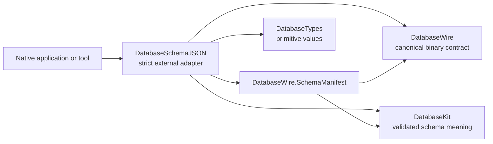
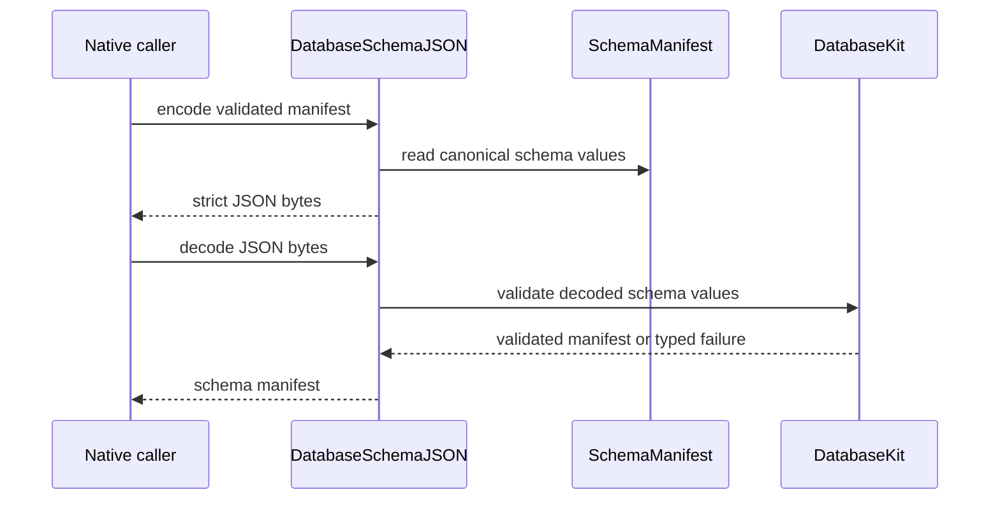

# DatabaseSchemaJSON

## Purpose and Scope

`DatabaseSchemaJSON` is the optional native strict-JSON adapter for the
validated `SchemaManifest` and related schema values. It gives applications and
tools an external JSON representation without making JSON the canonical schema
or wire representation.

- Parent: [`database-kit` package design](../../DESIGN.md).
- Children: none; codec, strict parser, and scalar helpers are implementation
  units of this module.
- Dependencies: `DatabaseKit`, `DatabaseWire`, and `DatabaseTypes`; the native
  implementation uses Foundation for its JSON boundary.
- Dependents: native applications, tools, and schema administration surfaces
  that explicitly choose this product.

It is excluded from the canonical Embedded dependency graph. Schema meaning is
owned by `DatabaseKit`; binary schema operations are owned by `DatabaseWire`.

## Responsibilities and Boundaries

This module owns:

- strict JSON encoding and decoding of `SchemaManifest`;
- JSON-safe adaptation of canonical field values and index definitions;
- duplicate-key, unknown-key, malformed-value, and numeric-shape diagnostics;
- the native external-format boundary and its typed `SchemaJSONError` values.

It does not own schema meaning, model macros, binary framing, operation
dispatch, transport, storage, transactions, query planning, or application
schema policy.

## Related Designs

| Design | Relationship | Contract used | Summary | Cautions |
|---|---|---|---|---|
| [`../../DESIGN.md`](../../DESIGN.md) | package parent | adapter and canonical-graph boundary | Places JSON outside the semantic and Embedded core. | JSON is not a second schema authority. |
| [`../DatabaseKit/DESIGN.md`](../DatabaseKit/DESIGN.md) | semantic dependency | validated schema and field values | Supplies the logical schema values being adapted. | This module must not accept invalid schema values as successful output. |
| [`../DatabaseWire/DESIGN.md`](../DatabaseWire/DESIGN.md) | binary dependency | `SchemaManifest` and wire field/value contracts | Keeps external JSON and canonical binary representations consistent. | Wire version and operation meaning remain in DatabaseWire. |

## Architecture

## Contracts and Invariants

- Encoding emits one deterministic JSON representation for a validated schema
  manifest; decoding accepts only the documented keys and value shapes.
- Duplicate or unknown keys, malformed base64url, invalid numeric forms,
  unsupported field values, and trailing JSON input produce typed failures.
- JSON adaptation preserves every canonical `FieldValue` case without
  platform-dependent numeric inference or lossy conversion.
- A decoded schema manifest still passes the same `DatabaseKit` validation
  boundary before a runtime consumer can use it.
- The canonical schema fingerprint is derived from canonical DatabaseWire bytes;
  JSON formatting cannot change schema identity.
- This module does not define a new schema, operation, or binary wire version.
- Foundation and JSON types stop at this native external boundary and never
  enter `DatabaseKit`, `DatabaseWire`, or Embedded source graphs.

### S01 query descriptor JSON

S01 consumes [Schema's queryType contract](../DatabaseKit/Schema/DESIGN.md#contracts-and-invariants)
and [Query's semantic descriptor](../DatabaseKit/Query/DESIGN.md#s01-public-query-boundary).
Every encoded field adds the required `queryType` key: JSON null for no
descriptor, or one closed tagged descriptor object. Decoding requires the key
and exact documented members; it does not infer a descriptor from an object
default, accept an old missing-key layout or ignore unknown members.

| Descriptor | Exact JSON members |
|---|---|
| Primitive | `kind` is `primitive`, `type` is FieldSchemaType.rawValue, `isArray` is Boolean |
| SQL | `kind` is `sql`, `type` is the DataType object below |

Each DataType object has `kind` equal to its existing enum case spelling.
boolean/smallint/integer/bigint/real/doublePrecision/text/date/interval/blob/
json/jsonb/uuid have no additional members. decimal has `precision` and `scale`,
each an integer or explicit null. char/varchar/binary/varbinary have `length`,
an integer or explicit null. time/timestamp have Boolean `withTimeZone`.
array has `element`, recursively another DataType object. custom has string
`name`. Counts, depth and integer ranges use the existing strict JSON budgets;
the same Kit constructor validates type parameters and field admission before
returning a manifest. Deterministic member order follows the order described
here, but JSON input member order does not alter schema identity.

The descriptor boundary admits resolved SQL types only. The closed grammar
describes `custom` and nested arrays so malformed and unresolved descriptors
receive explicit typed admission failures rather than an unknown-key fallback.

SchemaJSONCodec+Encoding.swift and SchemaJSONCodec+Decoding.swift migrate their
field grammar together; a native QueryColumnTypeJSONCodec owns reusable strict
descriptor encode/decode for schema and CLI column metadata. It returns or
consumes bounded JSON text at the public boundary rather than exposing this
module's parser tree. SchemaJSONError preserves malformed descriptor paths and
typed admission causes. FieldValueJSONCodec continues encoding the unchanged
primitive default representation, including a declared rich-field envelope;
it does not acquire query-type inference or SQL runtime policy.

Canonical fingerprint equality is checked after JSON decode against the
SchemaManifest containing queryType. Nil, primitive and rich descriptors remain
distinct. This native adapter adds no Foundation conversion for rich values
and does not change DatabaseKitFoundation's scalar contract.

### S03 qualified custom type shape

The custom DataType object's exact grammar is kind/name/schema, where schema
is a required String or explicit null and name is one exact terminal component.
This adapts [Query's S03 model](../DatabaseKit/Query/DESIGN.md#s03-semantic-carriage-and-occurrence-addresses);
it does not add catalog resolution. QueryColumnTypeJSONCodec and schema field
admission remain resolved-descriptor boundaries and continue to reject custom
types, including qualified or nested custom types, with typed unresolved-type
failure. Updating the internal grammar must not turn unresolved descriptors
into a successful schema/column round trip. Native strict-key/budget tests and
the existing resolved descriptor regression satisfy S03-C12.

## Runtime Flows

## State, Ownership, and Lifecycle

- Codec state and parsed JSON values live for one encode/decode operation and
  are owned by the caller or returned value.
- The module has no global schema registry, storage connection, transaction,
  operation lease, transport, or durable state.
- Canonical byte ownership follows `DatabaseTypes`; JSON materialization occurs
  only at this external-format boundary.

## Failure, Concurrency, and Constraints

- The adapter is native-only because its JSON/Foundation boundary is not part
  of the canonical Embedded graph.
- JSON input is bounded and validated before constructing large arrays, byte
  values, or nested schema structures.
- Errors remain typed and visible; malformed input is never mapped to an empty
  schema or a default value.
- No shared mutable state or unchecked concurrency escape is part of the
  module contract.

## Verification and Change Impact

| Contract | Evidence owner |
|---|---|
| Strict encode/decode round trips | `Tests/DatabaseSchemaJSONTests` |
| Duplicate/unknown/trailing/malformed rejection | `Tests/DatabaseSchemaJSONTests` strict JSON suites |
| Canonical field-value preservation | `Tests/DatabaseSchemaJSONTests` field-value codec suites |
| Native-only graph boundary | Package dependency review and canonical/Embedded release builds |

Changes to schema JSON keys, numeric or byte representations, or failure
categories require this module design, the `SchemaManifest`/DatabaseWire
contract, and the strict behavioral tests to be reviewed together.

S01-C09/C13 in the [SQL acceptance ledger](../DatabaseKit/Query/SQL/DESIGN.md#s01-falsifiable-case-ids)
require manual/generated schemas with rich defaults and queryType to round
trip through canonical bytes and strict JSON, retain the same fingerprint,
and distinguish descriptor changes. Missing/extra/unknown keys, mismatched
defaults, integer/depth/byte limits and old layouts fail explicitly. Existing
primitive field-value bytes and optional Foundation dependency boundaries are
regression obligations. The workspace progress record owns S01 execution evidence.
