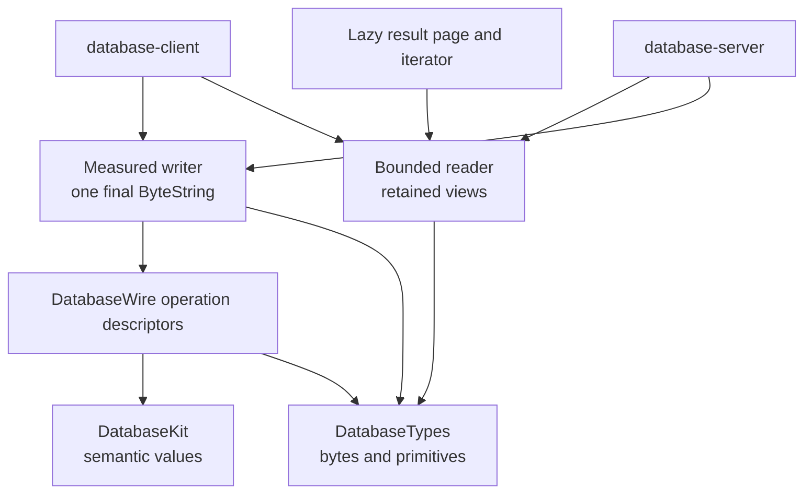
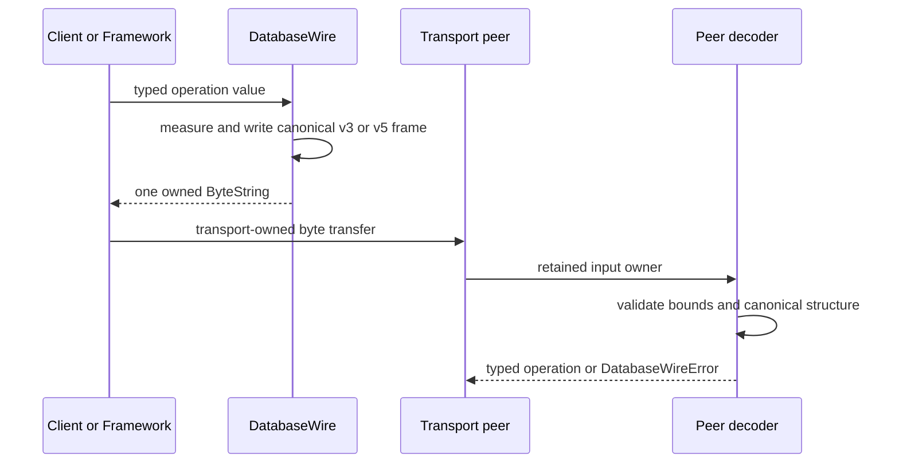

# DatabaseWire

## Purpose and Scope

`DatabaseWire` is the canonical bounded binary protocol module of
[`database-kit`](../../DESIGN.md). It encodes and decodes typed operations,
envelopes, semantic values, result pages, limits, and typed protocol failures
without owning transport or operation execution.

- Parent: [`database-kit` package design](../../DESIGN.md).
- Children: none; `RDF` source files and operation families are classifications
  inside this module, not independent authorities.
- Dependencies: `DatabaseKit` and `DatabaseTypes`.
- Dependents: `database-client`, `database-server`,
  `database-framework` integration paths, and the native schema JSON adapter.

The wire contract is selected at compile time. The default graph is version 3
and target-free. The non-default `MultiBase` graph is version 5 and
target-bound.

## Responsibilities and Boundaries

`DatabaseWire` owns:

- canonical request/response envelope framing;
- closed typed operation descriptors and the operation catalog;
- bounded binary readers and writers;
- wire representations for model, schema, query, graph, ontology, SHACL,
  command, mutation, maintenance, and job values;
- lazy result pages, iterators, provenance payloads, and retained byte views;
- protocol limits and typed malformed, unsupported, and resource-limit errors.

It does not own the semantic meaning declared by `DatabaseKit`, client or
server transport, operation dispatch, authorization evaluation, query
planning/execution, storage, transaction lifetime, or application commands.

## Related Designs

| Design | Relationship | Contract used | Summary | Cautions |
|---|---|---|---|---|
| [`../../DESIGN.md`](../../DESIGN.md) | package parent | v3/v5 trait matrix and wire ownership | Fixes the standard and optional protocol graphs. | No runtime version negotiation or target fabrication. |
| [`../DatabaseKit/DESIGN.md`](../DatabaseKit/DESIGN.md) | semantic dependency | validated models, schema, query, graph, and MultiBase values | Supplies meanings encoded by this module. | Wire codecs must not add semantic execution policy. |
| [Query](../DatabaseKit/Query/DESIGN.md) | semantic dependency | ordered typed columns, positional query values and language distinction | Supplies query/result meaning and the authoritative SQL profile child. | Encoding must retain duplicate names, empty-result metadata and value-specific metadata; it does not execute SQL. |
| [`../../../database-client`](https://github.com/1amageek/database-client) | downstream consumer | typed encoding/decoding and request correlation | Adapts operations to transports. | Transport and cancellation ownership remain in the client. |
| [`../../../database-server/DESIGN.md`](../../../database-server/DESIGN.md) | downstream consumer | envelope and operation catalog | Dispatches decoded operations and publishes results. | Server does not move dispatch or durable jobs into this module. |

## Architecture



The two protocol graphs are explicit:

| Build | Header and request shape | Operation target |
|---|---|---|
| Default | DatabaseWire v3; request contains request ID, operation, metadata, and payload | No target field; one ordinary database root |
| `MultiBase` | DatabaseWire v5; request contains the same data plus an explicit target | Database, Base, or Composition target as declared by the trait |

## Contracts and Invariants

- The default `EnvelopeWireFormat.protocolVersion` is 3. The default request
  envelope has no target and the default operation catalog has no Base,
  Composition, or Grant families.
- With `MultiBase`, the protocol version is 5, target-bearing operation
  requests are explicit, and Base/Composition/Grant operation families are
  compiled into the catalog. The trait does not provide a compatibility alias
  or runtime downgrade path.
- Operation descriptors and their encode/decode witnesses are constructed by
  `DatabaseWire`; users cannot provide an arbitrary raw wire conformance or
  operation identifier.
- Encoding first measures exact frame size and writes one final owned
  `ByteString`. Results and readers retain that owner and expose bounded
  ranges/iterators rather than eagerly copying every element.
- Decoders apply frame, string, byte, collection, nesting, and operation limits
  before allocation. They reject truncation, malformed or unknown values,
  non-canonical order, invalid RDF structure, and trailing bytes.
- Typed `DatabaseWireError` and related errors preserve the distinction between
  malformed input, unsupported operation, resource limit, authorization,
  conflict, retryability, and server failure. No failure is normalized into an
  empty success response.
- `DatabaseWire` serializes semantic contracts; it does not decide query plans,
  storage keys, transactions, leases, or publication ownership.

### S01 frozen query codec contract

The semantic authorities are [Query](../DatabaseKit/Query/DESIGN.md#s01-public-query-boundary)
and [SQL values](../DatabaseKit/Query/SQL/DESIGN.md#s01-frozen-value-and-persistence-interfaces).
S01 moves QueryColumn to DatabaseKit and replaces query cells with QueryValue.
Wire consumes those declarations through explicit DatabaseKit imports and
codec extensions; it owns no duplicate declaration, typealias or re-export
that hides the semantic owner. Primitive FieldValue and RDF codecs retain
their existing tags, bytes, identity and failure contracts.

The following grammar fixes field order and discriminators. Integer, Boolean,
count, string, optional-string and bytes productions use the existing bounded
DatabaseWireReader/Writer encodings. Unknown discriminators fail; they are not
extension slots that can be skipped. Every recursive node participates in the
same reader/writer nesting, object and collection ledger.

| Production | Exact ordered payload |
|---|---|
| QueryColumnType tag 0 | bounded FieldSchemaType.rawValue string, Boolean isArray |
| QueryColumnType tag 1 | existing QueryIRDataTypeWireCodec DataType payload |
| QueryColumn | UInt32 number, string name, QueryColumnType, Boolean isNullable |
| QueryParameter | UInt32 position, optional string name, Boolean explicit-type-present, QueryColumnType if present, QueryValue |
| QueryValue tag 0 | unchanged FieldValue codec payload |
| QueryValue tag 1 | Int128 canonical coefficient, Int32 canonical scale, Int32 displayScale |
| QueryValue tag 2 | length-bounded original JSON UTF-8 bytes |
| QueryValue tag 3 | one JSONB node |
| QueryValue tag 4 | DataType elementType, dimension count, each Int32 lowerBound and Int32 length, element count, positional QueryValue elements |
| QueryValue tag 5 | Int32 months, Int32 days, Int64 microseconds |
| JSONB node tags 0/1/2/3 | null with no payload / Boolean / string / numeric payload from QueryValue tag 1 without another value discriminator |
| JSONB node tag 4 | element count followed by JSONB nodes |
| JSONB node tag 5 | member count followed by string key and JSONB node pairs in canonical member order |
| QueryRow | value count, positional QueryValue cells, unchanged FieldObject annotations, unchanged optional version bytes |
| SchemaManifest field queryType | Boolean presence followed by QueryColumnType when present, after referenceTargetEntity and before the existing default-value presence flag |
| SchemaDescribe field queryType | Boolean presence followed by QueryColumnType when present, after the existing optional reference metadata and before the next field payload |

Literal.queryValue receives discriminator 18 in QueryIRLiteralWireCodec,
fixed in QueryIRWireFormat and golden vectors in the same change. Existing
Literal cases retain discriminators 0 through 17. Its payload is Boolean
explicit-type-present, QueryColumnType when present, then the QueryValue
production; parameter binding does not erase explicit
type or rich metadata. No separate parameter/result/persisted-value algebra is
introduced. A Wire encoder does not encode a model persistence envelope in
place of the direct query-value production.

QueryColumnType's SQL production validates admitted DataType parameters before
acceptance. Column numbers are consecutive one-based ordinals and are unrelated
to persisted field numbers; duplicate/empty names are valid. QueryRowPage
retains the existing page field order and standard snapshot or MultiBase
provenance/consistency tail. Its columns are encoded before the row count even
for an empty page. Row arity and cell/declaration compatibility are checked on
both materialized encoding and encoded-page validation. A NULL cell is tag 0
with primitive null and obtains its type from its column or parameter.
Primitive array declarations permit NULL elements independently of the outer
column's isNullable flag, matching Kit's primitive array adaptation. A
nonnullable array column still rejects an outer NULL; non-NULL elements must
match the declared primitive element kind during in-place validation and
materialization alike.

### S01 validation and retained ownership

QueryValueLimits is derived from the admitting Wire limits without resetting
or increasing the enclosing ledger. Decoding checks lengths/counts, dimension
count/product/upper bounds, element compatibility, numeric coefficient/dscale,
complete lexical JSON, canonical JSONB members and interval microsecond bounds
before publishing a value or encoded page. Retention admission follows the
owners that publication creates: an encoded page owns its frame and columns;
materializing a row additionally admits each actual JSONB flat owner before
returning that row. SchemaManifest carries queryType in its
canonical fingerprint input and validates defaults through the Schema-owned
admission. Missing, unknown or mismatched metadata never becomes inferred type,
NULL, an empty page or a repaired canonical value. QueryValueError remains a
typed cause of DatabaseWireError; malformed wire and resource exhaustion stay
distinct.
Primitive type mismatches consult the FieldValue grammar validator before
reporting incompatibleType, so an unrecognized primitive tag retains
invalidValueTag in scalar, outer-array and array-element positions. Query
validation does not maintain a separate set of recognized primitive tags.

#### One-frame retention accounting

The reader owns one immutable root ByteString; readBytes, length-prefixed
subreaders and consumed row ranges produce bounded views of that root. Query
decoding validates the root's known retainedByteCount once against the admitting
retention bound, separately from maximumFrameBytes' visible encoded-size check.
An oversized backing or unknown retained capacity fails explicitly; visible
slice length is not a substitute for retained capacity. A caller may explicitly
copy into a known owned buffer before admission. No public owner identity API
or raw-pointer identity is needed for this structurally known source.

| Ledger | Counts and ownership |
|---|---|
| Root retained storage | One known backing capacity per admitted root, retained through its last page/iterator/value owner |
| View representation | Each bounded view's visible length and reference/node count; a second slice does not allocate or charge a second root backing |
| New materialization | Cumulative decoded JSONB strings/keys and other newly owned UTF-8, plus admitted node/array/column storage; check before constructing the destination |
| Materialized JSONB retention | Cumulative finished-owner backing-array bytes plus UTF-8 content across JSONB values, array elements, row cells and child readers; admit each independently decoded owner once before returning it |
| Structural validation | Cumulative nodes/elements and enclosing depth across child readers; no reset or increased quota at a subtree boundary |

Root retention and new materialization are distinct claims. Neither encoded
frame length nor aggregate visible view length is reported as a physical
allocation measurement. Framework's destination admission combines retained
owner claims and layout/capacity charges; Wire's structural limits alone are
not a peak-process-memory guarantee. Multiplying a byte budget by reference
count is not an admissible way to pass shared-frame values.

Public Kit QueryValue validators and footprint measurement keep conservative
per-reference known-capacity accounting for arbitrary caller-owned value
graphs. That upper bound is not unique-owner physical usage. Unknown capacity
remains a typed failure when a retained-byte bound must be proved. Codec-owned
assembly instead uses package-only
`QueryArrayValue.init(admittedElementType:dimensions:elements:) throws(QueryValueError)`
after the root and child ledgers have admitted all decoded elements. It calls
the same intrinsic shape/type validator as the public initializer and skips
only the aggregate repeated-reference retained-capacity measurement. It cannot
skip checked dimensions/product, element compatibility or any metadata rule.
Only codec-created children from this admitted root may enter that path;
external arbitrary QueryValue graphs use public conservative validation.

An individual QueryJSONValue uses its existing public validating initializer
with the unchanged admitted root-retention bound. Its cached footprint remains
the conservative per-reference capacity; the Wire ledger does not sum that
capacity again. No JSON constructor bypass is required. JSONB string creation
uses the separate cumulative new-UTF8 ledger and cannot consume an enlarged
alias quota. Package assembly is not public authority to bypass a value budget.
These rules apply equally to lazy iteration and encoded-page revalidation;
their root provenance survives slicing while destination ledgers retain the
current depth/object/materialization state.

JSONB decoding uses the Kit [flat ownership construction contract](../DatabaseKit/Query/SQL/DESIGN.md#flat-jsonb-ownership-and-construction):
open collection frames retain child IDs, and one package builder appends each
scalar and collection once before finishing one immutable owner. It does not
rebuild completed subtrees through public composite factories. Binary tags and
canonical member ordering stay unchanged. The finished owner admits its actual
backing-array capacities and UTF-8 content before publication; the value's
retained metadata includes that whole owner even when a child view is retained.
Validation-only traversal keeps bounded frames without materializing the owner.
It admits encoded ownership and logical counts, depth and UTF-8 content, and
does not predict the capacities Swift Array growth will select. Iterator.next()
may therefore throw a typed retained-resource failure when an otherwise valid
encoded row's actual flat owner exceeds the materialization limit. It returns
no partially materialized row. Eagerly building and discarding every owner is
not required to publish a lazy encoded page.
The reader carries this actual JSONB retention ledger through length-prefixed
children and iterator progress; separate owners cannot each reuse the full
retained-byte quota. The existing new-UTF8 ledger admits content before String
creation. UTF-8 content appears in both independent checks, but those ledgers
are not added together or claimed as two physical allocations. Root-frame
retention remains a separate once-per-root admission.

Page decoding validates the complete encoded row subtree in place, then retains
its ByteString range and immutable typed columns. It does not eagerly allocate
all QueryValue trees to validate them. QueryRowIterator materializes only the
requested row and byte/JSON values retain bounded views of the original owner.
Validation and row materialization share the same grammar and intrinsic
invariants, including columns when no rows exist. Re-encoding an encoded page
validates with the destination writer's current depth/object ledger before
copying its retained range; it cannot reset limits at a nested page boundary.
Truncation, trailing input, invalid tag/shape/type and encoded-validation limit
failure publish neither a partial page nor a partially accepted operation.
Actual materialization capacity is reconciled at the row publication boundary.

The source migration updates QueryColumn.swift (semantic declaration moves to
Kit), QueryRow.swift, QueryRowPage.swift, QueryRowIterator.swift,
QueryParameter+Wire.swift, QueryIRLiteralWireCodec.swift,
QueryIRDataTypeWireCodec.swift, QueryIRWireFormat.swift, SchemaManifest.swift,
DatabaseWireError.swift and the reader/writer validation and size-accounting
paths. A single QueryValueWireCodec and its in-place validator own the new
production. Schema JSON consumes the same declaration through its native
[adapter contract](../DatabaseSchemaJSON/DESIGN.md); it is not a binary codec.

This is a coordinated pre-release layout change within target-free v3 and
opt-in target-bound v5. It changes neither header version nor target authority.
All source consumers, schema fingerprints, golden vectors and dependency pins
migrate together; there is no old-layout decode fallback or negotiation.

### Later statement and block operations

Later SQL statement/block descriptors are closed DatabaseWire operations, with
results distinguishing rows, command count and schema change in statement
order. This module encodes diagnostics and outcomes but does not turn schema
job acceptance or precommit rows into completion. Publication belongs to the
server/host after authoritative execution close.

These are planned interfaces, not implemented capabilities. Their byte changes
require golden-vector and downstream mapping updates in the same completed
change. They do not select a new protocol version, negotiate compatibility,
fabricate a standard target, or import runtime SQL semantics into Wire. SPARQL
boolean/RDF result contracts and MultiBase provenance/consistency fields retain
their distinct meanings.

### S02 type and constructor Wire grammar

S02 consumes the [SQL semantic changes](../DatabaseKit/Query/SQL/DESIGN.md#s02-frozen-syntax-to-value-boundary)
without changing standard v3 versus MultiBase v5 authority selection. QueryIR
expression tags 0...40 keep their existing meanings. New tag 41 encodes an
ARRAY constructor and tag 42 a ROW constructor; each contains the existing
bounded expression-list count followed by its ordered children. Unknown tags,
truncation and one-past structural counts fail explicitly in the codec. The
consuming SQL/SPARQL semantic gate rejects invalid child languages before
execution; the representation codec does not introduce language policy.
No QueryValue tag or primitive field codec is added for ROW.

DataType tags 11 and 12 retain the existing time/timestamp Boolean payload and
mean precision nil. New tags 22 and 23 carry respectively time/timestamp with
withTimeZone Boolean followed by UInt8 precision in 0...6; encoding chooses
these tags only for explicit precision, including zero. Decoder never silently
drops precision or treats an invalid value as nil. Existing DataType tags 0...21
and their nil-precision goldens remain unchanged. Extended metadata uses the
same bounded type validator, structural walk and nested-value ownership as
existing casts, columns, parameters and schema query descriptors.

Pure codecs must round-trip both constructors, deeply nested bounded children,
all seven temporal precision values and both timezone flags. Direct consumers
and typed JSON adapters migrate before this coherent sprint completes. Old
unknown-tag rejection remains deliberate; there is no permissive compatibility
decode or runtime version negotiation. SQL parsing/serialization stays in
Framework and is not reimplemented by the codec.

### S03 unknown and qualified-name grammar

Wire consumes the [S03 Query carriage contract](../DatabaseKit/Query/DESIGN.md#s03-semantic-carriage-and-occurrence-addresses).
Literal tag 19 carries sqlUnknownString as one bounded String. Existing tag 4
remains typed string. DataType tag 24 carries qualified custom type as schema
String then terminal name String; nil-schema custom retains tag 21. Expression
tag 43 carries qualified FunctionCall as schema String, terminal name String,
existing expression-list production and distinct Boolean; nil-schema function
retains tag 28. All identifiers are exact components, including embedded dots.
Existing tags retain their meanings and standard v3/MultiBase v5 selection is
unchanged. No QueryValue or FieldValue alternative is added.

Structural walks and decoders charge the additional string/children before
growth, preserve parameter references/declarations and reject unknown tags,
truncation, invalid names and one-past limits explicitly. Pure carriage of an
unresolved custom CAST input is distinct from resolved result/schema type
admission. Occurrence arenas/source sidecars are local binding provenance and
do not add a Wire source-text or runtime-plan production. S03-C02/C04/C12 require
goldens, typed failure and standard/MultiBase/native/WASM/Embedded runtime
evidence; direct semantic round trips preserve exact enum identity.

## Runtime Flows



Bulk pages retain their frame owner while consumers iterate or request bounded
materialization. Transport, dispatch, transaction, and publication steps are
outside this module.

## State, Ownership, and Lifecycle

- A writer owns its temporary measurement state and produces one final
  `ByteString` at the encoding boundary.
- A reader, result page, view, and iterator retain the same input owner for
  their lifetime. Pointer borrows used to inspect that owner are synchronous
  and cannot escape their borrow scope.
- The module has no network connection, retry loop, operation registry with
  mutable global state, transaction, cursor, authority, or durable job state.
- Any copy required by an independent transport or native external-format
  boundary is owned by that consumer; internal wire stages retain one owner.

## Failure, Concurrency, and Constraints

- Canonical wire values and readers are `Sendable` where their owner/view
  contract permits; no unchecked mutable global state is used.
- Unknown, oversize, malformed, and trailing input fails before it can become a
  runtime operation.
- A decoder never trusts a length or count before checked arithmetic and the
  corresponding configured limit.
- The canonical module has no Foundation, Codable, URLSession, JavaScriptKit,
  or backend dependency and must compile for standard and Embedded WASM.
- Native JSON adaptation and Foundation scalar conversion are separate module
  contracts and cannot be imported into this canonical graph.

## Verification and Change Impact

| Contract | Evidence owner |
|---|---|
| Operation catalog and v3/v5 envelope mapping | `Tests/DatabaseWireTests` operation and envelope suites |
| Truncation, bounds, malformed, non-canonical, and trailing-input rejection | `Tests/DatabaseWireTests` decoder suites |
| Retained owner, lazy page, iterator, and exact-frame behavior | `Tests/DatabaseWireTests` result and byte-ownership suites |
| Planned typed SQL results and statement/block payloads | QueryResultPage/QueryIR codec suites expanded for duplicate names, zero-row metadata, SQL-specific values, full malformed-input boundaries and standard/MultiBase golden vectors; SQL semantics use the [Query evidence contract](../DatabaseKit/Query/DESIGN.md#verification-and-change-impact) |
| Standard and `MultiBase` protocol graphs | Isolated native package harness runs with reviewed exact counts owned by scripts/xcode-test-harness |
| Standard and Embedded compatibility | Package README release builds for `DatabaseWire` |

Any change to a wire byte, operation family, version, target field, limit,
failure category, or ownership boundary requires this module design, the
package design, golden/behavioral tests, and all downstream mapping consumers
to be reviewed together.

S01-C04–C11/C13 in the [SQL acceptance ledger](../DatabaseKit/Query/SQL/DESIGN.md#s01-falsifiable-case-ids)
own query-value golden, malformed-input, lazy ownership, schema fingerprint and
trait regression obligations. Native focused execution requires the package
harness to support selectors without weakening final exact-count lanes. WASM
and Embedded gates use the package's pinned toolchain/matching SDKs and scoped
SDK lookup; compile/link does not replace native behavioral evidence. Required
harness support and the complete affected native lanes precede S01 completion.
These frozen interfaces are pending implementation and runtime evidence.

S01-C11 additionally rejects double charging two JSON views of one 4 MiB
owner as two physical allocations, oversized backing behind a small visible
frame, unknown-capacity admission, JSONB exact/one-past materialization bytes,
and child/lazy-reader ledger reset. The alias fixture checks one root retention
claim and two view representations, not an expanded byte budget. Arbitrary
public value measurement continues to report its conservative upper bound.

### S04 conditional expression grammar

Consume [Query semantic additions](../DatabaseKit/Query/SQL/DESIGN.md#s04-semantic-additions-and-scope)
without runtime policy. Existing searched CASE tag29 retains its exact bytes
when operand is nil. Allocate expression tags44...49 respectively to simple
CASE, GREATEST, LEAST, truth test, DISTINCT predicate, quantified comparison.
Simple CASE is operand expression then existing CASE-pair count/pairs/optional
ELSE production. GREATEST/LEAST use the existing expression-list production.
Truth test is operand then truth byte (0=false,1=true,2=unknown), negated Bool.
DISTINCT is left expression, right expression, negated Bool. Quantified
comparison is left expression, comparison byte (0=equal,1=notEqual,2=lessThan,
3=lessThanOrEqual,4=greaterThan,5=greaterThanOrEqual), quantifier byte
(0=any,1=all), source byte (0=array expression,1=SelectQuery), then its payload.
Unknown discriminators, invalid structure, truncation, trailing bytes and
one-past limits fail typed before growth. Standard v3/MultiBase v5 remain
unchanged. Existing value/type/schema JSON adapters retain their own closed
contracts; this change adds no Expression or QueryStatement JSON boundary.
Occurrence/source sidecars and selected runtime signatures remain local.
S04-C11/C12 require canonical goldens and actual native/WASM/Embedded decode,
not only generated declarations.

### S05 pattern grammar

Expression tag 50 carries the closed pattern kind, escape-presence Boolean,
subject expression, pattern expression and optional escape expression in that
order. Kind bytes 0...4 mean LIKE, case-insensitive LIKE, SIMILAR TO, ERE and
case-insensitive ERE. ERE with a present escape is rejected. Tag 51 carries
the concatenation operator and its two expressions. Retired LIKE tag 21 is
rejected; no compatibility decoder reconstructs a superseded declaration.
Existing iterative expression owners enforce depth, bytes and node budgets.
Golden, truncation, invalid discriminator/Boolean, nested parameter and
standard/MultiBase request tests prove carriage without executing predicates.


### S06 temporal value and interval descriptor carriage

Consume the temporal declarations and intrinsic admission owned by
[Query](../DatabaseKit/Query/DESIGN.md) and its
[SQL profile](../DatabaseKit/Query/SQL/DESIGN.md). Wire transports those values;
it does not interpret lexical input, apply interval qualifiers, round precision,
resolve zones, or read clocks. Primitive FieldValue productions remain unchanged.

| Production | Exact payload after its UInt8 tag |
|---|---|
| QueryValue 6: time | Int64 microseconds since midnight |
| QueryValue 7: time with time zone | Int64 microseconds since midnight, Int32 UTC offset seconds |
| QueryValue 8: date infinity | UInt8 direction |
| QueryValue 9: timestamp infinity | UInt8 direction, Bool withTimeZone |
| QueryValue 10: interval infinity | UInt8 direction |
| DataType 13: unconstrained interval | No payload; fields and precision are both absent |
| DataType 25: modified interval | Bool hasFields, optional UInt8 fields, Bool hasPrecision, optional UInt8 precision |

Infinity direction bytes are 0 negative and 1 positive. Interval field bytes
0...12 are year, month, day, hour, minute, second, yearToMonth, dayToHour,
dayToMinute, dayToSecond, hourToMinute, hourToSecond, minuteToSecond respectively.
Absent fields mean the full range. Modified interval tag 25 requires at least
one modifier; the no-modifier value has only tag 13. Scalar temporal values use
the existing nested-value accounting around their fixed-size payloads.

Both materializing decode and lazy cell validation consume the same intrinsic
Kit admission. Invalid time bounds, descriptor precision/field combinations,
infinity direction, Boolean, type/zone mismatch, truncated payloads and unknown
tags fail with typed DatabaseWireError; SQL NULL remains the existing primitive
NULL production. No infinity payload is decoded into a finite primitive.
Arrays retain their exact declared element type and validate every temporal
cell against it. Schema fields, defaults, parameters, operation frames and
lazy result pages use these same productions in standard v3 and MultiBase v5.

S06-W01 verifies deterministic temporal/infinity and interval descriptor goldens;
S06-W02 verifies eager/lazy typed NULL, array and schema carriage;
S06-W03 verifies malformed discriminators, incompatible declarations and every
truncated prefix; S06-W04 verifies exact/one-past byte, node and nesting limits
on native, WASM and Embedded. These are required behavioral obligations, not a
claim that S06 implementation or verification has run.


Expression tag 52 carries currentValue: UInt8 kind, Bool hasPrecision, optional
UInt8 precision. Kind bytes 0...4 are date, time, timestamp, localTime,
localTimestamp. There are no child expressions. Intrinsic Kit admission rejects
precision for date and precision outside 0...6 for the remaining kinds. Unknown
kind, invalid Boolean, forbidden precision and truncation fail typed. Generic
FunctionCall tags 28/43 remain distinct and never reconstruct this expression.
S06-W01/W03 additionally require exact current-value goldens, quoted generic
identity separation, malformed precision and truncation coverage.


### S07 collection expression carriage

This layout consumes [Query declarations](../DatabaseKit/Query/DESIGN.md#s07-collection-expression-carriage)
and the [SQL semantic authority](../DatabaseKit/Query/SQL/DESIGN.md#s07-frozen-array-and-json-contract).
Existing QueryValue/DataType/FieldStorage productions do not change. Expression
53 and 54 are the next unused tags after currentValue52; existing expression
and standard v3/MultiBase v5 envelope tags keep their meanings.

| Tag | Exact payload order after UInt8 tag |
|---|---|
| 53 arrayAccess | Collection count using the existing bounded count production; all subscript metadata in dimension order; base expression; present child expressions in dimension order. Count must be1...6. |
| 54 collectionOperation | UInt8 operator; left expression; right expression. |

Each tag53 metadata entry starts with UInt8 kind: 0 index, 1 slice. Index has
no additional metadata and exactly one child. Slice carries Bool hasLower then
Bool hasUpper and has only those present children, lower before upper. Metadata
for the entire group precedes expressions so the decoder validates the closed
kinds, Boolean values, count and checked child total before allocating or
scheduling children. The base is decoded first after metadata. An all-omitted
slice is valid; an empty access group is invalid. One expression represents
one contiguous group, preserving nested group boundaries without flattening.

Tag54 operator bytes are fixed as follows; no String operator fallback exists.

| Byte | CollectionOperator |
|---|---|
| 0 | contains |
| 1 | containedBy |
| 2 | overlaps |
| 3 | jsonField |
| 4 | jsonFieldText |
| 5 | jsonPath |
| 6 | jsonPathText |
| 7 | jsonHasKey |
| 8 | jsonHasAnyKey |
| 9 | jsonHasAllKeys |
| 10 | jsonDeletePath |

Both encoding and decoding enforce the same shape and existing byte, object,
collection and nesting budgets. Count/metadata and child-frame storage are
bounded before allocation; present children are charged once. Unknown tag,
kind/operator byte, non-Boolean presence, count0/count7+, incompatible
structure, overflow and every truncated prefix fail with typed DatabaseWireError.
No malformed metadata becomes an omitted bound or a default operator. Reuse the
existing subtract and concatenate productions for their S07 overloads; generic
functions retain their existing productions.

Required S07-W01 evidence is deterministic goldens for both cases, all operator
bytes and all slice-presence combinations in standard and MultiBase frames.
S07-W02 proves nested groups, parameters and deep iterative roundtrips with
source-independent structural identity. S07-W03 proves invalid count/kind/
operator/Boolean, every truncation and exact/one-past byte/node/depth/collection
limits before publication/allocation. S07-W04 preserves existing array/JSON
value, lazy-cell, declared-type and retained-owner behavior across native,
ordinary WASM and Embedded. SQL execution and SRF composition are outside this
codec's proof and follow the semantic authority's stage gates.


### S07 explicit variadic function layout

Consume [FunctionCall's explicit final-array flag](../DatabaseKit/Query/DESIGN.md#s07-explicit-variadic-function-carriage).
False retains existing tags28/43 and their exact payload bytes. True uses the
next unused expression tag55, for qualified and unqualified functions alike:

| Tag | Exact payload order after UInt8 tag |
|---|---|
| 55 | Bool hasSchema; optional schema String; name String; bounded argument count >=1; Bool distinct; all argument expressions in order. |

Tag55 itself denotes finalArrayIsVariadic=true; there is no redundant Boolean
flag. Metadata precedes children, with the existing bounded string/count
productions and strict Boolean grammar. Validate nonzero count, byte/node/depth
budgets and checked child-frame admission before allocating/scheduling argument
storage. Decode never infers the flag from an array argument or downgrades
unknown/invalid metadata to an ordinary call. Unknown tags, bad Booleans, zero
count, excess count and every truncated prefix fail typed DatabaseWireError.
The codec preserves metadata; registered-function/type admission is binding's
responsibility. Required goldens prove false calls unchanged and tag55 true
calls with/without schema; roundtrips preserve distinct, nested arguments,
parameters and identity. Malformed-count/Boolean/truncation and exact/one-past
budget tests apply in standard/MultiBase and portable codec lanes.

### S08 composite value and descriptor carriage

This is the planned codec contract, not evidence of implemented support.
Consume the sole [SQL composite/value and ownership contract](../DatabaseKit/Query/SQL/DESIGN.md#s08-frozen-composite-values-and-ownership)
and the [QueryIR owner](../DatabaseKit/Query/DESIGN.md) for relational query
carriage. This section owns only the binary grammar and codec admission. The
standard target-free v3 and optional target-bound MultiBase v5 remain unchanged;
there is no version negotiation or new envelope.

| Production | Exact payload after UInt8 tag |
|---|---|
| DataType tag26 | Bounded column count, then each existing QueryColumn production in ordinal order: UInt32 number, bounded UTF-8 name, QueryColumnType, strict Bool isNullable. |
| QueryValue tag11 | Composite DataType production (tag26), bounded field count, then positional QueryValue fields in order. |

QueryColumnType retains tags0/1 for primitive/SQL; its SQL branch uses the
extended DataType grammar rather than adding another descriptor. A tag11 value
must contain a composite descriptor, and its field count must equal that
descriptor's column count. Fields satisfy selected type and nullability. Zero
columns/fields are valid. With an external declared result/parameter type, the
carried composite descriptor must match that declaration completely, including
ordinals, names, types and nullability. It cannot replace a mismatched external
descriptor. Typed NULL retains existing QueryValue tag0/FieldValue NULL and its
external composite declaration; all-NULL tag11 is a non-NULL composite value.

Existing QueryValue tags0...10, DataType tags0...25 and their payload bytes are
unchanged. QueryValue tag4 retains its exact array element-type/dimensions/cell
production; an element type may now use composite tag26 and a cell may use
tag11. Nested DataType.array elements remain invalid, independently of a
composite field that contains an array. Preserve each Int32 lower bound/length,
flat row-major cells, six-rank limit and canonical empty shape. DataSource tag13
remains reserved for MultiBase; S08 value additions never reuse it. QueryIR
expression/source/query changes are defined by their Query contract and must
join the existing shared iterative codec rather than a recursive side codec.

DataType encoding/decoding and QueryValue encoding/decoding/validation extend
the existing iterative owners with descriptor/field/array cursors. A value
cannot call a recursive descriptor codec that calls itself through QueryColumn,
nor recursively invoke scalar decoding for nested composite fields. Bounded
metadata/counts and checked prospective cursor/record capacity are admitted
before scheduling or allocating children. Production decoders append flat
builder records and indices directly and publish only a validated final root;
they do not repeatedly invoke public collection factories on partial subtrees.

The lazy QueryValue validator scans every encoded composite field and nested
array/descriptor in place, using the declared metadata and one iterative
traversal. It does not build QueryCompositeValue, QueryArrayValue, JSONB or
primitive collection trees to validate a cell. It validates carried versus
external descriptors before exposing that cell. QueryRowPage retains the
response frame and validates rows before publication; QueryRowIterator
materializes only a requested row/cell through the ordinary decoder. Byte
leaves retain bounded frame slices. Newly materialized flat type/value storage
capacities are charged separately, just as materialized UTF-8/JSONB storage is
charged today. Neither a nested reader nor a cell boundary resets enclosing
object/count/depth/retention ledgers or recharges an already admitted root frame
as a new independent owner. Public arbitrary-value measurement retains its
conservative owner accounting; the codec's proved one-frame alias accounting
does not become a public validation bypass.

Unknown tags, invalid Booleans, invalid UTF-8/ordinals, unresolved or malformed
descriptors, wrong carried descriptor, field count/type/nullability mismatch,
invalid array shape, overflow, every truncated prefix, trailing input and any
exceeded limit fail through typed DatabaseWireError. Intrinsic failures remain
invalidQueryValue with their QueryValueError cause; malformed protocol tags and
structural limits retain their existing Wire error cases. No decoder repairs
metadata, drops fields, substitutes NULL, infers a primitive object descriptor
or returns an empty result. Failure unwinds open scopes and partial builder
storage before propagation, without publishing a partially validated value.

| ID | Required falsifiable evidence |
|---|---|
| S08-W01 | Deterministic standard/MultiBase tag26/tag11 goldens, zero-field and nested descriptors/values, typed NULL and non-NULL all-NULL composite, array-of-composite bounds and row order. Existing tag0...10/type0...25 and primitive-array bytes remain unchanged. |
| S08-W02 | Decoder and in-place validator reject non-composite tag11 descriptors, wrong external descriptor, invalid ordinal/name UTF-8/type/Boolean/count/shape/nullability, unknown tags, every truncated prefix and trailing bytes with typed causes; malformed metadata never becomes a default. |
| S08-W03 | Exact/one-past byte/object/collection/depth and flat-construction capacity limits apply cumulatively across SELECT/expression/descriptor/value/array/ROW nesting and cells. Deep alternating type/value graphs use bounded iterative cursors; a child never gains a fresh quota. |
| S08-W04 | Retained encoded page validates without eager value trees; only requested cells materialize flat owners. Fields/columns remain valid after page/root release, full-owner and materialized-capacity accounting is preserved, and final release/error/truncation leaves no owner cycle or partial publication. |
| S08-W05 | Typed parameters, Literal.queryValue, duplicate-name/zero-row result columns, strict QueryColumnType JSON adaptation and server/CLI consumers carry or explicitly reject the selected descriptor/value under their own contracts. Native behavior plus exact ordinary-WASM/Embedded runtime lanes execute nested/NULL/limit/owner cases; compile-only success does not satisfy this contract. |

Result-only composite persistence rejection is owned by the SQL value contract,
not by a new Wire persistence envelope. SQL coercion, composite equality and
comparison, JSON conversion, query execution budgets and lease attachment remain
Framework responsibilities; deterministic codec identity is not their proof.

### S08 relational query carriage

This planned grammar consumes the canonical declarations in
[Query S08](../DatabaseKit/Query/DESIGN.md#s08-frozen-relational-query-carriage).
That design owns shape, occurrence identity and language semantics; this
section owns exact bytes. S08 replaces the affected single SELECT/projection
layout in place. There is no old-layout decoder, compatibility alias, second
SELECT discriminator or new protocol version. All callers and deterministic
fixtures migrate together. An old byte sequence is interpreted only by this
grammar and rejected when it does not satisfy it; the codec does not identify
the historical origin of bytes that also form a valid current production.

All discriminators below are UInt8. Count, String, strict Bool and optional
productions are the existing bounded Wire productions. An optional is Bool
presence followed only when true by its payload; an optional array is Bool
presence followed by count and ordered elements. Nil and a present empty array
remain distinguishable. Recursive productions enter the existing shared
iterative expression/query/source codec and its enclosing reader/writer ledger.

#### SELECT, projection and pagination

One SELECT payload has the following exact field order within its existing
nested-value scope; no stored field is omitted from canonical encoding:

| Position | Payload |
|---|---|
| 1 | Optional NamedSubquery array. Each element uses the complete production below, including S10 SEARCH/CYCLE metadata. |
| 2 | Projection item count, then ordered ProjectionItem productions. |
| 3 | DataSource. |
| 4 | Optional AccessPath using its existing production. |
| 5 | Optional filter Expression. |
| 6 | Optional groupBy GroupingElement array (S09). |
| 7 | Optional having Expression. |
| 8 | NamedWindow array (S09). |
| 9 | SelectQuantifier. |
| 10 | Optional SortKey array, each retaining Expression, direction byte (0 ascending, 1 descending), optional NULL order byte (0 first, 1 last). |
| 11 | QueryPagination. |
| 12 | Bool reduced. |
| 13 | Existing SPARQLDataset production. |
| 14 | Bool withRecursive (S10). |

| Production | Discriminator and exact remaining payload |
|---|---|
| ProjectionItem.expression | 0; Expression; optional alias String. |
| ProjectionItem.wildcard | 1; optional qualifier String. |
| SelectQuantifier.all | 0; no payload. |
| SelectQuantifier.distinct | 1; no payload. |
| SelectQuantifier.distinctOn | 2; nonzero bounded expression count; ordered Expressions. |
| QueryPagination | Optional offset QueryCount; optional limit QueryLimit. |
| QueryCount.fixed | 0; UInt64 count. |
| QueryCount.expression | 1; Expression. |
| QueryLimit.all | 0; no payload. |
| QueryLimit.count | 1; Bool withTies; QueryCount. |

Projection is an ordered item array, with no outer Projection discriminator,
distinctItems production or duplicate DISTINCT flag. Pagination has no second
fixed limit/offset fields. WITH TIES metadata precedes its count child, so it
is validated before scheduling that expression. The byte order is not SQL
parameter-inference or evaluation order; consumers use Query's named semantic
edges. UInt64 fixed counts, including UInt64.max, round-trip unchanged for
non-SQL consumers. SQL signed-bigint admission, NULL coercion, ties ordering,
source-reference restrictions and SPARQL language rejection belong to their
semantic owners and are not imposed by a context-free Wire decoder.

#### Sources and expressions

| DataSource tag | Exact payload after tag |
|---|---|
| 14 values | Bounded row count; for each row, bounded expression count and ordered Expressions. Raw row widths must match unless any direct cell is fieldExpansion; expanded arity is validated by binding under the [Query contract](../DatabaseKit/Query/DESIGN.md#s08-frozen-relational-query-carriage). |
| 15 subquery | Complete SELECT query; no source alias payload. |
| 16 aliased | Source alias name String; optional column-name String array; nested DataSource. |
| 17 setOperation | SetOperator byte (0 union, 1 intersect, 2 except); SetQuantifier byte (0 all, 1 distinct); complete left SELECT; complete right SELECT. |

Tags2/4/9/10/11/12 are reserved and rejected with invalidValueTag, rather than
decoded as their superseded subquery/VALUES/set layouts. Tag13 retains its
existing MultiBase-only Base/source payload and remains invalid in standard
frames. Tags0/1/3/5/6/7/8 retain their source meanings; migration removes
source aliases from their former per-family payloads as follows:

- Tag0 table retains the existing TableRef production, including its optional
  alias slot and partition bindings. Within DataSource.table, alias must be
  absent. Direct mutation-target TableRef carriage still permits the alias.
- Tag1 logical carries kindIdentifier String and identifier String, with no
  former optional alias. A source alias uses tag16.
- Tag5 graphTable carries graphName String, existing MatchPattern, and optional
  columns. Each column retains Expression followed by its alias String. Remove
  only the former final optional relation alias; a relation alias uses tag16.
- Tag3 join and graph source tags6/7/8 retain their existing metadata and
  payload order. Their nested sources/expressions use this grammar.

Programmatic zero-row VALUES and the one-zero-column-row identity are admitted
without synthetic rows or inferred column names. The decoder validates raw
VALUES widths after all rows are decoded, because a later row can contain the
direct expansion that defers arity to binding. Nested expansions do not defer
raw-width validation; carriage never normalizes the source cells.
A set source is admitted only
in the canonical direct SELECT envelope defined by Query; an ordinary relation
uses a complete subquery wrapper. Metadata for tags16/17 is validated before
scheduling children. Operator precedence is already represented by binary
query operands, not reconstructed from a flat list by the decoder.

| Expression tag | Exact payload after tag |
|---|---|
| 56 collate | SQLCollation byte (0 c, 1 posix); operand Expression. |
| 57 arraySubquery | Complete SELECT query. |
| 58 wholeRow | Source name String. |
| 59 field | Field name String; operand Expression. |
| 60 fieldExpansion | Operand Expression. |

Expression tags0...55 and their payloads retain their existing meanings;
nested SELECT/source children use the new canonical query productions. Field
expansion context, whole-row lookup, collation capabilities and array-subquery
column/type/cardinality rules are semantic decisions, not decoder guesses.
QueryValue11/DataType26 remain the separate composite productions above;
expression tags do not introduce a second value algebra or persisted format.

#### Admission, failure and migration evidence

The existing iterative SCC handles every new edge, including CTEs, projection,
VALUES cells, binary query operands, DISTINCT keys, offset/limit expressions
and composite descriptors/values. A cursor holds one active collection frame,
not one scheduled entry per sibling. Checked counts, node/depth claims,
metadata strings and prospective assembly capacity are admitted before growth.
Malformed nested input cannot reset the enclosing ledger or gain a new quota.
Both materialized and measuring/streaming writers traverse the same grammar;
invalid shape fails before any sink emission. Encoding and decoding validate
the same intrinsic structures before returning a query.

Add the typed boundary
`DatabaseWireError.invalidQueryStructure(QueryStructuralValidationError)` to
preserve Query's intrinsic shape cause, including invalidValuesRowArity,
emptyDistinctOn, invalidSetQueryEnvelope and sourceAliasInTableReference.
DataSource.table with an alias fails through that boundary before reads; the
TableRef codec itself does not erase a legitimate mutation-target alias.
Unknown/reserved discriminators, invalid Booleans, truncated/trailing input,
invalid UTF-8, overflow and structural limits retain their existing typed Wire
failures. There is no fallback to an old layout, omitted expression, empty
source, false DISTINCT state or repaired envelope.

| ID | Required falsifiable evidence |
|---|---|
| S08-W06 | Standard/MultiBase exact SELECT/projection/quantifier/pagination goldens cover every discriminator, optional presence, mixed wildcard position, CTE hint, fixed UInt64 boundary and expression child. Canonical emit/owned encoding agree and preserving copies retain all fields. |
| S08-W07 | Source14...17 and expression56...60 goldens and roundtrips preserve row-major expressions, alias metadata, binary operands/local versus outer modifiers, COLLATE and whole-row/field/expansion identity. All reserved old source tags and unknown enum bytes fail explicitly. |
| S08-W08 | Ragged VALUES, empty DISTINCT ON, invalid set envelope, nonnil table-source alias, malformed Bool/count, every truncated prefix and trailing input fail with the selected typed cause before publication/emission. Direct mutation-target aliases continue to round-trip. |
| S08-W09 | Exact/one-past shared count/node/depth/string/frame and assembly budgets across mixed SELECT/source/expression/value/type nesting reject without quota reset. Deep and wide traversals preserve occurrence/parameter children with constant process-stack depth; error cleanup leaves no partial result or retained scratch. |
| S08-W10 | Native standard/MultiBase and exact ordinary-WASM/Embedded runtime witnesses execute the new query/value graph. Every active Kit, Framework, Server, Client, CLI, Cloudflare and MultiBase caller/golden migrates to the canonical grammar. SQL runtime failures and retained results are verified by their owning integration tests; compile/discovery alone is insufficient. |

No compatibility decoder is retained after callers and golden vectors migrate.
Canonical bytes encode logical positional values and descriptor metadata,
never arena indices, owner identity or allocated capacity. Equal represented
values in independent owners produce equal bytes; primitive and scalar-array
representation meaning is preserved. Array/composite mutual traversal uses the
same iterative SCC rather than recursive equality/hash or codec calls.
Canonical continuation fingerprints change with the complete new encoding;
their consumers cannot omit a quantifier, alias, nested modifier or pagination
expression to preserve a historical fingerprint. Semantic compatibility or
language admission is never inferred from a successful representation roundtrip.

### S09 canonical grouping, aggregate and window carriage

S09 replaces the SELECT grouping field with optional GroupingElement array
and inserts the bounded NamedWindow array immediately after HAVING, before
SelectQuantifier. Standard v3 and MultiBase v5 use this same grammar, with no
version alias or historical-layout decoder. Query owns shape and meaning in
[its S09 contract](../DatabaseKit/Query/DESIGN.md#s09-frozen-grouping-aggregate-and-window-declarations).

| Production | Exact ordered payload |
|---|---|
| GroupingElement | UInt8 0 expression + Expression; 1 rollup / 2 cube + array of expression arrays; 3 groupingSets + array of GroupingElement arrays. |
| AggregateFunction.sql | Aggregate tag8 + SQLAggregateCall. Existing generic tags0...7 remain unchanged. |
| SQLAggregateCall | Canonical function raw-name String; optional schema String; Expression array arguments; Bool distinct; SortKey array orderBy; optional Expression filter; optional SortKey array withinGroup. |
| Expression.grouping | Expression tag61 + Expression array. |
| Expression.window | Expression tag62 + WindowCall. |
| WindowCall | WindowFunction then WindowReference. Function tag0 + SQLAggregateCall; tag1 + canonical analytic raw-name String + Expression array arguments. Reference tag0 + name String; tag1 + WindowSpecification. |
| NamedWindow | Name String then WindowSpecification. |
| WindowSpecification | Optional inheritedName String; Expression array partitionBy; SortKey array orderBy; optional WindowFrame. |
| WindowFrame | Mode byte 0 rows / 1 range / 2 groups; start bound; end bound; exclusion byte 0 noOthers / 1 currentRow / 2 group / 3 ties. |
| WindowFrameBound | Byte0 unboundedPreceding; 1 preceding + Expression; 2 currentRow; 3 following + Expression; 4 unboundedFollowing. |

Nil grouping and a present grouping list containing an empty grouping set have
different bytes. Composite ROLLUP/CUBE units, empty grouping units, duplicate
grouping sets and source order are preserved. A named OVER reference differs
from an inline specification that inherits that name. An absent frame differs
from every explicit frame, including its exclusion. No encoder infers SQL
defaults or normalizes any of these declarations.

All arrays, strings, optional values and strict Booleans use existing bounded
productions. Every recursive child enters the shared iterative SCC, including
nested grouping sets and frame offsets. Cursors keep one active collection
frame; no recursive side codec or preflattened expression list is permitted.
Counts, metadata and assembly capacity share the enclosing ledger. Native
materialized, measured/streaming and helper paths encode identical bytes.
Unknown names/tags, malformed Booleans/UTF-8, truncation, trailing bytes and
limits fail with typed Wire errors before publication or sink emission.

| Case | Required falsifiable evidence |
|---|---|
| S09-W01 | Exact deterministic SELECT/group/aggregate/window bytes and owned/streaming parity in standard/MultiBase, preserving order and nil versus present-empty metadata. |
| S09-W02 | Every expression-bearing child round-trips through the shared iterative encoder/decoder, including nested grouping sets, aggregate FILTER/order and both window offsets. |
| S09-W03 | Every truncated prefix, unknown name/tag, invalid Bool, trailing input and one-past structural budget rejects explicitly without a repaired or partial success. |
| S09-W04 | Native and exact ordinary/Embedded runtime lanes execute carriage, identity, parameter and bounded failure witnesses; compilation alone is insufficient. |

### S10 canonical recursive and function-source carriage

The [Query carriage contract](../DatabaseKit/Query/DESIGN.md#s10-frozen-recursive-and-function-source-carriage)
owns the declarations; the [SQL profile](../DatabaseKit/Query/SQL/DESIGN.md#s10-frozen-recursion-and-table-functions)
owns recursive evaluation, function selection, generated columns and SQL name
admission. Wire owns only this deterministic, bounded representation. Both
standard v3 and MultiBase v5 use the following grammar without an older-layout
decoder or version alias.

| Production | Exact ordered payload |
|---|---|
| SelectQuery | Existing positions1...13 followed by strict Bool withRecursive. |
| NamedSubquery | Name String; optional column-name String array; complete SelectQuery; optional Materialization byte0 materialized /1 notMaterialized; optional CTESearchClause; optional CTECycleClause. |
| CTESearchClause | Order byte0 depthFirst /1 breadthFirst; bounded key-name String array; sequenceColumn String. |
| CTECycleClause | Bounded key-name String array; markColumn String; pathColumn String; strict Bool constants-present; when true, markValue Literal followed by defaultValue Literal. |
| DataSource.tableFunction | Source tag18; strict Bool withOrdinality; existing Expression.function production, including its tag28/43/55, schema, name, argument order, DISTINCT and final-array VARIADIC metadata. |

The single constants presence bit encodes exactly the two absent or two
present fields. A materialized declaration containing only one constant fails
with the semantic owner's typed structural error; a truncated pair fails with
the existing truncated error. Key/name shape validation also uses Kit's
structural error contract. SQL visibility, existence/type compatibility of
keys, actual recursion and supported function names are binding decisions and
are not inferred from Wire roundtrips. Source18 rejects an encoded expression
other than FunctionCall with invalidQueryIRWireState. Alias/column overrides
remain exclusively in source16; no alias field is duplicated in source18.

SELECT/source/function arguments traverse the existing explicit continuation
SCC. SEARCH/CYCLE collections use existing bounded strings/counts and CYCLE
constants use the existing iterative Literal codec; neither side introduces a
recursive process-stack walk, separate quota or alternate value algebra.
Residual NamedSubquery entry points use the identical metadata production.
Measurement, owned encoding and sink emission must agree before publication.
All nesting, object, collection, string and frame charges remain in the
enclosing reader/writer. No budget or formal default128KiB Kit runtime stack
is increased for these fields. Primitive FieldValue and persistence bytes do
not change.

| Case | Required falsifiable evidence |
|---|---|
| S10-W01 | Exact SELECT tail, SEARCH order/key/name, CYCLE default/explicit Literal pair, source18 ordinary/schema/VARIADIC and alias-wrapper goldens; independently owned equal values have equal bytes and streaming matches owned encoding. |
| S10-W02 | Full query and residual NamedSubquery roundtrips preserve withRecursive, optional declaration metadata, rich/array constant owners, function arguments and ordinality in standard/MultiBase. |
| S10-W03 | Every truncated prefix, unknown SEARCH order/function expression/source tag, malformed Bool, invalid semantic shape and trailing bytes fails with its typed cause, with no repaired or partial output. |
| S10-W04 | Exact and one-past frame/string/collection/object/nesting limits cover generated metadata, constants and function children on the same ledger; rejected measured encoding emits no sink bytes. |
| S10-W05 | Native affected-target/consolidated and exact ordinary/Embedded runtime fixtures execute carriage and bounded failures on a frozen source graph at the existing default128KiB Kit stack. Fixtures extend the portable carriage owner; harness count changes are owned by the harness task. |


## S13 Catalog Persistence Adapters and DEFAULT

`Expression.defaultValue` is the childless expression tag 63 in the existing
standard/MultiBase QueryIR codec; all earlier tags retain their production.
`QueryIRWireFormat.encodeExpression(_:limits:)` and `decodeExpression(_:limits:)`
provide bounded ByteString entry points over the existing SELECT envelope with
exactly one unaliased projection and empty VALUES source. Decode rejects any
other envelope shape and trailing bytes. This adapter adds no remote operation.

`QueryIRWireFormat.encodeColumnType(_:limits:)` and `decodeColumnType(_:limits:)`
reuse the existing closed QueryColumnTypeWireCodec for persisted virtual-column
types, including primitive and SQL descriptors. Limits and complete input
consumption remain mandatory; no catalog owner duplicates type codecs.

Kit declarations own catalog semantics; Framework owns the catalog frame and
its version/digest. Wire owns only the reusable existing expression/type bytes.
Direct tests check tag63, deterministic roundtrip, malformed/truncated/trailing
input, exact and one-past byte limits, and refusal of noncanonical envelopes.


S13 extends the INSERT production after its existing returning field with one
strict byte: 0 for absent override, 1 for SYSTEM VALUE, 2 for USER VALUE. Unknown
tags and missing/trailing bytes fail explicitly. Initial development does not
retain an old layout or negotiate versions; both standard and MultiBase consume
the same statement production. Direct tests cover all three bytes and forced
parameter reconstruction so an identity override cannot be dropped.

## S14 Mutation Carriage

[Query](../DatabaseKit/Query/DESIGN.md#s14-mutation-declaration-carriage)
owns declarations; [SQL](../DatabaseKit/Query/SQL/DESIGN.md#s14-mutation-semantics)
owns their meaning. This section fixes one binary layout for standard and
MultiBase. It adds no operation, protocol version, compatibility decoder or
runtime execution policy.

| Production | Ordered fields and strict discriminators |
|---|---|
| Statement tag 10, WITH | recursive Bool; bounded named-statement array; body Statement. |
| Named statement | name String; optional columns String array; optional Materialization using existing production; optional SEARCH; optional CYCLE; child Statement. |
| Statement tag 11, MERGE | target TableRef; source DataSource; join Expression; bounded clause array; optional RETURNING ProjectionItem array; optional returning aliases. |
| MERGE clause | match byte 0 matched / 1 byTarget / 2 bySource; optional condition Expression; action production. |
| MERGE action | byte 0 insert / 1 update / 2 delete / 3 nothing. Insert carries optional column-name array, optional expression array (absent means DEFAULT VALUES), strict identity override; update carries bounded Assignment array; delete/nothing have no payload. |
| Statement tag 12, TRUNCATE | bounded TableRef array; identity byte 0 continue / 1 restart; references byte 0 restrict / 1 cascade. |
| Assignment | bounded nonempty target-name array; one Expression. Scalar construction encodes a singleton target array. |
| INSERT addition | After existing override byte, optional conflict target then optional returning aliases. Target byte 0 columns / 1 constraint; columns carries bounded names followed by optional inference Expression, constraint carries one String. |
| UPDATE/DELETE addition | After existing RETURNING, optional returning aliases. |
| Returning aliases | Optional old String then optional new String; enclosing optional preserves explicit clause presence. |

Statement tags 0–9 and existing action/source/override discriminators retain
their meaning. Assignment and DML payload layouts change together without
old-layout inference. All existing optional, Bool, string, array, TableRef,
expression and SELECT metadata productions retain their bounds and exact
validation. DEFAULT VALUES cannot decode as a fabricated empty VALUES list.

```text
validate structure -> measure complete statement -> emit exact bytes
bounded reader -> explicit statement continuation -> child decode
    -> assemble immutable statement -> require end of input
```

Statement-WITH edges use explicit continuations and indexed collection
cursors for measure, owned encode, streaming emission and decode. Nested
SELECT/source/expression edges use the existing iterative SCC. One enclosing
frame/object/collection/name/nesting ledger charges every wrapper and child;
there is no per-CTE reset or enlarged formal target stack. Owned encoding and
streaming must agree. Failed admission publishes no sink bytes.

| Case | Falsifiable completion evidence |
|---|---|
| S14-W01 | Deterministic goldens for every statement/match/action/identity/reference/conflict tag; tuple RHS, returning aliases, mixed CTE metadata and parameters survive roundtrip and owned/streaming equivalence. |
| S14-W02 | Every truncated prefix, unknown tag, malformed Bool/optional, invalid intrinsic shape and trailing byte fails typed without partial repair. |
| S14-W03 | Exact/one-past frame, names, collections, objects and nesting use the shared ledger; rejected measured encoding emits nothing. |
| S14-W04 | Native, ordinary WASM and Embedded execute deep mixed statement encode/decode/identity at the existing stack size; standard/MultiBase direct tests cover identical productions. |

These witnesses establish carriage, never mutation execution, arbiter
selection, eager CTE completion or authoritative publication.

## S15 DDL Carriage

Statement tag13 carries `SQLDDLStatement`; tags0–12 retain their meanings.
DDL tags0–15 follow the declaration order in
[DDL](../DatabaseKit/Query/SQL/DDL/DESIGN.md): create/rename/drop schema,
create/alter/drop table, create/drop index, create/drop view,
create/refresh/drop materialized view, create/alter/drop sequence.
Each record emits fields in declaration order. Drop records emit names,
ifExists, then behavior. Table definition tags0 columns /1 query carry their
associated values in declaration order. Column-policy tags0 input /1 generated
/2 identity /3 serial, constraint-kind tags0 primaryKey /1 unique /2 notNull
/3 check /4 foreignKey, and ALTER-action tags0–10 follow their declaration order.
Immediate timing is tag0; deferrable timing is tag1 then a strict deferred Bool.
Drop behavior, null uniqueness, FK match and identity generation each use tag0
for their first declared case and tag1 for their second. Referential actions
use tags0–4 in declaration order. Sequence bound tags0 value /1 none,
ownership tags0 none /1 column, and restart tags0 start /1 value retain explicit
presence separately from optional absence. Integers use signed Int64.

```text
statement13 -> DDL metadata -> existing iterative Expression / SELECT codecs
    -> same reader/writer name, count, node, depth and frame ledger
    -> Kit intrinsic validation -> complete input consumption
```

All strings, arrays, optional presence and Booleans use existing strict bounded
productions. TableRef, SortKey and DataType retain their existing productions.
DDL metadata has bounded, nonrecursive call depth; every unbounded query or
expression child enters the existing iterative SCC. No child creates a reader,
writer or fresh quota. Collection loops retain only the active child, not a
preflattened expression list. DDL decoding admits each declared count on the
shared ledger, then appends completed children without reserving absent input
from that count. Names enter the same retained-frame and materialized-UTF8
ledger used by nested query values. Invalid intrinsic DDL is mapped to
`invalidQueryStructure`; malformed tags, Booleans and bytes keep existing typed
Wire errors. Measurement rejects before sink emission. There is no compatibility
layout, protocol-version change or new remote operation.

Framework owns complete SQLCatalog persistence. Stored view SELECT bodies can
use existing statement SELECT encoding, expression and column-type adapters;
Wire does not introduce a duplicate catalog representation or semantic validator.
Direct S15 Wire tests own deterministic bytes, every declaration alternative,
child preservation, truncation/trailing/unknown/Bool/shape failures and shared
budget/deep/wide witnesses. Runtime DDL effects remain Framework evidence.

## S16 SQL Block Carriage

[SQL S16](../DatabaseKit/Query/SQL/DESIGN.md#s16-block-operations-and-diagnostics)
owns the semantic contract. `QueryIRWireFormat.encode(SQLBlock)` and
`decodeBlock` use a distinct block envelope and closed step tags 0–12, retaining
existing QueryStatement tags unchanged. Every nested query, option, identifier,
sequence field and request byte payload shares the same bounded reader/writer.
Unknown tags, invalid values, truncation and trailing bytes fail typed. Semantic
admission uses Kit's cumulative ledger after decode and before encode.

`S16SQLBlockWireTests` verifies deterministic mixed-block round trips, independent
PREPARE parameter scope, malformed prefixes/tags/trailing bytes and exact/one-past
resource limits. Block carriage adds no operation dispatch or transport.

## SQL Projection and Diagnostics

The semantic authority remains the [SQL profile](../DatabaseKit/Query/SQL/DESIGN.md).
The canonical execution input and final result grammar are defined by
[IR-centered Execution Integration](#ir-centered-execution-integration).
This section owns the diagnostic codec and bounded provisional SQL projection.

```text
QueryStatement / SQLBlock / execution-side parsed SQL
    -> Framework admission, execution and authoritative closure
    -> common result projection or typed remote diagnostic
```

The canonical query operation and its temporary SQL-only migration descriptor
are not admitted JobOperationIdentifier families: no durable execution replay is
introduced. Complete SQL rows assert no invented common read point. They reuse
QueryRowPage with absent read metadata, preserving columns, affectedRows and
metadata independently of row count. DDL retains SQLCommandKind and a nil count.

### Bounded Grammar and Diagnostics

Input/result tags, block structure and row footers have one authority in
[Unified Query Result Carriage](#unified-query-result-carriage); SQL projection
uses those exact productions. SQLCommandKind and diagnostic category tags are
explicit and closed; declaration order and raw strings do not select identity.

The generic failure envelope retains category, code, message, retryability and
FieldObject details. The exact details key `sqlDiagnostic` is reserved for one
FieldObject with required keys `sqlState`, `category`, `message` and optional
`position`, `schema`, `table`, `column`, `constraint`. Strings use
FieldValue.string; category uses a fixed FieldValue.uint8 tag; position uses
positive FieldValue.uint64. Optional keys are absent rather than null. Unknown
keys, missing required keys, wrong scalar types, invalid SQLSTATE/position and
unknown category tags fail as `DatabaseWireError.invalidSQLDiagnostic`.
The typed initializer preserves other details, rejects an existing reserved key,
and creates this object; the typed accessor and generic
failure encode/decode boundaries validate it. Other details keys retain their
meaning. Failures without the reserved key retain identical bytes. Native
underlying causes remain Framework-owned and are not serialized.

All productions share enclosing frame, nesting, collection, object and retained
query ledgers. Block integration must not create an independent frame budget.
Decoded rows retain their response frame and materialize cells through the
existing iterator.

SQL full-frame decoding preserves an internal immutable admission snapshot when
the envelope separates its payload. The snapshot captures the existing reader's
nesting depth, object count, root-retention admission, query payload depth,
view bytes, materialized UTF-8 bytes, JSONB retained bytes and collection retained
bytes after the length-prefixed boundary is admitted. Typed request/response
decoding resumes that exact context; Server routing through a decoded raw
request envelope preserves it as well. This includes metadata and MultiBase
target charges rather than reconstructing a fixed depth or empty budget.
Applying a snapshot under different decoder limits rechecks every carried
charge and the retained frame owner before decoding the body. Admission context
does not affect envelope value identity or encoded bytes. The standalone
request/response payload APIs have no enclosing frame and start their own
explicit payload admission. Families outside canonical query execution and the temporary SQL migration
descriptor retain their existing decoding paths.
SQL envelope admission checks the existing root-retention contract immediately
after reading the operation identifier, before target/metadata materialization;
SQL standalone request/response bodies check it at their own entry. A payload
slice retains the original full-frame owner, so re-admitting that physical
capacity under stricter limits also bounds the original header and payload.

Complete success-frame measurement uses the same header and length-prefixed
payload writer as success encoding. Callers do not calculate envelope overhead.
Server measures and encodes only within Framework's synchronous provisional
result borrow, reserves the complete frame against the Framework claim before
allocation, and publishes it only after authoritative close. Wire owns byte
measurement, not provisional result lifetime or transaction publication.

The canonical query execution SPI provides scoped noncopyable
`QueryResponseWriter`, `SQLRowWriter` and `RDFQuadWriter` values for complete-frame measurement and encoding into a
caller-owned destination. Framework projects borrowed provisional SQL and read outputs synchronously
rather than allocating duplicate row or quad arrays.
The response writer accepts only the closed rows/COPY/command/boolean/RDF outcomes;
the row writer checks declared columns, row/cell counts, nullability and types.
No source pointer or callback is retained, and no arbitrary operation/wire
conformance or generic source protocol is exposed.

| Execution SPI | Frozen synchronous signature |
|---|---|
| Measure SQL frame | `DatabaseWireEncoder.measureQueryResponse(requestID: UInt64, resultCount: Int, body: (inout QueryResponseWriter) throws -> Void) throws -> Int` |
| Initialize SQL frame | `DatabaseWireEncoder.encodeQueryResponse(requestID: UInt64, resultCount: Int, into: UnsafeMutableRawBufferPointer, body: (inout QueryResponseWriter) throws -> Void) throws` |
| Command result | `QueryResponseWriter.writeCommand(_ kind: SQLCommandKind, affectedRows: UInt64?) throws(DatabaseWireError)` |
| COPY result | `QueryResponseWriter.writeCopy(bytes: ByteString, affectedRows: UInt64) throws(DatabaseWireError)` |
| Rows result | `QueryResponseWriter.writeRows(columnCount: Int, rowCount: Int, affectedRows: UInt64?, body: (inout SQLRowWriter) throws -> Void) throws` |
| Rows declarations | `SQLRowWriter.writeColumn(_ column: QueryColumn) throws(DatabaseWireError)` |
| Row start/cells | `SQLRowWriter.beginRow() throws(DatabaseWireError)` and `writeValue(_ value: QueryValue) throws(DatabaseWireError)` |
| Row end | `SQLRowWriter.endRow(annotations: FieldObject = FieldObject(), version: ByteString? = nil) throws(DatabaseWireError)` |

The caller must supply exactly resultCount outcomes, all columns before the
first row, exactly rowCount rows and exactly columnCount cells per row. Invalid
phases, unfinished rows and count mismatches fail as
`DatabaseWireError.invalidSQLResponse`; cell/type violations retain the existing
query validation errors. Metadata projection reuses the application/server's
existing annotation and version adapters. The existing canonical FieldObject
conversion and version digest adaptation are bounded per-row temporaries on
both measuring and encoding passes; they do not materialize the complete rows
or results. The Framework provisional borrow accounts temporary metadata
storage before allocation using its existing retained-footprint machinery.
No zero-allocation claim is made and no async callback is accepted.
Projection callback failures, including Framework reservation errors, propagate
unchanged through the untyped throwing execution SPI. Individual closed value
writer operations retain typed DatabaseWireError failures.

The destination owner is the caller's final ByteString construction. Wire
initializes exactly the measured byte count, uses byte alignment, checks the
destination size, and does not retain or escape its synchronous borrowed raw
pointer. The same row source is revisited only synchronously for measurement
and encoding; the Framework claim retains authority over temporary and final
storage until publication or failure cleanup.

| Mutable state owner | Native | WASM | Embedded | Access and release |
|---|---|---|---|---|
| QueryResponseWriter / SQLRowWriter | scoped noncopyable writer values | same | same | synchronous inout callback; no Sendable conformance or conditional storage; callback completion releases schema scratch |
| SQL decoding/encoding ledgers | existing reader/writer value | same | same | one enclosing frame ledger; no global registration or shared mutable owner |

### Verification and Change Impact

Tests cover the current closed standard/MultiBase golden operation vectors, all input/outcome/command/category variants, duplicate and zero-row
column metadata, affected counts and COPY bytes, exact/one-past limits,
invalid/truncated/trailing payloads, diagnostic validation and owner lifetime.
Multiple row outcomes consume one shared decode budget. Server and Client map
this contract. Cloudflare remains opaque: the application-owned session must
encode diagnostic bytes before host application-failure conversion. No host ABI
change is required.

## IR-centered Execution Integration

[Query Execution](../DatabaseKit/Query/Execution/DESIGN.md) owns the directly consumed contract for the accepted QueryStatement/SQLBlock unification. Existing authorization, exact work budgets, first-error rollback, retained ownership and authoritative shutdown remain required. Runtime state and publication do not move into Kit declarations.

### Unified Query Result Carriage

`QueryExecuteOperation.Request.page == nil` requests a complete result, including
mutating statements and transactional blocks. An explicit page requests bounded
read publication; effectful SQL is never inferred to be safe for continuation
from its outer SELECT syntax. Continuations retrieve an admitted result rather
than replaying effects. The high-level execute surface defaults to complete.

`QueryExecuteOperation.Response` specializes Kit's common QueryResult with
QueryRowPage, RDFGraphPage and Bool (or the existing MultiBase Boolean carrier).
Result tags are rows=1, boolean=2, RDF graph=3, command=4, COPY=5 and block=6.
Blocks are nonempty, ordered and contain only statement outcomes; nested blocks
are rejected before recursive decoding. Command payloads retain SQLCommandKind
and optional UInt64 affected count. COPY retains owned bytes and UInt64 count.

QueryRowPage appends optional affectedRows and FieldObject metadata after its
existing continuation/read-context fields. The MultiBase consistency field has
an explicit presence flag: complete statement outcomes do not invent a common
read point, while paged reads retain their actual consistency and provenance.
Both complete statement and paged rows use this single retained row carrier.
The scoped response writer uses the same tags and row footer; a single outcome
is encoded directly, while multiple outcomes use a block. Final row ownership
is Kit's QueryRow and row decoding remains lazy.

Only `query.execute` is registered. The SQL-only descriptor and identifier are
removed; text, statements and blocks use QueryInput and one QueryResult codec.
Unknown old identifiers fail explicitly. No compatibility alias, negotiation or
implicit fallback is introduced.

The scoped query writer uses the same canonical operation identifier, result tags
and RDF/row footers as materialized response encoding. RDFQuadWriter enforces its
exact declared quad count; no callback, span or source pointer escapes. Boolean
and graph provenance/consistency come from the producing read snapshot rather
than an invented shared SQL transaction read point.
