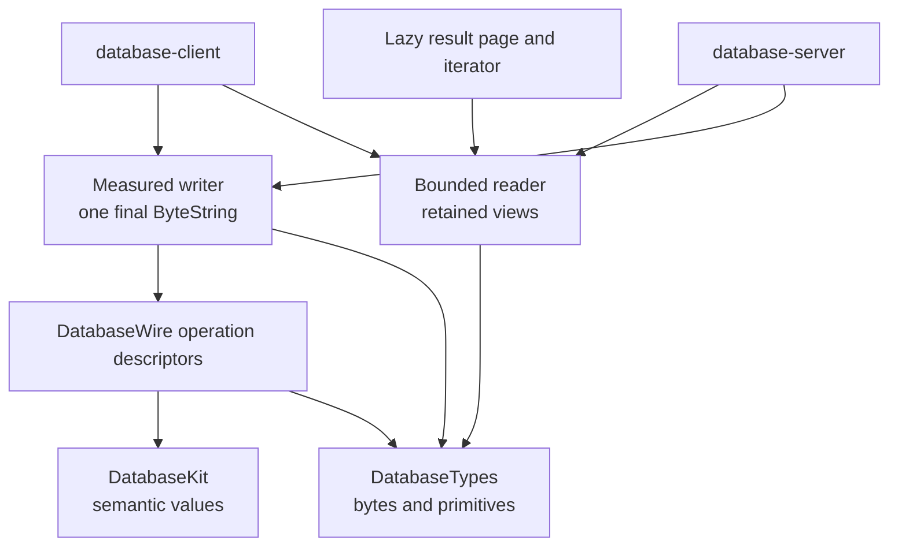
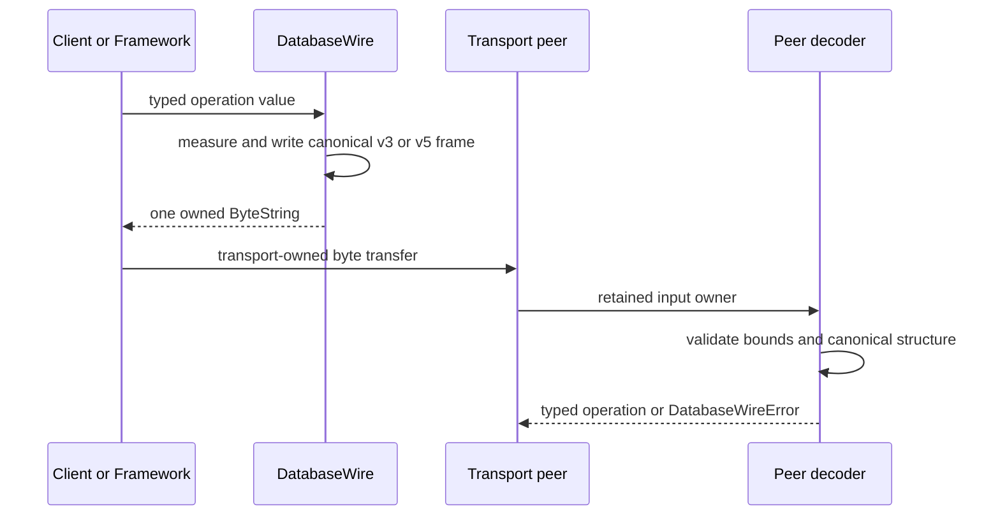

# DatabaseWire

## Purpose and Scope

`DatabaseWire` is the canonical bounded binary protocol module of
[`database-kit`](../../DESIGN.md). It encodes and decodes typed operations,
envelopes, semantic values, result pages, limits, and typed protocol failures
without owning transport or operation execution.

- Parent: [`database-kit` package design](../../DESIGN.md).
- Children: none; `RDF` source files and operation families are classifications
  inside this module, not independent authorities.
- Dependencies: `DatabaseKit` and `DatabaseTypes`.
- Dependents: `database-client`, `database-server`,
  `database-framework` integration paths, and the native schema JSON adapter.

The wire contract is selected at compile time. The default graph is version 3
and target-free. The non-default `MultiBase` graph is version 5 and
target-bound.

## Responsibilities and Boundaries

`DatabaseWire` owns:

- canonical request/response envelope framing;
- closed typed operation descriptors and the operation catalog;
- bounded binary readers and writers;
- wire representations for model, schema, query, graph, ontology, SHACL,
  command, mutation, maintenance, and job values;
- lazy result pages, iterators, provenance payloads, and retained byte views;
- protocol limits and typed malformed, unsupported, and resource-limit errors.

It does not own the semantic meaning declared by `DatabaseKit`, client or
server transport, operation dispatch, authorization evaluation, query
planning/execution, storage, transaction lifetime, or application commands.

## Related Designs

| Design | Relationship | Contract used | Summary | Cautions |
|---|---|---|---|---|
| [`../../DESIGN.md`](../../DESIGN.md) | package parent | v3/v5 trait matrix and wire ownership | Fixes the standard and optional protocol graphs. | No runtime version negotiation or target fabrication. |
| [`../DatabaseKit/DESIGN.md`](../DatabaseKit/DESIGN.md) | semantic dependency | validated models, schema, query, graph, and MultiBase values | Supplies meanings encoded by this module. | Wire codecs must not add semantic execution policy. |
| [Query](../DatabaseKit/Query/DESIGN.md) | semantic dependency | ordered typed columns, positional query values and language distinction | Supplies query/result meaning and the authoritative SQL profile child. | Encoding must retain duplicate names, empty-result metadata and value-specific metadata; it does not execute SQL. |
| [`../../../database-client`](https://github.com/1amageek/database-client) | downstream consumer | typed encoding/decoding and request correlation | Adapts operations to transports. | Transport and cancellation ownership remain in the client. |
| [`../../../database-server/DESIGN.md`](../../../database-server/DESIGN.md) | downstream consumer | envelope and operation catalog | Dispatches decoded operations and publishes results. | Server does not move dispatch or durable jobs into this module. |

## Architecture

The two protocol graphs are explicit:

| Build | Header and request shape | Operation target |
|---|---|---|
| Default | DatabaseWire v3; request contains request ID, operation, metadata, and payload | No target field; one ordinary database root |
| `MultiBase` | DatabaseWire v5; request contains the same data plus an explicit target | Database, Base, or Composition target as declared by the trait |

## Contracts and Invariants

- The default `EnvelopeWireFormat.protocolVersion` is 3. The default request
  envelope has no target and the default operation catalog has no Base,
  Composition, or Grant families.
- With `MultiBase`, the protocol version is 5, target-bearing operation
  requests are explicit, and Base/Composition/Grant operation families are
  compiled into the catalog. The trait does not provide a compatibility alias
  or runtime downgrade path.
- Operation descriptors and their encode/decode witnesses are constructed by
  `DatabaseWire`; users cannot provide an arbitrary raw wire conformance or
  operation identifier.
- Encoding first measures exact frame size and writes one final owned
  `ByteString`. Results and readers retain that owner and expose bounded
  ranges/iterators rather than eagerly copying every element.
- Decoders apply frame, string, byte, collection, nesting, and operation limits
  before allocation. They reject truncation, malformed or unknown values,
  non-canonical order, invalid RDF structure, and trailing bytes.
- Typed `DatabaseWireError` and related errors preserve the distinction between
  malformed input, unsupported operation, resource limit, authorization,
  conflict, retryability, and server failure. No failure is normalized into an
  empty success response.
- `DatabaseWire` serializes semantic contracts; it does not decide query plans,
  storage keys, transactions, leases, or publication ownership.

### S01 frozen query codec contract

The semantic authorities are [Query](../DatabaseKit/Query/DESIGN.md#s01-public-query-boundary)
and [SQL values](../DatabaseKit/Query/SQL/DESIGN.md#s01-frozen-value-and-persistence-interfaces).
S01 moves QueryColumn to DatabaseKit and replaces query cells with QueryValue.
Wire consumes those declarations through explicit DatabaseKit imports and
codec extensions; it owns no duplicate declaration, typealias or re-export
that hides the semantic owner. Primitive FieldValue and RDF codecs retain
their existing tags, bytes, identity and failure contracts.

The following grammar fixes field order and discriminators. Integer, Boolean,
count, string, optional-string and bytes productions use the existing bounded
DatabaseWireReader/Writer encodings. Unknown discriminators fail; they are not
extension slots that can be skipped. Every recursive node participates in the
same reader/writer nesting, object and collection ledger.

| Production | Exact ordered payload |
|---|---|
| QueryColumnType tag 0 | bounded FieldSchemaType.rawValue string, Boolean isArray |
| QueryColumnType tag 1 | existing QueryIRDataTypeWireCodec DataType payload |
| QueryColumn | UInt32 number, string name, QueryColumnType, Boolean isNullable |
| QueryParameter | UInt32 position, optional string name, Boolean explicit-type-present, QueryColumnType if present, QueryValue |
| QueryValue tag 0 | unchanged FieldValue codec payload |
| QueryValue tag 1 | Int128 canonical coefficient, Int32 canonical scale, Int32 displayScale |
| QueryValue tag 2 | length-bounded original JSON UTF-8 bytes |
| QueryValue tag 3 | one JSONB node |
| QueryValue tag 4 | DataType elementType, dimension count, each Int32 lowerBound and Int32 length, element count, positional QueryValue elements |
| QueryValue tag 5 | Int32 months, Int32 days, Int64 microseconds |
| JSONB node tags 0/1/2/3 | null with no payload / Boolean / string / numeric payload from QueryValue tag 1 without another value discriminator |
| JSONB node tag 4 | element count followed by JSONB nodes |
| JSONB node tag 5 | member count followed by string key and JSONB node pairs in canonical member order |
| QueryRow | value count, positional QueryValue cells, unchanged FieldObject annotations, unchanged optional version bytes |
| SchemaManifest field queryType | Boolean presence followed by QueryColumnType when present, after referenceTargetEntity and before the existing default-value presence flag |
| SchemaDescribe field queryType | Boolean presence followed by QueryColumnType when present, after the existing optional reference metadata and before the next field payload |

Literal.queryValue receives discriminator 18 in QueryIRLiteralWireCodec,
fixed in QueryIRWireFormat and golden vectors in the same change. Existing
Literal cases retain discriminators 0 through 17. Its payload is Boolean
explicit-type-present, QueryColumnType when present, then the QueryValue
production; parameter binding does not erase explicit
type or rich metadata. No separate parameter/result/persisted-value algebra is
introduced. A Wire encoder does not encode a model persistence envelope in
place of the direct query-value production.

QueryColumnType's SQL production validates admitted DataType parameters before
acceptance. Column numbers are consecutive one-based ordinals and are unrelated
to persisted field numbers; duplicate/empty names are valid. QueryRowPage
retains the existing page field order and standard snapshot or MultiBase
provenance/consistency tail. Its columns are encoded before the row count even
for an empty page. Row arity and cell/declaration compatibility are checked on
both materialized encoding and encoded-page validation. A NULL cell is tag 0
with primitive null and obtains its type from its column or parameter.
Primitive array declarations permit NULL elements independently of the outer
column's isNullable flag, matching Kit's primitive array adaptation. A
nonnullable array column still rejects an outer NULL; non-NULL elements must
match the declared primitive element kind during in-place validation and
materialization alike.

### S01 validation and retained ownership

QueryValueLimits is derived from the admitting Wire limits without resetting
or increasing the enclosing ledger. Decoding checks lengths/counts, dimension
count/product/upper bounds, element compatibility, numeric coefficient/dscale,
complete lexical JSON, canonical JSONB members and interval microsecond bounds
before publishing a value or encoded page. Retention admission follows the
owners that publication creates: an encoded page owns its frame and columns;
materializing a row additionally admits each actual JSONB flat owner before
returning that row. SchemaManifest carries queryType in its
canonical fingerprint input and validates defaults through the Schema-owned
admission. Missing, unknown or mismatched metadata never becomes inferred type,
NULL, an empty page or a repaired canonical value. QueryValueError remains a
typed cause of DatabaseWireError; malformed wire and resource exhaustion stay
distinct.
Primitive type mismatches consult the FieldValue grammar validator before
reporting incompatibleType, so an unrecognized primitive tag retains
invalidValueTag in scalar, outer-array and array-element positions. Query
validation does not maintain a separate set of recognized primitive tags.

#### One-frame retention accounting

The reader owns one immutable root ByteString; readBytes, length-prefixed
subreaders and consumed row ranges produce bounded views of that root. Query
decoding validates the root's known retainedByteCount once against the admitting
retention bound, separately from maximumFrameBytes' visible encoded-size check.
An oversized backing or unknown retained capacity fails explicitly; visible
slice length is not a substitute for retained capacity. A caller may explicitly
copy into a known owned buffer before admission. No public owner identity API
or raw-pointer identity is needed for this structurally known source.

| Ledger | Counts and ownership |
|---|---|
| Root retained storage | One known backing capacity per admitted root, retained through its last page/iterator/value owner |
| View representation | Each bounded view's visible length and reference/node count; a second slice does not allocate or charge a second root backing |
| New materialization | Cumulative decoded JSONB strings/keys and other newly owned UTF-8, plus admitted node/array/column storage; check before constructing the destination |
| Materialized JSONB retention | Cumulative finished-owner backing-array bytes plus UTF-8 content across JSONB values, array elements, row cells and child readers; admit each independently decoded owner once before returning it |
| Structural validation | Cumulative nodes/elements and enclosing depth across child readers; no reset or increased quota at a subtree boundary |

Root retention and new materialization are distinct claims. Neither encoded
frame length nor aggregate visible view length is reported as a physical
allocation measurement. Framework's destination admission combines retained
owner claims and layout/capacity charges; Wire's structural limits alone are
not a peak-process-memory guarantee. Multiplying a byte budget by reference
count is not an admissible way to pass shared-frame values.

Public Kit QueryValue validators and footprint measurement keep conservative
per-reference known-capacity accounting for arbitrary caller-owned value
graphs. That upper bound is not unique-owner physical usage. Unknown capacity
remains a typed failure when a retained-byte bound must be proved. Codec-owned
assembly instead uses package-only
`QueryArrayValue.init(admittedElementType:dimensions:elements:) throws(QueryValueError)`
after the root and child ledgers have admitted all decoded elements. It calls
the same intrinsic shape/type validator as the public initializer and skips
only the aggregate repeated-reference retained-capacity measurement. It cannot
skip checked dimensions/product, element compatibility or any metadata rule.
Only codec-created children from this admitted root may enter that path;
external arbitrary QueryValue graphs use public conservative validation.

An individual QueryJSONValue uses its existing public validating initializer
with the unchanged admitted root-retention bound. Its cached footprint remains
the conservative per-reference capacity; the Wire ledger does not sum that
capacity again. No JSON constructor bypass is required. JSONB string creation
uses the separate cumulative new-UTF8 ledger and cannot consume an enlarged
alias quota. Package assembly is not public authority to bypass a value budget.
These rules apply equally to lazy iteration and encoded-page revalidation;
their root provenance survives slicing while destination ledgers retain the
current depth/object/materialization state.

JSONB decoding uses the Kit [flat ownership construction contract](../DatabaseKit/Query/SQL/DESIGN.md#flat-jsonb-ownership-and-construction):
open collection frames retain child IDs, and one package builder appends each
scalar and collection once before finishing one immutable owner. It does not
rebuild completed subtrees through public composite factories. Binary tags and
canonical member ordering stay unchanged. The finished owner admits its actual
backing-array capacities and UTF-8 content before publication; the value's
retained metadata includes that whole owner even when a child view is retained.
Validation-only traversal keeps bounded frames without materializing the owner.
It admits encoded ownership and logical counts, depth and UTF-8 content, and
does not predict the capacities Swift Array growth will select. Iterator.next()
may therefore throw a typed retained-resource failure when an otherwise valid
encoded row's actual flat owner exceeds the materialization limit. It returns
no partially materialized row. Eagerly building and discarding every owner is
not required to publish a lazy encoded page.
The reader carries this actual JSONB retention ledger through length-prefixed
children and iterator progress; separate owners cannot each reuse the full
retained-byte quota. The existing new-UTF8 ledger admits content before String
creation. UTF-8 content appears in both independent checks, but those ledgers
are not added together or claimed as two physical allocations. Root-frame
retention remains a separate once-per-root admission.

Page decoding validates the complete encoded row subtree in place, then retains
its ByteString range and immutable typed columns. It does not eagerly allocate
all QueryValue trees to validate them. QueryRowIterator materializes only the
requested row and byte/JSON values retain bounded views of the original owner.
Validation and row materialization share the same grammar and intrinsic
invariants, including columns when no rows exist. Re-encoding an encoded page
validates with the destination writer's current depth/object ledger before
copying its retained range; it cannot reset limits at a nested page boundary.
Truncation, trailing input, invalid tag/shape/type and encoded-validation limit
failure publish neither a partial page nor a partially accepted operation.
Actual materialization capacity is reconciled at the row publication boundary.

The source migration updates QueryColumn.swift (semantic declaration moves to
Kit), QueryRow.swift, QueryRowPage.swift, QueryRowIterator.swift,
QueryParameter+Wire.swift, QueryIRLiteralWireCodec.swift,
QueryIRDataTypeWireCodec.swift, QueryIRWireFormat.swift, SchemaManifest.swift,
DatabaseWireError.swift and the reader/writer validation and size-accounting
paths. A single QueryValueWireCodec and its in-place validator own the new
production. Schema JSON consumes the same declaration through its native
[adapter contract](../DatabaseSchemaJSON/DESIGN.md); it is not a binary codec.

This is a coordinated pre-release layout change within target-free v3 and
opt-in target-bound v5. It changes neither header version nor target authority.
All source consumers, schema fingerprints, golden vectors and dependency pins
migrate together; there is no old-layout decode fallback or negotiation.

### Later statement and block operations

Later SQL statement/block descriptors are closed DatabaseWire operations, with
results distinguishing rows, command count and schema change in statement
order. This module encodes diagnostics and outcomes but does not turn schema
job acceptance or precommit rows into completion. Publication belongs to the
server/host after authoritative execution close.

These are planned interfaces, not implemented capabilities. Their byte changes
require golden-vector and downstream mapping updates in the same completed
change. They do not select a new protocol version, negotiate compatibility,
fabricate a standard target, or import runtime SQL semantics into Wire. SPARQL
boolean/RDF result contracts and MultiBase provenance/consistency fields retain
their distinct meanings.

### S02 type and constructor Wire grammar

S02 consumes the [SQL semantic changes](../DatabaseKit/Query/SQL/DESIGN.md#s02-frozen-syntax-to-value-boundary)
without changing standard v3 versus MultiBase v5 authority selection. QueryIR
expression tags 0...40 keep their existing meanings. New tag 41 encodes an
ARRAY constructor and tag 42 a ROW constructor; each contains the existing
bounded expression-list count followed by its ordered children. Unknown tags,
truncation and one-past structural counts fail explicitly in the codec. The
consuming SQL/SPARQL semantic gate rejects invalid child languages before
execution; the representation codec does not introduce language policy.
No QueryValue tag or primitive field codec is added for ROW.

DataType tags 11 and 12 retain the existing time/timestamp Boolean payload and
mean precision nil. New tags 22 and 23 carry respectively time/timestamp with
withTimeZone Boolean followed by UInt8 precision in 0...6; encoding chooses
these tags only for explicit precision, including zero. Decoder never silently
drops precision or treats an invalid value as nil. Existing DataType tags 0...21
and their nil-precision goldens remain unchanged. Extended metadata uses the
same bounded type validator, structural walk and nested-value ownership as
existing casts, columns, parameters and schema query descriptors.

Pure codecs must round-trip both constructors, deeply nested bounded children,
all seven temporal precision values and both timezone flags. Direct consumers
and typed JSON adapters migrate before this coherent sprint completes. Old
unknown-tag rejection remains deliberate; there is no permissive compatibility
decode or runtime version negotiation. SQL parsing/serialization stays in
Framework and is not reimplemented by the codec.

### S03 unknown and qualified-name grammar

Wire consumes the [S03 Query carriage contract](../DatabaseKit/Query/DESIGN.md#s03-semantic-carriage-and-occurrence-addresses).
Literal tag 19 carries sqlUnknownString as one bounded String. Existing tag 4
remains typed string. DataType tag 24 carries qualified custom type as schema
String then terminal name String; nil-schema custom retains tag 21. Expression
tag 43 carries qualified FunctionCall as schema String, terminal name String,
existing expression-list production and distinct Boolean; nil-schema function
retains tag 28. All identifiers are exact components, including embedded dots.
Existing tags retain their meanings and standard v3/MultiBase v5 selection is
unchanged. No QueryValue or FieldValue alternative is added.

Structural walks and decoders charge the additional string/children before
growth, preserve parameter references/declarations and reject unknown tags,
truncation, invalid names and one-past limits explicitly. Pure carriage of an
unresolved custom CAST input is distinct from resolved result/schema type
admission. Occurrence arenas/source sidecars are local binding provenance and
do not add a Wire source-text or runtime-plan production. S03-C02/C04/C12 require
goldens, typed failure and standard/MultiBase/native/WASM/Embedded runtime
evidence; direct semantic round trips preserve exact enum identity.

## Runtime Flows

Bulk pages retain their frame owner while consumers iterate or request bounded
materialization. Transport, dispatch, transaction, and publication steps are
outside this module.

## State, Ownership, and Lifecycle

- A writer owns its temporary measurement state and produces one final
  `ByteString` at the encoding boundary.
- A reader, result page, view, and iterator retain the same input owner for
  their lifetime. Pointer borrows used to inspect that owner are synchronous
  and cannot escape their borrow scope.
- The module has no network connection, retry loop, operation registry with
  mutable global state, transaction, cursor, authority, or durable job state.
- Any copy required by an independent transport or native external-format
  boundary is owned by that consumer; internal wire stages retain one owner.

## Failure, Concurrency, and Constraints

- Canonical wire values and readers are `Sendable` where their owner/view
  contract permits; no unchecked mutable global state is used.
- Unknown, oversize, malformed, and trailing input fails before it can become a
  runtime operation.
- A decoder never trusts a length or count before checked arithmetic and the
  corresponding configured limit.
- The canonical module has no Foundation, Codable, URLSession, JavaScriptKit,
  or backend dependency and must compile for standard and Embedded WASM.
- Native JSON adaptation and Foundation scalar conversion are separate module
  contracts and cannot be imported into this canonical graph.

## Verification and Change Impact

| Contract | Evidence owner |
|---|---|
| Operation catalog and v3/v5 envelope mapping | `Tests/DatabaseWireTests` operation and envelope suites |
| Truncation, bounds, malformed, non-canonical, and trailing-input rejection | `Tests/DatabaseWireTests` decoder suites |
| Retained owner, lazy page, iterator, and exact-frame behavior | `Tests/DatabaseWireTests` result and byte-ownership suites |
| Planned typed SQL results and statement/block payloads | QueryResultPage/QueryIR codec suites expanded for duplicate names, zero-row metadata, SQL-specific values, full malformed-input boundaries and standard/MultiBase golden vectors; SQL semantics use the [Query evidence contract](../DatabaseKit/Query/DESIGN.md#verification-and-change-impact) |
| Standard and `MultiBase` protocol graphs | Isolated native package harness runs with reviewed exact counts owned by scripts/xcode-test-harness |
| Standard and Embedded compatibility | Package README release builds for `DatabaseWire` |

Any change to a wire byte, operation family, version, target field, limit,
failure category, or ownership boundary requires this module design, the
package design, golden/behavioral tests, and all downstream mapping consumers
to be reviewed together.

S01-C04–C11/C13 in the [SQL acceptance ledger](../DatabaseKit/Query/SQL/DESIGN.md#s01-falsifiable-case-ids)
own query-value golden, malformed-input, lazy ownership, schema fingerprint and
trait regression obligations. Native focused execution requires the package
harness to support selectors without weakening final exact-count lanes. WASM
and Embedded gates use the package's pinned toolchain/matching SDKs and scoped
SDK lookup; compile/link does not replace native behavioral evidence. Required
harness support and the complete affected native lanes precede S01 completion.
These frozen interfaces are pending implementation and runtime evidence.

S01-C11 additionally rejects double charging two JSON views of one 4 MiB
owner as two physical allocations, oversized backing behind a small visible
frame, unknown-capacity admission, JSONB exact/one-past materialization bytes,
and child/lazy-reader ledger reset. The alias fixture checks one root retention
claim and two view representations, not an expanded byte budget. Arbitrary
public value measurement continues to report its conservative upper bound.

### S04 conditional expression grammar

Consume [Query semantic additions](../DatabaseKit/Query/SQL/DESIGN.md#s04-semantic-additions-and-scope)
without runtime policy. Existing searched CASE tag29 retains its exact bytes
when operand is nil. Allocate expression tags44...49 respectively to simple
CASE, GREATEST, LEAST, truth test, DISTINCT predicate, quantified comparison.
Simple CASE is operand expression then existing CASE-pair count/pairs/optional
ELSE production. GREATEST/LEAST use the existing expression-list production.
Truth test is operand then truth byte (0=false,1=true,2=unknown), negated Bool.
DISTINCT is left expression, right expression, negated Bool. Quantified
comparison is left expression, comparison byte (0=equal,1=notEqual,2=lessThan,
3=lessThanOrEqual,4=greaterThan,5=greaterThanOrEqual), quantifier byte
(0=any,1=all), source byte (0=array expression,1=SelectQuery), then its payload.
Unknown discriminators, invalid structure, truncation, trailing bytes and
one-past limits fail typed before growth. Standard v3/MultiBase v5 remain
unchanged. Existing value/type/schema JSON adapters retain their own closed
contracts; this change adds no Expression or QueryStatement JSON boundary.
Occurrence/source sidecars and selected runtime signatures remain local.
S04-C11/C12 require canonical goldens and actual native/WASM/Embedded decode,
not only generated declarations.

### S05 pattern grammar

Expression tag 50 carries the closed pattern kind, escape-presence Boolean,
subject expression, pattern expression and optional escape expression in that
order. Kind bytes 0...4 mean LIKE, case-insensitive LIKE, SIMILAR TO, ERE and
case-insensitive ERE. ERE with a present escape is rejected. Tag 51 carries
the concatenation operator and its two expressions. Retired LIKE tag 21 is
rejected; no compatibility decoder reconstructs a superseded declaration.
Existing iterative expression owners enforce depth, bytes and node budgets.
Golden, truncation, invalid discriminator/Boolean, nested parameter and
standard/MultiBase request tests prove carriage without executing predicates.

### S06 temporal value and interval descriptor carriage

Consume the temporal declarations and intrinsic admission owned by
[Query](../DatabaseKit/Query/DESIGN.md) and its
[SQL profile](../DatabaseKit/Query/SQL/DESIGN.md). Wire transports those values;
it does not interpret lexical input, apply interval qualifiers, round precision,
resolve zones, or read clocks. Primitive FieldValue productions remain unchanged.

| Production | Exact payload after its UInt8 tag |
|---|---|
| QueryValue 6: time | Int64 microseconds since midnight |
| QueryValue 7: time with time zone | Int64 microseconds since midnight, Int32 UTC offset seconds |
| QueryValue 8: date infinity | UInt8 direction |
| QueryValue 9: timestamp infinity | UInt8 direction, Bool withTimeZone |
| QueryValue 10: interval infinity | UInt8 direction |
| DataType 13: unconstrained interval | No payload; fields and precision are both absent |
| DataType 25: modified interval | Bool hasFields, optional UInt8 fields, Bool hasPrecision, optional UInt8 precision |

Infinity direction bytes are 0 negative and 1 positive. Interval field bytes
0...12 are year, month, day, hour, minute, second, yearToMonth, dayToHour,
dayToMinute, dayToSecond, hourToMinute, hourToSecond, minuteToSecond respectively.
Absent fields mean the full range. Modified interval tag 25 requires at least
one modifier; the no-modifier value has only tag 13. Scalar temporal values use
the existing nested-value accounting around their fixed-size payloads.

Both materializing decode and lazy cell validation consume the same intrinsic
Kit admission. Invalid time bounds, descriptor precision/field combinations,
infinity direction, Boolean, type/zone mismatch, truncated payloads and unknown
tags fail with typed DatabaseWireError; SQL NULL remains the existing primitive
NULL production. No infinity payload is decoded into a finite primitive.
Arrays retain their exact declared element type and validate every temporal
cell against it. Schema fields, defaults, parameters, operation frames and
lazy result pages use these same productions in standard v3 and MultiBase v5.

S06-W01 verifies deterministic temporal/infinity and interval descriptor goldens;
S06-W02 verifies eager/lazy typed NULL, array and schema carriage;
S06-W03 verifies malformed discriminators, incompatible declarations and every
truncated prefix; S06-W04 verifies exact/one-past byte, node and nesting limits
on native, WASM and Embedded. These are required behavioral obligations, not a
claim that S06 implementation or verification has run.

Expression tag 52 carries currentValue: UInt8 kind, Bool hasPrecision, optional
UInt8 precision. Kind bytes 0...4 are date, time, timestamp, localTime,
localTimestamp. There are no child expressions. Intrinsic Kit admission rejects
precision for date and precision outside 0...6 for the remaining kinds. Unknown
kind, invalid Boolean, forbidden precision and truncation fail typed. Generic
FunctionCall tags 28/43 remain distinct and never reconstruct this expression.
S06-W01/W03 additionally require exact current-value goldens, quoted generic
identity separation, malformed precision and truncation coverage.

### S07 collection expression carriage

This layout consumes [Query declarations](../DatabaseKit/Query/DESIGN.md#s07-collection-expression-carriage)
and the [SQL semantic authority](../DatabaseKit/Query/SQL/DESIGN.md#s07-frozen-array-and-json-contract).
Existing QueryValue/DataType/FieldStorage productions do not change. Expression
53 and 54 are the next unused tags after currentValue52; existing expression
and standard v3/MultiBase v5 envelope tags keep their meanings.

| Tag | Exact payload order after UInt8 tag |
|---|---|
| 53 arrayAccess | Collection count using the existing bounded count production; all subscript metadata in dimension order; base expression; present child expressions in dimension order. Count must be1...6. |
| 54 collectionOperation | UInt8 operator; left expression; right expression. |

Each tag53 metadata entry starts with UInt8 kind: 0 index, 1 slice. Index has
no additional metadata and exactly one child. Slice carries Bool hasLower then
Bool hasUpper and has only those present children, lower before upper. Metadata
for the entire group precedes expressions so the decoder validates the closed
kinds, Boolean values, count and checked child total before allocating or
scheduling children. The base is decoded first after metadata. An all-omitted
slice is valid; an empty access group is invalid. One expression represents
one contiguous group, preserving nested group boundaries without flattening.

Tag54 operator bytes are fixed as follows; no String operator fallback exists.

| Byte | CollectionOperator |
|---|---|
| 0 | contains |
| 1 | containedBy |
| 2 | overlaps |
| 3 | jsonField |
| 4 | jsonFieldText |
| 5 | jsonPath |
| 6 | jsonPathText |
| 7 | jsonHasKey |
| 8 | jsonHasAnyKey |
| 9 | jsonHasAllKeys |
| 10 | jsonDeletePath |

Both encoding and decoding enforce the same shape and existing byte, object,
collection and nesting budgets. Count/metadata and child-frame storage are
bounded before allocation; present children are charged once. Unknown tag,
kind/operator byte, non-Boolean presence, count0/count7+, incompatible
structure, overflow and every truncated prefix fail with typed DatabaseWireError.
No malformed metadata becomes an omitted bound or a default operator. Reuse the
existing subtract and concatenate productions for their S07 overloads; generic
functions retain their existing productions.

Required S07-W01 evidence is deterministic goldens for both cases, all operator
bytes and all slice-presence combinations in standard and MultiBase frames.
S07-W02 proves nested groups, parameters and deep iterative roundtrips with
source-independent structural identity. S07-W03 proves invalid count/kind/
operator/Boolean, every truncation and exact/one-past byte/node/depth/collection
limits before publication/allocation. S07-W04 preserves existing array/JSON
value, lazy-cell, declared-type and retained-owner behavior across native,
ordinary WASM and Embedded. SQL execution and SRF composition are outside this
codec's proof and follow the semantic authority's stage gates.

### S07 explicit variadic function layout

Consume [FunctionCall's explicit final-array flag](../DatabaseKit/Query/DESIGN.md#s07-explicit-variadic-function-carriage).
False retains existing tags28/43 and their exact payload bytes. True uses the
next unused expression tag55, for qualified and unqualified functions alike:

| Tag | Exact payload order after UInt8 tag |
|---|---|
| 55 | Bool hasSchema; optional schema String; name String; bounded argument count >=1; Bool distinct; all argument expressions in order. |

Tag55 itself denotes finalArrayIsVariadic=true; there is no redundant Boolean
flag. Metadata precedes children, with the existing bounded string/count
productions and strict Boolean grammar. Validate nonzero count, byte/node/depth
budgets and checked child-frame admission before allocating/scheduling argument
storage. Decode never infers the flag from an array argument or downgrades
unknown/invalid metadata to an ordinary call. Unknown tags, bad Booleans, zero
count, excess count and every truncated prefix fail typed DatabaseWireError.
The codec preserves metadata; registered-function/type admission is binding's
responsibility. Required goldens prove false calls unchanged and tag55 true
calls with/without schema; roundtrips preserve distinct, nested arguments,
parameters and identity. Malformed-count/Boolean/truncation and exact/one-past
budget tests apply in standard/MultiBase and portable codec lanes.
